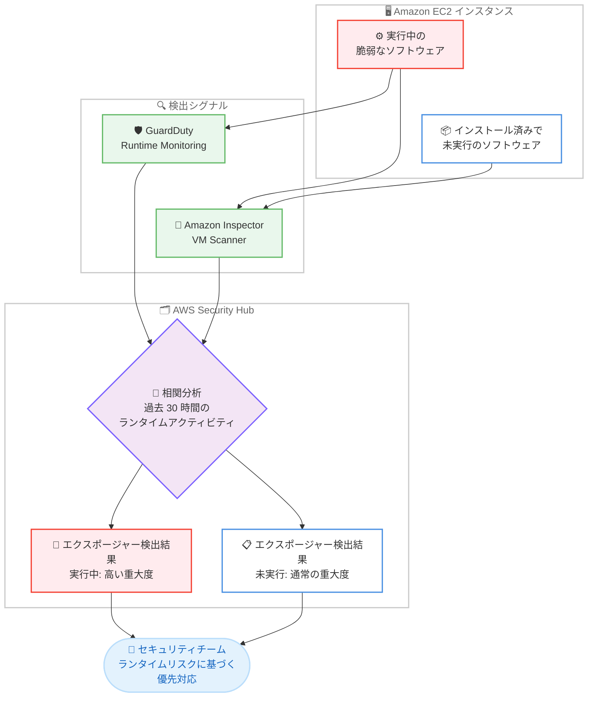

# AWS Security Hub - EC2 インスタンス上で実行中の脆弱なソフトウェアの検出

**リリース日**: 2026 年 11 月 16 日
**サービス**: AWS Security Hub
**機能**: 実行中の脆弱なソフトウェアの検出とエクスポージャー検出結果への反映

📊 [このアップデートのインフォグラフィックを見る](https://takech9203.github.io/aws-news-summary/20261116-security-hub-detects-vulnerable-software.html)

## 概要

AWS Security Hub が、既知の脆弱性を持つソフトウェアが Amazon EC2 インスタンス上で実際に実行されていることを検出できるようになりました。エクスポージャー検出結果 (exposure findings) に新しいトレイト「The EC2 instance is running software with a known vulnerability」が追加され、同じ脆弱性でもソフトウェアが実行されていない場合と比べて、より高い重大度が割り当てられます。

Security Hub は、Amazon GuardDuty Runtime Monitoring と Amazon Inspector VM Scanner のデータを相関分析し、過去 30 時間以内のランタイムアクティビティから脆弱なソフトウェアの実行を判定します。この情報を他のシグナルと組み合わせてエクスポージャー検出結果を生成するため、数千台規模のインスタンスを管理するセキュリティチームは、実際のランタイムリスクに基づいてパッチ適用の優先順位を決定できます。

本機能は AWS Security Hub Essentials プランで追加料金なしで利用でき、Security Hub が利用可能なすべての AWS リージョンで提供されます。

**アップデート前の課題**

- 脆弱性スキャンはインストール済みパッケージを対象とするため、検出された脆弱性のソフトウェアが実際に使用されているかどうかは、セキュリティチームが個別に調査する必要があった
- 実行されていないソフトウェアの脆弱性と、実行中のソフトウェアの脆弱性が同じ重大度で報告され、真に危険な脆弱性の優先順位付けが困難だった
- 大量のインスタンスを管理する環境では、膨大な脆弱性検出結果の中から対応すべきものを選別するために多くの時間とリソースが必要だった

**アップデート後の改善**

- ソフトウェアが実際に実行されているかどうかを Security Hub が自動的に判定し、エクスポージャー検出結果のトレイトとして明示するようになった
- 実行中のソフトウェアの脆弱性には、より高い重大度が割り当てられ、最もリスクの高い脆弱性に集中できるようになった
- トレイトの Vulnerability タブでは、実行中のソフトウェアの脆弱性が CVSS スコア順で先頭に表示され、対応順序の判断が容易になった

## アーキテクチャ図



GuardDuty Runtime Monitoring と Amazon Inspector VM Scanner が報告するランタイムアクティビティを Security Hub が相関分析し、実行中の脆弱なソフトウェアを持つインスタンスのエクスポージャー検出結果に高い重大度を割り当てる流れを示しています。

## サービスアップデートの詳細

### 主要機能

1. **実行中の脆弱なソフトウェアの検出**
   - 既知の脆弱性 (CVE) を持つソフトウェアが EC2 インスタンス上で実際に実行されていることを検出
   - 過去 30 時間以内のランタイムアクティビティに基づいて判定
   - GuardDuty Runtime Monitoring または Amazon Inspector VM Scanner が報告するデータを使用

2. **新しいエクスポージャートレイト**
   - エクスポージャー検出結果に「The EC2 instance is running software with a known vulnerability」トレイトを追加
   - 同じ脆弱性でもソフトウェアが実行されていない検出結果より高い重大度を割り当て
   - トレイトの Vulnerability タブでは、実行中のソフトウェアの脆弱性を CVSS スコア順で先頭に表示

3. **複数シグナルの相関分析によるリスク優先順位付け**
   - GuardDuty と Inspector のデータを他のシグナル (ネットワーク到達性、設定ミス、影響範囲など) と組み合わせてエクスポージャー検出結果を生成
   - ソフトウェアが実際に使用されているかどうかの手動調査が不要になり、対応と修復の優先順位付けを支援

## 技術仕様

### 検出の仕組み

| 項目 | 詳細 |
|------|------|
| 対象リソース | Amazon EC2 インスタンス |
| トレイト名 | The EC2 instance is running software with a known vulnerability |
| トレイト分類 | 脆弱性トレイト (Vulnerability traits) |
| 判定基準 | 過去 30 時間以内のランタイムアクティビティ |
| データソース | Amazon GuardDuty Runtime Monitoring、Amazon Inspector VM Scanner |
| 重大度への影響 | ソフトウェアが実行されていない同一脆弱性の検出結果より高い重大度を割り当て |
| 検出結果の取得 | Security Hub コンソール、または GetFindingsV2 API |
| 対象プラン | AWS Security Hub Essentials プラン |

### 推奨される修復手順

公式ドキュメントでは、このトレイトに対して以下の修復アプローチが推奨されています。

| 状況 | 推奨アクション |
|------|----------------|
| パッチ適用が可能 | Systems Manager Patch Manager で対象パッケージを更新し、サービスやプロセスを再起動して修正版を反映 |
| 即時のパッチ適用が困難 | 不要なサービスの停止・無効化、またはセキュリティグループのインバウンドルール制限によるネットワークアクセスの限定 |
| Auto Scaling グループの一部 | グループが使用する AMI を更新し、新規インスタンスが影響を受けないようにする |

## 設定方法

### 前提条件

1. AWS Security Hub (Essentials プラン) が有効化されていること
2. Amazon GuardDuty Runtime Monitoring または Amazon Inspector VM Scanner が有効化されていること
3. 検出結果を取得するための適切な IAM 権限 (securityhub:GetFindingsV2 など) があること

### 手順

#### ステップ 1: ランタイムデータソースの有効化を確認

```bash
# GuardDuty ディテクターの一覧を確認
aws guardduty list-detectors

# ディテクターの Runtime Monitoring 設定を確認
aws guardduty get-detector --detector-id <detector-id>
```

GuardDuty のディテクター ID を取得し、Runtime Monitoring 機能が有効になっているかを確認します。Amazon Inspector VM Scanner を使用する場合は、Inspector コンソールまたは API でスキャン設定を確認します。

#### ステップ 2: エクスポージャー検出結果の取得

```bash
# Security Hub のエクスポージャー検出結果を取得
aws securityhub get-findings-v2 \
  --filters '{"CompositeFilters": [{"StringFilters": [{"FieldName": "findings.metadata.product.name", "Filter": {"Value": "Exposure", "Comparison": "EQUALS"}}]}]}' \
  --max-results 50
```

GetFindingsV2 API でエクスポージャー検出結果を取得します。フィルターを使用して、エクスポージャータイプの検出結果に絞り込んでいます。

#### ステップ 3: トレイトの確認と修復

Security Hub コンソールのエクスポージャー検出結果の詳細画面で、「The EC2 instance is running software with a known vulnerability」トレイトの有無を確認します。トレイトの Vulnerability タブには、実行中のソフトウェアの脆弱性が CVSS スコア順で先頭に表示されるため、上位の脆弱性から順にパッチ適用を実施します。パッチ適用後は、対象のサービスやプロセスを再起動して修正版が実行されるようにします。

## メリット

### ビジネス面

- **調査工数の削減**: ソフトウェアが実際に使用されているかどうかの手動調査が不要になり、セキュリティチームの時間とリソースを節約できる
- **リスクベースの意思決定**: 実際のランタイムリスクに基づいてパッチ適用を優先順位付けできるため、限られたリソースを最も効果の高い対応に集中できる
- **追加コストなし**: Security Hub Essentials プランに含まれるため、追加料金なしで利用できる

### 技術面

- **複数サービスの自動相関**: GuardDuty Runtime Monitoring と Inspector VM Scanner のデータを Security Hub が自動的に相関分析するため、個別のツール間でのデータ突合作業が不要になる
- **重大度の自動調整**: 実行中のソフトウェアの脆弱性に高い重大度が自動的に割り当てられ、既存の検出結果管理ワークフローにそのまま反映される
- **CVSS スコア順の表示**: Vulnerability タブで実行中のソフトウェアの脆弱性が CVSS スコア順に先頭表示され、対応順序の判断が容易になる

## デメリット・制約事項

### 制限事項

- 対象リソースは Amazon EC2 インスタンスのエクスポージャー検出結果に限定される
- ランタイムアクティビティの判定は過去 30 時間のデータに基づくため、それより前にのみ実行されたソフトウェアは「実行中」として扱われない可能性がある
- 検出には GuardDuty Runtime Monitoring または Amazon Inspector VM Scanner のいずれかが有効である必要がある

### 考慮すべき点

- GuardDuty Runtime Monitoring や Inspector VM Scanner 自体の利用には、それぞれのサービスの料金が発生する
- 実行されていないソフトウェアの脆弱性も攻撃対象になり得るため、重大度が低い検出結果を放置してよいわけではなく、計画的なパッチ適用は引き続き必要

## ユースケース

### ユースケース 1: 大規模環境でのパッチ適用の優先順位付け

**シナリオ**: 数千台の EC2 インスタンスを運用する企業で、脆弱性スキャンにより大量の CVE が検出されており、どのインスタンスから対応すべきか判断に時間がかかっている。

**実装例**:
```
1. Security Hub でエクスポージャー検出結果を重大度順に表示
2. 「The EC2 instance is running software with a known vulnerability」トレイトを
   持つ検出結果を優先対応リストとして抽出
3. Systems Manager Patch Manager で対象インスタンスにパッチを一括適用
4. パッチ適用後にサービスを再起動し、検出結果の重大度の変化を確認
```

**効果**: 実行中の脆弱なソフトウェアを持つインスタンスから優先的に対応することで、実際の攻撃リスクを効率的に低減できる。

### ユースケース 2: 即時パッチ適用が困難な本番環境での暫定リスク低減

**シナリオ**: 本番環境で実行中のアプリケーションに脆弱性が検出されたが、メンテナンスウィンドウまでパッチを適用できない。

**実装例**:
```
1. トレイトの Vulnerability タブで対象ソフトウェアと CVE を特定
2. インスタンスで当該サービスが必須かどうかを確認し、不要であれば停止
3. 必要なサービスの場合は、セキュリティグループのインバウンドルールを
   信頼できる IP 範囲に限定してネットワークアクセスを制限
4. メンテナンスウィンドウでパッチを適用し、サービスを再起動
```

**効果**: パッチ適用までの間、攻撃経路を制限することで暫定的にリスクを低減できる。

### ユースケース 3: Auto Scaling グループでの恒久的な脆弱性対応

**シナリオ**: Auto Scaling グループで起動するインスタンスに、実行中の脆弱なソフトウェアが繰り返し検出される。

**実装例**:
```
1. エクスポージャー検出結果から対象のソフトウェアとバージョンを特定
2. パッチ適用済みの新しいゴールデン AMI を作成
3. Auto Scaling グループの起動テンプレートを新 AMI に更新
4. インスタンスリフレッシュを実行して既存インスタンスを置き換え
```

**効果**: 新規に起動されるインスタンスが脆弱性の影響を受けなくなり、検出結果の再発を防止できる。

## 料金

本機能は AWS Security Hub Essentials プランに追加料金なしで含まれます。

ただし、検出のデータソースとなる Amazon GuardDuty Runtime Monitoring および Amazon Inspector VM Scanner の利用には、それぞれのサービスの料金が別途発生します。詳細は各サービスの料金ページを参照してください。

## 利用可能リージョン

Security Hub が利用可能なすべての AWS リージョンで利用できます。最新のリージョン一覧は [AWS Regional Services List](https://aws.amazon.com/about-aws/global-infrastructure/regional-product-services/) を参照してください。

## 関連サービス・機能

- **Amazon GuardDuty Runtime Monitoring**: EC2 インスタンス上のランタイムアクティビティを監視し、実行中のソフトウェアに関するデータを Security Hub に提供する
- **Amazon Inspector VM Scanner**: EC2 インスタンスのソフトウェア脆弱性 (CVE) をスキャンし、実行状況を含む検出データを提供する
- **AWS Systems Manager Patch Manager**: 検出された脆弱性に対するパッチを大量のインスタンスへ自動的に適用するために使用する
- **Amazon EC2 Auto Scaling**: AMI 更新とインスタンスリフレッシュにより、脆弱性対応をグループ全体へ恒久的に反映できる

## 参考リンク

- 📊 [インフォグラフィック](https://takech9203.github.io/aws-news-summary/20261116-security-hub-detects-vulnerable-software.html)
- [公式発表 (What's New)](https://aws.amazon.com/about-aws/whats-new/2026/11/security-hub-detects-vulnerable-software/)
- [AWS Security Hub User Guide](https://docs.aws.amazon.com/securityhub/latest/userguide/what-is-securityhub-v2.html)
- [Remediating exposures for EC2 instances](https://docs.aws.amazon.com/securityhub/latest/userguide/exposure-ec2-instance.html#vulnerable-software-currently-running)
- [GuardDuty Runtime Monitoring User Guide](https://docs.aws.amazon.com/guardduty/latest/ug/runtime-monitoring.html)
- [Amazon Inspector VM Scanner User Guide](https://docs.aws.amazon.com/inspector/latest/user/inspector-vm-scanner.html)
- [AWS Security Hub 製品ページ](https://aws.amazon.com/security-hub/)

## まとめ

AWS Security Hub が実行中の脆弱なソフトウェアを自動検出し、エクスポージャー検出結果の重大度に反映することで、セキュリティチームは実際のランタイムリスクに基づいた優先順位付けが可能になりました。Security Hub Essentials プランで追加料金なしで利用できるため、GuardDuty Runtime Monitoring または Amazon Inspector VM Scanner を有効化している環境では、エクスポージャー検出結果の新しいトレイトを確認し、パッチ適用ワークフローへの組み込みを検討することを推奨します。
