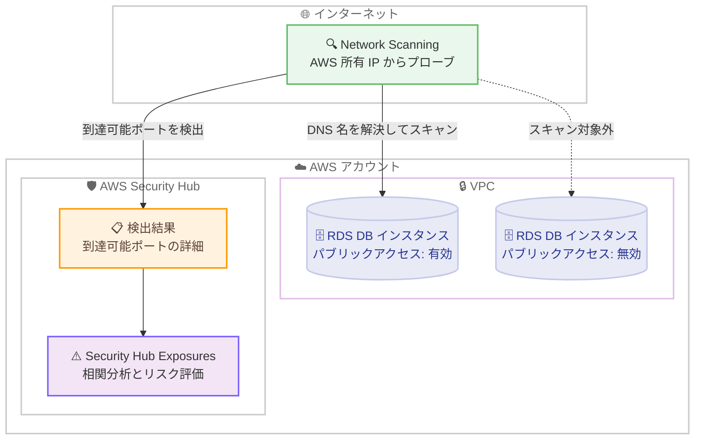

# AWS Security Hub - Network Scanning による Amazon RDS DB インスタンスのスキャン対応

**リリース日**: 2026 年 11 月 16 日
**サービス**: AWS Security Hub, Amazon Relational Database Service (Amazon RDS)
**機能**: Network Scanning による Amazon RDS DB インスタンスの到達性スキャン

📊 [このアップデートのインフォグラフィックを見る](https://takech9203.github.io/aws-news-summary/20261116-security-hub-network-scanning-rds.html)

## 概要

AWS Security Hub の Network Scanning が、Amazon RDS DB インスタンスのスキャンに対応しました。Network Scanning はアカウント内の既存および新規の RDS DB インスタンスを自動的に検出し、パブリックアクセスが設定されているインスタンスをインターネット側から実際にプローブしてスキャンします。DB インスタンスに到達可能なポートが見つかると、Security Hub はインスタンスと到達可能ポートの詳細を含む検出結果 (Finding) を作成します。

Network Scanning の特長は、セキュリティグループやルートテーブルの設定から「到達できる可能性がある」と推定するコントロールプレーン分析にとどまらず、インターネットから実際にリソースをプローブして「実際に到達できるか」を検証する点です。検出結果は Security Hub Exposures によって他の検出結果やリソース設定と相関分析され、より広範なリスク評価に活用されます。

本アップデートは、データベースという機密性の高いリソースのインターネット露出を可視化したいセキュリティ管理者や、組織全体のアタックサーフェスを継続的に監視したいユーザーに特に有用です。すでに Network Scanning を有効化しているユーザーに対しては、RDS スキャンが自動的に有効化されるため、追加の設定作業は不要です。

**アップデート前の課題**

- Network Scanning の対象は EC2 インスタンス、Elastic IP、ロードバランサーなどに限られており、RDS DB インスタンスのインターネット到達性を実スキャンで検証できなかった
- RDS のパブリックアクセス設定やセキュリティグループの設定からリスクを推定することはできても、実際にインターネットから到達可能かどうかを確認するには手動のテストや外部ツールが必要だった
- データベースの意図しない公開は情報漏えいに直結するリスクが高いにもかかわらず、継続的かつ自動的な到達性検証の仕組みが不足していた

**アップデート後の改善**

- Network Scanning が RDS DB インスタンスを自動検出し、パブリックアクセスが有効なインスタンスをインターネット側から実際にスキャンして到達性を検証できるようになった
- 到達可能なポートごとに検出結果が作成され、インスタンスの詳細とともに Security Hub 上で確認・調査できるようになった
- Security Hub Exposures が到達性の検出結果を他の検出結果やリソース設定と相関分析し、より広範なリスク評価が可能になった
- Network Scanning を有効化済みのユーザーには RDS スキャンが自動的に有効化され、追加設定なしで保護範囲が拡大された

## アーキテクチャ図



Network Scanning は AWS 所有の IP アドレスからインターネット経由で RDS DB インスタンスの DNS 名を解決してプローブし、実際に到達可能なポートを検出して Security Hub に検出結果を作成します。パブリックアクセスが無効なインスタンスはスキャン対象外です。

## サービスアップデートの詳細

### 主要機能

1. **RDS DB インスタンスの自動検出とスキャン**
   - アカウント内の既存および新規の RDS DB インスタンスを自動的に検出
   - パブリックアクセス (Public Access) が設定されているインスタンスのみをスキャン対象とする
   - DB インスタンスの DNS 名を解決してスキャンを実行
   - 機能有効化後、既存リソースは約 24 時間以内にスキャンされ、新規リソースは作成通知の受信後すみやかにスキャンされる
   - アクティブなリソースは約 12 時間ごとに再スキャンされ、到達性の変化を検出

2. **到達可能ポートごとの検出結果の作成**
   - 到達可能なポートごとに、インスタンスとポートの詳細を含む検出結果を OCSF (Open Cybersecurity Schema Framework) 形式で作成
   - 開いているポートが検出されなかった場合は、重要度 Informational の検出結果を作成し、スキャン済みであることを確認可能
   - RDS 固有のライフサイクルとして、エンドポイントのポート変更時は再スキャンして新旧の検出結果を更新し、パブリックアクセスが無効化された場合はそのインスタンスのすべての検出結果をクローズ

3. **エンジン固有ポートのスキャン**
   - DB インスタンスエンドポイントのポートに加え、エンジン固有の既知ポートもスキャン
   - MySQL: 11211, 33060
   - Amazon Aurora PostgreSQL: 1433
   - Oracle: 1158, 1522, 1535, 1830, 2057, 2484, 3306, 3872, 3873, 5433, 5500, 5533, 6141
   - SQL Server (Enterprise / Standard Edition): 2383, 8443, 5000
   - SQL Server (Developer / Express / Web Edition): 5000
   - 上記以外のエンジンはエンドポイントポートのみをスキャン

4. **Security Hub Exposures との連携**
   - Network Scanning の検出結果を他の検出結果やリソース設定と相関分析
   - 単なるポート到達性の報告にとどまらず、より広範なリスク評価を実現

## 技術仕様

### スキャンの仕組み

| 項目 | 詳細 |
|------|------|
| スキャン方式 | AWS 所有の IP アドレスからのアクティブなネットワーク到達性テスト |
| スキャン対象 | パブリックアクセスが有効な RDS DB インスタンス (DNS 名を解決してスキャン) |
| 対応 IP バージョン | IPv4 のみ |
| 検出結果の形式 | OCSF 形式 (AWS OCSF Extension を使用) |
| 初回スキャン | 機能有効化後、既存リソースは約 24 時間以内 |
| 再スキャン間隔 | 約 12 時間ごと (対象となるコントロールプレーン変更時にも再スキャン) |
| スキャン除外方法 | タグキー `SecurityHubNetworkScanExclusion` を DB インスタンスに付与 |
| 収集される証拠 | TCP バナー、HTTP メタデータ、TLS 証明書情報、サービス検出結果 |

### Network Scanning の対応リソースタイプ

| クラウドプロバイダー | リソースタイプ |
|------|------|
| AWS | EC2 インスタンス (パブリック IP あり) |
| AWS | Elastic IP (EIP) |
| AWS | Network Load Balancer (NLB) |
| AWS | Application Load Balancer (ALB) |
| AWS | Classic Load Balancer (CLB) |
| AWS | Amazon RDS DB インスタンス (今回追加) |
| Azure | パブリック IP アドレス |
| GCP | VM インスタンス (パブリック IP あり) |
| GCP | 外部転送ルール |

### 検出結果の例

到達可能なポートが検出された場合、OCSF 検出結果の `port_scan_result_list` セクションにスキャン結果が含まれます。

```json
"port_scan_result_list": [
    {
      "port_info": {
        "port": 3306,
        "protocol_name": "tcp",
        "protocol_num": 6
      },
      "status": "Open",
      "status_id": 1,
      "svc_name": "mysql"
    }
]
```

## 設定方法

### 前提条件

1. AWS Security Hub が有効化されていること
2. Network Scanning を有効化する権限 (個別アカウント、または組織の委任管理者による設定ポリシー) があること
3. スキャン対象とする RDS DB インスタンスにパブリックアクセスが設定されていること (スキャン対象の条件)

### 手順

#### ステップ 1: Network Scanning の有効化

```bash
aws securityhub enable-security-hub-feature-v2 --feature-name NETWORK_SCANNING
```

AWS CLI で Security Hub の Network Scanning 機能を有効化します。コンソールの場合は、Security Hub コンソールの [General settings] から [Network Scanning] セクションで [Enable] を選択し、アクティブスキャンの承認を確認します。組織全体で有効化する場合は、設定ポリシーの作成または編集で Network Scanning を有効化します。すでに Network Scanning を有効化している場合、RDS スキャンは自動的に有効化されるためこのステップは不要です。

#### ステップ 2: RDS DB インスタンスのパブリックアクセス設定の確認

```bash
aws rds describe-db-instances \
  --query "DBInstances[?PubliclyAccessible==\`true\`].[DBInstanceIdentifier,Endpoint.Address,Endpoint.Port]" \
  --output table
```

アカウント内でパブリックアクセスが有効になっている RDS DB インスタンスの一覧を表示します。これらのインスタンスが Network Scanning のスキャン対象となります。

#### ステップ 3: 検出結果の確認と対応

Security Hub コンソールで Network Scanning の検出結果を確認します。到達可能なポートが検出された RDS DB インスタンスについては、意図した公開かどうかを調査し、不要な場合はパブリックアクセスの無効化やセキュリティグループの見直しを行います。パブリックアクセスを無効化すると、Network Scanning はそのインスタンスのすべての検出結果をクローズします。

#### ステップ 4: スキャン除外設定 (必要な場合)

```bash
aws rds add-tags-to-resource \
  --resource-name arn:aws:rds:ap-northeast-1:123456789012:db:my-db-instance \
  --tags Key=SecurityHubNetworkScanExclusion,Value=""
```

特定の DB インスタンスをスキャン対象から除外する場合、タグキー `SecurityHubNetworkScanExclusion` を DB インスタンスに付与します。タグを付与すると以降のスキャンが停止し、アクティブな検出結果がクローズされます。タグを削除すると再びスキャン対象になります。

## メリット

### ビジネス面

- **データ漏えいリスクの低減**: 機密データを保持するデータベースの意図しないインターネット公開を早期に検出し、情報漏えいにつながるリスクを低減できる
- **追加コストなし**: Network Scanning は Security Hub Essentials に追加料金なしで含まれており、コストを増やさずにデータベースの露出監視を強化できる
- **コンプライアンス対応の強化**: データベースのインターネット到達性を継続的に検証する仕組みにより、セキュリティ監査やコンプライアンス要件への対応を支援

### 技術面

- **実到達性に基づく検証**: セキュリティグループやルートテーブルからの推定ではなく、インターネットからの実際のプローブにより到達性を検証するため、誤検知が少なく実態に即した結果が得られる
- **自動検出と継続的スキャン**: 新規 RDS DB インスタンスを自動的に検出し、約 12 時間ごとに再スキャンするため、構成変更による露出の変化を継続的に監視できる
- **運用負荷の最小化**: Network Scanning 有効化済みの環境では RDS スキャンが自動的に有効化され、追加の設定やエージェント導入が不要
- **リスクの相関分析**: Security Hub Exposures が到達性の検出結果を他の検出結果と相関分析し、優先度付けされたリスク評価を提供

## デメリット・制約事項

### 制限事項

- スキャン対象はパブリックアクセスが有効な RDS DB インスタンスのみ (プライベートなインスタンスはスキャンされない)
- IPv4 アドレスのみ対応 (IPv6 は現時点で未対応)
- 一時的または短命なリソースは、終了前にスキャンされない場合がある
- スキャン対象ポートはエンドポイントポートとエンジン固有の既知ポートに限られる

### 考慮すべき点

- Network Scanning の有効化により、TCP ポート接続試行、アプリケーション / プロトコル識別、サービスバナーや TLS 証明書メタデータの収集を含むアクティブスキャンを Security Hub に許可することになる
- 設定ポリシーで有効化された場合、メンバーアカウント側で機能を無効化できない
- Network Scanning を無効化しても既存の検出結果は即座にクローズされず、通常のライフサイクルに従って期限切れになるまで表示される
- ポートが断続的に到達可能な場合、検出結果はスキャン時点の肯定的な証拠に基づいて作成される

## ユースケース

### ユースケース 1: 意図しないパブリック公開データベースの検出

**シナリオ**: 開発チームが検証目的で RDS DB インスタンスのパブリックアクセスを有効化したまま放置しており、セキュリティチームが組織全体でこうしたインスタンスを把握できていない。

**実装例**:
```bash
# 組織全体で Network Scanning を有効化する設定ポリシーを適用後、
# 到達可能ポートが検出された RDS インスタンスの検出結果を Security Hub で確認
aws securityhub enable-security-hub-feature-v2 --feature-name NETWORK_SCANNING
```

**効果**: インターネットから実際に到達可能なデータベースポートが検出結果として可視化され、セキュリティチームは意図しない公開を特定してパブリックアクセスの無効化などの是正措置を迅速に実施できる。

### ユースケース 2: 組織全体のアタックサーフェス管理

**シナリオ**: マルチアカウント環境を運用する企業が、EC2、ロードバランサーに加えてデータベースを含むインターネット露出リソースの全体像を一元的に把握したい。

**実装例**:
```text
1. 委任管理者アカウントで Security Hub の設定ポリシーを編集
2. Network Scanning 機能を組織のすべてのアカウントとリージョンで有効化
3. Security Hub Exposures で相関分析されたリスクを確認し、優先度順に対応
```

**効果**: EC2、EIP、ロードバランサー、RDS を含むインターネット到達可能リソースが統一されたビューで可視化され、組織全体のアタックサーフェスを継続的に管理できる。

### ユースケース 3: 構成変更による露出の継続監視

**シナリオ**: 運用チームによるセキュリティグループやエンドポイントポートの変更により、これまで非公開だったデータベースが意図せずインターネットに露出することを防ぎたい。

**実装例**:
```text
1. Network Scanning を有効化 (約 12 時間ごとの再スキャンと変更時の再スキャンが自動実行)
2. EventBridge で Security Hub の検出結果をトリガーに通知を設定
3. 新たな到達可能ポートの検出時にセキュリティチームへ自動通知
```

**効果**: コントロールプレーンの変更やポート変更が発生しても再スキャンにより露出の変化が検出され、意図しない公開を早期に発見して対応できる。

## 料金

Network Scanning は Security Hub Essentials に追加料金なしで含まれています。RDS DB インスタンスのスキャンについても追加コストは発生しません。

## 利用可能リージョン

Security Hub をサポートするすべての AWS 商用リージョンおよび AWS GovCloud (US) リージョンで利用可能です。リージョンの一覧は [AWS Regional Services List](https://aws.amazon.com/about-aws/global-infrastructure/regional-product-services/) を参照してください。

## 関連サービス・機能

- **Amazon RDS**: 今回のスキャン対象となるマネージドリレーショナルデータベースサービス。パブリックアクセス設定がスキャン対象の条件となる
- **Security Hub Exposures**: Network Scanning の検出結果を他の検出結果やリソース設定と相関分析し、広範なリスク評価を提供
- **AWS Organizations**: 設定ポリシーを通じて組織全体のアカウントとリージョンで Network Scanning を一括有効化
- **Amazon EventBridge**: Security Hub の検出結果をトリガーとした通知や自動修復ワークフローの構築に活用

## 参考リンク

- 📊 [インフォグラフィック](https://takech9203.github.io/aws-news-summary/20261116-security-hub-network-scanning-rds.html)
- [公式発表 (What's New)](https://aws.amazon.com/about-aws/whats-new/2026/11/security-hub-network-scanning-rds/)
- [AWS Security Hub User Guide - Network Scanning](https://docs.aws.amazon.com/securityhub/latest/userguide/securityhub-v2-network-scanning.html)
- [AWS Security Hub 製品ページ](https://aws.amazon.com/security-hub/)
- [Amazon RDS のパブリック / プライベートアクセス設定](https://docs.aws.amazon.com/AmazonRDS/latest/gettingstartedguide/security-public-private.html)

## まとめ

AWS Security Hub の Network Scanning が RDS DB インスタンスに対応したことで、機密性の高いデータベースのインターネット露出を実際のプローブに基づいて継続的に検証できるようになりました。Network Scanning を有効化済みの環境では自動的に RDS スキャンが有効化されるため、まずは Security Hub で RDS 関連の検出結果を確認し、意図しないパブリックアクセス設定がないかを点検することを推奨します。まだ Network Scanning を利用していない場合は、追加料金なしで利用できるため、組織全体での有効化を検討する価値があります。
