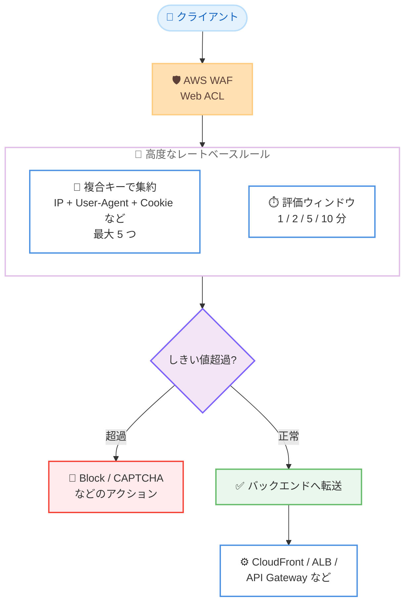

# AWS WAF - 高度なレートベースルールのリージョン拡大

**リリース日**: 2026 年 11 月 16 日
**サービス**: AWS WAF
**機能**: 高度なレートベースルール (Advanced Rate-Based Rules) の AWS GovCloud (US)、タイ、メキシコリージョンへの拡大

📊 [このアップデートのインフォグラフィックを見る](https://takech9203.github.io/aws-news-summary/20261116-waf-advanced-rate-rules-available.html)

## 概要

AWS WAF の高度なレートベースルール機能が、新たにアジアパシフィック (タイ)、メキシコ (中部)、AWS GovCloud (US-East)、AWS GovCloud (US-West) の 4 つのリージョンで利用可能になりました。これにより、これらのリージョンのユーザーも、カスタムキーによるリクエスト集約と、1 分または 2 分の短い評価ウィンドウを利用できるようになります。

レートベースルールは、受信リクエストをカウントし、設定したしきい値をトラフィックが超過した場合に Block や CAPTCHA などのアクションを実行する AWS WAF の機能です。今回のリージョン拡大により、IP アドレス単体での集約だけでなく、HTTP ヘッダー、Cookie、クエリ文字列、URI パス、HTTP メソッド、ラベル名前空間などのリクエストコンポーネントを最大 5 つ組み合わせた複合キーでの集約が、対象リージョンでも可能になります。

本アップデートは既存機能のリージョン拡大であり、機能自体はすでに商用リージョンで広く提供されていたものです。規制要件により AWS GovCloud (US) を利用する政府機関や関連事業者、タイ・メキシコリージョンでワークロードを運用するユーザーにとって、より精緻なレート制限による DDoS 対策やボット対策が可能になる点が主な価値です。

**アップデート前の課題**

対象リージョンでは、レートベースルールの機能が以下のように制限されていました。

- リクエストの集約キーが IP アドレスのみに制限されており、User-Agent やセッション Cookie などを組み合わせた精緻なレート制限ができなかった
- 評価ウィンドウが 5 分または 10 分のみで、短時間に急増するリクエストフラッドへの迅速な検知・対応が難しかった
- 分散型攻撃のように複数の IP アドレスから送信される攻撃に対して、IP アドレス単位の集約では効果的な制限が困難だった

**アップデート後の改善**

- アジアパシフィック (タイ)、メキシコ (中部)、AWS GovCloud (US-East)、AWS GovCloud (US-West) でカスタムキーによるリクエスト集約が利用可能になった
- HTTP ヘッダー、Cookie、クエリ文字列、URI パス、HTTP メソッド、ラベル名前空間を最大 5 つ組み合わせた複合キーで集約できるようになった
- 従来の 5 分・10 分に加えて、1 分・2 分の評価ウィンドウを選択できるようになり、急激なリクエスト増加への迅速な対応が可能になった

## アーキテクチャ図



高度なレートベースルールは、複合キーでリクエストを集約し、選択した評価ウィンドウ内でしきい値を超過したトラフィックに対して Block や CAPTCHA などのアクションを実行します。

## サービスアップデートの詳細

### 主要機能

1. **カスタムキーによるリクエスト集約**
   - IP アドレスに加えて、HTTP ヘッダー、Cookie、クエリ文字列、URI パス、HTTP メソッド、ラベル名前空間でリクエストを集約可能
   - 最大 5 つのコンポーネントを組み合わせた複合キーを作成可能
   - 例: IP アドレスと User-Agent ヘッダーの組み合わせごとにログイン試行を制限

2. **短い評価ウィンドウの選択**
   - 従来の 5 分・10 分に加えて、1 分・2 分の評価ウィンドウを選択可能
   - 短いウィンドウはリクエストフラッドの迅速な検知に有効
   - 長いウィンドウは低速で持続的な攻撃の検知に有効

3. **新規対応リージョン**
   - アジアパシフィック (タイ)
   - メキシコ (中部)
   - AWS GovCloud (US-East)
   - AWS GovCloud (US-West)

## 技術仕様

### 集約キーと評価ウィンドウ

| 項目 | 詳細 |
|------|------|
| 集約キーの種類 | IP アドレス、HTTP ヘッダー、Cookie、クエリ文字列、URI パス、HTTP メソッド、ラベル名前空間など |
| 複合キー | 最大 5 つのコンポーネントを組み合わせ可能 |
| 評価ウィンドウ | 1 分、2 分、5 分、10 分 |
| 実行可能なアクション | Block、CAPTCHA、Challenge、Count など |
| 設定方法 | AWS WAF コンソール、AWS CLI、SDK、AWS CloudFormation |

### 設定例 (複合キーを使用したレートベースルール)

```json
{
  "Name": "LoginRateLimit",
  "Priority": 1,
  "Statement": {
    "RateBasedStatement": {
      "Limit": 100,
      "EvaluationWindowSec": 60,
      "AggregateKeyType": "CUSTOM_KEYS",
      "CustomKeys": [
        { "IP": {} },
        {
          "Header": {
            "Name": "User-Agent",
            "TextTransformations": [
              { "Priority": 0, "Type": "NONE" }
            ]
          }
        }
      ]
    }
  },
  "Action": { "Block": {} },
  "VisibilityConfig": {
    "SampledRequestsEnabled": true,
    "CloudWatchMetricsEnabled": true,
    "MetricName": "LoginRateLimit"
  }
}
```

IP アドレスと User-Agent ヘッダーの組み合わせごとに、60 秒間で 100 リクエストを超えた場合にブロックするルールの例です。

## 設定方法

### 前提条件

1. AWS WAF の Web ACL が対象リージョンに作成済みであること
2. Web ACL が CloudFront、Application Load Balancer、API Gateway などのリソースに関連付けられていること
3. ルールの作成・更新に必要な IAM 権限 (wafv2:UpdateWebACL など) があること

### 手順

#### ステップ1: 既存の Web ACL を確認する

```bash
aws wafv2 list-web-acls \
  --scope REGIONAL \
  --region ap-southeast-7
```

アジアパシフィック (タイ) リージョンのリージョナルスコープの Web ACL 一覧を取得します。GovCloud (US) の場合は対応するリージョン名を指定します。

#### ステップ2: 高度なレートベースルールを追加する

```bash
aws wafv2 update-web-acl \
  --scope REGIONAL \
  --region ap-southeast-7 \
  --id <web-acl-id> \
  --name <web-acl-name> \
  --lock-token <lock-token> \
  --default-action Allow={} \
  --visibility-config SampledRequestsEnabled=true,CloudWatchMetricsEnabled=true,MetricName=MyWebACL \
  --rules file://rate-based-rule.json
```

複合キーと評価ウィンドウを定義したルール (前述の JSON 例) を含むファイルを指定して、Web ACL を更新します。`--lock-token` には `get-web-acl` で取得した値を指定します。

#### ステップ3: 動作確認

CloudWatch メトリクスとサンプルリクエストを確認し、ルールが意図したとおりにリクエストを集約・制限しているかを検証します。まず Count アクションで挙動を確認してから Block に切り替えると、誤遮断のリスクを抑えられます。

## メリット

### ビジネス面

- **規制対応環境での高度な保護**: AWS GovCloud (US) を利用する政府機関や規制業界のユーザーが、商用リージョンと同等の高度なレート制限機能を利用可能
- **新興リージョンでのセキュリティ強化**: タイ・メキシコリージョンのワークロードでも精緻なボット対策・DDoS 対策が可能
- **追加コストなし**: 標準の AWS WAF 料金のみで利用可能

### 技術面

- **分散型攻撃への対応力向上**: IP アドレス単体では検知が難しい分散型攻撃に対し、複合キーによる集約で効果的な制限が可能
- **迅速な検知**: 1 分・2 分の短い評価ウィンドウにより、リクエストフラッドへの対応時間を短縮
- **柔軟な制御**: セッション Cookie 単位、API キー単位など、アプリケーションの特性に合わせたレート制限を設計可能

## デメリット・制約事項

### 制限事項

- 複合キーに組み合わせられるコンポーネントは最大 5 つまで
- 評価ウィンドウは 1 分、2 分、5 分、10 分の 4 種類から選択 (任意の値は指定不可)
- レートベースルールのカウントは近似値であり、しきい値到達後のブロック開始には若干の遅延が生じる場合がある

### 考慮すべき点

- 集約キーの設計を誤ると、正当なユーザーを誤ってブロックする可能性があるため、まず Count アクションでの検証を推奨
- ヘッダーや Cookie は攻撃者が偽装可能なため、集約キーの選択時には回避リスクを考慮する必要がある

## ユースケース

### ユースケース1: ログイン試行のレート制限

**シナリオ**: GovCloud (US) 上の政府系 Web アプリケーションで、ブルートフォース攻撃によるログイン試行を制限したい。

**実装例**:
```
集約キー: IP アドレス + User-Agent ヘッダー
評価ウィンドウ: 1 分
しきい値: 50 リクエスト
アクション: Block
スコープダウン: URI パスが /login に一致するリクエストのみ
```

**効果**: IP アドレスと User-Agent の組み合わせ単位で制限することで、単一 IP からの大量試行を迅速にブロックしつつ、同一 NAT 配下の正当なユーザーへの影響を軽減できます。

### ユースケース2: セッション単位の API レート制限

**シナリオ**: タイリージョンで運用する EC サイトの API に対し、セッションごとの過剰なリクエストを制限したい。

**実装例**:
```
集約キー: セッション Cookie
評価ウィンドウ: 2 分
しきい値: 300 リクエスト
アクション: CAPTCHA
```

**効果**: セッション Cookie 単位で集約することで、複数 IP を使い分けるボットによるスクレイピングや在庫買い占めを抑制できます。

### ユースケース3: 低速で持続的な攻撃の検知

**シナリオ**: メキシコ (中部) リージョンのワークロードで、しきい値を下回る速度で長時間継続するリクエストを検知したい。

**実装例**:
```
集約キー: IP アドレス + URI パス
評価ウィンドウ: 10 分
しきい値: 1,000 リクエスト
アクション: Count でラベル付与後、別ルールで Challenge
```

**効果**: 長い評価ウィンドウにより、短時間の観測では検知できない持続的な攻撃パターンを捕捉できます。

## 料金

追加料金は発生せず、標準の AWS WAF 料金が適用されます。Web ACL、ルール、リクエスト数に応じた既存の料金体系のまま、高度なレートベースルールを利用できます。

## 利用可能リージョン

今回のアップデートにより、以下のリージョンで新たに利用可能になりました。

- アジアパシフィック (タイ)
- メキシコ (中部)
- AWS GovCloud (US-East)
- AWS GovCloud (US-West)

これにより、高度なレートベースルールは AWS WAF が提供されているすべての商用リージョンおよび AWS GovCloud (US) リージョンで利用可能です。

## 関連サービス・機能

- **Amazon CloudFront**: Web ACL を関連付けることで、エッジでのレート制限が可能
- **Application Load Balancer / Amazon API Gateway**: リージョナルリソースとして Web ACL を関連付け、アプリケーション層の保護を実現
- **AWS Shield Advanced**: DDoS 対策として AWS WAF と組み合わせることで、多層的な防御を構築可能

## 参考リンク

- 📊 [インフォグラフィック](https://takech9203.github.io/aws-news-summary/20261116-waf-advanced-rate-rules-available.html)
- [公式発表 (What's New)](https://aws.amazon.com/about-aws/whats-new/2026/11/waf-advanced-rate-rules-available/)
- [ドキュメント: Using rate-based rule statements](https://docs.aws.amazon.com/waf/latest/developerguide/waf-rule-statement-type-rate-based.html)
- [料金ページ](https://aws.amazon.com/waf/pricing/)

## まとめ

AWS WAF の高度なレートベースルールが AWS GovCloud (US)、タイ、メキシコの各リージョンに拡大され、複合キーによる集約と 1 分・2 分の短い評価ウィンドウが利用可能になりました。対象リージョンでワークロードを運用している場合は、既存の IP アドレスベースのレートベースルールを見直し、アプリケーション特性に合わせた複合キーと評価ウィンドウへの移行を検討することを推奨します。
