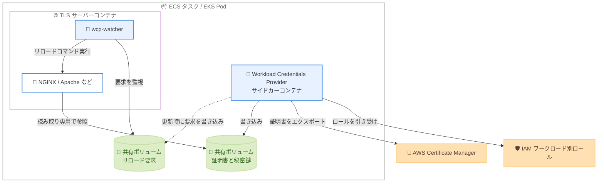

# AWS Certificate Manager - AWS Workload Credentials Provider のコンテナサポート

**リリース日**: 2026 年 11 月 17 日
**サービス**: AWS Certificate Manager (ACM)、Amazon ECS、Amazon EKS
**機能**: AWS Workload Credentials Provider による ACM 証明書のコンテナ環境へのエクスポート

📊 [このアップデートのインフォグラフィックを見る](https://takech9203.github.io/aws-news-summary/20261117-acm-certificates-container-support.html)

## 概要

オープンソースの [AWS Workload Credentials Provider](https://github.com/aws/aws-workload-credentials-provider) が、AWS Certificate Manager (ACM) の証明書をコンテナ上のアプリケーションへエクスポートできるようになりました。対象は Amazon Elastic Container Service (Amazon ECS、AWS Fargate を含む)、Amazon Elastic Kubernetes Service (Amazon EKS)、および Amazon EC2 上の Docker です。これにより、EC2 インスタンスと同じ方法で、コンテナ化された TLS ワークロードの証明書デプロイと更新を Linux と Windows の両方で自動化できます。

プロバイダーは ECS タスクまたは EKS Pod 内でサイドカーコンテナとして動作します。各証明書と秘密鍵を共有ボリュームにエクスポートし、ACM が証明書をローテーションすると更新後のファイルを書き込みます。NGINX、Apache、HAProxy、IIS のように証明書ファイルを自動で再読み込みしない TLS サーバー向けには、TLS コンテナ内で動作するコンパニオンウォッチャー (wcp-watcher) が更新のたびにリロードコマンドを実行します。ウォッチャーは AWS 認証情報を必要としません。Envoy、Traefik、Caddy のように自動で再読み込みする TLS サーバーは、共有ボリュームのマウントのみで利用できます。

アクセス制御は IAM で行われます。サイドカーはワークロードごとのロールを引き受け、そのロールは該当ワークロードの証明書のみエクスポートを許可されます。最小権限の原則に沿った証明書管理を、コンテナ環境でも実現できます。

**アップデート前の課題**

- AWS Workload Credentials Provider の証明書管理機能は EC2 インスタンスとオンプレミスホストが対象で、コンテナ環境では利用できなかった
- コンテナ化された TLS ワークロードでは、ACM 証明書の配布と更新のために独自のスクリプトやカスタムの仕組みを構築する必要があった
- 証明書更新後に NGINX や Apache などの TLS サーバーへリロードを反映させる処理を自前で実装する必要があった

**アップデート後の改善**

- ECS (Fargate 含む)、EKS、EC2 上の Docker で、サイドカーとして ACM 証明書のエクスポートと自動更新が可能になった
- 自動リロードに対応しない TLS サーバーでも、ウォッチャーが更新のたびにリロードコマンドを実行するため、手動対応が不要になった
- IAM のワークロード別ロールにより、各ワークロードが自身の証明書のみをエクスポートできるアクセス制御を簡単に実装できるようになった

## アーキテクチャ図



サイドカーの Provider が IAM ロールを引き受けて ACM から証明書をエクスポートし、共有ボリューム経由で TLS サーバーコンテナに配布します。証明書更新時はウォッチャーがリロードコマンドを実行して新しい証明書を反映します。

## サービスアップデートの詳細

### 主要機能

1. **サイドカーによる証明書エクスポートと自動更新**
   - プロバイダーが ECS タスクまたは EKS Pod 内のサイドカーコンテナとして動作
   - 各証明書と秘密鍵を PEM 形式で共有ボリュームにエクスポート
   - ACM が証明書をローテーションすると、更新後のファイルを自動的に書き込み
   - 証明書は定期的 (24 時間ごと) にチェックされ、最大 50 証明書まで管理可能

2. **コンパニオンウォッチャー (wcp-watcher) によるリロード自動化**
   - NGINX、Apache、HAProxy、IIS など、証明書ファイルを自動再読み込みしない TLS サーバー向けの軽量バイナリ
   - TLS コンテナ内で動作し、証明書更新のたびに設定済みのリロードコマンドを実行
   - ローカルファイルのみを読み取るため、AWS 認証情報は不要
   - Envoy、Traefik、Caddy など自動リロード対応サーバーでは、ウォッチャー不要で共有ボリュームのみで利用可能

3. **IAM によるワークロード単位のアクセス制御**
   - サイドカーはワークロードごとの IAM ロールを引き受けて証明書をエクスポート
   - 各ロールは該当ワークロードの証明書のみエクスポート可能に制限
   - ECS ではタスクロール、EKS では IRSA または EKS Pod Identity と連携

4. **幅広いプラットフォームサポート**
   - Amazon ECS (Fargate および EC2 起動タイプ)、Amazon EKS、Amazon EC2 上の Docker (Compose) に対応
   - Linux (x86_64 および Arm64) と Windows の両方のコンテナをサポート

## 技術仕様

### コンポーネント構成

| 項目 | 詳細 |
|------|------|
| プロバイダー | サイドカーコンテナとして動作し、`acm:ExportCertificate` で証明書を取得して共有ボリュームへ書き込み |
| ウォッチャー (wcp-watcher) | TLS コンテナ内で動作し、リロード要求を監視してリロードコマンドを実行。AWS 認証情報は不要 |
| 共有ボリューム | 証明書と秘密鍵用、ウォッチャー設定用、リロード要求用の 3 つをマウント |
| 対応プラットフォーム | ECS (Fargate / EC2 起動タイプ)、EKS、EC2 上の Docker |
| 対応 OS / アーキテクチャ | Linux (x86_64、Arm64)、Windows |
| 証明書の形式 | PEM 形式。チェーンパス省略時は証明書にチェーンを連結する fullchain モード |

### 共有ボリュームのマウント構成 (Linux の例)

| ボリューム | パス | プロバイダー | ウォッチャー |
|------|------|------|------|
| 証明書と秘密鍵 | `/shared/certs` | 読み書き | 読み取り専用 |
| ウォッチャー設定 | `/shared/wcp-watchers/config` | 読み書き | 読み取り専用 |
| リロード要求 | `/shared/wcp-watchers/requests` | 読み書き | 読み書き |

### API 変更履歴

今回のアップデートはオープンソースのクライアントサイドツールの機能追加であり、AWS サービス API の変更は伴いません (既存の `acm:ExportCertificate` API を使用します)。

### 設定ファイルの例

```toml
[logging]
log_to_file = false

[capabilities.acm]
enabled = true

[[capabilities.acm.certificates]]
certificate_arn = "arn:aws:acm:us-east-1:123456789012:certificate/EXAMPLE"
certificate_path = "/shared/certs/fullchain.pem"
private_key_path = "/shared/certs/privkey.pem"
role_arn = "arn:aws:iam::123456789012:role/EXAMPLE-ExportRole"
watcher_id = "nginx"
refresh_command = "/usr/sbin/nginx -s reload"
```

`log_to_file = false` によりログは標準出力に出力され、`docker logs`、`kubectl logs`、CloudWatch Logs で確認できます。自動リロード対応の TLS サーバーでは `watcher_id` と `refresh_command` を省略します。

## 設定方法

### 前提条件

1. エクスポート可能な ACM 証明書が発行済みであること
2. ECS タスクロールまたは EKS のサービスアカウント用ロールに、証明書エクスポート用ロールへの `sts:AssumeRole` 権限があること (EKS Pod Identity の場合は `sts:TagSession` も必要)
3. エクスポート用ロールに `acm:ExportCertificate` 権限が付与されていること

### 手順

#### ステップ 1: バイナリの取得とコンテナイメージの作成

```bash
# GitHub リリースからプロバイダーとウォッチャーのバイナリをダウンロード
# Linux x86_64 / Arm64 または Windows 向けを選択
# プロバイダー用イメージ: バイナリと設定ファイルをコピーして起動コマンドを設定
# 例: acm start --config /etc/wcp/config.toml
```

プロバイダー用コンテナイメージと、`wcp-watcher` を組み込んだ TLS サーバー用イメージを作成します。リポジトリには `Dockerfile.provider` と `Dockerfile.tls` のサンプルが用意されています。

#### ステップ 2: IAM ロールの設定

```json
{
  "Version": "2012-10-17",
  "Statement": [{
    "Effect": "Allow",
    "Principal": { "AWS": "arn:aws:iam::123456789012:role/<タスクロールまたはサービスアカウントロール>" },
    "Action": "sts:AssumeRole"
  }]
}
```

証明書エクスポート用ロールの信頼ポリシーで、ECS タスクロールまたは EKS のサービスアカウントロールからの引き受けを許可します。エクスポート用ロールには対象証明書に対する `acm:ExportCertificate` 権限を付与します。

#### ステップ 3: タスク定義または Pod マニフェストの作成

ECS では、プロバイダーコンテナと TLS サーバーコンテナを 1 つのタスク定義に含め、3 つのボリュームを共有します。TLS コンテナ側の証明書とウォッチャー設定のマウントは読み取り専用に設定します。プロバイダーコンテナには `AWS_REGION` を設定します (Fargate では自動設定、EC2 起動タイプでは明示的な設定が必要)。

EKS では、1 つの Pod に両コンテナを配置し、`emptyDir` ボリュームを共有します。サービスアカウントは IRSA または EKS Pod Identity でロールと関連付けます。詳細な手順と ECS、EKS のサンプルは [GitHub リポジトリの README](https://github.com/aws/aws-workload-credentials-provider#-running-as-a-container-sidecar-) を参照してください。

## メリット

### ビジネス面

- **運用負荷の削減**: 証明書の配布と更新が自動化され、手動更新に伴う証明書期限切れによる障害リスクを低減できる
- **追加コストなし**: プロバイダー自体は無料のオープンソースツールであり、既存の ACM 証明書運用にそのまま組み込める
- **EC2 とコンテナの運用統一**: EC2 インスタンスとコンテナで同じ仕組みを使えるため、ハイブリッドな環境でも運用方法を統一できる

### 技術面

- **サイドカーパターンによる疎結合**: アプリケーションコードの変更なしに証明書管理を追加でき、TLS サーバー側は共有ボリュームを参照するだけでよい
- **ウォッチャーの最小権限設計**: リロードを担当するウォッチャーは AWS 認証情報を持たず、ローカルファイルの読み取りのみで動作する
- **ワークロード単位のアクセス制御**: ワークロードごとの IAM ロールにより、証明書エクスポート権限を必要最小限に絞り込める

## デメリット・制約事項

### 制限事項

- 1 つのプロバイダーで管理できる証明書は最大 50 件
- `refresh_command` は Linux では絶対パスが必須で、使用可能な文字が制限され、シェルを介さず実行される (パイプや `;`、コマンド置換は使用不可)
- Windows のウォッチャーは PowerShell 経由でコマンドを実行するため、Windows Server Core が必要 (Nano Server は非対応)
- リージョンは SDK のデフォルトチェーン (`AWS_REGION` など) から解決され、証明書 ARN のリージョンと一致している必要がある

### 考慮すべき点

- ウォッチャーはリロードコマンドの実行結果をプロバイダーへ報告しないため、リロード失敗はウォッチャーのログでのみ確認できる。セットアップ時に `refresh_command` の動作確認が推奨される
- 秘密鍵を共有ボリュームに書き出すため、非 root コンテナの利用、UID の統一、`fsGroup` の設定など、ファイル権限の設計に注意が必要
- プロバイダーコンテナを `essential: true` にすると、プロバイダー障害時にタスク全体が停止するため、ECS サービスとして実行して自動復旧させる構成が推奨される

## ユースケース

### ユースケース 1: Fargate 上の NGINX への TLS 終端の自動化

**シナリオ**: AWS Fargate で NGINX を TLS 終端として運用しており、ACM 証明書の更新のたびに手動でデプロイし直している。

**実装例**:
```toml
[[capabilities.acm.certificates]]
certificate_arn = "arn:aws:acm:ap-northeast-1:123456789012:certificate/xxxx"
certificate_path = "/shared/certs/fullchain.pem"
private_key_path = "/shared/certs/privkey.pem"
role_arn = "arn:aws:iam::123456789012:role/nginx-cert-export-role"
watcher_id = "nginx"
refresh_command = "/usr/sbin/nginx -s reload"
```

**効果**: ACM のローテーションに追随して証明書が自動更新され、ウォッチャーが NGINX をグレースフルにリロードするため、再デプロイなしで常に最新の証明書を利用できる。

### ユースケース 2: EKS 上の Envoy によるサービス間 mTLS

**シナリオ**: EKS 上で Envoy をプロキシとして使用し、証明書ファイルの自動再読み込みに対応している。

**実装例**:
```yaml
# Pod に emptyDir の共有ボリュームを定義し、
# プロバイダーサイドカーが証明書を書き込み、
# Envoy コンテナは読み取り専用でマウント (ウォッチャー不要)
volumes:
  - name: certs
    emptyDir: {}
```

**効果**: Envoy は証明書ファイルを自動で再読み込みするため、ウォッチャーなしの最小構成で証明書の自動更新を実現できる。サービスアカウントと IRSA により権限も最小化される。

### ユースケース 3: Windows コンテナ上の IIS ワークロード

**シナリオ**: ECS 上の Windows コンテナで IIS を運用しており、証明書更新を手動で行っている。

**実装例**:
```powershell
# Windows 向けバイナリを使用し、C:\shared 配下の共有ボリュームを構成
# refresh_command に IIS のリロード用コマンドを設定
```

**効果**: Linux と同じ仕組みで Windows コンテナの証明書更新も自動化でき、OS が混在する環境でも運用を統一できる。

## 料金

AWS Workload Credentials Provider 自体は追加料金なしで利用できるオープンソースツールです。エクスポートする証明書には標準の [ACM 料金](https://aws.amazon.com/certificate-manager/pricing/)が適用されます。

## 利用可能リージョン

プロバイダーはオープンソースのクライアントサイドツールであり、ACM のエクスポート可能な証明書が利用できるリージョンで使用できます。利用するリージョンは `AWS_REGION` などの SDK デフォルトチェーンで指定し、証明書 ARN のリージョンと一致させる必要があります。

## 関連サービス・機能

- **AWS Certificate Manager (ACM)**: 証明書の発行、管理、ローテーションを行うサービス。本ツールはエクスポート可能な ACM 証明書を取得する
- **Amazon ECS / AWS Fargate**: タスク定義内のサイドカーコンテナとしてプロバイダーを実行し、タスクロールでロールの引き受けを制御する
- **Amazon EKS**: Pod 内のサイドカーとして実行し、IRSA または EKS Pod Identity でサービスアカウントと IAM ロールを関連付ける
- **AWS Secrets Manager**: 本ツールは旧 AWS Secrets Manager Agent であり、シークレット取得のローカル HTTP エンドポイント機能も提供する

## 参考リンク

- 📊 [インフォグラフィック](https://takech9203.github.io/aws-news-summary/20261117-acm-certificates-container-support.html)
- [公式発表 (What's New)](https://aws.amazon.com/about-aws/whats-new/2026/11/acm-certificates-container-support/)
- [AWS Workload Credentials Provider (GitHub)](https://github.com/aws/aws-workload-credentials-provider)
- [コンテナサイドカーのセットアップ手順 (GitHub README)](https://github.com/aws/aws-workload-credentials-provider#-running-as-a-container-sidecar-)
- [AWS Certificate Manager ドキュメント](https://docs.aws.amazon.com/acm/)
- [ACM 料金ページ](https://aws.amazon.com/certificate-manager/pricing/)

## まとめ

ACM 証明書の自動デプロイと更新が、EC2 だけでなく ECS、EKS、Docker といったコンテナ環境でも利用できるようになりました。コンテナで TLS 終端やサービス間 TLS を運用しているチームは、独自の証明書配布スクリプトを置き換える候補として、GitHub の ECS および EKS サンプルを参照しながら評価することを推奨します。
