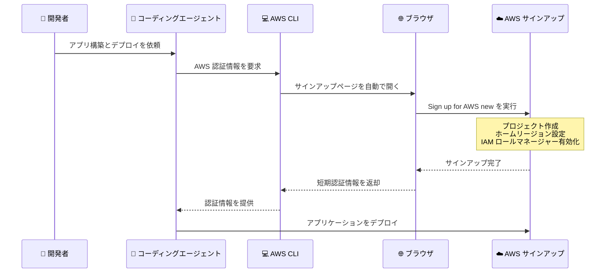

# AWS アカウント - エージェンティックコーディングハーネス向けアカウント作成機能

**リリース日**: 2026 年 11 月 17 日
**サービス**: AWS アカウント (AWS Sign-up / AWS Agent Toolkit)
**機能**: Agentic account creation for agentic coding harnesses

📊 [このアップデートのインフォグラフィックを見る](https://takech9203.github.io/aws-news-summary/20261117-agentic-account-creation.html)

## 概要

AWS は、エージェンティックコーディングハーネス (Claude Code、Codex、Cursor など) から、AWS アカウントを持っていない開発者向けに新しい AWS サインアップ体験を直接開始できる機能を発表しました。コーディングエージェントがブラウザを自動的に開き、サインアップを完了すると、短期認証情報がハーネスに返却されるため、開発者はアイデアからアプリケーションのデプロイまでをコーディング環境から離れることなく実現できます。

サインアップで作成される環境は「Sign up for AWS (new)」と呼ばれる新しい AWS 体験に基づいており、最初のプロジェクトにはホームリージョン、IAM ロールマネージャー、自動的に更新される短期認証情報があらかじめセットアップされています。これにより、エージェントはサインアップ直後からデプロイを開始できます。

この機能は、AWS をこれから使い始める個人開発者や、AI コーディングツールを使ってプロトタイプを素早く構築したい開発者を主な対象としています。利用するには、エージェンティックコーディングハーネスに AWS プラグインをインストールするか、AWS Agent Toolkit を設定します。

**アップデート前の課題**

このアップデート以前は、AI コーディングエージェントで開発を始める際に以下の課題がありました。

- AWS アカウントを持たない開発者は、コーディング環境を離れて手動で aws.amazon.com にアクセスし、アカウントのサインアップを行う必要があった
- サインアップ後も、認証情報の設定を手動で行ってからでないとワークロードをデプロイできなかった
- コーディングエージェントでの開発フローがアカウント作成のたびに中断され、アイデアからデプロイまでの体験が分断されていた

**アップデート後の改善**

今回のアップデートにより、以下が可能になりました。

- コーディングエージェントからブラウザが自動的に開き、新しい AWS サインアップ体験をそのまま開始できるようになった
- サインアップ完了後、短期認証情報が自動的にハーネスへ返却され、手動での認証情報設定が不要になった
- 最初のプロジェクトにホームリージョン、IAM ロールマネージャー、自動更新される短期認証情報が事前構成され、エージェントが即座にデプロイを開始できるようになった

## アーキテクチャ図



開発者がコーディングエージェントに依頼すると、AWS CLI 経由でブラウザが自動的に開き、サインアップ完了後に短期認証情報がハーネスへ返却されてデプロイが開始されるまでの流れを示しています。

## サービスアップデートの詳細

### 主要機能

1. **コーディングエージェントからのサインアップ開始**
   - AWS アカウントを持たない開発者に対して、AI コーディングツールが AWS CLI から「Sign up for AWS (new)」を開始できる
   - ブラウザが自動的に開き、開発者はブラウザ上でサインアップと新しいプロジェクトの選択を完了する
   - 完了後、AWS CLI が認証情報を受け取り、AI コーディングツールがその認証情報を利用できる

2. **事前構成されたプロジェクト環境**
   - 最初のプロジェクトには、コンテンツの保存先となるホームリージョンが連絡先情報に基づいて設定される
   - IAM ロールマネージャー、AWS Organizations、IAM Identity Center への自動オプトインが行われる
   - プロジェクト内のアプリケーションやコードは、同一プロジェクト内のすべての AWS リソースにアクセスできるマネージドなセキュリティ実装が適用され、追加のアクセス設定は不要

3. **自動更新される短期認証情報**
   - 認証情報は AWS CLI、AWS Tools for PowerShell、AWS SDK で利用可能
   - リソースへのアクセスは 12 時間有効で、`aws login --profile {プロファイル名}` コマンドで更新できる
   - AWS は 90 日間認証情報を更新でき、90 日経過後はブラウザでの再認可が必要

4. **AWS Agent Toolkit**
   - AWS MCP サーバー設定と、厳選されたエージェントスキルのセットをバンドルしたツールキット
   - 新しい AWS 体験向けに調整されたガイダンスを含むルールファイルが提供される
   - エージェントによる支援レベルを Low (セキュリティリスクの指摘のみ)、Medium (潜在的な問題の確認)、High (アーキテクチャ改善の提案) から選択できる

## 技術仕様

### Sign up for AWS (new) と Sign up for AWS (advanced) の比較

| 項目 | Sign up for AWS (new) | Sign up for AWS (advanced) |
|------|----------------------|---------------------------|
| アカウント所有者 | AWS Builder ID (ルートユーザーなし) | ルートユーザーのメールアドレス |
| リソースの管理単位 | プロジェクト (プロジェクトアカウント) | AWS アカウント |
| リージョン選択 | 不可 (連絡先情報に基づき自動設定) | 可能 |
| AWS CLI からのサインアップ | 可能 | 不可 |
| IAM ロールマネージャー | 自動オプトイン | 手動 |
| AWS Organizations / IAM Identity Center | 自動オプトイン | 手動 |
| 支出上限 (スペンドリミット) の設定 | 可能 | 不可 |
| AWS Marketplace / Savings Plans | 不可 | 可能 |
| 規制ワークロード (HIPAA、FedRAMP など) | 非対応 | 対応 |

### 認証情報の仕様

| 項目 | 詳細 |
|------|------|
| 有効期間 | 12 時間 |
| 更新方法 | `aws login --profile {プロファイル名}` (ブラウザが自動で開く) |
| 自動更新可能期間 | 90 日間 (経過後はブラウザでの再認可が必要) |
| 対応ツール | AWS CLI、AWS Tools for PowerShell、AWS SDK |
| プロジェクトとの対応 | プロジェクトごとに固有の認証情報とプロファイルを使用 |

## 設定方法

### 前提条件

1. エージェンティックコーディングハーネス (Claude Code、Codex、Cursor など) がインストールされていること
2. AWS CLI が利用可能であること
3. サインアップを完了するためのブラウザ環境があること

### 手順

#### ステップ 1: AWS Agent Toolkit のセットアップ

```bash
curl -fsSL https://github.com/aws/agent-toolkit-for-aws/blob/main/setup-instructions/setup.md
```

セットアップ手順をダウンロードして実行します。AWS アカウントを持っていない場合は、このセットアップ手順がサインアップを自動的に開始します。コンソールを利用する場合は、AWS Settings (https://settings.aws.com) の [Copy agent prompt] からエージェント用プロンプトを取得してコーディングエージェントに入力する方法も利用できます。

#### ステップ 2: ブラウザでサインアップを完了

ブラウザが自動的に開き、新しい AWS サインアップ体験が表示されます。サインアップを完了してプロジェクトを選択すると、AWS CLI が短期認証情報を受け取り、コーディングエージェントがその認証情報を使ってデプロイを開始できます。セットアップ時にはプロジェクトにアクセスするためのプロファイル名を入力します。

#### ステップ 3: 認証情報の更新

```bash
aws login --profile MyFirstProjectProfile
```

認証情報の有効期限 (12 時間) が切れた場合に実行します。このコマンドはデフォルトブラウザを自動的に開き、プロジェクト名を選択するとログインが完了します。複数プロジェクトを利用する場合は、プロジェクトごとに異なるプロファイル名を使い分けます。

## メリット

### ビジネス面

- **オンボーディング時間の短縮**: アカウント作成から初回デプロイまでの手順が自動化され、新規開発者が AWS を使い始めるまでの時間が大幅に短縮される
- **開発体験の向上**: アイデアからデプロイまでコーディング環境内で完結し、開発フローの中断がなくなる
- **コスト管理**: プロジェクトごとに支出上限 (スペンドリミット) を設定でき、AI エージェントによる予期しないコスト増加を抑制できる

### 技術面

- **セキュアな認証情報管理**: 長期的なアクセスキーではなく、12 時間で失効する短期認証情報が自動的に発行・更新されるため、認証情報漏えいのリスクが低減される
- **事前構成されたガードレール**: AWS が組織管理ポリシー (SCP、RCP) を管理し、プロジェクト間はデフォルトで分離されるため、初心者でも安全に構築できる
- **MCP サーバーとエージェントスキルの統合**: AWS Agent Toolkit により、AWS MCP サーバーの設定とベストプラクティスに基づくエージェントスキルが自動的に導入される

## デメリット・制約事項

### 制限事項

- 新しいサインアップ体験では利用できる AWS サービスが限定されており、フルセットのサービスが必要な場合は「Sign up for AWS (advanced)」を使用する必要がある
- リージョンを自分で選択できず、連絡先情報に基づいてホームリージョンが自動的に設定される (オプトインリージョンへのアクセスも不可)
- HIPAA や FedRAMP などの規制ワークロードには対応していない
- AWS Marketplace、Savings Plans、AWS Partner Network への参加などは利用できない
- 作成した IAM ロールや IAM ユーザーはプログラムによるアクセスのみに使用でき、コンソールアクセスには使用できない

### 考慮すべき点

- AI コーディングツールが作成したリソースに対する責任 (セキュリティおよび課金) は、責任共有モデルに基づき利用者にある
- 発行される認証情報は AWS CLI、AWS Tools for PowerShell、AWS SDK 向けであり、外部ツールはサポートされない場合がある
- 90 日経過後はブラウザでの再認可が必要になるため、長期運用の自動化パイプラインには別の認証方式を検討する必要がある
- 細かい粒度のユーザー権限管理やロールベースの権限制御が必要な場合は、新しいサインアップ体験は適さない

## ユースケース

### ユースケース 1: AI エージェントによるゼロからのアプリケーション構築

**シナリオ**: AWS アカウントを持たない開発者が、Claude Code で Web アプリケーションを構築し、そのまま AWS にデプロイしたい。

**実装例**:
```
1. Claude Code に AWS Agent Toolkit をセットアップ
2. 「この Web アプリを AWS にデプロイして」と依頼
3. ブラウザが自動で開き、サインアップとプロジェクト選択を完了
4. エージェントが短期認証情報を受け取り、リソースを作成してデプロイ
```

**効果**: アカウント作成、認証情報設定、デプロイまでが一連の流れで完結し、初回デプロイまでの時間を大幅に短縮できる。

### ユースケース 2: プロジェクト単位でのプロトタイプ開発と共同作業

**シナリオ**: 複数のプロトタイプを並行して開発し、プロジェクトごとにコストとリソースを分離したい。

**実装例**:
```bash
# プロジェクトごとにプロファイルを作成してログイン
aws login --profile MyFirstProjectProfile
aws login --profile BookstoreProfile
```

**効果**: プロジェクト間はデフォルトで分離され、プロジェクトごとの支出上限とチームメンバー招待により、安全かつ低リスクで複数のプロトタイプを管理できる。

### ユースケース 3: 支援レベルを調整した段階的な学習

**シナリオ**: AWS 初心者がエージェントの支援を受けながら、アーキテクチャのベストプラクティスを学びつつ構築したい。

**実装例**:
```
ルールファイルで支援レベルを設定。
- Low: セキュリティリスクの指摘のみ
- Medium: 潜在的な問題に関する確認質問
- High: アーキテクチャ改善や代替案の提案
```

**効果**: 習熟度に応じてエージェントの介入度合いを調整でき、セキュリティリスクを早期に検知しながらスキルアップできる。

## 料金

この機能自体に追加料金はありません。サインアップ後に作成した AWS リソースに対して、選択したプラン (Free Plan または Paid Plan) に基づく通常の料金が発生します。Paid Plan ではプロジェクトごとに月額の支出上限 (スペンドリミット) を設定できます。AI コーディングツールが作成したリソースの課金は利用者の責任となる点に注意してください。

## 利用可能リージョン

新しい AWS サインアップ体験は、選択された一部の AWS リージョンで利用できます。コンテンツの保存先となるホームリージョンは、連絡先情報に基づいて自動的に設定され、利用者が変更することはできません。オプトインリージョンへのアクセスはサポートされていません。

## 関連サービス・機能

- **AWS Agent Toolkit**: AWS MCP サーバー設定とエージェントスキルをバンドルし、コーディングエージェントと AWS の連携をセットアップするツールキット
- **AWS CLI (`aws login`)**: 新しいサインアップ体験でのログインと短期認証情報の取得・更新を担うコマンド
- **IAM ロールマネージャー**: 新しい AWS 体験で自動的にオプトインされ、プロジェクト内のロール管理を簡素化する機能
- **AWS Organizations / IAM Identity Center**: 新しいサインアップ体験で自動オプトインされ、プロジェクト (アカウント) と認証の基盤を提供
- **AWS Builder ID**: ルートユーザーの代わりにプロジェクトアカウントを所有する個人向けの認証 ID

## 参考リンク

- 📊 [インフォグラフィック](https://takech9203.github.io/aws-news-summary/20261117-agentic-account-creation.html)
- [公式発表 (What's New)](https://aws.amazon.com/about-aws/whats-new/2026/11/agentic-account-creation/)
- [AWS Agent Toolkit ドキュメント](https://docs.aws.amazon.com/agent-toolkit/latest/userguide/)
- [AWS アカウントドキュメント](https://docs.aws.amazon.com/accounts/latest/reference/accounts-welcome.html)
- [サインアップオプションの比較](https://docs.aws.amazon.com/accounts/latest/reference/sign-up-for-aws.html)
- [AI コーディングツールの接続](https://docs.aws.amazon.com/accounts/latest/reference/connect-ai-coding-tool.html)

## まとめ

今回のアップデートにより、AWS アカウントを持たない開発者でも、Claude Code、Codex、Cursor などのコーディングエージェントからサインアップとデプロイまでをシームレスに完了できるようになりました。短期認証情報の自動発行・更新と事前構成されたプロジェクト環境により、セキュリティを確保しながら初回デプロイまでの時間を大幅に短縮できます。AI コーディングツールで AWS を使った開発を始める場合は、まず AWS Agent Toolkit のセットアップを試し、規制ワークロードや細かい権限管理が必要な場合は従来の「Sign up for AWS (advanced)」との使い分けを検討してください。
