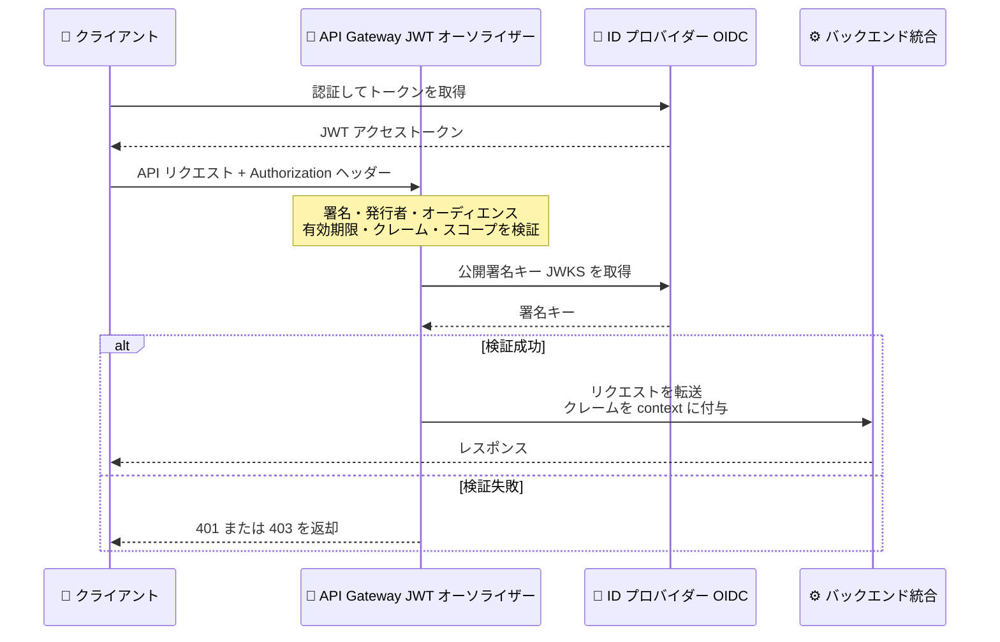

# Amazon API Gateway - REST API のネイティブ JWT オーソライザー

**リリース日**: 2026 年 11 月 17 日
**サービス**: Amazon API Gateway
**機能**: REST API 向け JWT オーソライザー

📊 [このアップデートのインフォグラフィックを見る](https://takech9203.github.io/aws-news-summary/20261117-amazon-api-gateway-rest-authorizers-jwt.html)

## 概要

Amazon API Gateway の REST API で、JSON Web Token (JWT) をゲートウェイ内で直接検証する新しいオーソライザータイプ「JWT オーソライザー」が利用可能になりました。OpenID Connect (OIDC) または OAuth 2.0 に対応した任意の ID プロバイダー (Amazon Cognito ユーザープールを含む) が発行するトークンを、コードを書かずに設定だけで検証できます。

これまで HTTP API では JWT オーソライザーがネイティブにサポートされていましたが、REST API で Amazon Cognito 以外の ID プロバイダーのトークンを検証するには Lambda オーソライザーの実装と運用が必要でした。今回のアップデートにより、トークン検証ロジックを自前で開発・保守する必要がなくなり、マシン間 (M2M) API、モバイル / Web バックエンド、複数の ID プロバイダーのトークンを受け入れるマルチテナント API の認可を簡素化できます。

1 つのオーソライザーに複数の発行者 (issuer) を定義し、発行者ごとに受け入れるオーディエンス、許可する署名アルゴリズム、追加のクレーム条件を設定できます。また、1 つのオーソライザーを多数のメソッドにアタッチし、メソッドごとに異なるスコープを要求できます。

**アップデート前の課題**

- REST API で Amazon Cognito 以外の OIDC / OAuth 2.0 ID プロバイダーのトークンを検証するには、Lambda オーソライザーのコードを実装・運用する必要があった
- トークンの署名検証、有効期限チェック、クレーム検証などの定型的なロジックを自前で開発し、ライブラリの更新やキーのローテーションにも対応し続ける必要があった
- Lambda オーソライザーの呼び出しに伴うレイテンシーとコストが発生していた

**アップデート後の改善**

- トークン検証をコードではなく設定として定義でき、Lambda オーソライザーの開発・運用が不要になった
- 複数の発行者・オーディエンス・署名アルゴリズム・追加クレームを宣言的に設定し、API Gateway がリクエストごとに署名、発行者、オーディエンス、有効期限、クレームを検証するようになった
- 1 つのオーソライザーを複数メソッドで共有しつつ、メソッドごとに異なる認可スコープを要求できるようになった

## アーキテクチャ図



クライアントが ID プロバイダーから取得した JWT を API Gateway がゲートウェイ内で直接検証し、検証に成功したリクエストのみバックエンドに転送するフローです。Lambda オーソライザーを介さずにトークン検証が完結します。

## サービスアップデートの詳細

### 主要機能

1. **ゲートウェイ内でのネイティブ JWT 検証**
   - API Gateway が設定したヘッダー (アイデンティティソース) からトークンを読み取り、リクエストごとに検証を実行
   - トークンの `iss` クレームに一致する発行者設定を検索し、未設定の発行者からのトークンは拒否
   - 発行者の OIDC ディスカバリードキュメント経由で公開署名キーを取得し、署名を検証

2. **柔軟な検証ルールの設定**
   - 複数の発行者を 1 つのオーソライザーに定義し、発行者ごとに受け入れるオーディエンス (`aud` クレーム) を指定可能
   - 許可する署名アルゴリズムを `defaultAlgorithms` で指定 (RS256 / RS384 / RS512 / ES256 / ES384 / ES512 をサポート)
   - 追加クレーム (`additionalClaims`) により、クレーム名、期待値、必須かどうかを条件として設定可能

3. **メソッドごとのスコープ制御**
   - 1 つのオーソライザーを多数のメソッドにアタッチし、メソッドごとに異なる認可スコープを要求可能
   - トークンの `scope` または `scp` クレームに、メソッドが要求するスコープの少なくとも 1 つが含まれるかを検証

4. **クレームのバックエンド連携**
   - 検証済みトークンのクレームを `$context.authorizer.claims` としてバックエンド統合に引き渡し可能

### 検証フローの詳細

ドキュメントによると、API Gateway は以下の手順でリクエストを認可します。

1. アイデンティティソースとして設定したリクエストヘッダーからトークンを読み取る
2. トークンの `iss` クレームに一致する発行者設定を特定する
3. 発行者の OIDC ディスカバリードキュメントから取得した公開署名キーで署名を検証する
4. `aud` クレーム (Amazon Cognito アクセストークンの場合は `client_id` クレーム) を設定済みオーディエンスと照合し、`exp`、`nbf`、`iat` を現在時刻と照合する (60 秒のクロックスキューを許容)
5. 発行者に設定した追加クレームルールを評価する
6. メソッドがスコープを要求する場合、`scope` または `scp` クレームを検証する

いずれかのステップが失敗するとリクエストは拒否されます。トークンの欠落・不正・期限切れ・未信頼の場合は `401 Unauthorized`、有効なトークンでもスコープ不足や追加クレームルール違反の場合は `403 Forbidden` が返され、バックエンドにはリクエストが渡されません。

## 技術仕様

### JWT オーソライザーの仕様

| 項目 | 詳細 |
|------|------|
| 対応 API タイプ | REST API (リージョナル、エッジ最適化、プライベート) |
| 対応 ID プロバイダー | OIDC / OAuth 2.0 準拠のプロバイダー (Amazon Cognito ユーザープールを含む) |
| 署名アルゴリズム | RS256、RS384、RS512、ES256、ES384、ES512 (HS256 などの HMAC 系と `alg: none` は拒否) |
| 発行者設定 | 複数発行者に対応。発行者ごとにオーディエンスと追加クレームを設定 |
| 時刻検証 | `exp`、`nbf`、`iat` を検証 (クロックスキュー許容: 60 秒) |
| スコープ検証 | メソッド単位で認可スコープを設定 (`scope` / `scp` クレーム) |
| クレーム連携 | `$context.authorizer.claims` でバックエンドに引き渡し |
| 前提条件 | ID プロバイダーの OIDC ディスカバリードキュメントとキーセットがパブリックインターネットから到達可能であること (プライベート API でも同様) |

### API 変更履歴

| 日付 | サービス | 変更内容 |
|------|----------|----------|
| 2026/11/17 | [apigateway](https://awsapichanges.com/archive/changes/a370bc-apigateway.html) | 4 updated api methods - `CreateAuthorizer`、`GetAuthorizer`、`GetAuthorizers`、`UpdateAuthorizer` にオーソライザータイプ `JWT` と `jwtConfiguration` (issuers、audiences、additionalClaims、jwksUri、defaultAlgorithms) が追加 |

### jwtConfiguration の構造

```json
{
  "type": "JWT",
  "jwtConfiguration": {
    "issuers": [
      {
        "issuer": "https://cognito-idp.ap-northeast-1.amazonaws.com/{user-pool-id}",
        "audiences": ["my-app-client-id"],
        "additionalClaims": [
          {
            "claimName": "custom:tenant",
            "format": "SINGLE_STRING",
            "required": true,
            "expectedValues": ["tenant-a", "tenant-b"]
          }
        ]
      }
    ],
    "defaultAlgorithms": ["RS256"]
  }
}
```

## 設定方法

### 前提条件

1. 既存の REST API (リージョナル、エッジ最適化、プライベートのいずれか)
2. OIDC / OAuth 2.0 準拠の ID プロバイダー (発行者 URL、オーディエンスを把握していること)
3. ID プロバイダーの OIDC ディスカバリードキュメント (`/.well-known/openid-configuration`) とキーセットがパブリックインターネットから到達可能であること

### 手順

#### ステップ 1: JWT オーソライザーを作成する

```bash
aws apigateway create-authorizer \
  --rest-api-id abcde12345 \
  --name my-jwt-authorizer \
  --type JWT \
  --identity-source method.request.header.Authorization \
  --jwt-configuration '{
    "issuers": [
      {
        "issuer": "https://idp.example.com",
        "audiences": ["my-api"]
      }
    ],
    "defaultAlgorithms": ["RS256"]
  }'
```

REST API に対してタイプ `JWT` のオーソライザーを作成します。`identity-source` でトークンを読み取るヘッダーを指定し、`jwt-configuration` で信頼する発行者、受け入れるオーディエンス、許可する署名アルゴリズムを宣言します。

#### ステップ 2: メソッドにオーソライザーをアタッチする

マネジメントコンソールまたは API でメソッドの認可設定に作成した JWT オーソライザーを指定します。必要に応じてメソッドごとに認可スコープを設定すると、トークンの `scope` / `scp` クレームにそのスコープが含まれているかどうかが検証されます。詳細な手順は[公式ドキュメント](https://docs.aws.amazon.com/apigateway/latest/developerguide/rest-api-jwt-authorizer.html)を参照してください。

#### ステップ 3: デプロイして動作を確認する

```bash
aws apigateway create-deployment \
  --rest-api-id abcde12345 \
  --stage-name prod
```

API をステージにデプロイし、有効なトークンでは 2xx、トークン欠落・不正では 401、スコープ不足では 403 が返ることを確認します。

## メリット

### ビジネス面

- **運用負荷の削減**: トークン検証用の Lambda オーソライザーのコード開発、ライブラリ更新、監視が不要になり、運用コストを削減できる
- **導入スピードの向上**: 設定のみで外部 ID プロバイダーとの連携を実現でき、API の公開までの期間を短縮できる
- **マルチテナント対応の簡素化**: 複数の ID プロバイダーのトークンを 1 つのオーソライザーで受け入れられ、テナントごとに異なる IdP を使う SaaS アーキテクチャに適合する

### 技術面

- **宣言的なセキュリティ設定**: 発行者、オーディエンス、署名アルゴリズム、追加クレームを設定として管理でき、IaC による統制が容易になる
- **堅牢な検証**: 署名、発行者、オーディエンス、有効期限、クレーム、スコープをマネージドに検証し、HMAC 系アルゴリズムや `alg: none` のトークンを拒否する
- **メソッド単位の細かな認可**: 1 つのオーソライザーを共有しつつ、メソッドごとに異なるスコープを要求できる

## デメリット・制約事項

### 制限事項

- 対応する署名アルゴリズムは RS256 / RS384 / RS512 / ES256 / ES384 / ES512 のみで、HS256 などの共有鍵 (HMAC) 方式は利用できない
- ID プロバイダーの OIDC ディスカバリードキュメントとキーセットは、プライベート API の場合でもパブリックインターネットから到達可能である必要がある
- JWT オーソライザーで評価できない独自の認可ロジック (外部データベース参照など) が必要な場合は、引き続き Lambda オーソライザーが必要

### 考慮すべき点

- Amazon Cognito ユーザープールのみを使用し、プール内の任意のアプリクライアントのトークンを受け入れたい場合は、クライアント ID を列挙せずに済む既存の Cognito ユーザープールオーソライザーも選択肢となる
- 既存の Lambda オーソライザーから移行する場合は、カスタムロジックが JWT オーソライザーの設定 (オーディエンス、追加クレーム、スコープ) で表現できるかを事前に確認する必要がある
- トークンの時刻検証には 60 秒のクロックスキューが許容される点を踏まえてテストを設計する

## ユースケース

### ユースケース 1: マシン間 (M2M) API の認可

**シナリオ**: 社内マイクロサービスやパートナーシステムが、OAuth 2.0 のクライアントクレデンシャルフローで取得したアクセストークンを使って REST API を呼び出す。

**実装例**:
```json
{
  "issuers": [
    {
      "issuer": "https://auth.example.com",
      "audiences": ["orders-api"]
    }
  ],
  "defaultAlgorithms": ["RS256"]
}
```

**効果**: Lambda オーソライザーを実装せずにサービス間認可を実現でき、トークン検証の実装差異による脆弱性リスクを低減できる。

### ユースケース 2: 複数 ID プロバイダーを受け入れるマルチテナント API

**シナリオ**: SaaS プロバイダーが、テナントごとに異なる OIDC プロバイダー (Amazon Cognito、外部 IdP など) が発行するトークンを 1 つの API で受け入れる。

**実装例**:
```json
{
  "issuers": [
    {
      "issuer": "https://cognito-idp.ap-northeast-1.amazonaws.com/{user-pool-id}",
      "audiences": ["tenant-a-client"]
    },
    {
      "issuer": "https://idp.tenant-b.example.com",
      "audiences": ["tenant-b-api"],
      "additionalClaims": [
        { "claimName": "tenant", "format": "SINGLE_STRING", "required": true, "expectedValues": ["tenant-b"] }
      ]
    }
  ],
  "defaultAlgorithms": ["RS256", "ES256"]
}
```

**効果**: 発行者ごとの検証ルールを 1 つのオーソライザーに集約し、テナント追加時も設定変更だけで対応できる。

### ユースケース 3: メソッドごとのスコープによる権限分離

**シナリオ**: モバイル / Web バックエンドで、読み取り系メソッドには `orders/read`、書き込み系メソッドには `orders/write` スコープを要求する。

**実装例**:
```
GET  /orders   → 認可スコープ: orders/read
POST /orders   → 認可スコープ: orders/write
```

**効果**: 同一のオーソライザーを共有しながらメソッド単位で最小権限を実現でき、トークンのスコープ不足は 403 で拒否される。

## 料金

What's New およびドキュメントに JWT オーソライザー固有の追加料金の記載はなく、REST API の標準料金 (API コール数に基づく課金) が適用されます。従来 Lambda オーソライザーでトークン検証を行っていた場合は、その Lambda 関数の呼び出し料金と実行時間分のコストが不要になります。詳細は [Amazon API Gateway の料金ページ](https://aws.amazon.com/api-gateway/pricing/)を参照してください。

## 利用可能リージョン

すべての商用 AWS リージョンおよび AWS GovCloud (US) リージョンで利用可能です。リージョナル、エッジ最適化、プライベートのすべての REST API エンドポイントタイプで動作します。

## 関連サービス・機能

- **Amazon Cognito**: ユーザープールは OIDC 発行者として JWT オーソライザーで利用可能。プール内の任意のアプリクライアントを受け入れる場合は Cognito ユーザープールオーソライザーも選択肢
- **API Gateway HTTP API**: HTTP API では以前から JWT オーソライザーをサポートしており、今回のアップデートで REST API でも同等の機能が利用可能になった
- **AWS Lambda (Lambda オーソライザー)**: JWT で表現できないカスタム認可ロジックが必要な場合に引き続き使用
- **AWS WAF**: JWT オーソライザーによる認可と組み合わせて、REST API の多層防御を構成可能

## 参考リンク

- 📊 [インフォグラフィック](https://takech9203.github.io/aws-news-summary/20261117-amazon-api-gateway-rest-authorizers-jwt.html)
- [公式発表 (What's New)](https://aws.amazon.com/about-aws/whats-new/2026/11/amazon-api-gateway-rest-authorizers-jwt/)
- [AWS Blog - Securing REST APIs with JWT authorizers in Amazon API Gateway](https://aws.amazon.com/blogs/compute/securing-rest-apis-with-jwt-authorizers-in-amazon-api-gateway/)
- [ドキュメント - Control access to REST APIs using JWT authorizers](https://docs.aws.amazon.com/apigateway/latest/developerguide/rest-api-jwt-authorizer.html)
- [API 変更履歴 (awsapichanges.com)](https://awsapichanges.com/archive/changes/a370bc-apigateway.html)
- [料金ページ](https://aws.amazon.com/api-gateway/pricing/)

## まとめ

REST API で外部 OIDC / OAuth 2.0 プロバイダーのトークン検証がネイティブにサポートされ、Lambda オーソライザーの開発・運用なしで JWT ベースの認可を実現できるようになりました。トークン検証のみを目的とした Lambda オーソライザーを運用している場合は、JWT オーソライザーへの移行によりコードの保守コストと Lambda 呼び出しコストの削減が期待できます。まずは開発環境の REST API で発行者・オーディエンス・スコープの設定を検証することを推奨します。
