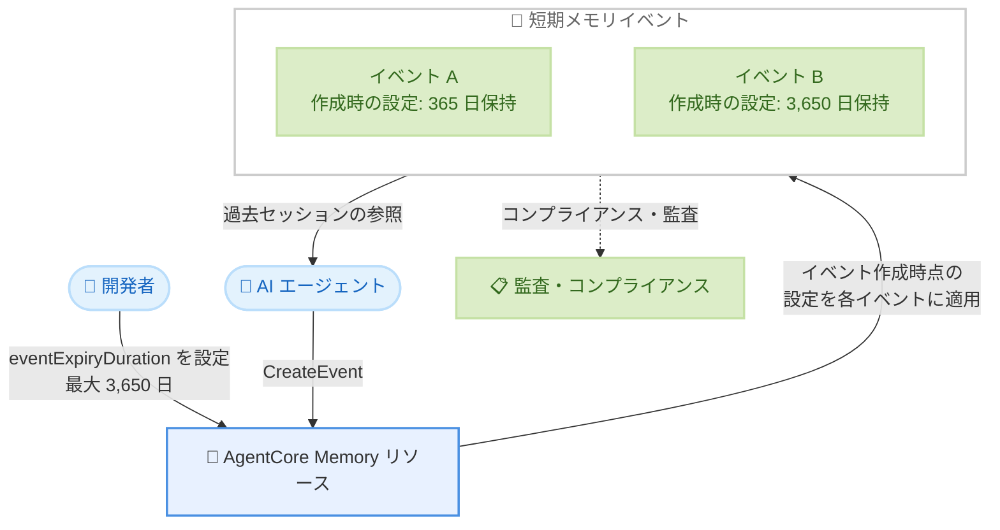

# Amazon Bedrock AgentCore - Memory の短期メモリ保持期間が最大 10 年に拡張

**リリース日**: 2026 年 11 月 17 日
**サービス**: Amazon Bedrock AgentCore
**機能**: AgentCore Memory 短期メモリの最大 10 年保持サポート

📊 [このアップデートのインフォグラフィックを見る](https://takech9203.github.io/aws-news-summary/20261117-amazon-bedrock-agentcore-memory-10-year-retention.html)

## 概要

Amazon Bedrock AgentCore Memory で、短期メモリ (short-term memory) のイベントを最大 10 年間保持できるようになりました。従来の上限は 1 年間でしたが、今回のアップデートにより、短期メモリをエージェントの会話や対話の長期的な記録として利用できます。

この機能強化は、会話履歴を長期間保持する必要があるケースで特に有効です。たとえば、コンプライアンスや監査の要件で対話記録の長期保存が求められる場合、数か月ぶりに戻ってきたユーザーに過去のコンテキストを提供したい場合、エージェントが過去のセッションを振り返る必要がある場合などが挙げられます。

保持期間はメモリリソースに対して設定し、イベント作成時点の設定が各イベントに適用されます。既存のイベントは元の保持期間を維持するため、設定変更が過去のデータに遡って影響することはありません。

**アップデート前の課題**

- 短期メモリのイベント保持期間は最大 1 年 (365 日) に制限されていた
- コンプライアンスや監査で 1 年を超える会話記録の保存が必要な場合、外部ストレージへのエクスポートなど独自の仕組みを構築する必要があった
- 長期間離れていたユーザーが戻ってきた際に、過去の会話イベントが既に失効している可能性があった

**アップデート後の改善**

- 短期メモリのイベントを最大 10 年 (3,650 日) 保持できるようになった
- 短期メモリをエージェントの会話・対話の長期的な記録としてそのまま利用できるようになった
- コンプライアンス・監査要件や、過去セッションの参照が必要なエージェントに追加の仕組みなしで対応できるようになった

## アーキテクチャ図



保持期間はメモリリソース単位で設定され、イベント作成時点の設定値が各イベントに個別に適用されます。設定を変更しても、既存イベントの保持期間は変わりません。

## サービスアップデートの詳細

### 主要機能

1. **短期メモリの最大 10 年保持**
   - 短期メモリイベントの保持期間の上限が 1 年から 10 年 (3,650 日) に拡張された
   - `CreateMemory` / `UpdateMemory` API の `eventExpiryDuration` パラメータで日数を指定する
   - API リファレンス上の有効範囲は最小 3 日、最大 3,650 日

2. **イベント作成時点での保持期間適用**
   - 保持期間はメモリリソースに設定し、イベント作成時にそのイベントへ適用される
   - 保持期間を変更しても、変更後に作成されたイベントにのみ新しい設定が適用される
   - 既存イベントは元の保持期間を維持し、延長はできない。失効したイベントは復元できない

3. **長期記録としての短期メモリの活用**
   - コンプライアンス・監査向けの会話記録の長期保存に対応
   - 数か月以上の間隔を空けて戻ってくるユーザーへのコンテキスト提供が可能
   - エージェントによる過去セッションの振り返り (ルックバック) に活用できる

## 技術仕様

### 保持期間設定の仕様

| 項目 | 詳細 |
|------|------|
| 設定パラメータ | `eventExpiryDuration` (整数、日数単位) |
| 設定対象 | メモリリソース (`CreateMemory` / `UpdateMemory`) |
| 有効範囲 | 最小 3 日、最大 3,650 日 (約 10 年) |
| 従来の上限 | 365 日 (1 年) |
| 適用タイミング | イベント作成時点の設定値が各イベントに適用 |
| 既存イベントへの影響 | なし (元の保持期間を維持、延長・復元は不可) |
| 料金 | 保持期間中は標準の短期メモリストレージ料金が発生 |

### 短期メモリと長期メモリの保持設定の違い

| メモリ種別 | 保持設定 | 説明 |
|------|------|------|
| 短期メモリ (raw イベント) | `eventExpiryDuration` | セッション内のターンごとの対話イベントを保持。今回のアップデートで最大 3,650 日に拡張 |
| 長期メモリレコード | `recordExpiryDurationDays` (最小 31 日) | 戦略ごとに設定する TTL。未設定の場合はレコードが失効しない |

### API 変更履歴

今回のアップデートは `eventExpiryDuration` パラメータの有効範囲の拡張であり、新規 API メソッドの追加はありません。なお、同日に Amazon Bedrock AgentCore では別機能に関する API 更新が公開されています。

| 日付 | サービス | 変更内容 |
|------|----------|----------|
| 2026/11/17 | [bedrock-agentcore-control](https://awsapichanges.com/archive/changes/a370bc-bedrock-agentcore-control.html) | 3 new 4 updated api methods - 継続的インサイトと自動データセット生成のサポート追加 (本アップデートとは別の機能) |

### 設定例

```python
import boto3

control_client = boto3.client('bedrock-agentcore-control')

# 短期メモリイベントを 10 年 (3,650 日) 保持するメモリリソースを作成
response = control_client.create_memory(
    name="ComplianceAgentMemory",
    description="Memory with 10-year short-term retention for audit.",
    eventExpiryDuration=3650
)
```

## 設定方法

### 前提条件

1. Amazon Bedrock AgentCore Memory が利用可能なリージョンであること
2. `bedrock-agentcore-control:CreateMemory` または `UpdateMemory` を実行できる IAM 権限があること
3. AWS SDK、AWS CLI、または AgentCore コンソールが利用できること

### 手順

#### ステップ 1: メモリリソースの作成時に保持期間を指定する

```bash
aws bedrock-agentcore-control create-memory \
  --name "ComplianceAgentMemory" \
  --event-expiry-duration 3650
```

`eventExpiryDuration` に 3,650 日 (10 年) を指定して新しいメモリリソースを作成します。このリソースに書き込まれるイベントは、作成時点から 10 年間保持されます。

#### ステップ 2: 既存メモリリソースの保持期間を更新する

```bash
aws bedrock-agentcore-control update-memory \
  --memory-id <memory-id> \
  --event-expiry-duration 3650
```

既存のメモリリソースの保持期間を 10 年に更新します。この変更は更新後に作成されるイベントにのみ適用され、既存イベントは元の保持期間を維持する点に注意してください。

#### ステップ 3: 設定を確認する

```bash
aws bedrock-agentcore-control get-memory \
  --memory-id <memory-id> \
  --query "memory.eventExpiryDuration"
```

メモリリソースの現在の `eventExpiryDuration` 設定値を確認します。

## メリット

### ビジネス面

- **コンプライアンス・監査対応**: 会話記録の長期保存要件に AgentCore Memory の標準機能だけで対応でき、外部アーカイブの仕組みが不要になる
- **ユーザー体験の向上**: 数か月以上間隔を空けて戻ってきたユーザーにも、過去の対話コンテキストに基づいた応対を提供できる
- **運用コストの削減**: 会話履歴のエクスポート・再取り込みといった独自実装の開発・保守が不要になる

### 技術面

- **シンプルな設定**: `eventExpiryDuration` の値を変更するだけで保持期間を拡張できる
- **予測可能な挙動**: 保持期間はイベント作成時に確定するため、設定変更が既存データに影響しない
- **過去セッションの参照**: エージェントが長期間にわたる過去セッションのイベントをルックバックできる

## デメリット・制約事項

### 制限事項

- 保持期間の変更は変更後に作成されたイベントにのみ適用され、既存イベントの保持期間は延長できない
- 失効したイベントは復元できない
- 保持期間の上限は 3,650 日 (約 10 年) である

### 考慮すべき点

- データを保持している間は標準の短期メモリストレージ料金が発生し続けるため、長期保持はコストとのトレードオフになる
- 長期保存する会話データに個人情報が含まれる場合、保持ポリシーやデータ保護規制 (保存期間・削除要件) との整合性を確認する必要がある
- 長期的な知識の抽出・要約が目的であれば、短期メモリの長期保持ではなく長期メモリ戦略の利用が適している場合がある

## ユースケース

### ユースケース 1: 金融機関のコンプライアンス記録

**シナリオ**: 金融機関のカスタマーサポートエージェントで、顧客との対話記録を規制要件に基づき 7 年間保存する必要がある。

**実装例**:
```python
control_client.create_memory(
    name="FinancialSupportMemory",
    eventExpiryDuration=2555  # 7 年間保持
)
```

**効果**: 外部アーカイブ基盤を構築せずに、AgentCore Memory のみで規制要件に沿った対話記録の保存を実現できる。

### ユースケース 2: 長期間利用されるパーソナルアシスタント

**シナリオ**: ユーザーが数か月から数年単位で断続的に利用するアシスタントで、復帰時に過去のやり取りを踏まえた応対をしたい。

**実装例**:
```python
control_client.update_memory(
    memoryId="<memory-id>",
    eventExpiryDuration=3650  # 10 年間保持
)
```

**効果**: 長期間離れていたユーザーに対しても、過去セッションのイベントを参照したパーソナライズされた体験を提供できる。

### ユースケース 3: 過去セッションを振り返るエージェント

**シナリオ**: プロジェクト管理エージェントが、年単位の過去の意思決定や議論の経緯を参照して回答を生成する。

**実装例**:
```python
# 過去のセッションのイベントを一覧して参照
data_client = boto3.client('bedrock-agentcore')
events = data_client.list_events(
    memoryId="<memory-id>",
    actorId="<actor-id>",
    sessionId="<past-session-id>"
)
```

**効果**: 長期にわたる履歴をエージェントが直接参照できるため、過去の経緯を踏まえた一貫性のある応答が可能になる。

## 料金

短期メモリの保持期間自体に追加料金はありませんが、データを保持している期間は標準の短期メモリストレージ料金が継続して発生します。保持期間を延長するほどストレージコストが累積するため、要件に応じた期間設定が重要です。詳細は [Amazon Bedrock AgentCore の料金ページ](https://aws.amazon.com/bedrock/agentcore/pricing/)を参照してください。

## 利用可能リージョン

Amazon Bedrock AgentCore Memory が利用可能なすべての AWS リージョンで利用できます。

## 関連サービス・機能

- **AgentCore Memory 長期メモリ**: 会話から重要な事実や嗜好を自動抽出して保存する機能。長期的な知識保持にはこちらの利用も検討できる
- **Amazon Bedrock AgentCore Runtime**: エージェントの実行環境。Memory と組み合わせてコンテキストを保持したエージェントを構築できる
- **AWS KMS**: メモリデータの暗号化にカスタマーマネージドキーを利用でき、長期保存データのセキュリティ要件に対応できる

## 参考リンク

- 📊 [インフォグラフィック](https://takech9203.github.io/aws-news-summary/20261117-amazon-bedrock-agentcore-memory-10-year-retention.html)
- [公式発表 (What's New)](https://aws.amazon.com/about-aws/whats-new/2026/11/amazon-bedrock-agentcore-memory-10-year-retention)
- [AgentCore Memory ドキュメント](https://docs.aws.amazon.com/bedrock-agentcore/latest/devguide/memory.html)
- [CreateMemory API リファレンス](https://docs.aws.amazon.com/bedrock-agentcore-control/latest/APIReference/API_CreateMemory.html)
- [料金ページ](https://aws.amazon.com/bedrock/agentcore/pricing/)

## まとめ

Amazon Bedrock AgentCore Memory の短期メモリ保持期間が最大 10 年に拡張され、コンプライアンス・監査や長期的なユーザーコンテキストの保持といった要件に標準機能で対応できるようになりました。保持期間はイベント作成時に確定し既存イベントには遡及しないため、長期保存が必要なワークロードでは早めに `eventExpiryDuration` の見直しを行うことを推奨します。
