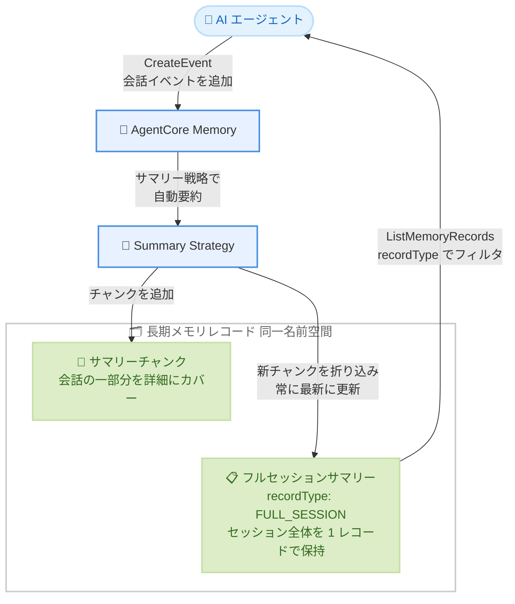

# Amazon Bedrock AgentCore - Memory がフルセッションサマリーを提供開始

**リリース日**: 2026 年 11 月 17 日
**サービス**: Amazon Bedrock AgentCore
**機能**: AgentCore Memory フルセッションサマリー (Full Session Summary)

📊 [このアップデートのインフォグラフィックを見る](https://takech9203.github.io/aws-news-summary/20261117-amazon-bedrock-agentcore-memory-full-session-summaries.html)

## 概要

Amazon Bedrock AgentCore Memory が、すべてのセッションに対してフルセッションサマリー (full session summary) を保持するようになりました。フルセッションサマリーは、会話で何が起きたかのスナップショットを提供する単一のレコードです。従来からあるサマリーチャンク (summary chunks) が会話の一部分をより詳細にカバーするのに対し、フルセッションサマリーはセッション全体の現在の状況を 1 つのレコードで把握できます。

AgentCore Memory は新しいイベントが到着するたびにフルセッションサマリーを更新するため、レコードは常に「セッションのこれまで」を反映します。会話の逐一の記録ではなく、手早い全体の振り返り (recap) が欲しい開発者に適した機能です。

フルセッションサマリーはサマリー戦略 (summary strategy) に付属しており、追加の設定は不要です。サマリー戦略を持つすべてのメモリで自動的に生成され、この機能の提供前に要約された既存セッションにも作成されます。各サマリーはセッションのサマリーチャンクと同じ名前空間に長期メモリレコードとして保存され、既存の Memory 操作 (`GetMemoryRecord`、`ListMemoryRecords`、`RetrieveMemoryRecords`) でそのまま取得できます。レコードタイプでフィルタリングすれば、フルセッションサマリーのみを返すことも可能です。

**アップデート前の課題**

- サマリー戦略の出力はサマリーチャンク単位であり、セッション全体の 1 つの要約を得るには複数のチャンクを取得して自前で組み立てる必要があった
- 会話が同じトピックに戻ると後続のチャンクに新しい `<topic>` エントリが追加されるため、トピック横断でまとまった全体像を把握しにくかった
- エージェントにセッションの完全なコンテキストを 1 レコードで渡す標準的な手段がなかった

**アップデート後の改善**

- セッション全体を 1 つのレコードで振り返れるフルセッションサマリーが自動的に生成・更新されるようになった
- 追加設定なしで、サマリー戦略を持つすべてのメモリ (既存セッションを含む) で利用できるようになった
- `x-amz-agentcore-memory-recordType` メタデータでフィルタリングし、フルセッションサマリーだけを取得できるようになった

## アーキテクチャ図



サマリー戦略は、会話の進行に合わせてサマリーチャンクを追加しつつ、新しいチャンクの内容をフルセッションサマリーに折り込んで常に最新の状態に更新します。両者は同じ名前空間に保存され、レコードタイプで区別できます。

## サービスアップデートの詳細

### 主要機能

1. **セッション全体を 1 レコードで保持するフルセッションサマリー**
   - セッション全体の振り返りを単一の実行中レコード (running record) として保持する
   - 新しいイベントが到着するたびに、AgentCore Memory が新しいサマリーチャンクを既存の振り返りに折り込んで更新する
   - モデルが生成・更新するため内容はセッションの進行とともに変化し、最新の振り返りを得るにはイベント追加後にレコードを再読み込みする

2. **追加設定不要の自動生成**
   - フルセッションサマリーはサマリー戦略に付属し、個別の設定項目は存在しない
   - サマリー戦略を持つすべてのメモリで自動的に生成される
   - この機能の提供前に要約されたセッションに対しても、フルセッションサマリーが作成される

3. **既存の Memory 操作による取得とレコードタイプでのフィルタリング**
   - `memoryRecordType` が `FULL_SESSION` の長期メモリレコードとして、サマリーチャンクと同じ名前空間に保存される
   - `GetMemoryRecord`、`ListMemoryRecords`、`RetrieveMemoryRecords` といった既存の操作で取得でき、新しい API は不要
   - システム生成のメタデータキー `x-amz-agentcore-memory-recordType` でフィルタリングでき、インデックスキーとしての宣言は不要
   - フルセッションサマリーも他のレコードと同様に埋め込み (embedding) されるため、`RetrieveMemoryRecords` のセマンティック検索結果にも含まれる

## 技術仕様

### サマリーチャンクとフルセッションサマリーの比較

| 項目 | サマリーチャンク | フルセッションサマリー |
|------|------|------|
| カバー範囲 | 会話の一部分。会話の進行に応じて新しいチャンクを生成 | セッション全体。会話の継続に応じて同一レコードを更新 |
| レコード数 | 1 セッションに複数 | 1 セッションに 1 レコード |
| トピックの扱い | 同じトピックに戻ると複数チャンクに分かれて記録される | セッション全体の状況を 1 つにまとめて保持 |
| 主な用途 | クエリに関連するセッションの一部のみを取得 | チャンクを自前で組み立てずに、セッションの完全なコンテキストを 1 レコードで取得 |

### フルセッションサマリーの仕様

| 項目 | 詳細 |
|------|------|
| レコードタイプ | `memoryRecordType: FULL_SESSION` |
| 保存先の名前空間 | `/strategy/{memoryStrategyId}/actor/{actorId}/session/{sessionId}/` (サマリーチャンクと同一) |
| 設定 | 不要 (サマリー戦略に付属し、個別の有効化設定はない) |
| 既存セッションへの適用 | あり (機能提供前に要約されたセッションにも作成される) |
| 取得 API | `GetMemoryRecord` / `ListMemoryRecords` / `RetrieveMemoryRecords` |
| フィルタリング | メタデータキー `x-amz-agentcore-memory-recordType` で絞り込み (インデックスキー宣言は不要) |
| IAM 権限 | 他のメモリレコードと同じアクション・同じリソース ARN を使用。レコードタイプ単位のアクセス制御は不可 |
| 暗号化 | 他のメモリレコードと同様に保存時に暗号化。カスタマーマネージド KMS キー (`encryptionKeyArn`) 設定時はそのキーで暗号化 |

### API 変更履歴

今回のアップデートは既存の Memory 操作で取得できる新しいレコードタイプの追加であり、新規 API メソッドの追加はありません。なお、同日に Amazon Bedrock AgentCore では別機能に関する API 更新が公開されています。

| 日付 | サービス | 変更内容 |
|------|----------|----------|
| 2026/11/17 | [bedrock-agentcore](https://awsapichanges.com/archive/changes/a370bc-bedrock-agentcore.html) | 7 new 2 updated api methods - 継続的インサイトと自動データセット生成のサポート追加 (本アップデートとは別の機能) |

### 取得コマンド例

```bash
aws bedrock-agentcore list-memory-records \
  --memory-id "<memory-id>" \
  --namespace "/strategy/<memory-strategy-id>/actor/<actor-id>/session/<session-id>/" \
  --metadata-filters '[
    {
      "left":     {"metadataKey": "x-amz-agentcore-memory-recordType"},
      "operator": "EQUALS_TO",
      "right":    {"metadataValue": {"stringValue": "FULL_SESSION"}}
    }
  ]'
```

## 設定方法

### 前提条件

1. Amazon Bedrock AgentCore Memory が利用可能なリージョンであること
2. メモリリソースにサマリー戦略 (summary strategy) が設定されていること
3. `bedrock-agentcore:GetMemoryRecord`、`bedrock-agentcore:ListMemoryRecords`、または `bedrock-agentcore:RetrieveMemoryRecords` を実行できる IAM 権限があること

### 手順

#### ステップ 1: サマリー戦略付きのメモリを確認する

```bash
aws bedrock-agentcore-control get-memory \
  --memory-id <memory-id> \
  --query "memory.strategies"
```

メモリリソースに設定されている戦略の一覧を確認します。サマリー戦略が含まれていれば、フルセッションサマリーは追加設定なしで自動的に生成されます。

#### ステップ 2: フルセッションサマリーのみを取得する

```bash
aws bedrock-agentcore list-memory-records \
  --memory-id "<memory-id>" \
  --namespace "/strategy/<memory-strategy-id>/actor/<actor-id>/session/<session-id>/" \
  --metadata-filters '[
    {
      "left":     {"metadataKey": "x-amz-agentcore-memory-recordType"},
      "operator": "EQUALS_TO",
      "right":    {"metadataValue": {"stringValue": "FULL_SESSION"}}
    }
  ]'
```

セッションの名前空間を指定し、`x-amz-agentcore-memory-recordType` が `FULL_SESSION` のレコードのみを一覧します。これにより、サマリーチャンクを除いたフルセッションサマリーだけを取得できます。

#### ステップ 3: セマンティック検索をフルセッションサマリーに限定する

`RetrieveMemoryRecords` を使用する場合は、`searchCriteria` 内の `metadataFilters` に同じ `x-amz-agentcore-memory-recordType` フィルタを追加します。これにより、セマンティック検索の対象をフルセッションサマリーに限定できます。

```python
import boto3

client = boto3.client('bedrock-agentcore')

response = client.retrieve_memory_records(
    memoryId="<memory-id>",
    namespace="/strategy/<memory-strategy-id>/actor/<actor-id>/session/<session-id>/",
    searchCriteria={
        "searchQuery": "セッションの現在の状況",
        "metadataFilters": [
            {
                "left": {"metadataKey": "x-amz-agentcore-memory-recordType"},
                "operator": "EQUALS_TO",
                "right": {"metadataValue": {"stringValue": "FULL_SESSION"}}
            }
        ]
    }
)
```

## メリット

### ビジネス面

- **エージェント品質の向上**: セッション全体の文脈を 1 レコードでエージェントに渡せるため、長い会話でも一貫性のある応答を提供しやすくなる
- **開発コストの削減**: 複数のサマリーチャンクを取得して全体像を組み立てる独自ロジックの開発・保守が不要になる
- **既存資産の活用**: 機能提供前に要約された既存セッションにもフルセッションサマリーが作成されるため、過去のセッションにも遡って活用できる

### 技術面

- **追加設定不要**: サマリー戦略を持つメモリであれば自動的に有効になり、移行作業や設定変更が不要
- **既存 API との互換性**: `GetMemoryRecord` / `ListMemoryRecords` / `RetrieveMemoryRecords` という既存の操作をそのまま利用できる
- **効率的なコンテキスト管理**: セッション全体の振り返りを 1 レコードで取得できるため、基盤モデルのコンテキストウィンドウを効率的に利用できる

## デメリット・制約事項

### 制限事項

- フルセッションサマリーの生成はサマリー戦略が前提であり、サマリー戦略を持たないメモリでは利用できない
- 他のレコードと同じ IAM アクション・リソース ARN を使用するため、フルセッションサマリーのみへのアクセス許可・拒否を IAM で分離することはできない (アプリケーション側で `x-amz-agentcore-memory-recordType` によるフィルタリングが必要)
- 生成を個別に無効化する設定はない

### 考慮すべき点

- モデルが生成・更新するレコードであるため、内容はセッションの進行とともに変化する。最新の振り返りを得るには、イベント追加後にレコードを再読み込みする必要がある
- フルセッションサマリーはセマンティック検索の結果にも含まれるため、チャンクのみを対象にしたい検索ではレコードタイプによる除外を検討する必要がある
- 会話の詳細な経緯が必要な場合は、フルセッションサマリーではなくサマリーチャンクや短期メモリの生イベントの参照が適している

## ユースケース

### ユースケース 1: カスタマーサポートエージェントのセッション引き継ぎ

**シナリオ**: 長時間にわたるサポート対応の途中で別のエージェントやオペレーターに引き継ぐ際、会話全体の状況を素早く把握させたい。

**実装例**:
```bash
aws bedrock-agentcore list-memory-records \
  --memory-id "<memory-id>" \
  --namespace "/strategy/<strategy-id>/actor/<customer-id>/session/<session-id>/" \
  --metadata-filters '[{"left":{"metadataKey":"x-amz-agentcore-memory-recordType"},"operator":"EQUALS_TO","right":{"metadataValue":{"stringValue":"FULL_SESSION"}}}]'
```

**効果**: 全チャンクを読み込まずに、問い合わせ内容と対応状況の全体像を 1 レコードで引き継げる。

### ユースケース 2: 長い会話におけるコンテキストウィンドウの節約

**シナリオ**: 多数のターンが続く会話で、基盤モデルに全履歴を渡すとコンテキストウィンドウを圧迫してしまう。

**実装例**:
```python
# フルセッションサマリーを取得してシステムプロンプトに注入
records = client.list_memory_records(
    memoryId="<memory-id>",
    namespace=session_namespace,
    metadataFilters=[full_session_filter]
)
session_recap = records["memoryRecords"][0]["content"]
```

**効果**: 会話履歴全体の代わりに常に最新のセッション振り返りをモデルに渡すことで、トークン消費を抑えつつ会話の一貫性を維持できる。

### ユースケース 3: セッション再開時のクイックリキャップ

**シナリオ**: ユーザーが中断したセッションを再開する際、エージェントが「前回までの状況」を踏まえて会話を続けたい。

**実装例**:
```python
# セッション再開時にフルセッションサマリーを読み込み
recap = client.get_memory_record(
    memoryId="<memory-id>",
    memoryRecordId="<full-session-record-id>"
)
```

**効果**: イベント履歴を再処理することなく、セッションの現在地を 1 回の読み取りで復元でき、自然な会話の再開が可能になる。

## 料金

フルセッションサマリーに固有の追加料金の発表はありません。長期メモリレコードとして保存されるため、AgentCore Memory の標準的な長期メモリの料金体系が適用されます。詳細は [Amazon Bedrock AgentCore の料金ページ](https://aws.amazon.com/bedrock/agentcore/pricing/)を参照してください。

## 利用可能リージョン

Amazon Bedrock AgentCore Memory が利用可能なすべての AWS リージョンで利用できます。

## 関連サービス・機能

- **AgentCore Memory サマリー戦略**: フルセッションサマリーの生成元となる戦略。サマリーチャンクとフルセッションサマリーの 2 種類の出力を生成する
- **AgentCore Memory 構造化メタデータ**: `x-amz-agentcore-memory-recordType` などのシステム生成メタデータによるレコードのフィルタリングを提供する
- **Amazon Bedrock AgentCore Runtime**: エージェントの実行環境。Memory と組み合わせてセッションコンテキストを保持したエージェントを構築できる

## 参考リンク

- 📊 [インフォグラフィック](https://takech9203.github.io/aws-news-summary/20261117-amazon-bedrock-agentcore-memory-full-session-summaries.html)
- [公式発表 (What's New)](https://aws.amazon.com/about-aws/whats-new/2026/11/amazon-bedrock-agentcore-memory-full-session-summaries)
- [サマリー戦略ドキュメント](https://docs.aws.amazon.com/bedrock-agentcore/latest/devguide/summary-strategy.html#summary-strategy-full-session-summary)
- [ListMemoryRecords API リファレンス](https://docs.aws.amazon.com/bedrock-agentcore/latest/APIReference/API_ListMemoryRecords.html)
- [料金ページ](https://aws.amazon.com/bedrock/agentcore/pricing/)

## まとめ

Amazon Bedrock AgentCore Memory のサマリー戦略に、セッション全体を 1 レコードで振り返れるフルセッションサマリーが追加されました。追加設定なしで既存セッションを含むすべての対象メモリに自動適用されるため、サマリー戦略を利用中の場合は `x-amz-agentcore-memory-recordType` フィルタによる取得を試し、チャンクの組み立てロジックの置き換えやコンテキスト注入への活用を検討することを推奨します。
