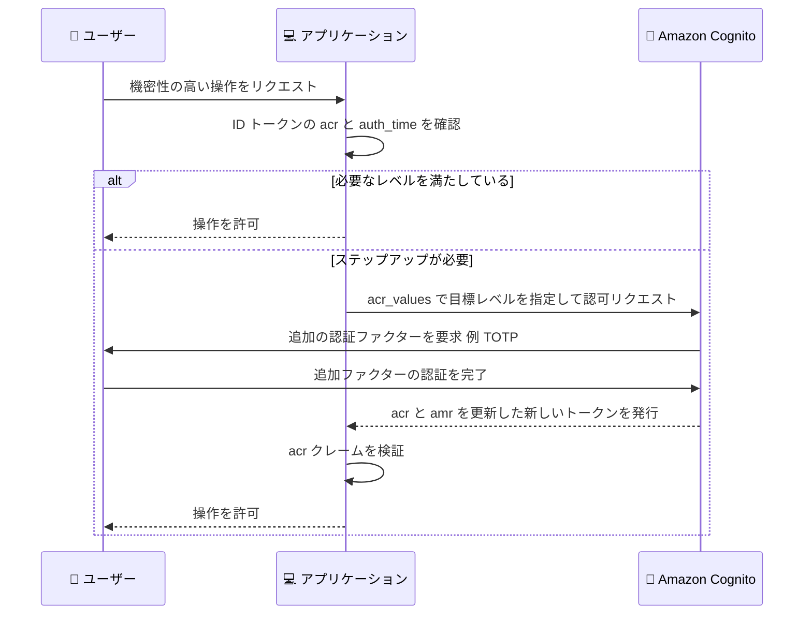

# Amazon Cognito - 認証レベル (ACR) と認証方式 (AMR) トークンクレームのサポート

**リリース日**: 2026 年 11 月 17 日
**サービス**: Amazon Cognito
**機能**: 認証コンテキストクラス参照 (ACR) および認証方式参照 (AMR) トークンクレーム

📊 [このアップデートのインフォグラフィックを見る](https://takech9203.github.io/aws-news-summary/20261117-amazon-cognito-acr-amr-token.html)

## 概要

Amazon Cognito が、発行するアクセストークン、ID トークン、リフレッシュトークンに認証コンテキストクラス参照 (ACR: Authentication Context Class Reference) クレームと認証方式参照 (AMR: Authentication Methods Reference) クレームを追加するようになりました。これらのクレームは OpenID Connect Core 仕様に準拠しており、`acr` クレームはユーザーが到達した認証レベルを、`amr` クレームはユーザーが完了した認証方式の一覧を示します。

Amazon Cognito は完了した認証ファクターに基づいて 4 段階の固定された認証レベルを定義します。レベル 1 のパスワードのみの認証から、レベル 4 のパスワードと認証アプリの時間ベースワンタイムパスワード (TOTP) の組み合わせまでが定義されています。アプリケーションは `acr` クレームを参照して、機密性の高い操作の前に追加のファクターを要求する「ステップアップ認証」などの認可判断を実装できます。また、`amr` クレームは「ユーザーが TOTP を完了した」といった事実を記録できるため、監査やコンプライアンスの用途に有効です。

サインイン時に必要なレベルに達していない場合、アプリケーションはマネージドログインまたは API で目標認証レベルをリクエストでき、ユーザーが必要なファクターを完了すると Amazon Cognito は更新されたクレームを含む新しいトークンを発行します。ACR レベルの URI 名はユーザープールごとにカスタマイズ可能です。OpenID Connect (OIDC) プロバイダー経由のフェデレーションユーザーについては、プロバイダーが返す ACR / AMR 値を設定済みのレベルにマッピングします。

**アップデート前の課題**

- 以前はトークンにユーザーの認証強度を示す標準クレームが含まれず、アプリケーション側で MFA 完了状況を独自に追跡する仕組みが必要だった
- 機密性の高い操作の前に追加認証を要求するステップアップ認証を、カスタム実装で作り込む必要があった
- 監査やコンプライアンスの要件で「どの認証方式を完了したか」を証明する標準的な手段がなかった

**アップデート後の改善**

- トークンの `acr` / `amr` クレームを参照するだけで、認証レベルと完了した認証方式を確認できるようになった
- `acr_values` (マネージドログイン) や `TARGET_ACR_VALUES` (`USER_AUTH` フロー) で目標レベルを指定し、ステップアップ認証をネイティブに実装できるようになった
- OIDC フェデレーションユーザーについても、IdP の ACR / AMR 値を自ユーザープールのレベルへマッピングして一貫した認可判断が可能になった

## アーキテクチャ図



ステップアップ認証のフローです。アプリケーションは現在のトークンの `acr` レベルと `auth_time` を確認し、不足している場合のみ Amazon Cognito に目標レベルを指定して再認証を要求します。

## サービスアップデートの詳細

### 主要機能

1. **`acr` クレームによる認証レベルの通知**
   - ユーザーが満たした認証レベルを示す文字列 (例: `urn:cognito:loa:3`) をトークンに付与
   - Amazon Cognito はユーザーが完了したファクターの組み合わせが完全に満たす最高レベルを割り当て
   - アクセストークンと ID トークンに含まれ、初回サインインを含むすべてのサインインに適用

2. **`amr` クレームによる完了済み認証方式の記録**
   - 完了した認証方式の文字列配列 (例: `["pwd", "otp", "mfa"]`) をトークンに付与
   - TOTP 完了の記録など、監査・コンプライアンス用途に活用可能
   - 2 つ以上の異なるファクターを完了すると `mfa` 値が追加される

3. **目標認証レベルのリクエスト (ステップアップ認証)**
   - マネージドログインの authorize / login エンドポイントでは `acr_values` パラメータを使用
   - `USER_AUTH` API フローでは `TARGET_ACR_VALUES` パラメータを使用
   - オプションの `max_age` (API では `MAX_AGE`) で、直近の認証からの経過時間も要求可能
   - 必要なファクターをユーザーが完了すると、更新されたクレームを持つ新しいアクセストークン、ID トークン、リフレッシュトークンを発行

4. **ACR レベル URI のカスタマイズ**
   - `CreateUserPool` / `UpdateUserPool` の `AcrConfiguration` フィールドで各レベルの URI 名をユーザープールごとにカスタマイズ可能
   - レベルを満たすファクターの組み合わせ自体は固定で、変更できるのは名前のみ

5. **OIDC フェデレーションユーザーのマッピング**
   - OIDC プロバイダー経由でサインインしたユーザーについて、IdP が返す ACR / AMR 値を `AcrMapping` フィールドで設定済みレベルへマッピング
   - ACR / AMR をサポートしない IdP 経由の場合は、プレースホルダーとして `fed` 値を付与

## 技術仕様

### ACR 認証レベル

| ACR レベル | デフォルト ACR 値 | 満たすファクターの組み合わせ |
|-----------|------------------|------------------------------|
| 1 | `urn:cognito:loa:1` | パスワードのみ |
| 2 | `urn:cognito:loa:2` | SMS または E メールで配信されるワンタイムパスワード単体 (パスキーは含まない) |
| 3 | `urn:cognito:loa:3` | パスキー単体、またはパスワード + SMS ワンタイムコード、またはパスワード + E メールワンタイムコード |
| 4 | `urn:cognito:loa:4` | パスワード + 認証アプリの TOTP |

### AMR 値

| 認証方式 | AMR 値 | 備考 |
|----------|--------|------|
| パスワード | `pwd` | SRP を含むパスワード系サインイン |
| 認証アプリの TOTP | `otp` | 認証アプリなどによる時間ベースワンタイムパスワード |
| SMS ワンタイムコード | `sms` | SMS で配信されるワンタイムコード |
| E メールワンタイムコード | `email_otp` | E メールで配信されるワンタイムコード |
| プラットフォーム認証器のパスキー | `swk` | デバイスの生体認証などで保護されたソフトウェアバインドキー |
| ローミング認証器のパスキー | `hwk` | セキュリティキーなどのハードウェアバインドキー |
| 多要素の組み合わせ | `mfa` | 2 つ以上の異なるファクターを完了した場合に追加 |
| フェデレーションサインイン | `fed` | ACR / AMR 非対応の IdP 経由の場合のデフォルト値 |

### トークンの例

パスワードと TOTP で認証したユーザーの ID トークンの例です。

```json
{
  "sub": "a1b2c3d4-5678-90ab-cdef-1234567890ab",
  "iss": "https://cognito-idp.us-east-1.amazonaws.com/us-east-1_ExAmPlE",
  "aud": "abc123def456",
  "token_use": "id",
  "auth_time": 1759345200,
  "acr": "urn:cognito:loa:4",
  "amr": ["pwd", "otp", "mfa"],
  "email": "user@example.com"
}
```

### トークン更新時の動作

| 項目 | 詳細 |
|------|------|
| トークンリフレッシュ | 新しいアクセストークンと ID トークンに同じ `acr` / `amr` 値を引き継ぐ (リフレッシュのたびにステップアップを再要求しない) |
| `auth_time` | トークンリフレッシュではリセットされない。一定時間後の再認証を強制したい場合は `max_age` を使用 |
| ステップアップ完了時 | 更新されたクレームと新しい有効期間を持つアクセストークン、ID トークン、リフレッシュトークンを発行 |
| Lambda トリガー | `acr` / `amr` クレームは事前トークン生成 Lambda トリガーなどで上書き・追加・抑制できない |
| ホスト UI (クラシック) | `acr_values` / `max_age` は無視され、ローカルユーザーの `acr` は MFA 完了時でもレベル 1 になる。正確なレベルにはマネージドログインが必要 |

## 設定方法

### 前提条件

1. Amazon Cognito ユーザープールが作成済みであること
2. ステップアップ認証を使用する場合、ドメインのブランディングバージョンがマネージドログインに設定されていること (ホスト UI クラシックは非対応)
3. 目標レベルのリクエストとカスタム ACR 名の設定には Essentials または Plus 機能プランが必要

### 手順

#### ステップ 1: ACR レベル名のカスタマイズ (オプション)

```bash
aws cognito-idp update-user-pool \
  --user-pool-id us-east-1_ExAmPlE \
  --user-pool-add-ons AdvancedSecurityMode=ENFORCED \
  --cli-input-json '{
    "AcrConfiguration": {
      "Level2": { "AcrValue": "urn:my-standard:loa:2" },
      "Level3": { "AcrValue": "urn:my-standard:loa:3" }
    }
  }'
```

`UpdateUserPool` の `AcrConfiguration` フィールドで、カスタマイズしたいレベルの URI 名のみを上書きします。各 `AcrValue` は 1 ～ 64 文字で、4 レベル全体 (未カスタマイズのデフォルト名を含む) で一意である必要があります。

#### ステップ 2: マネージドログインで目標レベルをリクエスト

```text
https://<ドメイン>.auth.us-east-1.amazoncognito.com/oauth2/authorize?
  client_id=<クライアント ID>&
  response_type=code&
  redirect_uri=<リダイレクト URI>&
  acr_values=urn:cognito:loa:4&
  max_age=300
```

authorize エンドポイントに `acr_values` で目標認証レベルを指定します。`max_age` を併用すると、直近 300 秒以内に認証したことも要求できます。レベルが不足している場合、Amazon Cognito は必要なファクターの完了をユーザーに求めます。

#### ステップ 3: `USER_AUTH` API フローで目標レベルをリクエスト

```bash
aws cognito-idp initiate-auth \
  --client-id <クライアント ID> \
  --auth-flow USER_AUTH \
  --auth-parameters USERNAME=<ユーザー名>,TARGET_ACR_VALUES=urn:cognito:loa:4,MAX_AGE=300
```

SDK / API ベースのサインインでは、`InitiateAuth` の `USER_AUTH` フローで `TARGET_ACR_VALUES` と `MAX_AGE` パラメータを指定します。機能プランが不足している場合、`InitiateAuth` は `FeatureUnavailableInTierException` を返します (マネージドログインの authorize エンドポイントはエラーを返さず `acr_values` を無視します)。

#### ステップ 4: アプリケーションで `acr` クレームを検証

トークン発行後、アプリケーションは操作が要求するレベルと `acr` クレームが一致することを必ず検証します。Amazon Cognito は到達したレベルでトークンを発行するだけであり、操作ごとのレベル要求の強制はアプリケーションの責任です。

## メリット

### ビジネス面

- **コンプライアンス対応の強化**: `amr` クレームにより、ユーザーが完了した認証方式を標準形式で記録でき、監査証跡の要件に対応しやすくなる
- **リスクベースのセキュリティ**: 送金や設定変更などの機密操作にのみ強い認証を要求でき、セキュリティと利便性を両立できる
- **開発コストの削減**: ステップアップ認証のカスタム実装が不要になり、標準クレームベースの実装に集約できる

### 技術面

- **OpenID Connect 標準準拠**: `acr` / `amr` は OIDC Core 仕様のクレームであり、既存の OIDC 対応ライブラリやツールと親和性が高い
- **トークンリフレッシュでの引き継ぎ**: リフレッシュ時に同じ `acr` / `amr` 値が維持されるため、ユーザーに不要な再認証を求めない
- **フェデレーションの一貫性**: OIDC IdP の ACR / AMR 値を自ユーザープールのレベルにマッピングでき、ローカルユーザーとフェデレーションユーザーで統一した認可ロジックを実装できる

## デメリット・制約事項

### 制限事項

- 各 ACR レベルを満たすファクターの組み合わせは固定であり、変更できるのは URI 名のみ
- `acr` / `amr` クレームは事前トークン生成 Lambda トリガーなどでカスタマイズ・上書き・抑制できない
- ステップアップ認証はマネージドログインが必要で、ホスト UI (クラシック) では `acr_values` / `max_age` が無視される
- 目標レベルのリクエストとカスタム ACR 名の設定には Essentials または Plus 機能プランが必要
- 本機能は段階的にロールアウト中であり、ユーザープールによってはまだ利用できない場合がある

### 考慮すべき点

- `acr` の検証と操作ごとのレベル強制はアプリケーションの責任であり、Amazon Cognito は到達レベルを報告するのみ
- NIST や eIDAS など他の標準への変換が必要な場合は、アプリケーション層で Amazon Cognito のレベルを翻訳する必要がある
- ACR レベル名を変更すると、古い名前を持つ既存トークンは「認識されないレベル」として扱われる (エラーにはならず、`amr` の値に基づいて不足ファクターのみ要求される)
- SAML フェデレーションユーザーはホスト UI (クラシック) では `acr` がレベル 1、`amr` が `["fed"]` になる

## ユースケース

### ユースケース 1: 送金操作前のステップアップ認証

**シナリオ**: 金融アプリケーションで、残高照会はパスワード認証のみで許可するが、送金操作にはパスワード + TOTP (レベル 4) を要求したい。

**実装例**:
```text
1. 送金リクエスト時に ID トークンの acr を確認
2. acr が urn:cognito:loa:4 未満の場合、authorize エンドポイントへリダイレクト
   acr_values=urn:cognito:loa:4 を指定
3. ユーザーが TOTP を完了すると新しいトークンが発行される
4. アプリケーションで acr クレームを再検証して送金を実行
```

**効果**: 日常操作の利便性を損なわずに、機密操作にのみ強い認証を強制できる。

### ユースケース 2: 監査・コンプライアンスでの認証方式の証明

**シナリオ**: 規制対象の業務システムで、管理者操作の実行時に MFA が完了していたことを監査ログに記録する必要がある。

**実装例**:
```text
1. 操作実行時にアクセストークンの amr クレームを取得
2. ["pwd", "otp", "mfa"] のような完了済み認証方式を監査ログに記録
3. 監査時に「操作時点で TOTP による MFA が完了していた」ことを証明
```

**効果**: 認証方式の証跡を標準クレームとして取得でき、独自の MFA 追跡の仕組みが不要になる。

### ユースケース 3: OIDC フェデレーション環境での統一的な認可

**シナリオ**: 社内 IdP (OIDC) と Amazon Cognito ローカルユーザーが混在する環境で、両者に同じ認可ポリシーを適用したい。

**実装例**:
```text
1. OIDC IdP の設定で AcrMapping を構成し、IdP の ACR 値を
   ユーザープールのレベルにマッピング
2. アプリケーションは acr クレームのみを参照して認可判断
3. ローカルユーザーもフェデレーションユーザーも同一ロジックで処理
```

**効果**: 認証経路の違いを意識せず、トークンクレームベースの一貫した認可を実装できる。

## 料金

`acr` / `amr` クレームの付与自体は、機能プランにかかわらずすべてのユーザープールに含まれ、追加料金はありません。ただし、以下の機能には Essentials または Plus 機能プランが必要です。

- 目標認証レベルのリクエスト (`TARGET_ACR_VALUES` / `acr_values` によるステップアップ認証)
- `AcrConfiguration` によるカスタム ACR レベル名の設定

機能プランの料金は月間アクティブユーザー (MAU) 数に基づきます。詳細は [Amazon Cognito の料金ページ](https://aws.amazon.com/cognito/pricing/) を参照してください。

## 利用可能リージョン

Amazon Cognito が提供されているすべての AWS リージョンで利用可能です。なお、本機能は段階的にロールアウト中のため、ユーザープールによっては利用可能になるまで時間がかかる場合があります。

## 関連サービス・機能

- **Amazon Cognito マネージドログイン**: ステップアップ認証 (`acr_values` / `max_age`) にはマネージドログインが必要で、ホスト UI (クラシック) では非対応
- **Amazon Cognito 機能プラン (Essentials / Plus)**: 目標レベルのリクエストとカスタム ACR 名の設定に必要
- **Amazon Verified Permissions**: トークンクレームに基づくきめ細かな認可ポリシーの実装に組み合わせて活用可能
- **AWS CloudTrail**: 監査要件に対する `amr` クレームの記録と組み合わせた証跡管理

## 参考リンク

- 📊 [インフォグラフィック](https://takech9203.github.io/aws-news-summary/20261117-amazon-cognito-acr-amr-token.html)
- [公式発表 (What's New)](https://aws.amazon.com/about-aws/whats-new/2026/11/amazon-cognito-acr-amr-token/)
- [ドキュメント: Authentication levels with ACR and AMR claims](https://docs.aws.amazon.com/cognito/latest/developerguide/cognito-user-pools-step-up-authentication.html)
- [料金ページ](https://aws.amazon.com/cognito/pricing/)

## まとめ

Amazon Cognito のトークンに OIDC 標準の `acr` / `amr` クレームが追加され、認証強度に基づく認可判断とステップアップ認証をネイティブに実装できるようになりました。機密操作を持つアプリケーションでは、カスタム実装の MFA 追跡を本機能に置き換えることを検討してください。ステップアップ認証を利用する場合は、マネージドログインへの移行と Essentials / Plus 機能プランの要件を確認することが推奨されます。
