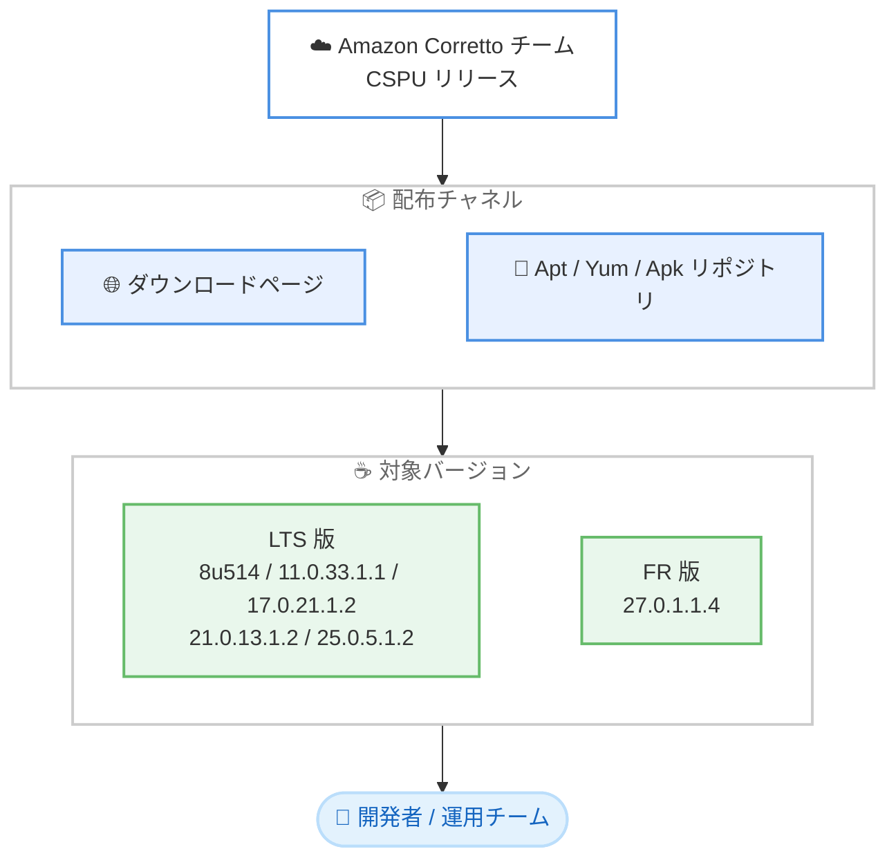

# Amazon Corretto - 2026 年 11 月の重要セキュリティパッチアップデート

**リリース日**: 2026 年 11 月 17 日
**サービス**: Amazon Corretto
**機能**: 重要セキュリティパッチアップデート CSPU

📊 [このアップデートのインフォグラフィックを見る](https://takech9203.github.io/aws-news-summary/20261117-amazon-corretto-nov-2026-updates.html)

## 概要

2026 年 11 月 17 日、Amazon は Amazon Corretto の長期サポート (LTS) バージョンおよび機能リリース (FR) バージョンに対する重要セキュリティパッチアップデート (CSPU) を発表しました。今回のアップデートにより、Corretto 27.0.1.1.4、25.0.5.1.2、21.0.13.1.2、17.0.21.1.2、11.0.33.1.1、8u514 がダウンロード可能になっています。

Amazon Corretto は、無償で利用できるマルチプラットフォーム対応の本番環境向け OpenJDK ディストリビューションです。OpenJDK の四半期ごとのセキュリティ更新サイクルに合わせてパッチが提供されており、今回の CSPU は Java アプリケーションを安全に運用するために適用が推奨される更新です。

Java で本番ワークロードを運用するすべてのユーザーが対象であり、Corretto のホームページからのダウンロードに加えて、Linux システムでは Apt、Yum、Apk リポジトリ経由での更新にも対応しています。

**アップデート前の課題**

CSPU 適用前の環境には以下のリスクが存在していました。

- 旧バージョンの JDK には、OpenJDK で報告されたセキュリティ脆弱性が未修正のまま残っている
- セキュリティ要件の厳しい本番環境では、脆弱性が修正されたランタイムへの速やかな入れ替えが求められる
- Java 8 から Java 27 まで複数バージョンを併用している環境では、各バージョンに対応した修正版の入手が必要だった

**アップデート後の改善**

今回のアップデートにより以下が可能になりました。

- LTS バージョン (Corretto 8、11、17、21、25) と FR バージョン (Corretto 27) の全系統で最新のセキュリティ修正を適用できる
- Corretto ホームページからのダウンロード、または Apt、Yum、Apk リポジトリ経由で速やかに更新できる
- 無償の OpenJDK ディストリビューションとして、追加費用なしで本番環境のセキュリティを維持できる

## アーキテクチャ図



今回の CSPU が対象とするバージョンと、更新版を入手するための配布チャネルの関係を示しています。

## サービスアップデートの詳細

### 主要機能

1. **全サポートバージョンへのセキュリティパッチ提供**
   - LTS バージョンの Corretto 8、11、17、21、25 と、FR バージョンの Corretto 27 のすべてに更新版が提供される
   - 各バージョンの最新版は 27.0.1.1.4、25.0.5.1.2、21.0.13.1.2、17.0.21.1.2、11.0.33.1.1、8u514
   - 複数の Java バージョンが混在する環境でも、系統ごとに修正版へ移行できる

2. **複数の配布チャネルによる入手**
   - [Corretto ホームページ](https://aws.amazon.com/corretto/) から各バージョンを直接ダウンロードできる
   - Linux システムでは Apt、Yum、Apk リポジトリを設定することで、パッケージマネージャー経由で更新できる
   - マルチプラットフォーム対応のため、Linux、Windows、macOS などの環境で利用できる

3. **無償での本番環境利用**
   - Amazon Corretto は無償 (no-cost) で提供される本番環境向け OpenJDK ディストリビューション
   - セキュリティパッチも追加費用なしで入手できる

## 技術仕様

### 更新対象バージョン

| 系統 | 更新後のバージョン | サポート区分 |
|------|------------------|--------------|
| Corretto 27 | 27.0.1.1.4 | 機能リリース FR |
| Corretto 25 | 25.0.5.1.2 | 長期サポート LTS |
| Corretto 21 | 21.0.13.1.2 | 長期サポート LTS |
| Corretto 17 | 17.0.21.1.2 | 長期サポート LTS |
| Corretto 11 | 11.0.33.1.1 | 長期サポート LTS |
| Corretto 8 | 8u514 | 長期サポート LTS |

## 設定方法

### 前提条件

1. 現在使用中の Corretto または他の JDK のバージョンを確認していること
2. 更新前にアプリケーションの動作確認環境を用意していること
3. Linux リポジトリ経由で更新する場合は、Corretto リポジトリが設定されていること

### 手順

#### ステップ 1: 現在のバージョンを確認する

```bash
java -version
```

現在インストールされている Java ランタイムのバージョンを表示し、更新が必要かどうかを確認します。

#### ステップ 2: パッケージマネージャーで更新する

```bash
# Amazon Linux / RHEL 系 Yum の例
sudo yum update java-21-amazon-corretto

# Debian / Ubuntu 系 Apt の例
sudo apt-get update
sudo apt-get upgrade java-21-amazon-corretto-jdk
```

設定済みの Corretto リポジトリから最新の CSPU 適用版パッケージを取得してインストールします。リポジトリの設定方法は [Corretto のドキュメント](https://docs.aws.amazon.com/corretto/latest/corretto-27-ug/generic-linux-install.html) を参照してください。

#### ステップ 3: 更新後のバージョンを確認する

```bash
java -version
```

更新後のバージョン番号が今回の CSPU 適用版 (例: 21.0.13.1.2) になっていることを確認します。確認後、アプリケーションの動作テストを実施してください。

## メリット

### ビジネス面

- **セキュリティリスクの低減**: 既知の脆弱性が修正されたランタイムへ更新することで、本番環境のセキュリティリスクを低減できる
- **コスト不要**: 無償の OpenJDK ディストリビューションであり、商用 JDK のようなライセンス費用なしでセキュリティ更新を継続できる
- **コンプライアンス対応**: 定期的なパッチ適用により、セキュリティポリシーや監査要件への対応が容易になる

### 技術面

- **幅広いバージョンカバレッジ**: Java 8 から Java 27 までの全サポート系統に修正版が提供され、レガシーアプリケーションも保護できる
- **簡単な更新手段**: Apt、Yum、Apk リポジトリ経由でパッケージマネージャーから更新でき、運用を自動化しやすい
- **マルチプラットフォーム対応**: Linux、Windows、macOS など複数のプラットフォームで同一系統の更新版を利用できる

## デメリット・制約事項

### 制限事項

- パッチ適用には JVM の再起動が必要であり、稼働中のアプリケーションへの適用にはメンテナンス計画が必要
- 修正される脆弱性の詳細は、各バージョンの変更履歴 (GitHub の corretto リポジトリ) で別途確認する必要がある

### 考慮すべき点

- 本番環境への適用前に、ステージング環境での動作確認を推奨
- コンテナイメージに JDK を同梱している場合は、ベースイメージの再ビルドと再デプロイが必要
- AMI やゴールデンイメージを使用している場合は、イメージの更新パイプラインへの反映が必要

## ユースケース

### ユースケース 1: EC2 上の Java アプリケーションの定期パッチ運用

**シナリオ**: Amazon EC2 上で Corretto 21 を使用した Java アプリケーションを運用しており、四半期ごとのセキュリティ更新を適用したい。

**実装例**:
```bash
# AWS Systems Manager Run Command で全インスタンスに一括適用
aws ssm send-command \
  --document-name "AWS-RunShellScript" \
  --targets "Key=tag:Role,Values=java-app" \
  --parameters 'commands=["sudo yum update -y java-21-amazon-corretto"]'
```

**効果**: 多数のインスタンスに対して CSPU を一括適用でき、パッチ運用の工数を削減できる。

### ユースケース 2: コンテナイメージのセキュリティ更新

**シナリオ**: Amazon ECS / EKS で稼働するコンテナ化された Java アプリケーションのベースイメージを最新の Corretto に更新したい。

**実装例**:
```dockerfile
# 最新の CSPU 適用版 Corretto をベースイメージとして使用
FROM amazoncorretto:21
COPY app.jar /app/app.jar
CMD ["java", "-jar", "/app/app.jar"]
```

**効果**: イメージの再ビルドと再デプロイにより、コンテナ環境全体へ速やかにセキュリティ修正を展開できる。

### ユースケース 3: レガシー Java 8 アプリケーションの保護

**シナリオ**: 移行が完了していない Java 8 ベースのレガシーアプリケーションを、セキュリティを維持しながら運用し続けたい。

**実装例**:
```bash
# Corretto 8 の最新版 8u514 へ更新
sudo yum update -y java-1.8.0-amazon-corretto
```

**効果**: 商用 JDK のサポート費用をかけずに、レガシーアプリケーションにもセキュリティ修正を適用し続けられる。

## 料金

Amazon Corretto は無償で提供されており、ダウンロード、利用、セキュリティパッチの適用に費用は発生しません。EC2 や ECS など、Corretto を実行する AWS リソースの料金は別途発生します。

## 利用可能リージョン

Amazon Corretto はリージョンに依存しないソフトウェアディストリビューションであり、グローバルにダウンロード可能です。AWS GovCloud (US) を含む各環境で利用できます。

## 関連サービス・機能

- **AWS Systems Manager**: Run Command や Patch Manager を使用して、EC2 フリート全体への Corretto 更新を自動化できる
- **Amazon ECS / Amazon EKS**: Corretto ベースイメージを利用したコンテナワークロードの実行基盤。イメージ更新により CSPU を展開できる
- **AWS Lambda**: Java ランタイムは Corretto をベースにしており、マネージドランタイムでは AWS がパッチ適用を管理する

## 参考リンク

- 📊 [インフォグラフィック](https://takech9203.github.io/aws-news-summary/20261117-amazon-corretto-nov-2026-updates.html)
- [公式発表 (What's New)](https://aws.amazon.com/about-aws/whats-new/2026/11/amazon-corretto-nov-2026-updates/)
- [Amazon Corretto ホームページ](https://aws.amazon.com/corretto/)
- [Corretto Linux リポジトリ設定ガイド](https://docs.aws.amazon.com/corretto/latest/corretto-27-ug/generic-linux-install.html)
- [Corretto GitHub リポジトリ](https://github.com/corretto)

## まとめ

今回の CSPU は、Corretto 8 から 27 までの全サポートバージョンに対する重要なセキュリティ更新です。Java アプリケーションを運用しているすべての環境で、ステージングでの動作確認を経て速やかにパッチを適用することを推奨します。コンテナやゴールデンイメージを使用している場合は、イメージ更新パイプラインへの反映も忘れずに実施してください。
