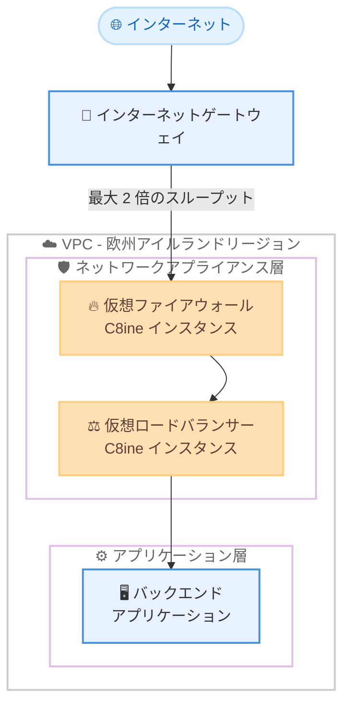

# Amazon EC2 - C8ine インスタンスが欧州 (アイルランド) リージョンで利用可能に

**リリース日**: 2026 年 11 月 17 日
**サービス**: Amazon Elastic Compute Cloud (Amazon EC2)
**機能**: C8ine インスタンスの欧州 (アイルランド) リージョン対応

📊 [このアップデートのインフォグラフィックを見る](https://takech9203.github.io/aws-news-summary/20261117-amazon-ec2-c8ine.html)

## 概要

Amazon EC2 の C8ine インスタンスが、新たに AWS 欧州 (アイルランド) リージョンで利用可能になりました。C8ine インスタンスは、AWS 専用にカスタマイズされた第 6 世代 Intel Xeon スケーラブルプロセッサを搭載したネットワーク最適化インスタンスで、最新の第 6 世代 AWS Nitro カードを備えています。前世代の C6in インスタンスと比較して最大 43% 高いパフォーマンスを実現します。

C8ine インスタンスは、vCPU あたりのパケット処理性能が前世代のネットワーク最適化インスタンスと比較して最大 2.5 倍に向上し、インターネットゲートウェイを経由するトラフィックのネットワークスループットは既存の C6in インスタンスと比較して最大 2 倍になります。仮想ファイアウォール、ロードバランサー、通信事業者向け 5G UPF ワークロードといった、セキュリティアプライアンスやネットワーク仮想アプライアンスの用途向けに設計されています。

今回のリージョン拡大により、欧州でネットワーク集約型ワークロードを運用するユーザーは、アイルランドリージョンで最新世代のネットワーク最適化インスタンスを選択できるようになりました。

**アップデート前の課題**

C8ine インスタンスの提供リージョンが限られていたため、欧州 (アイルランド) リージョンのユーザーには以下の制約がありました。

- アイルランドリージョンでは前世代の C6in などのネットワーク最適化インスタンスを使い続ける必要があった
- 最新世代のパケット処理性能やネットワークスループットの恩恵を受けるには、他リージョンへのワークロード配置を検討する必要があった
- 欧州内でデータレジデンシー要件を満たしつつ最新のネットワーク最適化インスタンスを利用できるリージョンがフランクフルトに限られていた

**アップデート後の改善**

- 欧州 (アイルランド) リージョンで C8ine インスタンスを起動できるようになった
- 既存の C6in ベースのネットワークアプライアンスを、同一リージョン内で最大 43% 高性能な C8ine へ移行できるようになった
- 欧州内でフランクフルトとアイルランドの 2 リージョン構成による冗長化設計が可能になった

## アーキテクチャ図



C8ine インスタンスをネットワークアプライアンス層に配置した構成例です。インターネットゲートウェイを経由するトラフィックに対して、前世代比で最大 2 倍のネットワークスループットを提供します。

## サービスアップデートの詳細

### 主要機能

1. **カスタム第 6 世代 Intel Xeon スケーラブルプロセッサ**
   - AWS 専用にカスタマイズされた Intel Xeon 6 プロセッサを搭載
   - 全コア持続ターボ周波数は 3.9 GHz
   - 常時有効なメモリ暗号化によりセキュリティを強化

2. **第 6 世代 AWS Nitro カードによる高いネットワーク性能**
   - 前世代の C6in インスタンスと比較して最大 43% 高いパフォーマンス
   - vCPU あたりのパケット処理性能が前世代のネットワーク最適化インスタンス比で最大 2.5 倍
   - インターネットゲートウェイ経由のトラフィックで C6in 比最大 2 倍のネットワークスループット

3. **固定ネットワーク帯域幅によるパフォーマンスの一貫性**
   - C8ine は全サイズで固定のネットワーク帯域幅を提供し、一貫した性能を実現
   - C8i や C8i-flex の小さいサイズで採用されているバースト型の帯域幅とは異なり、ネットワークアプライアンス用途に適した設計

## 技術仕様

### インスタンスサイズと仕様

| サイズ | vCPU | メモリ (GiB) | ネットワーク帯域幅 (Gbps) | EBS 帯域幅 (Gbps) |
|--------|------|--------------|---------------------------|--------------------|
| c8ine.large | 2 | 4 | 3.125 | 最大 10 |
| c8ine.xlarge | 4 | 8 | 6.25 | 最大 10 |
| c8ine.2xlarge | 8 | 16 | 12.5 | 最大 10 |
| c8ine.4xlarge | 16 | 32 | 25 | 最大 10 |
| c8ine.8xlarge | 32 | 64 | 50 | 10 |
| c8ine.12xlarge | 48 | 96 | 75 | 15 |

ストレージはすべて EBS のみの構成です。

### C8i ファミリー内での位置づけ

| 項目 | C8ine | C8i | C8i-flex |
|------|-------|-----|----------|
| 主な用途 | ネットワークアプライアンス最適化 | 汎用的なコンピューティング集約型ワークロード | コンピューティングリソースを使い切らないワークロードのコスト最適化 |
| ネットワーク帯域幅 | 全サイズで固定 | 小さいサイズはバースト型 | 小さいサイズはバースト型 |
| 最大サイズ | 12xlarge | 96xlarge およびメタル | 16xlarge |

## 設定方法

### 前提条件

1. AWS アカウントを保有していること
2. 欧州 (アイルランド) リージョン (eu-west-1) を利用できること
3. インスタンスを起動する VPC とサブネットが構成済みであること

### 手順

#### ステップ 1: アイルランドリージョンでの提供状況を確認

```bash
aws ec2 describe-instance-type-offerings \
  --region eu-west-1 \
  --filters "Name=instance-type,Values=c8ine.*" \
  --query "InstanceTypeOfferings[].InstanceType"
```

欧州 (アイルランド) リージョンで提供されている C8ine インスタンスのサイズ一覧を取得します。

#### ステップ 2: インスタンスタイプの詳細仕様を確認

```bash
aws ec2 describe-instance-types \
  --region eu-west-1 \
  --instance-types c8ine.4xlarge \
  --query "InstanceTypes[].{vCPU:VCpuInfo.DefaultVCpus,MemoryMiB:MemoryInfo.SizeInMiB,Network:NetworkInfo.NetworkPerformance}"
```

c8ine.4xlarge の vCPU 数、メモリサイズ、ネットワーク性能を確認します。

#### ステップ 3: C8ine インスタンスを起動

```bash
aws ec2 run-instances \
  --region eu-west-1 \
  --instance-type c8ine.4xlarge \
  --image-id ami-xxxxxxxxxxxxxxxxx \
  --subnet-id subnet-xxxxxxxxxxxxxxxxx \
  --security-group-ids sg-xxxxxxxxxxxxxxxxx \
  --count 1
```

アイルランドリージョンの指定したサブネットに C8ine インスタンスを 1 台起動します。AMI ID、サブネット ID、セキュリティグループ ID は環境に合わせて置き換えてください。

## メリット

### ビジネス面

- **欧州でのサービス品質向上**: アイルランドリージョンで最新世代のネットワーク性能を利用でき、欧州ユーザー向けサービスの応答性能を改善できる
- **コスト効率の改善**: vCPU あたりのパケット処理性能が最大 2.5 倍に向上するため、同等のワークロードをより少ないインスタンス数で処理できる可能性がある
- **柔軟な購入オプション**: Savings Plans、オンデマンド、スポットインスタンスから購入形態を選択できる

### 技術面

- **高いパケット処理性能**: 仮想ファイアウォールやロードバランサーなど、パケット処理が性能のボトルネックになりやすいワークロードに適している
- **固定ネットワーク帯域幅**: 全サイズで固定帯域幅を提供するため、ネットワークアプライアンスに求められる一貫した性能を確保できる
- **セキュリティ強化**: 常時有効なメモリ暗号化により、追加の設定なしでメモリ上のデータを保護できる

## デメリット・制約事項

### 制限事項

- 利用可能リージョンは米国東部 (バージニア北部)、米国西部 (オレゴン)、アジアパシフィック (東京)、欧州 (アイルランド、フランクフルト) に限られる
- インスタンスサイズは large から 12xlarge までで、C8i のような 96xlarge やメタルサイズは提供されない
- ストレージは EBS のみで、インスタンスストアは提供されない

### 考慮すべき点

- C6in からの移行時は、第 6 世代 Intel Xeon プロセッサ上でのアプライアンスソフトウェアの動作検証を実施することを推奨
- 大容量の L3 キャッシュが重要なワークロードの場合、C8in、C8ib、C8id など他の C8i ファミリーとの比較検討が必要
- 汎用的なコンピューティング用途であれば、より多くのサイズを選択できる C8i や C8i-flex が適している場合がある

## ユースケース

### ユースケース 1: 仮想ファイアウォールの性能強化

**シナリオ**: 欧州 (アイルランド) リージョンで C6in ベースの仮想ファイアウォールを運用しており、トラフィック増加に伴いパケット処理性能が逼迫している。

**実装例**:
```bash
# 既存の C6in ベースのファイアウォールを C8ine に置き換え
aws ec2 run-instances \
  --region eu-west-1 \
  --instance-type c8ine.8xlarge \
  --image-id ami-firewall-appliance \
  --subnet-id subnet-dmz
```

**効果**: vCPU あたり最大 2.5 倍のパケット処理性能により、インスタンスサイズを増やさずにスループットを向上できる。

### ユースケース 2: 通信事業者の 5G UPF ワークロード

**シナリオ**: 通信事業者が欧州で 5G コアネットワークの UPF (User Plane Function) を AWS 上に展開し、低遅延かつ高スループットなユーザープレーン処理を実現したい。

**実装例**:
```bash
# 固定帯域幅 75 Gbps の最大サイズで UPF を展開
aws ec2 run-instances \
  --region eu-west-1 \
  --instance-type c8ine.12xlarge \
  --image-id ami-5g-upf \
  --count 2
```

**効果**: 固定ネットワーク帯域幅と高いパケット処理性能により、5G ユーザープレーンに求められる一貫した性能を確保できる。

### ユースケース 3: 欧州 2 リージョンでのネットワークアプライアンス冗長化

**シナリオ**: 欧州内でフランクフルトとアイルランドの 2 リージョンにネットワーク仮想アプライアンスを配置し、リージョン障害に備えた冗長構成を実現したい。

**実装例**:
```bash
# フランクフルトとアイルランドの両リージョンに同一構成で展開
for region in eu-central-1 eu-west-1; do
  aws ec2 run-instances \
    --region $region \
    --instance-type c8ine.4xlarge \
    --image-id ami-lb-appliance \
    --count 1
done
```

**効果**: 欧州 2 リージョンで同世代のネットワーク最適化インスタンスを使用でき、性能特性を揃えた冗長構成を実現できる。

## 料金

C8ine インスタンスは、オンデマンド、スポットインスタンス、Savings Plans で利用できます。料金はインスタンスサイズとリージョンによって異なるため、最新の料金は [Amazon EC2 料金ページ](https://aws.amazon.com/ec2/pricing/) を参照してください。

## 利用可能リージョン

C8ine インスタンスは以下のリージョンで利用可能です。

- 米国東部 (バージニア北部)
- 米国西部 (オレゴン)
- アジアパシフィック (東京)
- 欧州 (アイルランド) - **今回追加**
- 欧州 (フランクフルト)

## 関連サービス・機能

- **Amazon EC2 C8i / C8i-flex インスタンス**: 同じカスタム第 6 世代 Intel Xeon プロセッサを搭載した汎用コンピューティング向けのバリアント。ネットワークアプライアンス以外の用途にはこちらが適する場合がある
- **AWS Nitro System**: C8ine の高いネットワーク性能を支える基盤。第 6 世代 Nitro カードがパケット処理をオフロードする
- **Amazon EBS**: C8ine は EBS のみのストレージ構成であり、サイズに応じて最大 15 Gbps の EBS 帯域幅を提供する

## 参考リンク

- 📊 [インフォグラフィック](https://takech9203.github.io/aws-news-summary/20261117-amazon-ec2-c8ine.html)
- [公式発表 (What's New)](https://aws.amazon.com/about-aws/whats-new/2026/11/amazon-ec2-c8ine)
- [Amazon EC2 C8i インスタンス](https://aws.amazon.com/ec2/instance-types/c8i/)
- [Amazon EC2 料金ページ](https://aws.amazon.com/ec2/pricing/)

## まとめ

ネットワーク最適化インスタンス C8ine が欧州 (アイルランド) リージョンに拡大し、欧州で仮想ファイアウォール、ロードバランサー、5G UPF などのネットワーク集約型ワークロードを運用するユーザーの選択肢が広がりました。C6in を利用中の場合は、最大 43% の性能向上と最大 2.5 倍のパケット処理性能を得られる C8ine への移行検証を推奨します。
