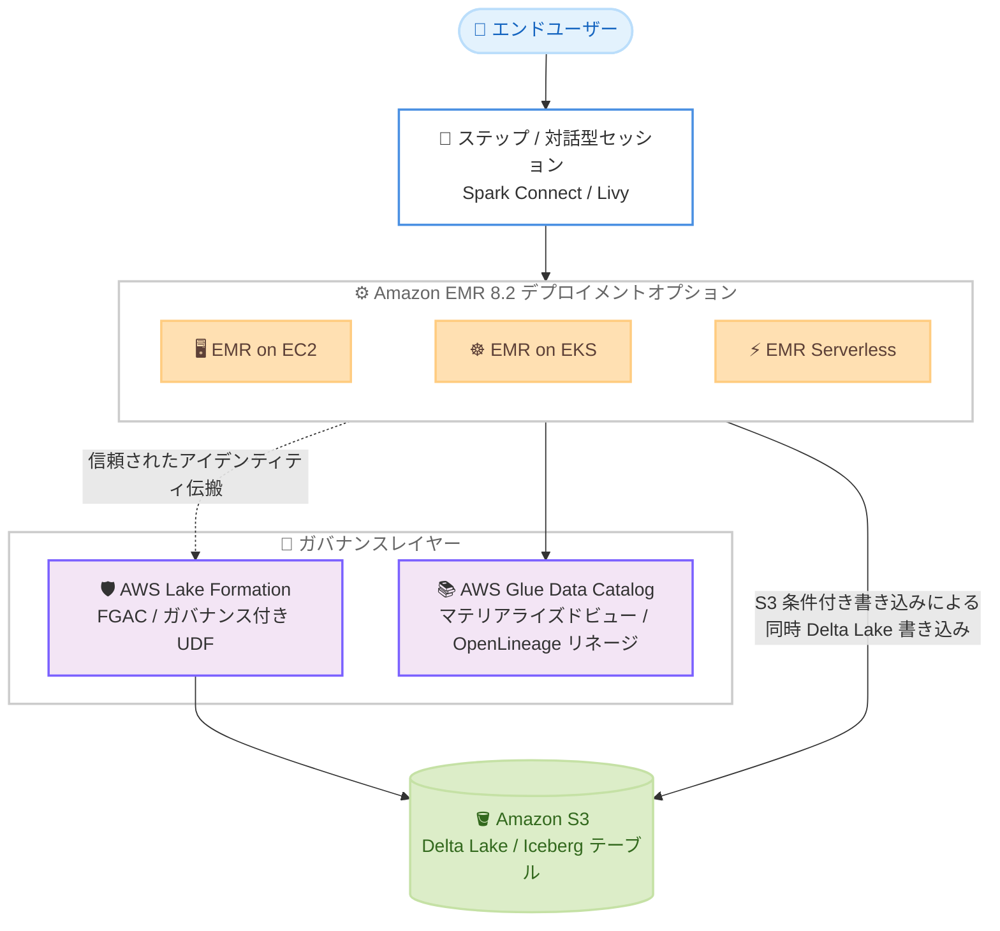

# Amazon EMR - Amazon EMR 8.2 リリース

**リリース日**: 2026 年 11 月 17 日
**サービス**: Amazon EMR (EMR on EC2 / EMR on EKS / EMR Serverless)
**機能**: Amazon EMR 8.2 (長期サポート LTS リリース)

📊 [このアップデートのインフォグラフィックを見る](https://takech9203.github.io/aws-news-summary/20261117-amazon-emr-8.2.html)

## 概要

Amazon EMR 8.2 が一般提供開始されました。本リリースは EMR on EC2、EMR on EKS、EMR Serverless の 3 つのデプロイメントオプションすべてに新機能をもたらし、Apache Spark 4.1.3、Apache Iceberg 1.11.0、Delta Lake 4.2.0 へのアップグレードを含みます。また、本リリースは長期サポート (LTS) リリースに指定されており、2029 年 11 月 17 日まで標準サポートが提供されます。

本リリースの中心テーマは「セキュアでガバナンスの効いた大規模分析の容易化」です。Amazon S3 条件付き書き込みを利用した複数クラスターからの同一 Delta Lake テーブルへの同時書き込み (DynamoDB ログストア不要)、Iceberg マテリアライズドビューの増分リフレッシュ、Spark ジョブや対話型セッションから AWS Lake Formation および Amazon S3 までエンドユーザーのアイデンティティを伝搬する信頼されたアイデンティティ伝搬 (Trusted Identity Propagation) など、データ基盤のガバナンスと運用効率を大きく向上させる機能が含まれています。

さらに、Lake Formation きめ細かなアクセス制御 (FGAC) の対象範囲がマテリアライズドビュー、ガバナンス付きユーザー定義関数 (UDF)、追加の Iceberg 操作、より広範な Spark SQL 機能へと拡大されたほか、OpenLineage ベースのリネージ取得の AWS Glue Data Catalog への発行にも対応しました。データエンジニア、データプラットフォーム管理者、セキュリティ管理者にとって重要なアップデートです。

**アップデート前の課題**

このアップデート以前には、以下の課題や制限が存在していました。

- 複数のクラスターから同一の Delta Lake テーブルに安全に同時書き込みするには、Amazon DynamoDB ベースのログストアを別途構成・運用する必要があった
- Glue Data Catalog のマテリアライズドビューはリフレッシュのたびにソーステーブル全体を再計算する必要があり、パイプラインの各ステージを事前計算するコストが高かった
- ステップや対話型セッションから実行されるジョブは実行ロールの権限で動作するため、Lake Formation や S3 へのアクセスを「元のユーザー」として認可・監査することが難しかった
- Lake Formation FGAC 環境ではカスタム UDF や一部の Iceberg 操作、Spark SQL 機能に制限があった
- 高い同時実行数のもとでは、ランタイムロールを使用するクラスターのユーザープロビジョニングに大きなレイテンシーが発生することがあった

**アップデート後の改善**

今回のアップデートにより、以下が可能になりました。

- Amazon S3 条件付き書き込みを利用して、DynamoDB ログストアなしで複数クラスターから同一 Delta Lake テーブルへ同時書き込みできるようになった
- Iceberg v3 テーブル上のマテリアライズドビュー (射影、フィルター、内部結合、SUM / COUNT 集計など) が変更分のみを増分リフレッシュできるようになった
- 信頼されたアイデンティティ伝搬により、ステップおよび Spark Connect / Livy セッションから Lake Formation や S3 Access Grants まで元のユーザーとして認可・監査できるようになった
- Lake Formation FGAC がマテリアライズドビュー、ガバナンス付き Glue UDF、`ALTER TABLE ... SET LOCATION` などの追加 Iceberg 操作、HyperLogLog 関数などの Spark SQL 機能をカバーするようになった
- Secret Agent の改善により、高同時実行時のユーザープロビジョニングレイテンシーが最大 97% 削減された
- EMR Serverless のスケーリングプロファイル (performance-optimized / balanced / cost-optimized) でエグゼキューターのスケール速度を選択できるようになった
- EMR on EKS の Spark Operator がバージョン 2 (オープンソース Spark Operator 2.5.0 ベース) にアップグレードされた

## アーキテクチャ図



EMR 8.2 では、3 つのデプロイメントオプションすべてから、エンドユーザーのアイデンティティを Lake Formation や Amazon S3 まで伝搬し、元のユーザーとして認可・監査できます。また、S3 条件付き書き込みにより複数クラスターからの同時 Delta Lake 書き込みが可能になります。

## サービスアップデートの詳細

### 主要機能

1. **Apache Spark 4.1.3 へのアップグレードと LTS 指定**
   - Apache Spark 4.1.3、Apache Iceberg 1.11.0、Delta Lake 4.2.0、Apache Hudi 1.1.1 を同梱
   - Apache ORC 2.2.2、AWS SDK for Java v2 2.55.8 などの依存関係も更新
   - GPU ワークロード向けに NVIDIA cuDF plugin for Apache Spark (旧 RAPIDS Accelerator) 26.08.1 をサポート
   - 長期サポート (LTS) リリースに指定され、2029 年 11 月 17 日まで標準サポート

2. **複数クラスターからの同時 Delta Lake 書き込み (全デプロイメントオプション)**
   - Amazon S3 条件付き書き込みを利用し、DynamoDB ベースのログストアなしで同一 Delta Lake テーブルへ複数の Spark ジョブ / クラスターから同時書き込みが可能
   - 2 つのライターが同時にコミットした場合、一方のみが成功し、他方は標準的な Delta コミット競合を受け取ってリトライ可能

3. **Iceberg マテリアライズドビューの強化 (Glue Data Catalog)**
   - **増分リフレッシュ**: Iceberg v3 テーブル上の集計なしマテリアライズドビュー (射影、フィルター、内部結合) はデフォルトで増分リフレッシュされ、必要時にはフルリフレッシュへフォールバック。Hive Parquet ベーステーブル上のビューも追記のみの変更で増分リフレッシュに対応
   - **FGAC 対応**: Lake Formation FGAC 有効クラスターで Iceberg マテリアライズドビューの作成・リフレッシュが可能。ベーステーブルの行フィルターと列マスクはビュー定義者の FGAC ポリシーに基づいて適用され、マテリアライズドビュー自体にも FGAC ポリシーを定義可能
   - **Spark Declarative Pipelines 対応**: パイプラインで定義したマテリアライズドビューを Glue Data Catalog の Iceberg マテリアライズドビューとして保存可能。定義とソースに変更がなければリフレッシュをスキップ
   - **スキーマ進化**: `CREATE OR REPLACE` によるスキーマ進化をサポート

4. **信頼されたアイデンティティ伝搬 (Trusted Identity Propagation)**
   - ステップおよび対話型セッション (Spark Connect / Livy) が IAM Identity Center の信頼されたアイデンティティコンテキストをランタイムロールセッションに伝搬
   - Lake Formation や Amazon S3 Access Grants などのダウンストリームサービスが「元のユーザー」としてアクセスを認可・監査可能
   - 永続的な Spark History Server では、完了したアプリケーションの所有者として各ユーザーが表示される
   - EMR on EKS でも IAM フェデレーションユーザー向けにバッチジョブ・対話型セッションの両方でサポート
   - ワークロード完了後、一時的な OS ユーザーと HDFS ホームディレクトリ、認証情報を自動クリーンアップ (デフォルト有効)

5. **Lake Formation FGAC の対象範囲拡大**
   - **ガバナンス付きカスタム UDF**: 管理者が承認した Lake Formation カスタムコードアーティファクトとしてパッケージ化された UDF を FGAC クラスターの Spark ジョブから呼び出し可能。承認済み JAR は自動ロードされ、未承認関数を呼び出すクエリは拒否される
   - **追加の Iceberg 操作**: `ALTER TABLE ... SET LOCATION`、`WRITE ORDERED BY`、`WRITE DISTRIBUTED BY`、`add_files` / `register_table` プロシージャに対応
   - **Spark SQL 機能の拡大**: `uuid()`、variant 式、列デフォルト値、HyperLogLog スケッチ関数、型付き Dataset、Hudi 増分 / 変更データクエリなどが FGAC 環境で利用可能に

6. **OpenLineage ベースのリネージ取得**
   - `glue-openlineage-spark` ライブラリを追加し、Spark ジョブから OpenLineage 互換のリネージを自動取得して Glue Data Catalog またはカスタムトランスポートへ発行
   - 取得されるリネージには入出力データセット・カラム、スキーマ、ユーザーアイデンティティなどが含まれる
   - 従来の `datazone-openlineage-spark` ライブラリを置き換え

7. **EMR on EC2 固有の機能強化**
   - **マルチプライマリクラスターでの Spark Connect**: emr-spark-8.2.0 以降のマルチプライマリクラスターで Spark Connect セッションをサポート
   - **Secret Agent の改善**: ノード間接続の再利用、CPU キャップのデフォルト撤廃、認証情報キャッシュのデッドロック修正などにより、高同時実行時のユーザープロビジョニングレイテンシーを最大 97% 削減
   - **EMRFS から S3A への移行支援**: 新しいオプトインパラメータ `fs.s3a.emrfs.compatibility.folder.marker.as.dir` と `fs.s3a.emrfs.compatibility.marker.empty` を追加

8. **EMR Serverless 固有の機能強化**
   - **スケーリングプロファイル**: `spark.emr-serverless.scalingProfile` に `performance-optimized`、`balanced`、`cost-optimized` を指定してエグゼキューターのスケール速度を選択可能 (本リリースのデフォルトは `balanced`)
   - **Lake Formation ガバナンス付き Glue UDF**: Lake Formation の行フィルター式を含め、Lake Formation がガバナンスする Glue UDF を実行可能

9. **EMR on EKS 固有の機能強化**
   - **Spark Operator バージョン 2**: オープンソース Spark Operator 2.5.0 ベースにアップグレード。イメージタグ未指定の場合は Helm チャートが最新のオペレーターイメージを使用し、常に最新パッチ適用済みイメージで実行
   - **FGAC ユーザーエグゼキューターへのノードセレクター適用**: 従来適用されなかったノードセレクターがユーザーエグゼキューターにも適用されるよう修正

## 技術仕様

### アプリケーションバージョン (emr-spark-8.2.0)

| アプリケーション | EMR 8.2 | EMR 8.1 |
|------|------|------|
| Apache Spark | 4.1.3-amzn-0 | 4.1.1-amzn-0 |
| Apache Iceberg | 1.11.0-amzn-0 | 1.11.0-amzn-0 |
| Delta Lake | 4.2.0-amzn-0 | 4.2.0-amzn-0 |
| Apache Hudi | 1.1.1-amzn-0 | 1.1.1-amzn-0 |
| AWS SDK for Java | 2.55.8 | 2.44.5 |
| Python | 3.11, 3.13 | 3.11, 3.13 |
| Scala | 2.13.17 | 2.13.17 |
| Livy | 0.9.0-incubating | 0.9.0-incubating |
| NVIDIA cuDF plugin (GPU) | 26.08.1-amzn-0 | 26.04.2-amzn-0 |

### LTS サポートライフサイクル

| サポートフェーズ | 日付 |
|------|------|
| 初回リリース日 | 2026 年 11 月 18 日 |
| 標準サポート期限 | 2029 年 11 月 17 日 |
| サポート終了 (End of Life) | 2029 年 11 月 18 日 |

### 主要な設定パラメータ

| パラメータ | 説明 |
|------|------|
| `spark.emr-serverless.scalingProfile` | EMR Serverless のスケーリングプロファイル。`performance-optimized` / `balanced` / `cost-optimized` を指定 |
| `spark.sql.pipelines.materializedView.implWithGlueIcebergMVMode` | Spark Declarative Pipelines のマテリアライズドビューを Glue Iceberg マテリアライズドビューとして保存。`GLUE_ICEBERG_MV_PREFERRED` でオプトイン |
| `spark.sql.optimizer.incrementalMVRefresh.enabled` | マテリアライズドビューの増分リフレッシュとリフレッシュスキップの有効化 |
| `emr.secretagent.users.teardown.enabled` | ワークロード完了後の一時 OS ユーザークリーンアップ。デフォルト `true` |
| `fs.s3a.emrfs.compatibility.folder.marker.as.dir` | EMRFS から S3A への移行支援パラメータ。デフォルト `false` |
| `yarn.emr.logpush.notify.enabled` | YARN コンテナログの即時 S3 発行。デフォルト `false` |

### 必要な IAM 権限 (ガバナンス付き UDF 使用時)

```json
{
  "Version": "2012-10-17",
  "Statement": [
    {
      "Effect": "Allow",
      "Action": "lakeformation:GetTemporaryGlueFunctionCredentials",
      "Resource": "*"
    }
  ]
}
```

ガバナンス付き UDF を使用するジョブの実行ロールには、`lakeformation:GetTemporaryGlueFunctionCredentials` 権限が必要です。

## 設定方法

### 前提条件

1. Amazon EMR を利用できる AWS アカウントと適切な IAM 権限
2. Lake Formation FGAC や信頼されたアイデンティティ伝搬を使用する場合は、AWS Lake Formation および IAM Identity Center の設定
3. マテリアライズドビューの増分リフレッシュを最大限活用する場合は、Iceberg v3 テーブルの利用

### 手順

#### ステップ 1: EMR 8.2 クラスターの作成 (EMR on EC2)

```bash
aws emr create-cluster \
  --name "emr-spark-8.2-cluster" \
  --release-label emr-spark-8.2.0 \
  --applications Name=Spark Name=Livy \
  --instance-type m7g.xlarge \
  --instance-count 3 \
  --use-default-roles
```

リリースラベル `emr-spark-8.2.0` を指定して EMR on EC2 クラスターを作成します。Spark と Livy をインストールし、デフォルトの IAM ロールを使用します。

#### ステップ 2: EMR Serverless アプリケーションでスケーリングプロファイルを設定

```bash
aws emr-serverless create-application \
  --name "spark-8.2-app" \
  --release-label emr-spark-8.2.0 \
  --type SPARK \
  --runtime-configuration '[
    {
      "classification": "spark-defaults",
      "properties": {
        "spark.emr-serverless.scalingProfile": "cost-optimized"
      }
    }
  ]'
```

EMR Serverless アプリケーションを作成し、アプリケーションデフォルトとしてコスト最適化のスケーリングプロファイルを設定します。ジョブ単位で Spark プロパティを上書きすることも可能です。

#### ステップ 3: Iceberg マテリアライズドビューの作成と増分リフレッシュ

```sql
-- マテリアライズドビューの作成 (集計を含む例)
CREATE MATERIALIZED VIEW glue_catalog.analytics.daily_sales_mv AS
SELECT order_date, region, SUM(amount) AS total_amount, COUNT(*) AS order_count
FROM glue_catalog.sales.orders
WHERE status = 'COMPLETED'
GROUP BY order_date, region;

-- 増分リフレッシュの実行 (変更分のみを反映)
REFRESH MATERIALIZED VIEW glue_catalog.analytics.daily_sales_mv;
```

Glue Data Catalog 上に Iceberg マテリアライズドビューを作成します。Iceberg v3 ベーステーブルでは、射影・フィルター・内部結合・SUM / COUNT 集計を含むビューが変更分のみを増分リフレッシュします。

## メリット

### ビジネス面

- **ガバナンスとコンプライアンスの強化**: 信頼されたアイデンティティ伝搬により、データアクセスを実行ロールではなく元のユーザー単位で認可・監査でき、監査要件への対応が容易になる
- **運用コストの削減**: Delta Lake の同時書き込みに DynamoDB ログストアが不要になり、追加コンポーネントの構築・運用・コストが削減される
- **計算コストの最適化**: マテリアライズドビューの増分リフレッシュによりソーステーブル全体の再計算が不要になり、パイプラインの計算コストと処理時間を削減できる
- **長期的な安定運用**: LTS リリースとして 2029 年 11 月まで標準サポートが提供され、計画的なバージョン管理が可能

### 技術面

- **アーキテクチャの簡素化**: S3 条件付き書き込みベースの Delta Lake コミットにより、マルチクラスター書き込み構成がシンプルになる
- **FGAC 環境での表現力向上**: ガバナンス付き UDF、追加の Iceberg 操作、拡大された Spark SQL 機能により、セキュリティを維持したまま高度な処理を実装できる
- **スケーラビリティの向上**: Secret Agent の改善により高同時実行環境でのユーザープロビジョニングレイテンシーが最大 97% 削減される
- **データリネージの自動化**: OpenLineage 互換のリネージが自動取得され、Glue Data Catalog でデータの流れを追跡できる

## デメリット・制約事項

### 制限事項

- 集計なしマテリアライズドビューのデフォルト増分リフレッシュは Iceberg v3 テーブルが対象 (Hive Parquet ベーステーブルは追記のみの変更に限定)
- Spark Declarative Pipelines のマテリアライズドビューを Glue Iceberg マテリアライズドビューとして保存するにはオプトイン設定が必要で、オプトイン後に作成されたビューにのみ適用される
- ガバナンス付き UDF の利用には実行ロールへの `lakeformation:GetTemporaryGlueFunctionCredentials` 権限付与が必要
- Delta Lake の同時書き込みでは、コミット競合時に一方のライターがリトライ処理を実装する必要がある

### 考慮すべき点

- Spark 4.1.3 へのメジャーバージョンアップを伴うため、既存ジョブの互換性検証を推奨 (特に EMR 7.x 以前からの移行時)
- `glue-openlineage-spark` ライブラリは従来の `datazone-openlineage-spark` を置き換えるため、既存のリネージ設定を確認する必要がある
- ワークロード完了後の一時 OS ユーザークリーンアップはデフォルトで有効のため、完了後のユーザー環境に依存する運用がある場合は `emr.secretagent.users.teardown.enabled` の設定を確認する
- EMR Serverless のスケーリングプロファイルは、独自に設定した Spark 動的割り当て設定が優先される

## ユースケース

### ユースケース 1: マルチクラスターからの Delta Lake テーブル同時更新

**シナリオ**: 複数の部門がそれぞれの EMR クラスターから共通の Delta Lake テーブルにデータを書き込むデータ基盤。従来は DynamoDB ログストアの構築と運用が必要だった。

**実装例**:
```python
# 各クラスターから同一テーブルへ同時書き込み (特別なログストア設定は不要)
df.write.format("delta") \
    .mode("append") \
    .save("s3://my-datalake/tables/shared_events/")
# コミット競合が発生した場合は Delta の標準的な競合例外を受け取りリトライ
```

**効果**: DynamoDB ログストアの構築・運用が不要になり、アーキテクチャが簡素化されるとともに運用コストが削減される。

### ユースケース 2: SQL によるパイプラインステージの事前計算と増分リフレッシュ

**シナリオ**: 日次で大量データを集計する ETL パイプラインで、毎回ソーステーブル全体を再計算しており、処理時間とコストが課題になっている。

**実装例**:
```sql
CREATE MATERIALIZED VIEW glue_catalog.mart.region_revenue_mv AS
SELECT region, product_category, SUM(revenue) AS total_revenue
FROM glue_catalog.raw.transactions t
JOIN glue_catalog.raw.products p ON t.product_id = p.product_id
GROUP BY region, product_category;

REFRESH MATERIALIZED VIEW glue_catalog.mart.region_revenue_mv;
```

**効果**: 各ステージが変更分のみを増分リフレッシュするため、再計算コストと処理時間が大幅に削減される。

### ユースケース 3: エンドユーザー単位のアクセス制御と監査

**シナリオ**: 複数のデータアナリストが対話型セッション (Spark Connect / Livy) から機密データを分析する環境で、ロール単位ではなくユーザー単位でのアクセス制御と監査証跡が求められている。

**実装例**:
```
1. IAM Identity Center と Lake Formation FGAC を構成したクラスターを作成
2. アナリストが Spark Connect セッションでクエリを実行
3. セッションに信頼されたアイデンティティコンテキストが伝搬され、
   Lake Formation と S3 Access Grants が元のユーザーとして認可
4. CloudTrail と Spark History Server にユーザー単位の記録が残る
```

**効果**: 実行ロールではなく元のユーザー単位でアクセスが認可・監査され、きめ細かなガバナンスとコンプライアンス対応が実現する。

## 料金

Amazon EMR 8.2 の利用自体に追加料金はありません。通常の Amazon EMR 料金体系が適用されます。

- **EMR on EC2**: EC2 インスタンス料金 + EMR 料金 (インスタンスタイプごとの秒単位課金)
- **EMR on EKS**: vCPU およびメモリリソースに基づく秒単位課金 + EKS クラスター料金
- **EMR Serverless**: ワーカーが使用した vCPU、メモリ、ストレージに基づく秒単位課金 (cost-optimized スケーリングプロファイルの活用でコスト最適化が可能)

詳細は [Amazon EMR 料金ページ](https://aws.amazon.com/emr/pricing/) を参照してください。

## 利用可能リージョン

Amazon EMR 8.2 は、Amazon EMR が利用可能なすべての AWS リージョンで利用できます (東京・大阪リージョンを含む)。

## 関連サービス・機能

- **AWS Lake Formation**: FGAC によるきめ細かなアクセス制御の対象が、マテリアライズドビュー、ガバナンス付き UDF、追加の Iceberg 操作へ拡大
- **AWS Glue Data Catalog**: Iceberg マテリアライズドビューの管理と OpenLineage ベースのリネージ情報の保存先
- **AWS IAM Identity Center**: 信頼されたアイデンティティ伝搬の基盤として、エンドユーザーのアイデンティティコンテキストを提供
- **Amazon S3**: 条件付き書き込みが Delta Lake 同時コミットの整合性を保証。S3 Access Grants はユーザー単位の認可に対応
- **Amazon EKS**: EMR on EKS の実行基盤。Spark Operator バージョン 2 により運用性が向上

## 参考リンク

- 📊 [インフォグラフィック](https://takech9203.github.io/aws-news-summary/20261117-amazon-emr-8.2.html)
- [公式発表 (What's New)](https://aws.amazon.com/about-aws/whats-new/2026/11/amazon-emr-8.2/)
- [Amazon EMR 8.2 リリースノート (EMR on EC2)](https://docs.aws.amazon.com/emr/latest/ReleaseGuide/emr-spark820-release.html)
- [EMR Serverless リリースノート (emr-spark-8.2.0)](https://docs.aws.amazon.com/emr/latest/EMR-Serverless-UserGuide/release-version-emr-spark-8.2.0.html)
- [EMR on EKS リリースノート (emr-spark-8.2.0)](https://docs.aws.amazon.com/emr/latest/EMR-on-EKS-DevelopmentGuide/emr-eks-spark-8.2.0.html)
- [料金ページ](https://aws.amazon.com/emr/pricing/)

## まとめ

Amazon EMR 8.2 は、Spark 4.1.3 / Iceberg 1.11.0 / Delta Lake 4.2.0 を同梱する LTS リリースであり、S3 条件付き書き込みによる Delta Lake 同時書き込み、Iceberg マテリアライズドビューの増分リフレッシュ、信頼されたアイデンティティ伝搬など、ガバナンスと効率性を両立する機能が多数追加されました。データレイクのガバナンス強化や ETL パイプラインのコスト最適化を検討している場合は、EMR 8.2 への移行検証を推奨します。LTS リリースのため、2029 年 11 月までの長期的な運用計画にも適しています。
