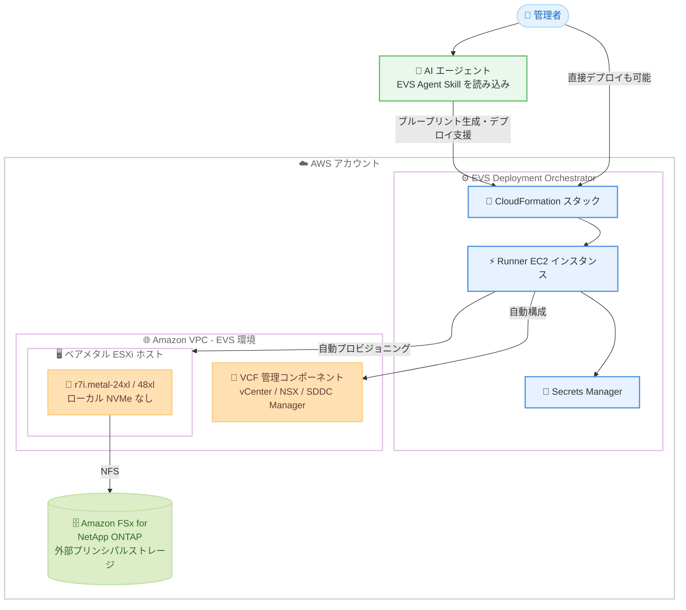

# Amazon Elastic VMware Service - r7i.metal インスタンス・外部プリンシパルストレージ・Agent Skill のサポート

**リリース日**: 2026 年 11 月 17 日
**サービス**: Amazon Elastic VMware Service (Amazon EVS)
**機能**: r7i.metal ベアメタルインスタンスサポート、VCF 外部プリンシパルストレージ、EVS Agent Skill

📊 [このアップデートのインフォグラフィックを見る](https://takech9203.github.io/aws-news-summary/20261117-amazon-evs-r7i-agent-skill-support.html)

## 概要

Amazon Elastic VMware Service (Amazon EVS) が、VMware Cloud Foundation (VCF) 9.x デプロイメント向けに Amazon EC2 ベアメタルインスタンスタイプ r7i.metal-24xl と r7i.metal-48xl のサポートを開始しました。r7i インスタンスはカスタム第 4 世代 Intel Xeon スケーラブルプロセッサ (Sapphire Rapids) を搭載したメモリ最適化インスタンスで、ローカル NVMe ディスクを持たず、外部ストレージと組み合わせて使用するよう設計されています。これに伴い、Amazon EVS は Amazon FSx for NetApp ONTAP などのソリューションを使用した VCF 外部プリンシパルストレージをサポートするようになりました。

また、Solutions for EVS GitHub リポジトリ内の Amazon EVS Deployment Orchestrator (EDO) を使用して、EVS 上の VCF 9.x 環境のエンドツーエンドのデプロイと設定を完全に自動化できるようになりました。EDO は単一の CloudFormation スタックと YAML ブループリントにより、ネットワーク構築からベアメタル ESXi ホストのプロビジョニング、vCenter Server / NSX Manager / SDDC Manager / VCF Operations の構成までを無人で実行します。

さらに、新しい Amazon EVS Agent Skill も同時にリリースされました。AI エージェントに EVS のコンテキストを与えることで、質問への回答や設計の推奨から、ブループリントの生成、EDO によるデプロイの実行まで、EVS 環境の計画・デプロイ・運用を支援します。VMware ベースの仮想マシンを Amazon VPC 内で実行する際の選択肢が広がり、既存のツール・スキル・運用プロセスを維持しながら、アーキテクチャ・設定・ライフサイクルを完全に制御できます。

**アップデート前の課題**

このアップデート以前には、以下のような課題や制限がありました。

- EVS で利用できるベアメタルインスタンスはローカル NVMe ディスクを持つ vSAN 向けタイプ (i4i.metal、i7i.metal-24xl/48xl) に限られ、ストレージとコンピュートを独立してスケールできなかった
- プリンシパルストレージとして vSAN が前提となり、Amazon FSx for NetApp ONTAP などの外部ストレージをプリンシパルストレージとして使用できなかった
- メモリ集約型の VMware ワークロードに対して、メモリ最適化インスタンスの選択肢がなかった
- EVS 環境の設計・デプロイ・運用に関するナレッジを AI エージェントに与える公式の仕組みがなかった

**アップデート後の改善**

今回のアップデートにより、以下が可能になりました。

- メモリ最適化型の r7i.metal-24xl / r7i.metal-48xl を VCF 9.x デプロイメントのホストとして選択可能になった
- Amazon FSx for NetApp ONTAP などの外部 NFS ストレージを VCF のプリンシパルストレージとして使用でき、ストレージとコンピュートを独立してスケールできるようになった
- EDO により、VCF 9.x 環境のエンドツーエンドのデプロイと設定を完全に自動化できるようになった
- EVS Agent Skill により、任意の AI エージェントが EVS の計画・デプロイ・運用を支援できるようになった

## アーキテクチャ図



EVS Agent Skill を読み込んだ AI エージェントまたは管理者が EDO の CloudFormation スタックを起動すると、Runner インスタンスが r7i.metal ベースの ESXi ホストと VCF 管理コンポーネントを自動構築し、プリンシパルストレージとして Amazon FSx for NetApp ONTAP を NFS 経由で利用する構成です。

## サービスアップデートの詳細

### 主要機能

1. **r7i.metal ベアメタルインスタンスのサポート**
   - VCF 9.x デプロイメント向けに r7i.metal-24xl と r7i.metal-48xl の 2 サイズをサポート
   - カスタム第 4 世代 Intel Xeon スケーラブルプロセッサ (Sapphire Rapids) を搭載したメモリ最適化インスタンス
   - ローカル NVMe ディスクを持たないディスクレス設計で、外部ストレージとの組み合わせを前提とする

2. **VCF 外部プリンシパルストレージのサポート**
   - Amazon FSx for NetApp ONTAP などの外部 NFS ストレージを VCF のプリンシパルストレージとして使用可能
   - vSAN に依存せず、ストレージ容量とコンピュート容量を独立してスケール可能
   - ストレージ要件の大きいワークロードでホスト数を増やさずに容量を拡張できる

3. **EVS Deployment Orchestrator (EDO) による完全自動デプロイ**
   - Solutions for EVS GitHub リポジトリで提供されるオープンソースツール (Apache-2.0 ライセンス)
   - 単一の CloudFormation スタックと YAML ブループリント 1 ファイルで VCF 9.x 環境をエンドツーエンドに無人構築
   - Runner EC2 インスタンスがネットワーク構築、ESXi ホストのプロビジョニング、vCenter Server / NSX Manager / SDDC Manager / VCF Operations の構成、NSX エッジクラスターによる VPC 接続までを実行
   - 認証情報は自動生成され AWS Secrets Manager に保存、チェックポイント付きステージにより再開時は完了済み部分をスキップ

4. **EVS Agent Skill**
   - AI エージェントに EVS のコンテキストを与える指示セット
   - Q&A 機能: 公式ドキュメントに基づいて EVS に関する質問に回答し、すべての回答に出典を明示
   - Deployment 機能: EDO を使った VCF 9 の計画・デプロイ・運用を支援 (設計の推奨、ブループリントの生成、デプロイの実行)
   - 利用方法: 任意の AI エージェントに EVS GitHub リポジトリの最新リリースに含まれる Agent Skill ファイルを読み込ませる

## 技術仕様

### r7i.metal インスタンスの仕様

| 項目 | r7i.metal-24xl | r7i.metal-48xl |
|------|----------------|----------------|
| vCPU | 96 | 192 |
| メモリ | 768 GiB | 1,536 GiB |
| ネットワーク帯域幅 | 37.5 Gbps | 50 Gbps |
| EBS 帯域幅 | 30 Gbps | 40 Gbps |
| ローカルストレージ | なし (EBS のみ) | なし (EBS のみ) |
| プロセッサ | カスタム第 4 世代 Intel Xeon スケーラブル (Sapphire Rapids) | 同左 |
| プリンシパルストレージ | 外部 NFS (FSx for NetApp ONTAP など) | 同左 |

### EVS で利用可能なインスタンスタイプとストレージ方式の比較

| インスタンスタイプ | 特性 | プリンシパルストレージ |
|--------------------|------|------------------------|
| i4i.metal | ストレージ最適化、ローカル NVMe あり | vSAN |
| i7i.metal-24xl / 48xl | ストレージ最適化、ローカル NVMe あり | vSAN |
| r7i.metal-24xl / 48xl (新規) | メモリ最適化、ローカル NVMe なし | 外部 NFS (FSx for NetApp ONTAP など) |

### API 変更履歴

| 日付 | サービス | 変更内容 |
|------|----------|----------|
| 2026/11/09 | [evs](https://awsapichanges.com/archive/changes/588ec7-evs.html) | 5 updated api methods - r7i.metal-24xl / r7i.metal-48xl のサポート追加。これらのディスクレスインスタンスはローカル NVMe と vSAN の代わりに、FSx for NetApp ONTAP などの外部 NFS ストレージを使用 |

### Solutions for EVS リポジトリのリリース

| リリース | 内容 | 対応 VCF バージョン |
|----------|------|---------------------|
| v1.1.0 | EDO + Agent Skill (r7i.metal 系と FSx for NetApp ONTAP に対応) | 9.0.2、9.1.0、9.1.1 |
| v1.0.0 | EDO のみ | 9.0.2、9.1.0 |

## 設定方法

### 前提条件

1. Business または Enterprise サポートプランが有効な AWS アカウント
2. Broadcom のデポトークン (VCF エンタイトルメント) と VCF SDDC Manager OVA
3. VMware ovftool、AWS CLI v2、Python 3.9 以上、Git (EDO 使用時)
4. 外部プリンシパルストレージを使用する場合は Amazon FSx for NetApp ONTAP ファイルシステム

### 手順

#### ステップ 1: Solutions for EVS リポジトリの取得

```bash
git clone https://github.com/aws/solutions-for-amazon-evs.git
cd solutions-for-amazon-evs
git checkout v1.1.0
```

GitHub リポジトリをクローンし、最新のリリースタグにチェックアウトします。デプロイは main ブランチではなくリリースタグから行うことが推奨されています。

#### ステップ 2: デポトークンの保存とブループリントの作成

```bash
# Broadcom デポトークンを Secrets Manager に保存
aws secretsmanager create-secret \
  --name evs-depot-token \
  --secret-string '{"token":"<YOUR_DEPOT_TOKEN>"}'
```

VCF コンポーネントのダウンロードに必要な Broadcom デポトークンを AWS Secrets Manager に保存します。その後、YAML ブループリントでインスタンスタイプ (例: `r7i.metal-24xl`) やネットワーク設定を定義します。

#### ステップ 3: EDO の CloudFormation スタックを起動

```bash
# クォータの事前確認 (推奨)
python3 check-quotas.py

# ブループリント・OVA・ovftool を S3 にアップロード後、スタックを起動
aws cloudformation create-stack \
  --stack-name evs-edo-deployment \
  --template-body file://edo-template.yaml \
  --parameters ParameterKey=BlueprintS3Uri,ParameterValue=s3://<bucket>/blueprint.yaml \
  --capabilities CAPABILITY_IAM
```

クォータを事前確認した上で、CloudFormation スタックを起動します。Runner インスタンスが VCF 9.x 環境のデプロイと設定をエンドツーエンドで自動実行します (全体で約 4〜7 時間)。

#### ステップ 4: EVS Agent Skill の利用

EVS GitHub リポジトリの最新リリースに含まれる Agent Skill ファイルを、使用している AI エージェントに読み込ませます。エージェントは EVS に関する質問への回答、設計の推奨、ブループリントの生成、EDO によるデプロイの実行を支援します。生成 AI は誤りを犯す可能性があるため、出力内容とコストの確認が推奨されています。

## メリット

### ビジネス面

- **コスト効率の向上**: ストレージとコンピュートを独立してスケールできるため、ストレージ容量のためだけにベアメタルホストを追加する必要がなくなり、ホスト数を最適化できる
- **移行の加速**: EDO による完全自動デプロイにより、VCF 環境の構築期間を短縮し、オンプレミス VMware 環境からの移行プロジェクトを加速できる
- **運用負荷の軽減**: EVS Agent Skill により、EVS の設計・デプロイ・運用に関するナレッジを AI エージェント経由で活用でき、専門知識への依存を軽減できる

### 技術面

- **メモリ最適化ワークロードへの対応**: r7i.metal-48xl は 192 vCPU / 1,536 GiB メモリを提供し、メモリ集約型の VMware ワークロードに適している
- **外部ストレージによる柔軟性**: FSx for NetApp ONTAP の重複排除・圧縮・スナップショットなどのストレージ機能を VCF のプリンシパルストレージとして活用できる
- **再現性と監査可能性**: EDO は YAML ブループリントによる宣言的な構成管理を提供し、手入力ミスの排除、パスワードの自動生成と Secrets Manager への保存、チェックポイントによる再開をサポートする

## デメリット・制約事項

### 制限事項

- r7i.metal インスタンスはローカル NVMe ディスクを持たないため、vSAN をプリンシパルストレージとして使用できず、外部 NFS ストレージが必須となる
- 外部プリンシパルストレージのサポートは VCF 9.x デプロイメントが対象
- EDO の利用には Broadcom のデポトークン (VCF エンタイトルメント) が必要

### 考慮すべき点

- 外部ストレージを使用する構成では、ストレージ I/O がネットワーク帯域幅 (r7i.metal-24xl で 37.5 Gbps、r7i.metal-48xl で 50 Gbps) を経由するため、ワークロードの I/O 特性に応じた設計が必要
- FSx for NetApp ONTAP の利用料金が別途発生するため、vSAN 構成とのトータルコストの比較検討が必要
- EVS Agent Skill の出力は生成 AI によるものであり、適用前に内容とコストへの影響を確認することが推奨されている

## ユースケース

### ユースケース 1: メモリ集約型 VMware ワークロードの移行

**シナリオ**: オンプレミスで大容量メモリを必要とするデータベースやインメモリ処理の仮想マシンを運用しており、ストレージ容量よりメモリ容量がホスト設計の制約になっている。

**実装例**:
```yaml
# EDO ブループリントの抜粋
instance_type: "r7i.metal-48xl"
# 外部プリンシパルストレージとして FSx for NetApp ONTAP を使用
```

**効果**: 1 ホストあたり 1,536 GiB のメモリを利用でき、メモリ要件に合わせたホスト設計が可能になる。ストレージは FSx for NetApp ONTAP 側で独立して拡張できる。

### ユースケース 2: ストレージ容量とコンピュートの独立スケーリング

**シナリオ**: vSAN ベースの構成では、ストレージ容量を増やすためにコンピュートが余っていてもホストを追加する必要があり、コストが増大している。

**実装例**:
```bash
# FSx for NetApp ONTAP のストレージ容量のみを拡張
aws fsx update-file-system \
  --file-system-id fs-xxxxxxxx \
  --storage-capacity 20480
```

**効果**: ホストを追加せずにストレージ容量だけを拡張でき、コンピュートとストレージのバランスをワークロードに合わせて最適化できる。

### ユースケース 3: AI エージェントによる VCF 環境の構築支援

**シナリオ**: VMware と AWS 双方の深い知識を持つエンジニアが限られており、EVS 環境の設計とデプロイの属人化を解消したい。

**実装例**:
```text
1. EVS GitHub リポジトリの最新リリースから Agent Skill ファイルを取得
2. 使用中の AI エージェントに Agent Skill ファイルを読み込ませる
3. 「本番向け HA 構成の VCF 9.1 環境のブループリントを作成して」と依頼
4. 生成されたブループリントを確認し、EDO でデプロイを実行
```

**効果**: 公式ドキュメントに基づく出典付きの回答と設計推奨により、EVS の専門知識がなくても一貫した品質で環境を計画・構築できる。

## 料金

Amazon EVS の料金は、使用するベアメタル EC2 インスタンス (ホスト) に基づいて課金されます。オンデマンドのほか、リザーブドインスタンスなどの購入オプションを利用できます。EDO によるデプロイでは、ホストの起動時点 (スタック起動から約 50 分後) からホストの課金が開始されます。

外部プリンシパルストレージを使用する場合は、Amazon FSx for NetApp ONTAP の料金 (ストレージ容量、スループットキャパシティなど) が別途発生します。また、EDO の Runner インスタンス (デフォルト t3.large) や NAT ゲートウェイなどの付随リソースの料金も発生します。

詳細は [Amazon EVS の料金ページ](https://aws.amazon.com/evs/pricing/) および [Amazon FSx for NetApp ONTAP の料金ページ](https://aws.amazon.com/fsx/netapp-ontap/pricing/) を参照してください。

## 利用可能リージョン

このリリースは、Amazon EVS が提供されているすべてのリージョンで利用可能です。

## 関連サービス・機能

- **Amazon FSx for NetApp ONTAP**: VCF の外部プリンシパルストレージとして使用するフルマネージドな NFS ストレージサービス
- **Amazon EC2 R7i インスタンス**: 今回サポートされたメモリ最適化ベアメタルインスタンスのファミリー
- **AWS CloudFormation**: EDO のデプロイ基盤として使用され、単一スタックで VCF 環境全体を構築する
- **AWS Secrets Manager**: EDO が生成する認証情報と Broadcom デポトークンの保管に使用される

## 参考リンク

- 📊 [インフォグラフィック](https://takech9203.github.io/aws-news-summary/20261117-amazon-evs-r7i-agent-skill-support.html)
- [公式発表 (What's New)](https://aws.amazon.com/about-aws/whats-new/2026/11/amazon-evs-r7i-agent-skill-support/)
- [AWS Blog: One stack, full VCF - EDO による VCF 9 のデプロイ](https://aws.amazon.com/blogs/migration-and-modernization/one-stack-full-vcf-deploying-vmware-cloud-foundation-9-on-amazon-evs-with-the-evs-deployment-orchestrator/)
- [Solutions for EVS GitHub リポジトリ](https://github.com/aws/solutions-for-amazon-evs)
- [Solutions for EVS リリース (Agent Skill ファイル)](https://github.com/aws/solutions-for-amazon-evs/releases)
- [Amazon EVS 製品ページ](https://aws.amazon.com/evs/)
- [Amazon EVS ユーザーガイド](https://docs.aws.amazon.com/evs/latest/userguide/what-is-evs.html)
- [Amazon EVS 料金ページ](https://aws.amazon.com/evs/pricing/)

## まとめ

Amazon EVS がメモリ最適化の r7i.metal インスタンスと FSx for NetApp ONTAP などの外部プリンシパルストレージをサポートしたことで、vSAN 前提だったストレージ設計の制約がなくなり、コンピュートとストレージを独立してスケールできるようになりました。EDO による完全自動デプロイと EVS Agent Skill の組み合わせにより、VCF 9.x 環境の構築・運用のハードルも大きく下がっています。EVS への移行を検討している場合は、まず Solutions for EVS GitHub リポジトリの最新リリースを確認し、ワークロードのメモリ・ストレージ要件に応じて r7i.metal + 外部ストレージ構成を評価することを推奨します。
