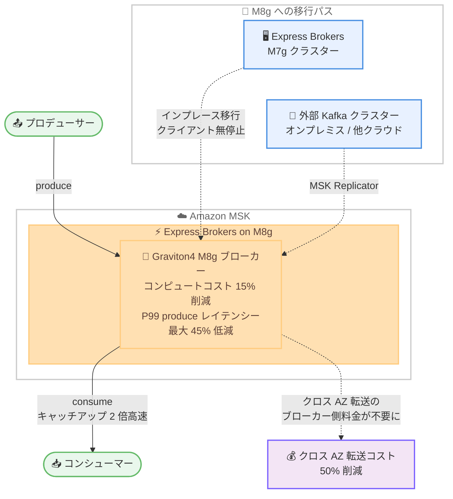

# Amazon MSK - Express Brokers が Graviton4 ベースの M8g インスタンスをサポート

**リリース日**: 2026 年 11 月 17 日
**サービス**: Amazon Managed Streaming for Apache Kafka (Amazon MSK)
**機能**: Express Brokers での Graviton4 ベース M8g インスタンスの一般提供

📊 [このアップデートのインフォグラフィックを見る](https://takech9203.github.io/aws-news-summary/20261117-amazon-msk-express-brokers-graviton4-m8g-instances.html)

## 概要

Amazon Managed Streaming for Apache Kafka (Amazon MSK) の Express Brokers で、AWS Graviton4 ベースの M8g インスタンスが一般提供されました。M7g ベースの Express Brokers と比較して、M8g はコンピュートコストが 15% 低く、P99 の produce レイテンシーが最大 45% 低減され、遅延したコンシューマーのキャッチアップが 2 倍高速になります。

さらに、クライアントとブローカー間でアベイラビリティーゾーン (AZ) をまたいでデータを転送する際のブローカー側のコストが不要になり、クロス AZ データ転送の総コストが 50% 削減されます。データ転送料金とブローカー時間料金の低減を合わせると、M7g 上の Express Brokers と比較して最大 30% のコスト削減が実現します。

Express Brokers は、Apache Kafka を実行する Standard Brokers と比較して、ブローカーあたり最大 3 倍のスループット、最大 20 倍高速なスケーリング、90% 短い復旧時間を提供するよう設計されています。M8g 上の Express Brokers は、これらの既存の Express 機能に加えて、さらに優れた経済性とパフォーマンスを提供します。大規模なストリーミング処理を運用する組織や、Kafka クラスターのコスト最適化を検討しているユーザーにとって重要なアップデートです。

**アップデート前の課題**

- Express Brokers は M7g インスタンスのみで提供されており、最新世代の Graviton4 の性能向上を活用できなかった
- クライアントとブローカー間のクロス AZ データ転送では、クライアント側とブローカー側の両方に料金が発生し、マルチ AZ 構成の Kafka クラスターでデータ転送コストが大きな割合を占めていた
- 遅延したコンシューマーが過去データを読み取ってキャッチアップする際の速度に制約があり、障害復旧やリプレイ処理に時間がかかる場合があった

**アップデート後の改善**

- M8g 上の Express Brokers により、M7g 比でコンピュートコストが 15% 低減し、P99 produce レイテンシーが最大 45% 低減された
- ブローカー側のクロス AZ データ転送料金が不要になり、クロス AZ データ転送の総コストが 50% 削減された
- 遅延したコンシューマーのキャッチアップが 2 倍高速になり、障害からの復旧やデータのリプレイがより迅速に行えるようになった
- 既存の M7g クラスターからクライアントアプリケーションを中断せずにインプレース移行が可能になった

## アーキテクチャ図



M8g 上の Express Brokers への 2 つの移行パス (既存 M7g クラスターからのインプレース移行、MSK Replicator による外部クラスターからの移行) と、性能・コスト面の主要な改善点を示しています。

## サービスアップデートの詳細

### 主要機能

1. **Graviton4 ベース M8g インスタンスによる性能向上**
   - M7g 上の Express Brokers と比較してコンピュートコストが 15% 低減
   - P99 の produce レイテンシーが最大 45% 低減し、テールレイテンシーが改善
   - 遅延したコンシューマーのキャッチアップ (過去データの読み取り) が 2 倍高速化

2. **クロス AZ データ転送コストの削減**
   - クライアントとブローカー間で AZ をまたいでデータを転送する際のブローカー側の料金が不要に
   - クロス AZ データ転送の総コストが 50% 削減
   - データ転送料金とブローカー時間料金の低減を合わせ、M7g 上の Express Brokers と比較して最大 30% のコスト削減を実現

3. **Express Brokers の既存の優位性を継承**
   - Standard Brokers と比較してブローカーあたり最大 3 倍のスループット
   - 最大 20 倍高速なスケーリング
   - 復旧時間を 90% 短縮
   - ストレージ管理が不要なアーキテクチャなど、既存の Express 機能をそのまま利用可能

4. **柔軟な移行オプション**
   - 既存の M7g クラスターからは、クライアントアプリケーションが produce / consume を継続したままインプレース移行が可能
   - オンプレミス、AWS 上のセルフマネージド、他クラウドなどの外部 Kafka クラスターからは、Amazon MSK Replicator を使用してシームレスに移行可能

## 技術仕様

### M7g と M8g の Express Brokers 比較

| 項目 | Express Brokers on M7g | Express Brokers on M8g |
|------|------------------------|------------------------|
| プロセッサ | AWS Graviton3 | AWS Graviton4 |
| コンピュートコスト | 基準 | 15% 低減 |
| P99 produce レイテンシー | 基準 | 最大 45% 低減 |
| コンシューマーのキャッチアップ速度 | 基準 | 2 倍高速 |
| クロス AZ 転送のブローカー側料金 | 発生 | 不要 (総転送コスト 50% 削減) |
| トータルコスト | 基準 | 最大 30% 削減 |

### Express Brokers と Standard Brokers の比較

| 項目 | Standard Brokers | Express Brokers |
|------|------------------|-----------------|
| ブローカーあたりスループット | 基準 | 最大 3 倍 |
| スケーリング速度 | 基準 | 最大 20 倍高速 |
| 復旧時間 | 基準 | 90% 短縮 |

## 設定方法

### 前提条件

1. AWS アカウントを保有し、MSK Express Brokers と M8g インスタンスの両方が利用可能なリージョンを使用していること
2. Amazon MSK クラスターの作成・更新を行う IAM 権限があること
3. 外部クラスターから移行する場合は、MSK Replicator を構成するためのネットワーク接続と権限があること

### 手順

#### ステップ 1: M8g の Express Brokers で新規クラスターを作成

```bash
aws kafka create-cluster-v2 \
  --cluster-name my-express-m8g-cluster \
  --provisioned '{
    "BrokerNodeGroupInfo": {
      "InstanceType": "express.m8g.large",
      "ClientSubnets": ["subnet-xxxxxxxx", "subnet-yyyyyyyy", "subnet-zzzzzzzz"],
      "SecurityGroups": ["sg-xxxxxxxx"]
    },
    "KafkaVersion": "3.6.0",
    "NumberOfBrokerNodes": 3
  }'
```

M8g ベースの Express Brokers を指定して、新しい MSK クラスターを作成します。インスタンスタイプやブローカー数はワークロードに応じて選択してください。AWS Management Console からも同様に作成できます。

#### ステップ 2: 既存の M7g クラスターをインプレース移行 (既存ユーザーの場合)

```bash
aws kafka update-broker-type \
  --cluster-arn arn:aws:kafka:ap-northeast-1:123456789012:cluster/my-cluster/xxxx \
  --current-version K3AEGXETSR30VB \
  --target-instance-type express.m8g.large
```

既存の M7g 上の Express Brokers クラスターのブローカータイプを M8g に更新します。移行中もクライアントアプリケーションは中断なく produce / consume を継続できます。

#### ステップ 3: 外部 Kafka クラスターから MSK Replicator で移行 (外部クラスターの場合)

```bash
aws kafka create-replicator \
  --replicator-name migrate-to-express-m8g \
  --kafka-clusters '[{"AmazonMskCluster": {"MskClusterArn": "arn:aws:kafka:...:cluster/source/..."}, "VpcConfig": {...}}, {"AmazonMskCluster": {"MskClusterArn": "arn:aws:kafka:...:cluster/target-m8g/..."}, "VpcConfig": {...}}]' \
  --replication-info-list '[{"SourceKafkaClusterArn": "...", "TargetKafkaClusterArn": "...", "TargetCompressionType": "NONE", "TopicReplication": {"TopicsToReplicate": [".*"]}, "ConsumerGroupReplication": {"ConsumerGroupsToReplicate": [".*"]}}]' \
  --service-execution-role-arn arn:aws:iam::123456789012:role/msk-replicator-role
```

MSK Replicator を作成して、移行元クラスターから M8g 上の Express Brokers クラスターへトピックとコンシューマーグループをレプリケーションします。レプリケーション完了後にクライアントを新クラスターへ切り替えることで、シームレスに移行できます。

## メリット

### ビジネス面

- **最大 30% のコスト削減**: ブローカー時間料金の低減とクロス AZ データ転送料金の削減により、M7g 上の Express Brokers と比較してトータルコストを最大 30% 削減できる
- **移行リスクの低減**: クライアント無停止のインプレース移行により、ビジネスへの影響を最小限に抑えながら新世代インスタンスの恩恵を受けられる
- **外部クラスターからの移行促進**: MSK Replicator により、オンプレミスや他クラウドで運用中の Kafka からの移行が容易になり、運用負荷の削減とコスト最適化を同時に実現できる

### 技術面

- **低レイテンシー**: P99 produce レイテンシーが最大 45% 低減し、リアルタイム性が求められるストリーミングアプリケーションの応答性が向上する
- **高速なキャッチアップ**: 遅延したコンシューマーの読み取りが 2 倍高速になり、障害復旧やデータリプレイの所要時間が短縮される
- **Express アーキテクチャの継承**: ブローカーあたり最大 3 倍のスループット、最大 20 倍高速なスケーリング、90% 短い復旧時間といった Express Brokers の特長をそのまま活用できる

## デメリット・制約事項

### 制限事項

- M8g の Express Brokers は、MSK Express Brokers と M8g インスタンスの両方が利用可能なリージョンに限定される
- Express Brokers 自体の機能特性 (Standard Brokers との構成上の違い) は従来どおりであり、Standard Brokers からの移行には構成の見直しが必要になる場合がある

### 考慮すべき点

- 利用予定のリージョンで M8g の Express Brokers が提供されているかを事前に確認する必要がある
- インプレース移行はクライアント無停止で実行できるが、本番環境での実施前に検証環境での動作確認を推奨する
- クロス AZ データ転送コストの削減効果は、クライアントとブローカーの AZ 配置やトラフィックパターンによって異なるため、自環境での削減額を試算することが望ましい

## ユースケース

### ユースケース 1: 既存 M7g クラスターのコスト最適化

**シナリオ**: M7g 上の Express Brokers で大規模なストリーミング基盤を運用しており、クラスターの停止を伴わずにコストを削減したい。

**実装例**:
```
UpdateBrokerType API または AWS Management Console から
既存クラスターのブローカータイプを express.m8g 系へ変更し、
クライアントアプリケーションを稼働させたままインプレース移行する
```

**効果**: クライアントの produce / consume を中断することなく、ブローカー時間料金とクロス AZ 転送料金を合わせて最大 30% のコスト削減を実現できる。

### ユースケース 2: マルチ AZ 構成でのデータ転送コスト削減

**シナリオ**: 高可用性のためにプロデューサー・コンシューマーを複数 AZ に分散配置しており、クライアントとブローカー間のクロス AZ データ転送コストが課題になっている。

**実装例**:
```
M8g 上の Express Brokers クラスターへ移行し、
クロス AZ 転送のブローカー側料金が不要になった構成で
マルチ AZ の高可用性アーキテクチャを維持する
```

**効果**: 可用性を犠牲にすることなく、クロス AZ データ転送の総コストを 50% 削減できる。

### ユースケース 3: 外部 Kafka クラスターからの移行

**シナリオ**: オンプレミスや他クラウドでセルフマネージドの Apache Kafka を運用しており、運用負荷の削減と価格性能の改善のためにマネージドサービスへ移行したい。

**実装例**:
```
M8g 上の Express Brokers で新規クラスターを作成し、
Amazon MSK Replicator で既存クラスターからトピックと
コンシューマーグループをレプリケーションした後、
クライアントを新クラスターへ切り替える
```

**効果**: ストレージ管理不要の Express アーキテクチャと M8g の価格性能を即座に活用でき、セルフマネージド運用と比較して運用負荷とコストの両方を削減できる。

## 料金

M8g 上の Express Brokers は、ブローカー時間とストレージなどに基づく MSK の料金体系に従います。M7g と比較してコンピュートコストが 15% 低く、クライアントとブローカー間のクロス AZ データ転送におけるブローカー側の料金が不要になります。

詳細な料金については、[Amazon MSK 料金ページ](https://aws.amazon.com/msk/pricing/) を参照してください。

## 利用可能リージョン

M8g 上の Express Brokers は、MSK Express Brokers と M8g インスタンスの両方が利用可能なすべての AWS リージョンで本日から利用できます。最新のリージョン対応状況は [AWS リージョン別サービス一覧](https://aws.amazon.com/about-aws/global-infrastructure/regional-product-services/) を参照してください。

## 関連サービス・機能

- **AWS Graviton4**: 最新世代の AWS 設計 ARM ベースプロセッサ。M8g インスタンスに搭載され、優れた価格性能を提供
- **Amazon MSK Express Brokers**: ストレージ管理が不要で、高スループット・高速スケーリング・高速復旧を特長とする MSK のブローカータイプ
- **Amazon MSK Replicator**: MSK クラスター間および外部 Kafka クラスターからのデータレプリケーションを実現するマネージド機能。外部クラスターからの移行に活用可能
- **Amazon EC2 M8g インスタンス**: Graviton4 を搭載した汎用インスタンスファミリー。Express Brokers の基盤として利用される

## 参考リンク

- 📊 [インフォグラフィック](https://takech9203.github.io/aws-news-summary/20261117-amazon-msk-express-brokers-graviton4-m8g-instances.html)
- [公式発表 (What's New)](https://aws.amazon.com/about-aws/whats-new/2026/11/amazon-msk-express-brokers-graviton4-m8g-instances/)
- [Amazon MSK Developer Guide - Getting Started](https://docs.aws.amazon.com/msk/latest/developerguide/getting-started.html)
- [Amazon MSK 料金ページ](https://aws.amazon.com/msk/pricing/)

## まとめ

Amazon MSK Express Brokers が Graviton4 ベースの M8g インスタンスに対応し、M7g 比でコンピュートコスト 15% 削減、P99 produce レイテンシー最大 45% 低減、クロス AZ データ転送コスト 50% 削減により、トータルで最大 30% のコスト削減を実現できるようになりました。既存の M7g クラスターを運用している場合はクライアント無停止のインプレース移行を、外部 Kafka クラスターを運用している場合は MSK Replicator による移行を検討し、価格性能の改善を早期に取り込むことを推奨します。
