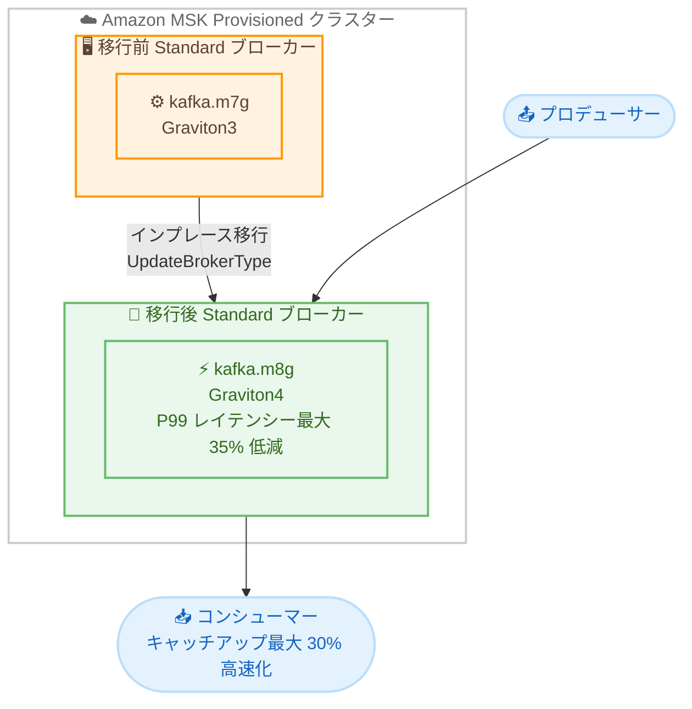

# Amazon MSK - Standard ブローカーでの Graviton4 ベース M8g インスタンスサポート

**リリース日**: 2026 年 11 月 17 日
**サービス**: Amazon Managed Streaming for Apache Kafka (Amazon MSK)
**機能**: Standard ブローカーにおける AWS Graviton4 ベース M8g インスタンスの一般提供

📊 [このアップデートのインフォグラフィックを見る](https://takech9203.github.io/aws-news-summary/20261117-amazon-msk-standard-brokers-graviton4-m8g-instances.html)

## 概要

Amazon Managed Streaming for Apache Kafka (Amazon MSK) の Standard ブローカーで、AWS Graviton4 ベースの M8g インスタンスが一般提供を開始しました。M7g ベースの Standard ブローカーと比較して、M8g は P99 プロデュースレイテンシーを最大 35% 低減し、遅延したコンシューマーのキャッチアップを最大 30% 高速化します。

M8g ブローカーは AWS Graviton4 プロセッサ (AWS が独自開発した Arm ベースプロセッサ) を採用しており、同等の M7g インスタンスと比較して優れた価格性能比を提供します。新規クラスターの作成に加えて、既存の M7g ベースの Standard ブローカーから M8g へのインプレース移行にも対応しているため、クラスターを再構築することなくアップグレードできます。

低レイテンシーが求められるリアルタイムストリーミング処理や、大規模な Kafka ワークロードを運用するユーザーにとって、性能とコスト効率の両面でメリットのあるアップデートです。

**アップデート前の課題**

- Standard ブローカーで利用できる最新の Graviton ベースインスタンスは Graviton3 ベースの M7g までであり、Graviton4 の性能向上を Standard ブローカーで活用できなかった
- レイテンシーに敏感なワークロードでは、M7g の性能が上限となり、ブローカー数の追加などで対応する必要があった
- コンシューマーが遅延した際のキャッチアップ速度に制約があり、リアルタイム性の回復に時間を要する場合があった

**アップデート後の改善**

- Standard ブローカーで Graviton4 ベースの M8g インスタンスが選択可能になり、P99 プロデュースレイテンシーが M7g 比で最大 35% 低減された
- 遅延したコンシューマーのキャッチアップが最大 30% 高速化され、障害やスパイク後のリアルタイム性の回復が迅速になった
- 既存クラスターの M7g から M8g へのインプレース移行が可能で、クラスター再作成なしでアップグレードできる
- kafka.m8g.24xlarge まで利用可能になり、M7g の最大サイズ (16xlarge) を超えるスケールアップの選択肢が追加された

## アーキテクチャ図



既存の M7g ベース Standard ブローカーからインプレース移行で M8g ブローカーへアップグレードする流れを示しています。移行後はプロデュースレイテンシーの低減とコンシューマーのキャッチアップ高速化が期待できます。

## サービスアップデートの詳細

### 主要機能

1. **Graviton4 ベース M8g インスタンスのサポート**
   - Standard ブローカーで kafka.m8g ファミリーが一般提供開始
   - AWS Graviton4 プロセッサによる高い価格性能比を実現
   - MSK 開発者ガイドによると、M8g ブローカーは同等の M7g インスタンスと比較して優れた価格性能比を提供

2. **パフォーマンスの向上**
   - M7g ベースの Standard ブローカーと比較して、P99 プロデュースレイテンシーを最大 35% 低減
   - 遅延したコンシューマーのキャッチアップを最大 30% 高速化
   - レイテンシーに敏感なストリーミングワークロードでの性能改善

3. **インプレース移行のサポート**
   - 既存クラスターを M7g ベースの Standard ブローカーから M8g へインプレースで移行可能
   - AWS マネジメントコンソールまたは API から実行可能
   - クラスターの再作成やデータ移行作業が不要

## 技術仕様

### 利用可能なブローカーサイズ (Standard ブローカー)

| インスタンスファミリー | 利用可能サイズ |
|------|------|
| kafka.m8g | large、xlarge、2xlarge、4xlarge、8xlarge、12xlarge、16xlarge、24xlarge |
| kafka.m7g | large、xlarge、2xlarge、4xlarge、8xlarge、12xlarge、16xlarge |
| kafka.m5 | large、xlarge、2xlarge、4xlarge、8xlarge、12xlarge、16xlarge、24xlarge |
| kafka.t3 | small |

M8g は M7g にはない 24xlarge サイズまで利用でき、より大規模なスケールアップが可能です。なお、一部のブローカーサイズは利用できないリージョンがあるため、最新の提供状況は MSK 料金ページのブローカーインスタンス料金表で確認してください。

### Standard ブローカーと Express ブローカーの比較

| 項目 | Standard ブローカー | Express ブローカー |
|------|------|------|
| サポートインスタンス | T3、M5、M7g、M8g | M7g、M8g |
| ストレージ管理 | ユーザー管理 (EBS、Tiered Storage など) | MSK フルマネージド |
| Kafka 設定 | 柔軟に設定可能 | 大部分を MSK が管理 |

### API 変更履歴

今回のアップデートに伴う新規 API の追加はありません。既存の MSK API (クラスター作成、ブローカータイプ更新) で M8g インスタンスタイプを指定できます。

## 設定方法

### 前提条件

1. Amazon VPC とサブネットが設定済みであること (Standard ブローカーは 2 つまたは 3 つの異なるアベイラビリティーゾーンのサブネットが必要)
2. 対象リージョンで MSK Standard ブローカーと M8g インスタンスが利用可能であること
3. 既存クラスターを移行する場合は、クラスターが M7g ベースの Standard ブローカーで稼働していること

### 手順

#### ステップ 1: M8g を指定して新規クラスターを作成

```bash
aws kafka create-cluster \
  --cluster-name "my-msk-cluster" \
  --broker-node-group-info '{
    "InstanceType": "kafka.m8g.large",
    "ClientSubnets": ["subnet-xxxx1", "subnet-xxxx2", "subnet-xxxx3"],
    "StorageInfo": {"EbsStorageInfo": {"VolumeSize": 1000}}
  }' \
  --kafka-version "3.8.x" \
  --number-of-broker-nodes 3
```

`create-cluster` コマンドで、ブローカーのインスタンスタイプに `kafka.m8g.large` を指定して新規の MSK Provisioned クラスターを作成しています。サブネット、EBS ストレージサイズ、ブローカー数も合わせて指定します。

#### ステップ 2: 既存クラスターを M7g から M8g へインプレース移行

```bash
aws kafka update-broker-type \
  --cluster-arn "arn:aws:kafka:ap-northeast-1:123456789012:cluster/my-msk-cluster/xxxx" \
  --current-version "K3AEGXETSR30VB" \
  --target-instance-type "kafka.m8g.large"
```

`update-broker-type` コマンドで、既存クラスターのブローカータイプを `kafka.m8g.large` に変更しています。`--current-version` には現在のクラスターバージョンを指定します。移行はローリング方式で実行されるため、クラスターの再作成は不要です。

#### ステップ 3: 移行状況の確認

```bash
aws kafka describe-cluster \
  --cluster-arn "arn:aws:kafka:ap-northeast-1:123456789012:cluster/my-msk-cluster/xxxx" \
  --query "ClusterInfo.{State:State,InstanceType:BrokerNodeGroupInfo.InstanceType}"
```

`describe-cluster` コマンドでクラスターの状態とインスタンスタイプを確認しています。移行完了後、`State` が `ACTIVE` になり、`InstanceType` が `kafka.m8g.large` に更新されていることを確認します。

## メリット

### ビジネス面

- **コスト効率の向上**: Graviton4 の優れた価格性能比により、同等のスループットをより少ないリソースで実現でき、インフラコストの最適化につながる
- **移行コストの最小化**: インプレース移行により、クラスター再構築やアプリケーション変更なしで性能向上の恩恵を受けられる
- **ユーザー体験の改善**: プロデュースレイテンシーの低減により、リアルタイム性が求められるサービスの応答性が向上する

### 技術面

- **P99 レイテンシーの低減**: M7g 比で最大 35% のプロデュースレイテンシー低減により、テールレイテンシーに敏感なワークロードの安定性が向上
- **キャッチアップの高速化**: コンシューマー遅延からの回復が最大 30% 高速化され、障害復旧やトラフィックスパイク後のリカバリ時間を短縮
- **スケールアップ余地の拡大**: kafka.m8g.24xlarge まで選択でき、M7g の上限 (16xlarge) を超える垂直スケーリングが可能

## デメリット・制約事項

### 制限事項

- M8g インスタンスが提供されていないリージョンでは利用できない (MSK Standard ブローカーと M8g の両方が利用可能なリージョンに限定)
- 一部のブローカーサイズは利用できないリージョンがある (最新の提供状況は料金ページで要確認)
- Standard ブローカーから Express ブローカーへのブローカータイプ切り替えはできない (別クラスターの新規作成が必要)

### 考慮すべき点

- M8g は Arm ベース (Graviton4) のため、クライアント側への影響はないが、ブローカー性能特性の変化を考慮して移行後の性能検証を推奨
- インプレース移行はローリング方式で実行されるため、移行中のブローカー再起動に伴う一時的なリーダー変更が発生する点に留意
- M7g から M8g への移行に合わせて、ブローカーサイズやブローカー数の見直し (リソース最適化) を検討する価値がある

## ユースケース

### ユースケース 1: レイテンシーに敏感なリアルタイム分析基盤の性能改善

**シナリオ**: 広告入札やリアルタイムレコメンデーションなど、ミリ秒単位のレイテンシーが収益に直結するワークロードで、P99 レイテンシーの改善が求められている。

**実装例**:
```bash
# 既存の M7g クラスターを M8g へインプレース移行
aws kafka update-broker-type \
  --cluster-arn <cluster-arn> \
  --current-version <current-version> \
  --target-instance-type "kafka.m8g.xlarge"
```

**効果**: P99 プロデュースレイテンシーが最大 35% 低減され、アプリケーション変更なしでテールレイテンシーを改善できる。

### ユースケース 2: 障害復旧時のコンシューマーラグ解消の高速化

**シナリオ**: コンシューマーアプリケーションの障害やデプロイによりラグが蓄積した際、リアルタイム性の回復に時間がかかっている。

**実装例**:
```bash
# M8g ベースの新規クラスターを作成し、高スループットでのキャッチアップに備える
aws kafka create-cluster \
  --cluster-name "realtime-pipeline" \
  --broker-node-group-info '{"InstanceType": "kafka.m8g.2xlarge", ...}' \
  --number-of-broker-nodes 3
```

**効果**: 遅延したコンシューマーのキャッチアップが最大 30% 高速化され、ラグ解消までの時間を短縮し SLA 違反のリスクを低減できる。

### ユースケース 3: 大規模クラスターの垂直スケーリングによる統合

**シナリオ**: M7g の最大サイズ (16xlarge) では処理能力が不足し、ブローカー数を増やして対応しているが、パーティション再配置などの運用負荷が課題になっている。

**実装例**:
```bash
# より大きな 24xlarge サイズへスケールアップ
aws kafka update-broker-type \
  --cluster-arn <cluster-arn> \
  --current-version <current-version> \
  --target-instance-type "kafka.m8g.24xlarge"
```

**効果**: M7g にはない 24xlarge サイズまで垂直スケーリングでき、ブローカー数を抑えたシンプルなクラスター構成を維持できる。

## 料金

Amazon MSK Provisioned の料金体系に従い、以下の要素で課金されます。

- **ブローカーインスタンス時間**: インスタンスサイズとブローカー数に応じた時間課金 (秒単位で計算)
- **ストレージ**: プロビジョニングした EBS ストレージに対する GB - 月単位の課金 (米国東部で 0.10 USD/GB - 月)
- **プロビジョンドストレージスループット** (オプション): MB/s - 月単位の課金

参考として、米国東部 (バージニア北部) の kafka.m7g.large は 0.204 USD/時です。M8g の各サイズの料金はリージョンごとに異なるため、最新の料金は [Amazon MSK 料金ページ](https://aws.amazon.com/msk/pricing/)のブローカーインスタンス料金表を確認してください。

## 利用可能リージョン

MSK Standard ブローカーと M8g インスタンスの両方が利用可能なすべての AWS リージョンで本日から利用できます。最新のリージョン対応状況は [AWS リージョン別サービス一覧](https://aws.amazon.com/about-aws/global-infrastructure/regional-product-services/)および MSK 料金ページで確認してください。

## 関連サービス・機能

- **Amazon EC2 M8g インスタンス**: 本アップデートの基盤となる Graviton4 ベースの汎用インスタンスファミリー
- **Amazon MSK Express ブローカー**: ストレージを MSK がフルマネージドで提供するブローカータイプで、M8g (express.m8g) にも対応
- **Amazon MSK Tiered Storage**: Standard ブローカーで利用できる階層型ストレージ機能で、長期保持データのコストを最適化
- **Amazon CloudWatch**: 移行前後のレイテンシーやスループットなどのブローカーメトリクスの監視に使用

## 参考リンク

- 📊 [インフォグラフィック](https://takech9203.github.io/aws-news-summary/20261117-amazon-msk-standard-brokers-graviton4-m8g-instances.html)
- [公式発表 (What's New)](https://aws.amazon.com/about-aws/whats-new/2026/11/amazon-msk-standard-brokers-graviton4-m8g-instances/)
- [Amazon MSK 開発者ガイド - Getting Started](https://docs.aws.amazon.com/msk/latest/developerguide/getting-started.html)
- [Amazon MSK ブローカータイプ](https://docs.aws.amazon.com/msk/latest/developerguide/broker-instance-types.html)
- [Amazon MSK ブローカーサイズ](https://docs.aws.amazon.com/msk/latest/developerguide/broker-instance-sizes.html)
- [Amazon MSK 料金ページ](https://aws.amazon.com/msk/pricing/)

## まとめ

Amazon MSK の Standard ブローカーで Graviton4 ベースの M8g インスタンスが利用可能になり、M7g 比で P99 プロデュースレイテンシーを最大 35% 低減、コンシューマーのキャッチアップを最大 30% 高速化できるようになりました。既存クラスターからのインプレース移行に対応しているため、現在 M7g や M5 で Standard ブローカーを運用している場合は、性能検証を行ったうえで M8g への移行を検討することを推奨します。
