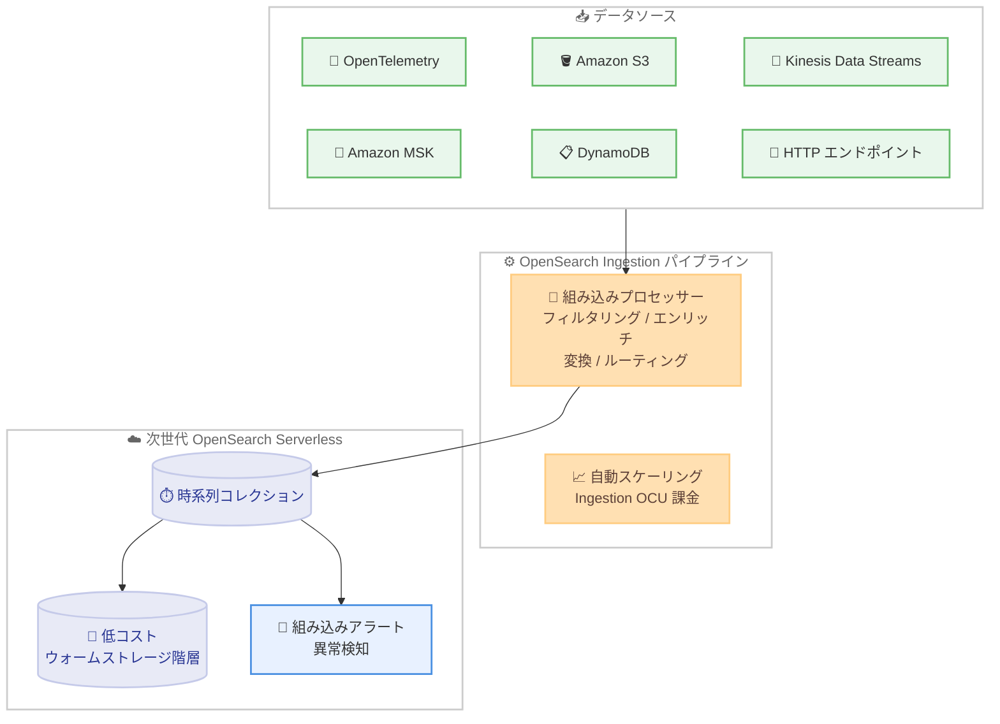

# Amazon OpenSearch Ingestion Service - 次世代時系列コレクションのサポート

**リリース日**: 2026 年 11 月 17 日
**サービス**: Amazon OpenSearch Ingestion Service / Amazon OpenSearch Serverless
**機能**: 次世代 OpenSearch Serverless 時系列コレクションをパイプラインの宛先として利用可能に

📊 [このアップデートのインフォグラフィックを見る](https://takech9203.github.io/aws-news-summary/20261117-amazon-opensearch-ingestion-service-nextgen-time-series-collections.html)

## 概要

Amazon OpenSearch Ingestion Service が、次世代 Amazon OpenSearch Serverless の時系列コレクション (time series collections) をパイプラインの宛先 (sink) としてサポートしました。ログ、メトリクス、トレース、イベントデータを、フルマネージドなパイプラインを通じて次世代時系列コレクションにストリーミングできます。独自のコレクターを運用したり、カスタムのインジェストコードを記述したりする必要はありません。

OpenSearch Ingestion は、オープンソースのデータコレクターである Data Prepper を基盤としたサーバーレスのデータ収集サービスです。今回のアップデートにより、OpenTelemetry、Amazon S3、Amazon Kinesis Data Streams、Amazon MSK、Amazon DynamoDB、HTTP エンドポイントといった多様なソースから取り込んだデータを、インデックス化の前に加工したうえで次世代時系列コレクションに配信できるようになりました。

次世代時系列コレクションは、低コストなウォームストレージ階層や組み込みのアラート・異常検知機能を備えています。OpenSearch Ingestion と組み合わせることで、クラスター管理が一切不要な、収集から分析までをカバーするオブザーバビリティパイプラインを構築できます。

**アップデート前の課題**

このアップデート以前には、次のような課題がありました。

- 次世代 OpenSearch Serverless の時系列コレクションにデータを送るには、独自のコレクター (Fluent Bit や OpenTelemetry Collector など) を自前で運用するか、カスタムのインジェストコードを記述する必要があった
- 収集基盤のスケーリング、パッチ適用、可用性の確保を利用者側で管理する必要があった
- ログのパースや機密情報のマスキングなどの前処理を、別途アプリケーション側や中間処理基盤で実装する必要があった

**アップデート後の改善**

今回のアップデートにより、次のことが可能になりました。

- OpenSearch Ingestion のマネージドパイプラインから、次世代時系列コレクションを宛先として直接選択できるようになった
- 組み込みプロセッサーにより、インデックス化の前にデータのフィルタリング、エンリッチ、変換、ルーティングが可能になった (ログフィールドの正規化、機密データのマスキング、ストリームの複数インデックスへの分割など)
- パイプラインがワークロードに応じて自動的にスケールするため、収集基盤の容量管理が不要になった

## アーキテクチャ図



多様なデータソースから OpenSearch Ingestion のマネージドパイプラインを経由して、次世代 OpenSearch Serverless の時系列コレクションにデータをストリーミングする構成です。パイプライン内の組み込みプロセッサーでインデックス化前のデータ加工を行います。

## サービスアップデートの詳細

### 主要機能

1. **次世代時系列コレクションを宛先としてサポート**
   - OpenSearch Ingestion パイプラインの sink として、次世代 OpenSearch Serverless の時系列コレクションを選択可能
   - ログ、メトリクス、トレース、イベントデータのストリーミングに対応
   - 独自のコレクター運用やカスタムインジェストコードの記述が不要

2. **多様なデータソースのサポート**
   - OpenTelemetry、Amazon S3、Amazon Kinesis Data Streams、Amazon MSK、Amazon DynamoDB、HTTP エンドポイントからのデータ取り込みに対応
   - 既存の OpenSearch Ingestion のソース群をそのまま活用可能

3. **インデックス化前のデータ加工**
   - 組み込みプロセッサーでデータのフィルタリング、エンリッチ、変換、ルーティングが可能
   - 例: ログフィールドのパースと正規化、機密データのマスキング、ストリームを複数のインデックスに分割

4. **自動スケーリング**
   - パイプラインはワークロードに応じて自動的にスケール
   - 容量計画やインフラ管理が不要

## 技術仕様

### OpenSearch Ingestion の主な仕様

| 項目 | 詳細 |
|------|------|
| 基盤エンジン | Data Prepper (オープンソースのデータコレクター) |
| 対応ソース | OpenTelemetry、Amazon S3、Kinesis Data Streams、Amazon MSK、DynamoDB、HTTP エンドポイントなど |
| 宛先 | OpenSearch Service ドメイン、OpenSearch Serverless コレクション (今回、次世代時系列コレクションを追加) |
| 処理機能 | フィルタリング、エンリッチ、変換、正規化、ルーティング |
| スケーリング | ワークロードに応じた自動スケーリング |
| 課金単位 | Ingestion OCU (OpenSearch Compute Unit) |
| 作成方法 | OpenSearch Service コンソール、AWS CLI、AWS CloudFormation |

### パイプライン設定例

OpenSearch Serverless コレクションを sink とするパイプライン設定の例です。次世代時系列コレクションを宛先とする場合も、コンソール、AWS CLI、または CloudFormation でパイプライン作成時に sink として選択します。

```yaml
version: "2"
log-pipeline:
  source:
    http:
      path: "/logs"
  processor:
    - grok:
        match:
          log: ["%{COMMONAPACHELOG}"]
  sink:
    - opensearch:
        hosts: ["https://<コレクションエンドポイント>"]
        index: "application-logs"
        aws:
          serverless: true
          region: "ap-northeast-1"
          sts_role_arn: "arn:aws:iam::123456789012:role/pipeline-role"
```

## 設定方法

### 前提条件

1. 次世代 Amazon OpenSearch Serverless の時系列コレクションが作成済みであること
2. パイプラインがコレクションへ書き込むための IAM ロールと、OpenSearch Serverless のデータアクセスポリシーが設定済みであること
3. OpenSearch Ingestion と次世代 OpenSearch Serverless の両方が利用可能なリージョンであること

### 手順

#### ステップ 1: 時系列コレクションの確認

```bash
# 利用可能な OpenSearch Serverless コレクションを一覧表示
aws opensearchserverless list-collections
```

既存のコレクション一覧を表示し、宛先とする次世代時系列コレクションの名前とステータスを確認します。

#### ステップ 2: パイプラインの作成

```bash
# OpenSearch Ingestion パイプラインを作成
aws osis create-pipeline \
  --pipeline-name "timeseries-pipeline" \
  --min-units 1 \
  --max-units 4 \
  --pipeline-configuration-body file://pipeline-config.yaml
```

パイプライン設定ファイル (YAML) を指定してパイプラインを作成します。`--min-units` と `--max-units` で自動スケーリングの範囲となる Ingestion OCU 数を指定します。sink には次世代時系列コレクションを指定します。

#### ステップ 3: データ送信と確認

データプロデューサー (OpenTelemetry Collector やアプリケーション) からパイプラインのエンドポイントにデータを送信し、時系列コレクション側でインデックスにデータが格納されていることを確認します。Amazon CloudWatch でパイプラインのメトリクスを監視できます。

## メリット

### ビジネス面

- **運用コストの削減**: 独自のコレクター基盤やカスタムインジェストコードの開発・運用が不要になり、運用負荷と人的コストを削減できる
- **ストレージコストの最適化**: 次世代時系列コレクションの低コストなウォームストレージ階層により、長期間の時系列データ保持コストを抑制できる
- **迅速な導入**: コンソール、AWS CLI、CloudFormation からパイプラインを作成するだけで、収集から分析までのオブザーバビリティパイプラインを構築できる

### 技術面

- **クラスター管理不要**: パイプラインとコレクションの両方がサーバーレスであり、インフラのプロビジョニングやスケーリングの管理が不要
- **インデックス化前のデータ加工**: 組み込みプロセッサーによるパース、正規化、マスキング、ルーティングにより、検索・分析に最適化された形でデータを格納できる
- **組み込みの分析機能**: 時系列コレクションに組み込まれたアラートと異常検知を、追加の基盤構築なしで活用できる

## デメリット・制約事項

### 制限事項

- OpenSearch Ingestion と次世代 OpenSearch Serverless の両方が利用可能なリージョンでのみ使用できる
- OpenSearch Ingestion は OpenSearch Service が利用可能なリージョンの一部でのみ提供されている

### 考慮すべき点

- Ingestion OCU はコレクションとは別に課金されるため、パイプラインとコレクション双方のコストを把握しておく必要がある
- パイプラインに割り当てられた Ingestion OCU は、データが流れていない間も課金対象となる (パイプラインの停止によりコスト制御は可能)
- 既存の自前コレクター構成から移行する場合は、前処理ロジックを Data Prepper のプロセッサー定義へ移植する設計が必要となる

## ユースケース

### ユースケース 1: アプリケーションログの集中管理

**シナリオ**: 複数のマイクロサービスから出力されるログを一元的に収集し、フィールドを正規化したうえで検索・分析したい。

**実装例**:
```yaml
processor:
  - grok:
      match:
        message: ["%{TIMESTAMP_ISO8601:time} %{LOGLEVEL:level} %{GREEDYDATA:body}"]
sink:
  - opensearch:
      index: "service-logs-%{yyyy.MM.dd}"
```

**効果**: コレクターの自前運用なしでログを時系列コレクションに集約し、組み込みアラートで特定ログレベルの急増を検知できる。

### ユースケース 2: OpenTelemetry によるメトリクス・トレース収集

**シナリオ**: OpenTelemetry で計装したアプリケーションのメトリクスとトレースを収集し、オブザーバビリティ基盤として活用したい。

**実装例**:
```
OpenTelemetry SDK → OpenSearch Ingestion の OTel ソース
→ 次世代時系列コレクション → 異常検知で遅延増加を検出
```

**効果**: クラスター管理不要で、収集から異常検知までのオブザーバビリティパイプラインを構築できる。

### ユースケース 3: 機密情報をマスキングしたセキュリティログ分析

**シナリオ**: Kinesis Data Streams 経由で流れるイベントデータに含まれる個人情報をマスキングしてから保存し、コンプライアンス要件を満たしたい。

**実装例**:
```yaml
processor:
  - substitute_string:
      entries:
        - source: "message"
          from: "[0-9]{3}-[0-9]{4}-[0-9]{4}"
          to: "***-****-****"
```

**効果**: インデックス化前に機密データをマスキングし、安全な形で長期保存と分析ができる。

## 料金

データ取り込みは Ingestion OCU (OpenSearch Compute Unit) 単位で課金され、コレクション側の料金とは別に発生します。パイプラインに割り当てられた OCU 数に応じて課金され、パイプラインはワークロードに応じて指定範囲内で自動的にスケールします。パイプラインの停止によりコストを制御することも可能です。

詳細は [Amazon OpenSearch Service の料金ページ](https://aws.amazon.com/opensearch-service/pricing/) を参照してください。

## 利用可能リージョン

OpenSearch Ingestion と次世代 Amazon OpenSearch Serverless の両方が利用可能なすべての AWS リージョンで利用できます。対応リージョンの一覧は [Amazon OpenSearch Service endpoints and quotas](https://docs.aws.amazon.com/general/latest/gr/opensearch-service.html) を参照してください。

## 関連サービス・機能

- **Amazon OpenSearch Serverless**: 今回のアップデートの宛先となる次世代時系列コレクションを提供。低コストなウォームストレージ階層、組み込みアラート、異常検知を備える
- **Data Prepper**: OpenSearch Ingestion の基盤となるオープンソースのデータコレクター。フィルタリング、エンリッチ、変換、正規化、集約機能を提供
- **Amazon Kinesis Data Streams / Amazon MSK**: ストリーミングデータのソースとしてパイプラインに接続可能
- **Amazon CloudWatch**: パイプラインのパフォーマンスモニタリングとエラーログの出力先

## 参考リンク

- 📊 [インフォグラフィック](https://takech9203.github.io/aws-news-summary/20261117-amazon-opensearch-ingestion-service-nextgen-time-series-collections.html)
- [公式発表 (What's New)](https://aws.amazon.com/about-aws/whats-new/2026/11/amazon-opensearch-ingestion-service-nextgen-time-series-collections)
- [Overview of Amazon OpenSearch Ingestion (ドキュメント)](https://docs.aws.amazon.com/opensearch-service/latest/developerguide/ingestion.html)
- [料金ページ](https://aws.amazon.com/opensearch-service/pricing/)

## まとめ

OpenSearch Ingestion が次世代 OpenSearch Serverless の時系列コレクションを宛先としてサポートしたことで、コレクターの自前運用やカスタムコードなしに、収集から加工、保存、アラート・異常検知までを完全マネージドで実現できるようになりました。オブザーバビリティ基盤の運用負荷を削減したい場合は、既存のログ・メトリクス収集構成をこのパイプラインへ移行することを検討してください。まずはコンソールから小規模なパイプラインを作成し、Ingestion OCU のコストとスケーリング挙動を確認することを推奨します。
