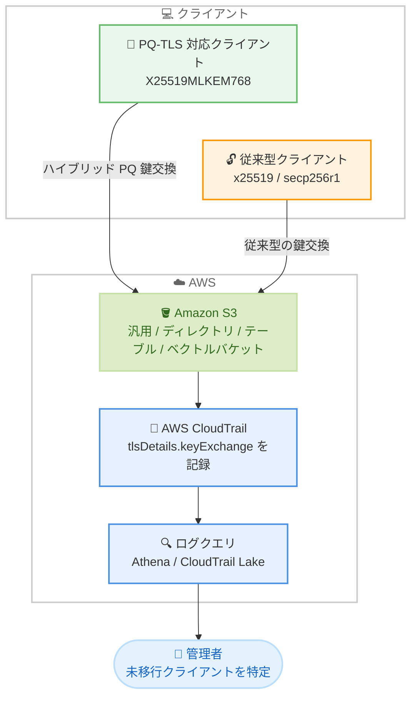

# Amazon S3 - AWS CloudTrail によるポスト量子 TLS 可視化

**リリース日**: 2026 年 11 月 17 日
**サービス**: Amazon S3 / AWS CloudTrail
**機能**: CloudTrail イベントでの TLS 鍵交換アルゴリズム (keyExchange) の記録

📊 [このアップデートのインフォグラフィックを見る](https://takech9203.github.io/aws-news-summary/20261117-amazon-s3-post-quantum-tls-aws-cloudtrail.html)

## 概要

Amazon S3 は、S3 へのリクエストで使用された TLS 鍵交換アルゴリズムを AWS CloudTrail に記録するようになりました。CloudTrail の管理イベントおよびデータイベントの `tlsDetails` フィールドに新しい `keyExchange` 値が追加され、各 TLS 接続でネゴシエートされた鍵交換方式 (ハイブリッドポスト量子アルゴリズムの `X25519MLKEM768` や従来型の `x25519` など) を確認できます。

この可視化により、S3 トラフィックのうちポスト量子暗号 (PQC) で保護されている割合を測定し、依然として従来型の鍵交換で接続しているアプリケーション、SDK バージョン、IAM プリンシパルを特定できます。例えば、CloudTrail ログをクエリして ML-KEM を使用していない S3 リクエストのユーザーエージェントを抽出し、ポスト量子移行の優先順位付けに活用できます。

`keyExchange` 値は、汎用バケット、ディレクトリバケット、テーブルバケット、ベクトルバケットへのリクエストで記録され、AWS PrivateLink 経由のリクエストも対象です。将来、暗号学的に意味のある量子コンピュータが実用化された場合、従来型の鍵交換は解読リスクにさらされるため、長期的な機密性が求められるデータを扱う組織にとって、PQ-TLS への移行状況を定量的に把握できる重要なアップデートです。

**アップデート前の課題**

- S3 エンドポイント側はハイブリッド PQ-TLS に対応していたものの、どのクライアントが実際に PQ-TLS で接続しているかを確認する手段がなかった
- S3 サーバーアクセスログには TLS バージョンと暗号スイートは記録されるが、鍵交換アルゴリズムは記録されない
- ポスト量子移行の進捗を定量的に測定できず、未移行のアプリケーションや SDK バージョンの特定が困難だった

**アップデート後の改善**

- CloudTrail の `tlsDetails.keyExchange` フィールドで、リクエスト単位の鍵交換アルゴリズムを確認できるようになった
- PQ-TLS で保護されている S3 トラフィックの割合を測定できるようになった
- 従来型の鍵交換を使用しているアプリケーション、SDK バージョン、IAM プリンシパルを特定し、アップグレードの優先順位付けができるようになった

## アーキテクチャ図



PQ-TLS 対応クライアントと従来型クライアントの双方からの S3 リクエストについて、TLS ハンドシェイクでネゴシエートされた鍵交換アルゴリズムが CloudTrail に記録され、クエリによって未移行クライアントを特定できる流れを示しています。

## サービスアップデートの詳細

### 主要機能

1. **CloudTrail への鍵交換アルゴリズムの記録**
   - CloudTrail の管理イベントおよびデータイベントの `tlsDetails` フィールドに `keyExchange` 値が追加された
   - 各 TLS 接続でネゴシエートされた鍵交換方式をリクエスト単位で確認できる
   - ハイブリッドポスト量子アルゴリズム (`X25519MLKEM768`、`SecP256r1MLKEM768`) と従来型アルゴリズム (`x25519`、`secp256r1`、`secp384r1`) を区別できる

2. **幅広いバケットタイプとアクセス経路への対応**
   - 汎用バケット、ディレクトリバケット、テーブルバケット、ベクトルバケットへのリクエストで記録される
   - AWS PrivateLink 経由のリクエストも対象
   - ハイブリッド PQ-TLS 自体は、Multi-Region Access Points を除くすべての S3 エンドポイントでサポートされる

3. **ポスト量子移行の進捗測定**
   - PQ-TLS で保護されている S3 トラフィックの割合を測定できる
   - ユーザーエージェント、IAM プリンシパル単位で未移行クライアントを特定し、移行の優先順位付けができる
   - S3 のデフォルトのサーバー側暗号化 (AES-256) と組み合わせることで、転送中と保管時の両方で耐量子性のある保護を実現できる

## 技術仕様

### keyExchange フィールドの値

| 値 | 意味 |
|------|------|
| `X25519MLKEM768` | ハイブリッドポスト量子鍵交換 (X25519 + ML-KEM-768)、TLS 1.3 |
| `SecP256r1MLKEM768` | ハイブリッドポスト量子鍵交換 (P-256 + ML-KEM-768)、TLS 1.3 |
| `x25519` | 従来型の楕円曲線鍵交換、TLS 1.3 または TLS 1.2 |
| `secp256r1`、`secp384r1` | 従来型の楕円曲線鍵交換、TLS 1.3 または TLS 1.2 |

### CloudTrail イベントの例

PQ-TLS を使用したリクエストの CloudTrail イベントでは、`tlsDetails` が以下のように記録されます。

```json
{
  "eventVersion": "1.11",
  "eventSource": "s3.amazonaws.com",
  "eventName": "ListBuckets",
  "awsRegion": "us-east-2",
  "userAgent": "aws-cli/2.40.1 ...",
  "tlsDetails": {
    "tlsVersion": "TLSv1.3",
    "cipherSuite": "TLS_AES_128_GCM_SHA256",
    "clientProvidedHostHeader": "s3.us-east-2.amazonaws.com",
    "keyExchange": "X25519MLKEM768"
  }
}
```

### API 変更履歴

本アップデートは CloudTrail イベントレコードへのフィールド追加であり、SDK の API 変更を伴いません。2026 年 11 月 17 日時点の AWS API Changes フィードに、本アップデートに関連する API 変更は含まれていません。

## 設定方法

### 前提条件

1. CloudTrail で S3 の管理イベントが記録されていること (データイベントの分析にはデータイベントの有効化が必要)
2. ログをクエリする場合、CloudTrail Lake または Athena のテーブルが設定されていること
3. クライアント側で PQ-TLS を利用するには、PQ-TLS に対応した AWS SDK / ツールのバージョンと設定が必要

### 手順

#### ステップ 1: S3 データイベントの記録を有効化

```bash
aws cloudtrail put-event-selectors \
  --trail-name my-trail \
  --advanced-event-selectors '[
    {
      "Name": "S3DataEvents",
      "FieldSelectors": [
        { "Field": "eventCategory", "Equals": ["Data"] },
        { "Field": "resources.type", "Equals": ["AWS::S3::Object"] }
      ]
    }
  ]'
```

既存のトレイルに対して S3 オブジェクトレベルのデータイベントの記録を有効化します。これにより、GetObject や PutObject などのリクエストごとに `tlsDetails` を含むイベントが記録されます。

#### ステップ 2: 従来型の鍵交換を使用しているクライアントをクエリ

```sql
SELECT useragent,
       useridentity.arn AS principal_arn,
       tlsdetails.keyexchange,
       count(*) AS request_count
FROM cloudtrail_logs
WHERE eventsource = 's3.amazonaws.com'
  AND tlsdetails.keyexchange IS NOT NULL
  AND tlsdetails.keyexchange NOT LIKE '%MLKEM%'
GROUP BY useragent, useridentity.arn, tlsdetails.keyexchange
ORDER BY request_count DESC;
```

Athena で CloudTrail ログをクエリし、ML-KEM を使用していない S3 リクエストのユーザーエージェントと IAM プリンシパルをリクエスト数の多い順に抽出します。テーブル名やカラム定義は環境に合わせて調整してください。

#### ステップ 3: 未移行クライアントのアップグレード

ステップ 2 で特定したクライアントについて、PQ-TLS に対応した SDK バージョンへの更新や設定変更を行います。SDK ごとの対応状況と設定方法は [AWS SDKs and Tools Reference Guide](https://docs.aws.amazon.com/sdkref/latest/guide/pqtls-details.html) を参照してください。アップグレード後、再度クエリを実行して `keyExchange` が `X25519MLKEM768` などのハイブリッド PQ アルゴリズムに切り替わったことを確認します。

## メリット

### ビジネス面

- **移行計画の定量化**: ポスト量子移行の進捗を具体的な数値 (PQ-TLS 利用率) で経営層や監査者に報告できる
- **コンプライアンス対応**: 長期的な機密性が求められるデータについて、Harvest Now Decrypt Later 攻撃への対策状況を証跡として示せる
- **追加コスト不要**: 鍵交換の記録自体に追加料金は発生せず、既存の CloudTrail の仕組みをそのまま活用できる

### 技術面

- **リクエスト単位の可視性**: 接続ごとにネゴシエートされた鍵交換アルゴリズムを正確に把握できる
- **未移行クライアントの特定**: ユーザーエージェントや IAM プリンシパルと組み合わせて、アップグレード対象を具体的に絞り込める
- **幅広いカバレッジ**: 汎用、ディレクトリ、テーブル、ベクトルの各バケットタイプと PrivateLink 経由のアクセスに対応

## デメリット・制約事項

### 制限事項

- オブジェクトレベルのリクエストを分析するには、CloudTrail の S3 データイベントの有効化が必要であり、標準の CloudTrail 料金が発生する
- S3 サーバーアクセスログには鍵交換アルゴリズムは記録されない (TLS バージョンと暗号スイートのみ)
- ハイブリッド PQ-TLS 自体は Multi-Region Access Points ではサポートされない
- AWS サービスがユーザーに代わって実行した API コールでは `tlsDetails` フィールドは記録されない

### 考慮すべき点

- `keyExchange` の値はクライアント側の TLS 設定に依存するため、PQ-TLS を利用するには SDK やツール側の対応バージョンと設定が必要
- データイベントの量が多い環境では、CloudTrail Lake や Athena でのクエリコストとログ保管コストを考慮する必要がある

## ユースケース

### ユースケース 1: ポスト量子移行の進捗ダッシュボード

**シナリオ**: 金融機関が全社的なポスト量子暗号移行プログラムを進めており、S3 トラフィックの PQ-TLS 利用率を継続的に追跡したい。

**実装例**:
```sql
SELECT date_trunc('day', from_iso8601_timestamp(eventtime)) AS day,
       sum(CASE WHEN tlsdetails.keyexchange LIKE '%MLKEM%' THEN 1 ELSE 0 END)
         * 100.0 / count(*) AS pq_tls_percentage
FROM cloudtrail_logs
WHERE eventsource = 's3.amazonaws.com'
  AND tlsdetails.keyexchange IS NOT NULL
GROUP BY 1
ORDER BY 1;
```

**効果**: 日次の PQ-TLS 利用率を可視化し、移行プログラムの KPI として経営層に報告できる。

### ユースケース 2: 未移行アプリケーションの特定と優先順位付け

**シナリオ**: 多数のアプリケーションが S3 を利用しており、どのアプリケーションの SDK を優先的にアップグレードすべきか判断したい。

**実装例**:
```sql
SELECT useragent, count(*) AS request_count
FROM cloudtrail_logs
WHERE eventsource = 's3.amazonaws.com'
  AND tlsdetails.keyexchange NOT LIKE '%MLKEM%'
GROUP BY useragent
ORDER BY request_count DESC
LIMIT 20;
```

**効果**: リクエスト数の多い未移行クライアントから優先的にアップグレードし、PQ-TLS 利用率を効率的に向上できる。

### ユースケース 3: セキュリティ監査での証跡提示

**シナリオ**: 長期保存が必要な個人情報を S3 に保管しており、監査で転送中データの耐量子性対策の実施状況を示す必要がある。

**実装例**:
```sql
SELECT useridentity.arn AS principal_arn,
       tlsdetails.keyexchange,
       count(*) AS request_count
FROM cloudtrail_logs
WHERE eventsource = 's3.amazonaws.com'
  AND requestparameters LIKE '%sensitive-data-bucket%'
GROUP BY useridentity.arn, tlsdetails.keyexchange;
```

**効果**: 機密データを扱うバケットへのアクセスがハイブリッド PQ 鍵交換で保護されていることを、プリンシパル単位の証跡として監査者に提示できる。

## 料金

S3 リクエストの鍵交換詳細の記録自体に追加料金はありません。S3 データイベントの記録と分析には、標準の AWS CloudTrail 料金が適用されます。管理イベントは各リージョンで 1 つ目のトレイルのコピーが無料で記録されます。詳細は [AWS CloudTrail の料金ページ](https://aws.amazon.com/cloudtrail/pricing/) を参照してください。

## 利用可能リージョン

S3 リクエストの鍵交換詳細は、すべての AWS リージョンで利用可能です。

## 関連サービス・機能

- **AWS CloudTrail**: `tlsDetails.keyExchange` フィールドを記録する基盤。CloudTrail Lake を使用するとマネージドなクエリ環境でログを分析できる
- **Amazon Athena**: S3 に保存された CloudTrail ログに対して SQL クエリを実行し、未移行クライアントを特定できる
- **AWS SDK / AWS CLI**: PQ-TLS を利用するにはクライアント側の対応が必要。SDK ごとの設定方法は AWS SDKs and Tools Reference Guide に記載されている
- **AWS KMS / ACM**: AWS では S3 以外にも各サービスで PQC 対応が進められており、全体像は Post-Quantum Cryptography for AWS のページで確認できる

## 参考リンク

- 📊 [インフォグラフィック](https://takech9203.github.io/aws-news-summary/20261117-amazon-s3-post-quantum-tls-aws-cloudtrail.html)
- [公式発表 (What's New)](https://aws.amazon.com/about-aws/whats-new/2026/11/amazon-s3-post-quantum-tls-aws-cloudtrail/)
- [ドキュメント: Using hybrid post-quantum TLS with Amazon S3](https://docs.aws.amazon.com/AmazonS3/latest/userguide/UsingEncryptionInTransit.PQ-TLS.html)
- [ドキュメント: CloudTrail record contents](https://docs.aws.amazon.com/awscloudtrail/latest/userguide/cloudtrail-event-reference-record-contents.html)
- [ドキュメント: Enabling hybrid post-quantum TLS (AWS SDKs and Tools Reference Guide)](https://docs.aws.amazon.com/sdkref/latest/guide/pqtls-details.html)
- [Post-Quantum Cryptography for AWS](https://aws.amazon.com/security/post-quantum-cryptography/)
- [料金ページ (AWS CloudTrail)](https://aws.amazon.com/cloudtrail/pricing/)

## まとめ

Amazon S3 へのリクエストで使用された TLS 鍵交換アルゴリズムが CloudTrail に記録されるようになり、ポスト量子移行の進捗を定量的に測定できるようになりました。長期的な機密性が求められるデータを S3 で扱っている場合は、まず CloudTrail ログで現在の PQ-TLS 利用状況を確認し、従来型の鍵交換を使用しているクライアントの SDK アップグレード計画を立てることを推奨します。
