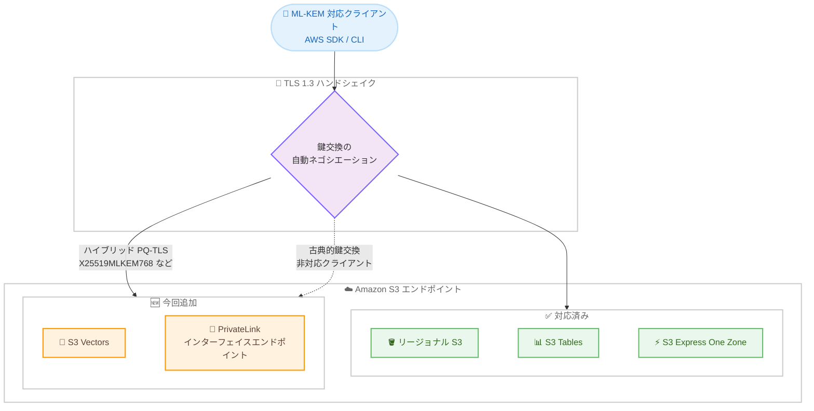

# Amazon S3 - S3 Vectors と AWS PrivateLink エンドポイントへのポスト量子 TLS 鍵交換サポート追加

**リリース日**: 2026 年 11 月 17 日
**サービス**: Amazon S3 (Amazon Simple Storage Service)
**機能**: ポスト量子 TLS (PQ-TLS) 鍵交換の対応エンドポイント拡大

📊 [このアップデートのインフォグラフィックを見る](https://takech9203.github.io/aws-news-summary/20261117-amazon-s3-post-quantum-tls-key-exchange-support.html)

## 概要

Amazon S3 は、ポスト量子 TLS (PQ-TLS) 鍵交換のサポートを S3 Vectors エンドポイントと AWS PrivateLink for Amazon S3 のインターフェイスエンドポイントに拡大しました。これにより、すでに対応済みのリージョナル S3、S3 Tables、S3 Express One Zone の各エンドポイントに加えて、より広い範囲の S3 エンドポイントで量子コンピュータ時代を見据えた通信保護が利用できるようになります。

今回対応したエンドポイントでは、NIST (米国国立標準技術研究所) が標準化したポスト量子暗号アルゴリズムの 1 つである ML-KEM (Module-Lattice-Based Key-Encapsulation Mechanism) を使用した鍵交換がサポートされます。エンドポイント側がクライアントソフトウェアのサポートする最も強力な鍵交換方式を自動的にネゴシエートするため、ML-KEM に対応したクライアントであれば、アプリケーションやエンドポイント設定を変更することなく PQ-TLS の恩恵を受けられます。

「今は暗号化された通信を記録しておき、将来量子コンピュータで解読する」という Harvest Now, Decrypt Later 攻撃への対策として、通信データの長期的な機密性が求められるワークロードを持つすべてのユーザーが対象です。

**アップデート前の課題**

このアップデート以前は、PQ-TLS 対応が一部のエンドポイントに限られていました。

- PQ-TLS 鍵交換はリージョナル S3、S3 Tables、S3 Express One Zone のエンドポイントでのみ利用可能だった
- S3 Vectors エンドポイントへのアクセスでは古典的な鍵交換 (X25519 や secp256r1 など) しか使用できなかった
- AWS PrivateLink のインターフェイスエンドポイント経由の S3 アクセスでは PQ-TLS を利用できず、閉域網経由でも将来の量子計算機による解読リスクが残っていた

**アップデート後の改善**

今回のアップデートにより、以下が可能になりました。

- S3 Vectors エンドポイントで ML-KEM を使用した PQ-TLS 鍵交換が利用可能になった
- AWS PrivateLink for Amazon S3 のインターフェイスエンドポイントでも PQ-TLS 鍵交換が利用可能になった
- エンドポイントが自動的に最も強力な鍵交換方式をネゴシエートするため、ML-KEM 対応クライアントはアプリケーション変更なしで PQ-TLS を利用できる

## アーキテクチャ図



ML-KEM に対応したクライアントが S3 エンドポイントに接続すると、TLS 1.3 ハンドシェイク時にエンドポイントが自動的に最も強力な鍵交換方式を選択します。今回のアップデートで S3 Vectors と PrivateLink インターフェイスエンドポイントがハイブリッド PQ-TLS に対応しました。

## サービスアップデートの詳細

### 主要機能

1. **S3 Vectors エンドポイントの PQ-TLS 対応**
   - ベクトルデータの保存・検索に使用する S3 Vectors エンドポイントで ML-KEM 鍵交換が利用可能
   - AI / ML ワークロードで扱う埋め込みベクトルなどの転送時データを量子耐性のある方式で保護
   - エンドポイント側で自動ネゴシエートされるため追加設定は不要

2. **AWS PrivateLink for Amazon S3 インターフェイスエンドポイントの PQ-TLS 対応**
   - VPC 内のプライベート IP アドレス経由で S3 にアクセスする場合も PQ-TLS を利用可能
   - オンプレミスから AWS Direct Connect や AWS Site-to-Site VPN 経由でアクセスする構成でも、転送時の量子耐性を確保
   - エンドポイント設定の変更は不要

3. **ハイブリッド鍵交換方式の採用**
   - 古典的な鍵交換 (X25519 や P-256) と ML-KEM-768 を組み合わせたハイブリッド方式を採用
   - 従来の暗号強度を維持しながらポスト量子の保護を追加するため、既存のセキュリティ水準を下回ることがない
   - IANA の業界標準仕様に準拠

## 技術仕様

### サポートされる鍵交換方式

Amazon S3 への各リクエストで使用された鍵交換は、AWS CloudTrail の `tlsDetails.keyExchange` フィールドに記録されます。

| keyExchange の値 | 意味 |
|------|------|
| `X25519MLKEM768` | ハイブリッドポスト量子鍵交換 (X25519 + ML-KEM-768)、TLS 1.3 |
| `SecP256r1MLKEM768` | ハイブリッドポスト量子鍵交換 (P-256 + ML-KEM-768)、TLS 1.3 |
| `x25519` | 古典的な楕円曲線鍵交換、TLS 1.3 または TLS 1.2 |
| `secp256r1`, `secp384r1` | 古典的な楕円曲線鍵交換、TLS 1.3 または TLS 1.2 |

### PQ-TLS 対応状況

| エンドポイント種別 | PQ-TLS 対応 |
|------|------|
| リージョナル S3 エンドポイント | 対応済み |
| S3 Tables エンドポイント | 対応済み |
| S3 Express One Zone エンドポイント | 対応済み |
| S3 Vectors エンドポイント | **今回対応** |
| AWS PrivateLink for S3 インターフェイスエンドポイント | **今回対応** |
| マルチリージョンアクセスポイント | 非対応 |

## 設定方法

### 前提条件

1. TLS 1.3 に対応したクライアント環境であること
2. ML-KEM 鍵交換に対応した AWS SDK / AWS CLI / TLS ライブラリ (s2n-tls、AWS CRT ベースの HTTP クライアントなど) を使用していること
3. 鍵交換方式の確認を行う場合は、AWS CloudTrail でデータイベントまたは管理イベントが記録されていること

### 手順

#### ステップ 1: クライアントの PQ-TLS 対応を確認する

```bash
# AWS CLI のバージョンを確認
aws --version
```

使用している AWS CLI や SDK のバージョンを確認します。PQ-TLS のサポート状況は言語やランタイムによって異なるため、AWS SDKs and Tools Reference Guide の「Enabling hybrid post-quantum TLS」で各ツールの対応状況と有効化方法を確認します。

#### ステップ 2: S3 Vectors または PrivateLink エンドポイント経由でアクセスする

```bash
# 例: PrivateLink インターフェイスエンドポイント経由で S3 にアクセス
aws s3 ls --endpoint-url https://bucket.vpce-xxxxxxxx-xxxxxxxx.s3.ap-northeast-1.vpce.amazonaws.com
```

ML-KEM 対応クライアントであれば、エンドポイントが自動的にハイブリッド PQ-TLS をネゴシエートします。アプリケーションコードやエンドポイント設定の変更は不要です。

#### ステップ 3: CloudTrail で鍵交換方式を検証する

```bash
# CloudTrail イベントから tlsDetails を確認
aws cloudtrail lookup-events \
  --lookup-attributes AttributeKey=EventSource,AttributeValue=s3.amazonaws.com \
  --max-results 5 \
  --query "Events[].CloudTrailEvent"
```

CloudTrail イベントの `tlsDetails.keyExchange` フィールドを確認し、`X25519MLKEM768` などのハイブリッドポスト量子鍵交換が使用されていることを検証します。古典的な鍵交換のままのクライアントを特定する用途にも活用できます。

## メリット

### ビジネス面

- **長期的なデータ機密性の確保**: Harvest Now, Decrypt Later 攻撃に対する備えとして、転送時データの長期的な機密性を確保できる
- **コンプライアンス対応の前進**: NIST 標準のポスト量子暗号アルゴリズムを採用しており、量子耐性暗号への移行を求める規制やガイドラインへの対応を早期に進められる
- **追加コストなし**: PQ-TLS 鍵交換は追加料金なしで利用可能

### 技術面

- **アプリケーション変更不要**: エンドポイント側が最も強力な鍵交換方式を自動ネゴシエートするため、ML-KEM 対応クライアントは設定変更なしで利用できる
- **ハイブリッド方式による安全性**: 古典的な鍵交換と ML-KEM を組み合わせるため、セキュリティ水準が従来を下回ることがない
- **検証可能性**: CloudTrail の `tlsDetails.keyExchange` フィールドで、実際に使用された鍵交換方式を監査できる

## デメリット・制約事項

### 制限事項

- マルチリージョンアクセスポイントは PQ-TLS に対応していない
- PQ-TLS が保護するのは転送時 (in transit) のみであり、保存時の保護はサーバー側暗号化 (デフォルトで AES-256) が担う
- ハイブリッド PQ-TLS の利用には TLS 1.3 が必要

### 考慮すべき点

- クライアント側が ML-KEM に対応していない場合は、従来どおり古典的な鍵交換が使用される (接続自体は引き続き可能)
- AWS SDK やツールごとに PQ-TLS の対応状況と有効化方法が異なるため、AWS SDKs and Tools Reference Guide での確認が必要
- S3 サーバーアクセスログには TLS バージョンと暗号スイートは記録されるが、鍵交換方式は記録されないため、検証には CloudTrail を使用する

## ユースケース

### ユースケース 1: PrivateLink 経由の機密データ転送の量子耐性化

**シナリオ**: 金融機関がオンプレミスから Direct Connect と PrivateLink インターフェイスエンドポイント経由で S3 に機密データをアップロードしており、長期保存されるデータの転送経路にも量子耐性を求めている。

**実装例**:
```bash
# ML-KEM 対応の AWS CLI / SDK に更新した上で、既存の
# インターフェイスエンドポイント経由のアクセスをそのまま継続
aws s3 cp confidential-report.pdf \
  s3://finance-archive-bucket/reports/ \
  --endpoint-url https://bucket.vpce-xxxxxxxx-xxxxxxxx.s3.ap-northeast-1.vpce.amazonaws.com
```

**効果**: 閉域網経由の S3 アクセスでも転送時データがハイブリッド PQ-TLS で保護され、将来の量子計算機による解読リスクを低減できる。

### ユースケース 2: S3 Vectors を使用した AI アプリケーションの通信保護

**シナリオ**: 機密性の高い社内文書の埋め込みベクトルを S3 Vectors に保存し、RAG アプリケーションから検索している。ベクトルデータの転送経路にも量子耐性のある暗号化を適用したい。

**実装例**:
```bash
# ML-KEM 対応クライアントから S3 Vectors にクエリを実行
# PQ-TLS はエンドポイント側で自動ネゴシエートされる
aws s3vectors query-vectors \
  --vector-bucket-name my-vector-bucket \
  --index-name my-index \
  --query-vector '{"float32": [0.12, 0.34, ...]}' \
  --top-k 5
```

**効果**: アプリケーションを変更することなく、埋め込みベクトルの転送が量子耐性のある鍵交換で保護される。

### ユースケース 3: CloudTrail による PQ-TLS 移行状況の監査

**シナリオ**: セキュリティチームが組織全体の S3 アクセスについて、どのクライアントがハイブリッド PQ-TLS を使用しているかを棚卸しし、古いクライアントの更新計画を立てたい。

**実装例**:
```sql
-- CloudTrail Lake での検索例
SELECT userAgent, tlsDetails.keyExchange, COUNT(*) AS request_count
FROM event_data_store
WHERE eventSource = 's3.amazonaws.com'
GROUP BY userAgent, tlsDetails.keyExchange
ORDER BY request_count DESC
```

**効果**: 古典的な鍵交換を使用しているクライアントを特定し、計画的にポスト量子暗号対応へ移行できる。

## 料金

S3 Vectors および AWS PrivateLink for S3 での PQ-TLS 鍵交換は、追加料金なしで利用できます。S3 Vectors や PrivateLink 自体の利用料金は従来どおり発生します。

## 利用可能リージョン

すべての AWS リージョンで利用可能です。

## 関連サービス・機能

- **Amazon S3 Vectors**: ベクトルデータをネイティブに保存・検索できる S3 の機能。今回のアップデートでエンドポイントが PQ-TLS に対応
- **AWS PrivateLink**: VPC 内のプライベート IP アドレスから S3 にアクセスするためのインターフェイスエンドポイントを提供。今回のアップデートで PQ-TLS に対応
- **AWS CloudTrail**: `tlsDetails.keyExchange` フィールドにより、各リクエストで使用された鍵交換方式を監査可能
- **s2n-tls / AWS Common Runtime**: AWS が開発する TLS 実装および HTTP クライアント。ML-KEM 鍵交換をサポート
- **AWS KMS / ACM**: S3 以外にも PQ-TLS 対応を進めている AWS サービスの例。AWS 全体のポスト量子暗号移行の一環

## 参考リンク

- 📊 [インフォグラフィック](https://takech9203.github.io/aws-news-summary/20261117-amazon-s3-post-quantum-tls-key-exchange-support.html)
- [公式発表 (What's New)](https://aws.amazon.com/about-aws/whats-new/2026/11/amazon-s3-post-quantum-tls-key-exchange-support/)
- [ドキュメント: Using hybrid post-quantum TLS with Amazon S3](https://docs.aws.amazon.com/AmazonS3/latest/userguide/UsingEncryptionInTransit.PQ-TLS.html)
- [AWS SDKs and Tools Reference Guide: Enabling hybrid post-quantum TLS](https://docs.aws.amazon.com/sdkref/latest/guide/pqtls-details.html)
- [Post-Quantum Cryptography for AWS](https://aws.amazon.com/security/post-quantum-cryptography/)
- [NIST Post-Quantum Cryptography](https://csrc.nist.gov/Projects/Post-Quantum-Cryptography)

## まとめ

今回のアップデートにより、S3 Vectors と AWS PrivateLink for S3 を含むほぼすべての S3 エンドポイントでポスト量子 TLS 鍵交換が利用可能になり、転送時データの量子耐性保護が S3 のアクセス経路全体に広がりました。ML-KEM 対応クライアントであれば設定変更なしで自動的に恩恵を受けられるため、まずは AWS SDK / CLI の対応状況を確認し、CloudTrail の `tlsDetails.keyExchange` フィールドで実際の鍵交換方式を検証することを推奨します。
