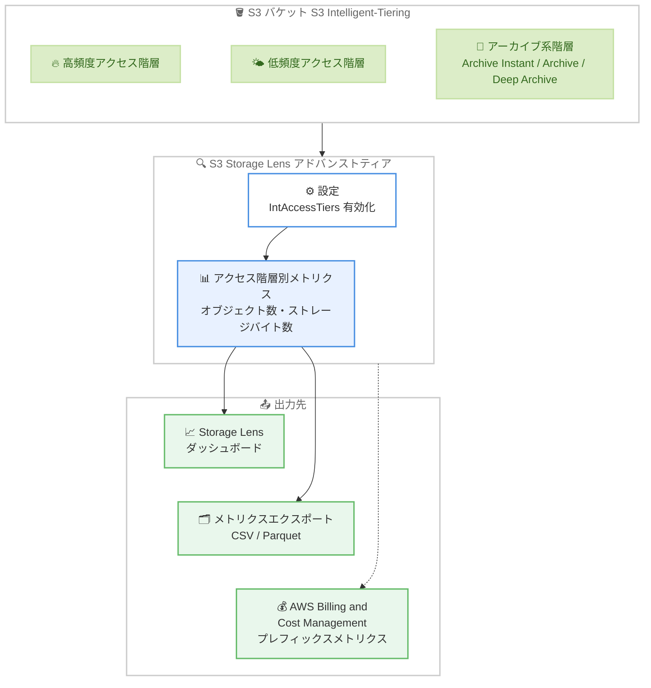

# Amazon S3 Storage Lens - S3 Intelligent-Tiering アクセス階層メトリクスのサポート

**リリース日**: 2026 年 11 月 17 日
**サービス**: Amazon S3 (S3 Storage Lens)
**機能**: S3 Intelligent-Tiering アクセス階層別ストレージメトリクス

📊 [このアップデートのインフォグラフィックを見る](https://takech9203.github.io/aws-news-summary/20261117-amazon-s3-storage-lens-s3-intelligent-tiering-access-tiers.html)

## 概要

Amazon S3 Storage Lens が、S3 Intelligent-Tiering の各アクセス階層ごとのストレージメトリクスを提供するようになりました。バケット全体を横断して、各アクセス階層 (高頻度アクセス、低頻度アクセス、アーカイブインスタントアクセス、アーカイブアクセス、ディープアーカイブアクセス) のオブジェクト数とストレージバイト数を確認できます。これにより、データがどのように階層間を移動しているかの追跡、ストレージコストの見積もり、そしてコスト削減効果の測定が可能になります。

S3 Storage Lens は、組織全体のストレージ使用状況とアクティビティを可視化し、コストとパフォーマンスの最適化を支援する分析機能です。今回追加されたアクセス階層メトリクスは、既存のメトリクスとともに S3 Storage Lens ダッシュボードとメトリクスエクスポートに表示されます。あわせて、S3 Storage Lens はプレフィックスメトリクスを AWS Billing and Cost Management に発行できるようになり、S3 の分割コスト配分データを使用して、共有バケットのコストをチームやアプリケーションに配分できるようになりました。

本アップデートは、S3 Intelligent-Tiering を大規模に利用している組織のストレージ管理者、FinOps 担当者、コスト最適化を推進する Solutions Architect にとって特に有用です。

**アップデート前の課題**

- 以前は S3 Storage Lens でストレージクラス単位の可視化はできたものの、S3 Intelligent-Tiering 内部のアクセス階層ごとの内訳 (オブジェクト数やストレージバイト数) を組織横断で確認できなかった
- S3 Intelligent-Tiering によるコスト削減効果を定量的に測定するには、S3 Inventory や CloudWatch メトリクスを個別に集計する必要があった
- 複数チームが共有するバケットのコストをチームやアプリケーション単位で配分するための、プレフィックスレベルの課金連携が S3 Storage Lens になかった

**アップデート後の改善**

- 今回のアップデートにより、すべてのバケットを横断して各アクセス階層のオブジェクト数とストレージバイト数をダッシュボードとメトリクスエクスポートで確認できるようになった
- 階層間のデータ移動の追跡、ストレージコストの見積もり、S3 Intelligent-Tiering による削減効果の測定が容易になった
- プレフィックスメトリクスの AWS Billing and Cost Management への発行により、S3 の分割コスト配分データを使った共有バケットのコスト配分が可能になった

## アーキテクチャ図



S3 Intelligent-Tiering の各アクセス階層に分散したデータを S3 Storage Lens が階層別に集計し、ダッシュボード、メトリクスエクスポート、AWS Billing and Cost Management へ出力する流れを示しています。

## サービスアップデートの詳細

### 主要機能

1. **アクセス階層別ストレージメトリクス**
   - S3 Intelligent-Tiering ストレージクラス内の対象コアストレージメトリクスを、アクセス階層別に分解して提供
   - 対象となる階層は、高頻度アクセス、低頻度アクセス、アーカイブインスタントアクセス、アーカイブアクセス、ディープアーカイブアクセスの 5 つ
   - バケット横断で各階層のオブジェクト数とストレージバイト数を確認可能

2. **ダッシュボードとメトリクスエクスポートへの統合**
   - アクセス階層メトリクスは、既存メトリクスとともに S3 Storage Lens ダッシュボードに表示される
   - メトリクスエクスポートにも含まれるため、Amazon Athena などの分析ツールで詳細な分析が可能
   - 階層間のデータ移動の追跡や、S3 Intelligent-Tiering によるコスト削減効果の測定に活用できる

3. **AWS Billing and Cost Management へのプレフィックスメトリクス発行**
   - S3 Storage Lens がプレフィックスメトリクスを AWS Billing and Cost Management に発行可能になった
   - S3 の分割コスト配分データ (split cost allocation data) を使用して、共有バケットのコストをチームやアプリケーション単位で配分できる
   - API では `CostAndUsageReportsPublish` 設定の `PrefixLevel` で有効化し、`MinDepth` / `MaxDepth` でプレフィックスの深さを指定する

## 技術仕様

### S3 Intelligent-Tiering アクセス階層

| アクセス階層 | 特徴 |
|------|------|
| 高頻度アクセス階層 | デフォルトの階層。頻繁にアクセスされるオブジェクトを格納 |
| 低頻度アクセス階層 | 連続 30 日間アクセスがないオブジェクトが自動的に移動 |
| アーカイブインスタントアクセス階層 | 連続 90 日間アクセスがないオブジェクトが自動的に移動 |
| アーカイブアクセス階層 | オプトイン。非同期アクセスが許容されるデータ向け |
| ディープアーカイブアクセス階層 | オプトイン。長期アーカイブ向けの最低コスト階層 |

### S3 Storage Lens のメトリクスティア

| 項目 | フリーティア | アドバンストティア |
|------|------|------|
| アクセス階層メトリクス | 利用不可 | 利用可能 (要有効化) |
| クエリ可能期間 | 14 日間 | 15 か月 |
| プレフィックスレベル集計 | 利用不可 | 利用可能 |
| Billing and Cost Management 発行 | 利用不可 | 利用可能 |
| 追加料金 | なし | あり |

### API 変更履歴

| 日付 | サービス | 変更内容 |
|------|----------|----------|
| 2026/11/17 | [AWS S3 Control](https://awsapichanges.com/archive/changes/a370bc-s3-control.html) | 2 updated api methods - `GetStorageLensConfiguration` と `PutStorageLensConfiguration` の `StorageLensConfiguration` に `IntAccessTiers` と `CostAndUsageReportsPublish` が追加 |

### 設定スキーマ (抜粋)

```json
{
  "StorageLensConfiguration": {
    "IntAccessTiers": {
      "IsEnabled": true
    },
    "CostAndUsageReportsPublish": {
      "PrefixLevel": {
        "IsEnabled": true,
        "SelectionCriteria": {
          "MinDepth": 1,
          "MaxDepth": 3
        }
      }
    }
  }
}
```

## 設定方法

### 前提条件

1. S3 Storage Lens のダッシュボード設定でアドバンストティアを選択していること (追加料金が発生)
2. `s3:PutStorageLensConfiguration` および `s3:GetStorageLensConfiguration` の IAM 権限があること
3. 組織全体で集計する場合は、AWS Organizations の信頼されたアクセスが有効化されていること

### 手順

#### ステップ 1: 既存の Storage Lens 設定を確認する

```bash
aws s3control get-storage-lens-configuration \
  --account-id 111122223333 \
  --config-id my-dashboard
```

指定したアカウントとダッシュボード ID の現在の S3 Storage Lens 設定を取得します。既存の設定内容をベースに、アクセス階層メトリクスの設定を追加します。

#### ステップ 2: アクセス階層メトリクスを有効化する

```bash
aws s3control put-storage-lens-configuration \
  --account-id 111122223333 \
  --config-id my-dashboard \
  --storage-lens-configuration '{
    "Id": "my-dashboard",
    "IsEnabled": true,
    "AccountLevel": {
      "ActivityMetrics": {"IsEnabled": true},
      "BucketLevel": {
        "ActivityMetrics": {"IsEnabled": true}
      }
    },
    "IntAccessTiers": {"IsEnabled": true}
  }'
```

`IntAccessTiers` の `IsEnabled` を `true` に設定して Storage Lens 設定を更新し、S3 Intelligent-Tiering アクセス階層メトリクスの収集を有効化します。マネジメントコンソールの場合は、S3 Storage Lens ダッシュボード設定のアドバンストティア設定から有効化します。

#### ステップ 3: ダッシュボードまたはエクスポートでメトリクスを確認する

S3 コンソールの Storage Lens ダッシュボードを開き、S3 Intelligent-Tiering のアクセス階層別にオブジェクト数とストレージバイト数を確認します。メトリクスエクスポートを設定している場合は、エクスポートされた CSV / Parquet ファイルにもアクセス階層メトリクスが含まれます。メトリクスは日次で集計されるため、有効化後の反映には時間がかかる点に注意してください。

## メリット

### ビジネス面

- **コスト削減効果の定量化**: S3 Intelligent-Tiering によってどれだけのデータが低コスト階層に移動し、どの程度の削減効果が得られているかを測定できる
- **コスト配分の精緻化**: プレフィックスメトリクスの Billing and Cost Management 発行により、共有バケットのコストをチームやアプリケーション単位で配分できる
- **ストレージ戦略の意思決定支援**: 階層ごとのデータ分布をもとに、アーカイブアクセス階層のオプトイン可否やライフサイクルポリシーの見直しを判断できる

### 技術面

- **組織横断の可視性**: バケット単位の個別調査なしに、組織・アカウント・バケットレベルで階層別メトリクスを一元的に把握できる
- **既存ワークフローとの統合**: メトリクスエクスポート (CSV / Parquet) に階層メトリクスが含まれるため、Athena などの既存の分析パイプラインをそのまま活用できる
- **運用負荷の軽減**: S3 Inventory やカスタムスクリプトによる階層別集計が不要になり、日次で自動的にメトリクスが更新される

## デメリット・制約事項

### 制限事項

- アクセス階層メトリクスの利用には、アドバンストティア (有料) の設定が必要
- AWS 中国リージョンおよび AWS GovCloud (US) リージョンでは利用できない
- S3 Storage Lens のメトリクスは日次集計であり、リアルタイムの階層分布は確認できない

### 考慮すべき点

- アドバンストティアは監視対象オブジェクト数に応じた追加料金が発生するため、大規模環境では事前にコストを見積もること
- アクセス階層メトリクスはダッシュボード設定ごとに有効化が必要であり、既存ダッシュボードには自動では適用されない
- 分割コスト配分を利用する場合は、AWS Billing and Cost Management 側の設定もあわせて確認すること

## ユースケース

### ユースケース 1: S3 Intelligent-Tiering の削減効果レポート

**シナリオ**: データレイクの大部分を S3 Intelligent-Tiering に移行した企業が、経営層向けにコスト削減効果を定期報告したい。

**実装例**:
```
1. Storage Lens アドバンストティアで IntAccessTiers を有効化
2. メトリクスエクスポートを Parquet 形式で S3 バケットに出力
3. Athena で階層別ストレージバイト数を月次集計し、
   高頻度アクセス階層の料金で保存した場合との差分を算出
```

**効果**: 低頻度アクセス階層以下に移動したデータ量と削減額を定量的に示し、ストレージ戦略の妥当性を客観的に報告できる。

### ユースケース 2: アーカイブ階層オプトインの判断

**シナリオ**: アーカイブアクセス階層とディープアーカイブアクセス階層のオプトインを検討しているが、対象データ量が不明で判断できない。

**実装例**:
```
1. アクセス階層メトリクスでアーカイブインスタントアクセス階層の
   オブジェクト数とバイト数を確認
2. 90 日以上アクセスのないデータ量の推移をダッシュボードで追跡
3. データ量が十分大きいバケットからアーカイブ階層をオプトイン
```

**効果**: 長期間アクセスされないデータ量を根拠として、取り出し時間とのトレードオフを考慮したオプトイン判断ができる。

### ユースケース 3: 共有バケットのチーム別コスト配分

**シナリオ**: 複数チームがプレフィックスで領域を分けて共有しているバケットのストレージコストを、チームごとに配分したい。

**実装例**:
```
1. Storage Lens 設定で CostAndUsageReportsPublish の
   PrefixLevel を有効化 (MinDepth / MaxDepth でプレフィックス深さを指定)
2. AWS Billing and Cost Management で S3 の
   分割コスト配分データを確認
3. プレフィックス単位のコストをチーム別にチャージバック
```

**効果**: バケットを分割することなく、プレフィックス単位でチームやアプリケーションへの正確なコスト配分を実現できる。

## 料金

アクセス階層メトリクスは S3 Storage Lens のアドバンストティアの機能であり、アドバンストティアの追加料金が適用されます。アドバンストティアでは、監視対象のオブジェクト数に基づいて課金されます。フリーティアのメトリクスは引き続き無料で利用できます。最新の料金詳細は [S3 の料金ページ](https://aws.amazon.com/s3/pricing/) を参照してください。

## 利用可能リージョン

AWS 中国リージョンと AWS GovCloud (US) リージョンを除く、すべての AWS リージョンで利用可能です。

## 関連サービス・機能

- **S3 Intelligent-Tiering**: アクセスパターンに応じてオブジェクトを自動的に最適な階層へ移動するストレージクラス。本アップデートの可視化対象
- **AWS Billing and Cost Management**: プレフィックスメトリクスの発行先。S3 の分割コスト配分データによるコスト配分を実現
- **Amazon Athena**: メトリクスエクスポート (CSV / Parquet) を SQL で分析し、階層別のカスタムレポートを作成可能
- **Amazon CloudWatch**: アドバンストティアで Storage Lens メトリクスを発行し、アラームやダッシュボードと連携可能

## 参考リンク

- 📊 [インフォグラフィック](https://takech9203.github.io/aws-news-summary/20261117-amazon-s3-storage-lens-s3-intelligent-tiering-access-tiers.html)
- [公式発表 (What's New)](https://aws.amazon.com/about-aws/whats-new/2026/11/amazon-s3-storage-lens-s3-intelligent-tiering-access-tiers/)
- [S3 Storage Lens ドキュメント](https://docs.aws.amazon.com/AmazonS3/latest/userguide/storage_lens.html)
- [S3 Storage Lens のメトリクスカテゴリ](https://docs.aws.amazon.com/AmazonS3/latest/userguide/storage_lens_basics_metrics_recommendations.html)
- [S3 料金ページ](https://aws.amazon.com/s3/pricing/)

## まとめ

S3 Storage Lens のアクセス階層メトリクスにより、S3 Intelligent-Tiering 内のデータ分布と削減効果を組織横断で定量的に把握できるようになりました。S3 Intelligent-Tiering を利用中でアドバンストティアを有効化している場合は、追加設定でアクセス階層メトリクスを有効化し、コスト最適化の効果測定に活用することを推奨します。共有バケットを運用している組織は、あわせてプレフィックスメトリクスの Billing and Cost Management 発行によるコスト配分の導入も検討してください。
