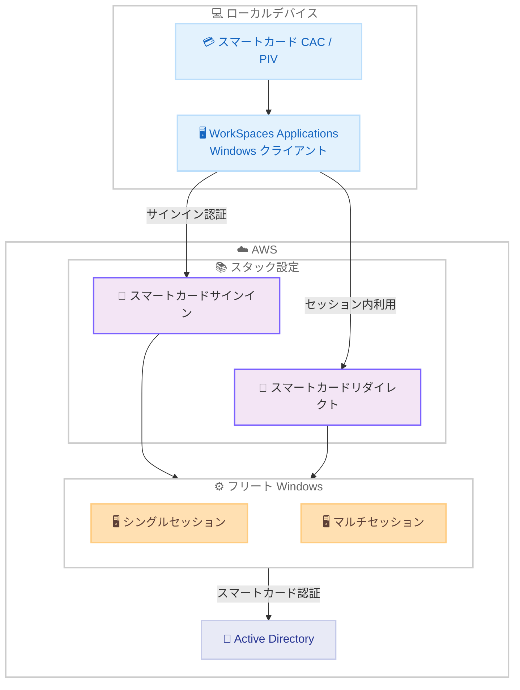

# Amazon WorkSpaces Applications - スマートカードリダイレクトのサポート

**リリース日**: 2026 年 11 月 17 日
**サービス**: Amazon WorkSpaces Applications (旧 Amazon AppStream 2.0)
**機能**: スマートカードリダイレクトおよびマルチセッションフリートでのスマートカードサインイン

📊 [このアップデートのインフォグラフィックを見る](https://takech9203.github.io/aws-news-summary/20261117-amazon-workspaces-applications-smart-card-redirection.html)

## 概要

Amazon WorkSpaces Applications が、シングルセッションフリートとマルチセッションフリートの両方でスマートカードリダイレクトをサポートしました。ユーザーはローカルデバイスに接続したスマートカードを、ストリーミングセッション内のアプリケーションから直接利用できます。また、これまでシングルセッションフリートに限定されていた Active Directory へのスマートカードサインインが、マルチセッションフリートでも利用可能になりました。

管理者はスタックごとに「スマートカードサインイン」と「スマートカードリダイレクト」の 2 つの設定を個別に制御できます。スマートカードサインインにより、ユーザーはパスワードの代わりにスマートカードでドメイン参加済みのストリーミングインスタンスに認証でき、リダイレクトされたスマートカードはセッション内での認証、電子署名、メール暗号化に利用できます。

このアップデートは、Common Access Card (CAC) や Personal Identity Verification (PIV) カードを利用する公共部門、医療機関などの規制の厳しい組織に特に有効です。コスト効率の高いマルチセッションフリートへの移行時にも、スマートカードベースの認証要件を維持できます。

**アップデート前の課題**

- スマートカードサインインはシングルセッションフリートに限定されており、マルチセッションフリートでは利用できなかった
- CAC / PIV カードを必須とする組織は、コスト効率の高いマルチセッションフリートへ移行できなかった
- セッション内でのスマートカード利用を、スタック設定として明示的に制御する手段が限られていた

**アップデート後の改善**

- マルチセッションフリートでもスマートカードサインインとセッション内リダイレクトが利用可能になった
- スタックごとに「スマートカードサインイン」と「スマートカードリダイレクト」を個別に有効化 / 無効化できるようになった
- CAC / PIV カードを利用する組織が、認証要件を維持したままマルチセッションフリートへ移行できるようになった

## アーキテクチャ図



ローカルデバイスのスマートカードは Windows クライアント経由でストリーミングセッションにリダイレクトされ、サインイン認証とセッション内でのアプリケーション利用の両方に使用できます。2 つの設定はスタック単位で個別に制御します。

## サービスアップデートの詳細

### 主要機能

1. **スマートカードリダイレクト**
   - ローカルデバイスに接続されたスマートカードをストリーミングセッション内にリダイレクト
   - セッション内のアプリケーションでの認証、電子署名、メール暗号化に利用可能
   - シングルセッションフリートとマルチセッションフリートの両方に対応

2. **マルチセッションフリートでのスマートカードサインイン**
   - これまでシングルセッションフリート限定だったスマートカードサインインをマルチセッションフリートに拡大
   - パスワードの代わりにスマートカードでドメイン参加済みのストリーミングインスタンスへ認証

3. **スタック単位での個別制御**
   - 「Active Directory へのスマートカードサインイン」と「スマートカードリダイレクト」を独立して有効化 / 無効化可能
   - 新規作成するスタックでは両設定ともデフォルトで無効
   - リダイレクトを既に利用している既存スタックでは、後方互換性のため有効のまま維持

## 技術仕様

### 要件

| 項目 | 詳細 |
|------|------|
| フリートタイプ | Windows シングルセッションフリートおよびマルチセッションフリート |
| イメージ | 最新の WorkSpaces Applications エージェントを実行する Windows イメージ |
| クライアント | WorkSpaces Applications の Windows 用クライアント |
| 設定単位 | スタックごと (サインインとリダイレクトを個別に設定) |
| デフォルト値 | 新規スタックでは両設定とも無効 |

### API 変更履歴

| 日付 | サービス | 変更内容 |
|------|----------|----------|
| 2026/11/17 | [appstream2](https://awsapichanges.com/archive/changes/a370bc-appstream2.html) | 3 updated api methods - Windows マルチセッションフリートでのセッション内スマートカードリダイレクトのサポートを追加 |

更新された API は以下のとおりです。

- `CreateStack`: `UserSettings` の `Action` に `SMART_CARD_REDIRECTION` 列挙値を追加 (リクエストとレスポンス)
- `UpdateStack`: `UserSettings` の `Action` に `SMART_CARD_REDIRECTION` 列挙値を追加 (リクエストとレスポンス)
- `DescribeStacks`: レスポンスの `Stacks` リスト内 `UserSettings.Action` に `SMART_CARD_REDIRECTION` を追加

### 設定例

```json
{
  "Name": "my-stack",
  "UserSettings": [
    {
      "Action": "SMART_CARD_REDIRECTION",
      "Permission": "ENABLED"
    }
  ]
}
```

## 設定方法

### 前提条件

1. 最新の WorkSpaces Applications エージェントを実行する Windows イメージを使用していること
2. ユーザーが WorkSpaces Applications の Windows 用クライアントで接続すること
3. スマートカードサインインを利用する場合、フリートが Active Directory ドメインに参加していること

### 手順

#### ステップ 1: スタックでスマートカードリダイレクトを有効化

```bash
aws appstream update-stack \
  --name my-stack \
  --user-settings "Action=SMART_CARD_REDIRECTION,Permission=ENABLED"
```

既存スタックの `UserSettings` に `SMART_CARD_REDIRECTION` アクションを追加し、ローカルデバイスのスマートカードをセッション内へリダイレクトできるようにします。

#### ステップ 2: 設定の確認

```bash
aws appstream describe-stacks --names my-stack \
  --query "Stacks[0].UserSettings"
```

スタックの `UserSettings` を取得し、`SMART_CARD_REDIRECTION` が `ENABLED` になっていることを確認します。

#### ステップ 3: クライアントからの動作確認

ユーザーは WorkSpaces Applications の Windows 用クライアントでセッションに接続し、ローカルのスマートカードがセッション内のアプリケーションから認識されることを確認します。無効化する場合は、`Permission` を `DISABLED` に設定して `UpdateStack` を実行します。

## メリット

### ビジネス面

- **コスト最適化**: CAC / PIV カードが必須の組織でも、複数ユーザーでインスタンスを共有するコスト効率の高いマルチセッションフリートへ移行可能
- **コンプライアンス維持**: 公共部門や医療機関などの規制要件であるスマートカードベースの多要素認証を、クラウドストリーミング環境でも継続
- **移行の簡素化**: シングルセッションからマルチセッションへの移行時に認証方式を変更する必要がない

### 技術面

- **柔軟な制御**: サインインとリダイレクトをスタック単位で個別に有効化 / 無効化できる
- **セッション内での多用途利用**: 認証に加え、電子署名やメール暗号化にもスマートカードを利用可能
- **API での管理**: `CreateStack` / `UpdateStack` API で設定を自動化でき、IaC にも組み込みやすい

## デメリット・制約事項

### 制限事項

- 最新の WorkSpaces Applications エージェントを実行する Windows イメージが必要
- クライアントは WorkSpaces Applications の Windows 用クライアントに限定 (Web ブラウザアクセスでは利用不可)
- スマートカードサインインにはドメイン参加済みフリートが必要

### 考慮すべき点

- 既存のリダイレクト利用スタックでは後方互換性のため設定が有効のまま維持されるため、不要な場合は明示的に `DISABLED` へ変更する必要がある
- 無効化には最新エージェントバージョンのイメージが必要
- イメージにスマートカードミドルウェア / ドライバーのインストールが必要な場合がある

## ユースケース

### ユースケース 1: 政府機関の CAC ユーザーのマルチセッション移行

**シナリオ**: 政府機関が、CAC サインインを利用しているシングルセッションフリートのユーザーを、コスト効率の高いマルチセッションフリートへ移行したい。

**実装例**:
```bash
# マルチセッションフリートに関連付けたスタックでサインインとリダイレクトを有効化
aws appstream update-stack \
  --name gov-multi-session-stack \
  --user-settings "Action=SMART_CARD_REDIRECTION,Permission=ENABLED"
```

**効果**: CAC によるサインイン要件を維持したままマルチセッションフリートへ移行でき、インスタンスコストを削減できる。

### ユースケース 2: 医療機関での電子署名

**シナリオ**: 医療機関で、ストリーミングセッション内の電子カルテアプリケーションから、職員の PIV カードで電子署名を行いたい。

**実装例**:
```bash
aws appstream update-stack \
  --name healthcare-stack \
  --user-settings "Action=SMART_CARD_REDIRECTION,Permission=ENABLED"
```

**効果**: ローカルのスマートカードをセッション内にリダイレクトし、電子署名やメール暗号化を安全に実行できる。

### ユースケース 3: セキュリティポリシーに応じたスタック別制御

**シナリオ**: 同一組織内で、機密性の高い業務用スタックのみスマートカード認証を必須とし、一般業務用スタックではリダイレクトを無効化したい。

**実装例**:
```bash
# 一般業務用スタックではリダイレクトを無効化
aws appstream update-stack \
  --name general-stack \
  --user-settings "Action=SMART_CARD_REDIRECTION,Permission=DISABLED"
```

**効果**: スタック単位の個別設定により、業務のセキュリティ要件に応じた柔軟なアクセス制御を実現できる。

## 料金

スマートカードリダイレクト機能自体に追加料金はありません。WorkSpaces Applications の標準料金 (インスタンスタイプとフリートタイプに応じた従量課金、およびユーザー料金) が適用されます。マルチセッションフリートは複数ユーザーで 1 つのインスタンスを共有するため、シングルセッションと比較してコストを削減できます。

## 利用可能リージョン

WorkSpaces Applications が提供されているすべての AWS 商用リージョンおよび AWS GovCloud (US) リージョンで利用可能です。

## 関連サービス・機能

- **Amazon WorkSpaces**: フルマネージドの仮想デスクトップサービス。WorkSpaces でも Windows WorkSpaces へのスマートカード認証をサポート
- **AWS Directory Service / Active Directory**: スマートカードサインインの前提となるドメイン参加とユーザー認証基盤
- **AWS Certificate Manager / PKI**: スマートカード認証に使用する証明書の発行・管理基盤との連携

## 参考リンク

- 📊 [インフォグラフィック](https://takech9203.github.io/aws-news-summary/20261117-amazon-workspaces-applications-smart-card-redirection.html)
- [公式発表 (What's New)](https://aws.amazon.com/about-aws/whats-new/2026/11/amazon-workspaces-applications-smart-card-redirection/)
- [ドキュメント: Create a stack](https://docs.aws.amazon.com/appstream2/latest/developerguide/set-up-stacks-fleets-install.html)
- [製品ページ: Amazon WorkSpaces Applications](https://aws.amazon.com/workspaces/applications/)
- [API 変更履歴 (awsapichanges.com)](https://awsapichanges.com/archive/changes/a370bc-appstream2.html)

## まとめ

スマートカードリダイレクトのサポートとマルチセッションフリートへのスマートカードサインイン拡大により、CAC / PIV カードを必須とする公共部門や医療機関などの組織が、認証要件を維持したままコスト効率の高いマルチセッションフリートを採用できるようになりました。該当する組織は、最新エージェントの Windows イメージと Windows 用クライアントを前提に、スタック設定でのリダイレクト有効化とマルチセッション移行の検討を推奨します。
