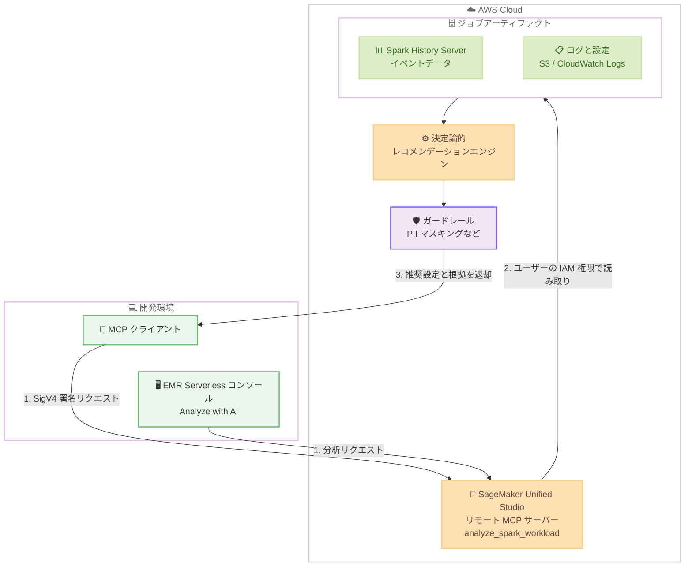

# Amazon EMR Serverless - Apache Spark Optimization Agent

**リリース日**: 2026 年 11 月 17 日
**サービス**: Amazon EMR Serverless
**機能**: Apache Spark Optimization Agent

📊 [このアップデートのインフォグラフィックを見る](https://takech9203.github.io/aws-news-summary/20261117-apache-spark-optimization-agent.html)

## 概要

Amazon EMR Serverless で Apache Spark Optimization Agent が利用可能になりました。このエージェントは、完了した Spark ジョブ実行を分析し、コストとパフォーマンスの最適化レコメンデーションを数秒で提示します。ユーザーはコストまたはパフォーマンスのどちらを優先するかを選択でき、エージェントはテレメトリの証拠と平易な言葉による理由付きで、具体的な設定変更を返します。

エージェントはジョブの設定、ログ、Spark テレメトリを選択した意図とともに入力として受け取り、決定論的なレコメンデーションエンジンで推奨事項を算出します。エンジンはすべてのジョブアーティファクトをまとめて読み取り、並列度の不足、スキューした結合キー、スピルを引き起こすメモリ圧迫、アイドル状態のエグゼキューター、過剰なキャパシティプロビジョニングなど、実行時間とコストを押し上げている要因を特定します。単一の実行の分析に加えて、正常だった過去のベースライン実行との比較により、何が変わったのかを特定することもできます。

アクセスは EMR Serverless コンソールの [Analyze with AI] ボタン、または Amazon SageMaker Unified Studio リモート MCP サーバー経由の MCP クライアントから行えます。すべてのアクセスは AWS IAM で認証され、AWS CloudTrail に記録されます。データエンジニアは本番昇格前の開発段階での設定チューニングにも活用できます。

**アップデート前の課題**

Spark ジョブのチューニングは専門知識と時間を要する作業でした。

- Spark ジョブの最適化には、Spark UI、ログ、メトリクスを手動で突き合わせて分析する必要があり、専門知識と多くの時間が必要だった
- データスキュー、メモリスピル、アイドルエグゼキューターなどの非効率の原因を特定するには、試行錯誤による設定変更の繰り返しが必要だった
- 以前は高速だったジョブが遅くなった場合、過去の実行との差分を体系的に比較する手段がなかった
- コストとパフォーマンスのトレードオフを考慮した設定値の判断は、個人の経験に依存していた

**アップデート後の改善**

エージェントが分析とレコメンデーションを自動化します。

- 完了した Spark ジョブ実行を数秒で分析し、根拠となるテレメトリと理由付きの具体的な設定変更を取得できるようになった
- コストまたはパフォーマンスの目標を指定でき、指定した指標を改善しつつ、もう一方の劣化を定義された範囲内に抑えたレコメンデーションが得られるようになった
- ベースライン実行との比較 (リグレッション分析) により、パフォーマンス劣化の原因となった変更点を特定できるようになった
- 新しい Spark バージョンへのアップグレードや Graviton プロセッサの利用など、プラットフォームレベルのベストプラクティスチェックも自動化された

## アーキテクチャ図



MCP クライアントまたはコンソールからのリクエストは SageMaker Unified Studio リモート MCP サーバーに届き、サーバーがユーザーの IAM 権限でジョブアーティファクトを読み取って分析し、レコメンデーションを返します。MCP クライアントからのアクセスは MCP Proxy for AWS 経由で SigV4 署名されます。

## サービスアップデートの詳細

### 主要機能

1. **単一実行の最適化分析**
   - 完了した 1 回の Spark ジョブ実行を分析し、非効率の一般的な原因を特定する
   - 検出対象: アイドルまたは低稼働のキャパシティ、データスキュー、メモリ圧迫、非効率な読み取りなど
   - 各レコメンデーションには、根拠となるテレメトリの証拠と平易な言葉による理由が付属する

2. **ベースライン比較 (リグレッション分析)**
   - パフォーマンスが劣化した実行を、過去の良好なベースライン実行と比較する
   - 設定、実行メトリクス、ステージとタスクの挙動、シャッフル、キャパシティを比較し、何が変わったのかを特定する
   - ベースラインは同一アプリケーションの過去の実行を実行 ID で指定する

3. **意図 (コストまたはパフォーマンス) に基づく最適化**
   - プロンプトでコスト削減または実行時間短縮のどちらを目標とするかを指定できる
   - 目標を指定しない場合はパフォーマンスを優先し、ベースライン比較では劣化した指標を自動的に採用する
   - コストとパフォーマンスがトレードオフになる場合、指定した指標を改善しつつ、もう一方の劣化を定義された範囲内に抑える

4. **決定論的レコメンデーションエンジンと検証**
   - ルールベースの調査が、メモリ (GC 圧迫、スピル、OOM)、データ (スキュー、ストラグラー、パーティション不足)、キャパシティ (アイドル、サイジング)、実行 (フェッチ失敗、AQE 設定) の 4 カテゴリをチェックする
   - AWS 上で実行される数百万の Spark ジョブで最も頻繁にチューニングされる設定を対象とする
   - 返却前に決定論的ルールで検証し、効果のない設定や目標に反する変更、証拠のないキャパシティ変更を除外する

5. **ベストプラクティスチェックリスト**
   - 新しい Spark バージョンへのアップグレードや Graviton プロセッサの利用など、プラットフォームレベルの改善項目も評価する
   - 各レコメンデーションは変更対象のサーフェスでラベル付けされる: インフラストラクチャ、Spark 設定、コード、データレイアウト

## 技術仕様

### エージェントの仕様

| 項目 | 詳細 |
|------|------|
| 分析対象 | 成功した Spark ジョブ実行 (失敗した実行は Troubleshooting Agent が担当) |
| 対応プラットフォーム | EMR Serverless、AWS Glue |
| 対応 EMR リリース | 7.6 以降 |
| エントリポイント | EMR Serverless コンソールの [Analyze with AI] ボタン、MCP クライアント |
| MCP ツール | `analyze_spark_workload` (sagemaker-unified-studio-mcp-troubleshooting) |
| 入力データ | Spark イベントデータ (Spark History Server)、アプリケーションレベルとジョブ実行レベルの設定、ログ |
| 出力 | サマリー、優先順位付きレコメンデーション (`[config]` / `[infra]` / `[data]`)、推奨 Spark プロパティの現在値と推奨値、ベースライン比較結果 |
| 認証と監査 | AWS IAM で認証、AWS CloudTrail に記録 |
| コード変更の適用 | 読み取り専用。ジョブの変更、開始、停止は行わない |

### IAM とセキュリティ

- エージェントは MCP クライアントに設定された IAM アイデンティティとして動作し、その権限の範囲内でのみ Amazon EMR、Amazon S3、Amazon CloudWatch Logs、Spark History Server のデータを読み取る
- リモート MCP サーバー経由のリクエストには条件キー `aws:ViaAWSMCPService` と `aws:CalledViaAWSMCP` が付与され、IAM ポリシーでアクセス範囲を制御できる
- モデルにデータが渡る前に Amazon Comprehend が PII を検出してマスキングし、すべてのモデル呼び出しは Amazon Bedrock ガードレールを通過する

### 分析プロンプトの例

```text
Analyze EMR Serverless job run {job-run-id} in application {application-id}
and recommend optimizations
```

## 設定方法

### 前提条件

1. EMR Serverless で EMR リリース 7.6 以降を使用してジョブを実行していること
2. 分析対象のジョブ実行が成功 (完了) していること
3. 使用する IAM アイデンティティに、対象のジョブ実行データ (EMR Serverless、S3 のログ、Spark History Server) への読み取り権限があること
4. MCP クライアントから使用する場合は、MCP Proxy for AWS を設定した MCP クライアントと AWS CLI プロファイル

### 手順

#### ステップ 1: コンソールから分析する

EMR Serverless コンソールで対象アプリケーションのジョブ実行を開き、[Analyze with AI] ボタンを選択します。成功した実行に対しては Optimization Agent が自動的に選択され、分析が開始されます。

#### ステップ 2: MCP クライアントから分析する

```text
Analyze EMR Serverless job run 00abc123def456 in application
00fedcba987654 with a cost goal and recommend optimizations
```

MCP クライアントに自然言語でプロンプトを送信します。ジョブ実行 ID とアプリケーション ID を指定し、必要に応じてコストまたはパフォーマンスの目標を明示します。MCP クライアントが `analyze_spark_workload` ツールを呼び出し、分析結果が返されます。

#### ステップ 3: ベースライン比較を実行する

```text
Compare EMR Serverless job run 00abc123def456 against baseline run
00xyz789uvw012 in application 00fedcba987654 and explain what changed
```

劣化した実行と、同一アプリケーションの過去の良好な実行の ID を指定すると、エージェントが設定、メトリクス、ステージ、キャパシティを比較し、リグレッションの原因と緩和策を返します。

#### ステップ 4: レコメンデーションを検証して適用する

返された推奨 Spark プロパティ (現在値と推奨値) を確認し、本番ジョブに適用する前に非本番環境の実行でテストします。分析は対話的に継続でき、特定のレコメンデーションの詳細や、コスト重視への切り替えを追加で依頼できます。

## メリット

### ビジネス面

- **追加コストなしの最適化**: エージェント自体は無料で利用でき、推奨に従うことで EMR Serverless の実行コストを削減できる
- **チューニング工数の削減**: 従来は専門家が時間をかけて行っていた分析が数秒で完了し、データエンジニアの生産性が向上する
- **本番前の品質向上**: 開発段階でのチューニングに活用することで、本番昇格後のコスト超過やパフォーマンス問題を予防できる

### 技術面

- **証拠に基づくレコメンデーション**: テレメトリの証拠と理由が明示されるため、推奨の妥当性を検証した上で適用を判断できる
- **決定論的な検証**: 効果のない設定や目標に反する変更が返却前に除外されるため、推奨の信頼性が高い
- **リグレッション分析**: ベースライン比較により、データ量の増加、設定変更、コード変更のどれが劣化の原因かを体系的に切り分けられる
- **セキュリティ統制**: IAM 認証、CloudTrail 記録、条件キーによるアクセス制御、PII マスキングが組み込まれている

## デメリット・制約事項

### 制限事項

- EMR リリース 7.6 以降のみ対応 (それ以前のリリースで実行したジョブは分析できない)
- AWS GovCloud (US) リージョンと中国リージョンでは利用できない
- 成功した実行のみが対象 (失敗した実行は Apache Spark Troubleshooting Agent の担当)
- Optimization Agent はコードレコメンデーションツール `spark_code_recommendation` をサポートしない
- ベースライン比較は同一アプリケーションの過去の実行に限られる

### 考慮すべき点

- レコメンデーションは提案のみで自動適用されないため、適用とテストはユーザー自身が行う必要がある
- 推奨された変更は本番適用前に非本番環境での検証が推奨されている
- MCP クライアントから使用する場合は MCP Proxy for AWS のセットアップが必要
- 検証のために実行するジョブには通常の EMR Serverless 料金が発生する

## ユースケース

### ユースケース 1: 定期バッチジョブのコスト削減

**シナリオ**: 毎日実行される ETL ジョブの EMR Serverless コストが増加しており、過剰なキャパシティやアイドルエグゼキューターがないか確認したい。

**実装例**:
```text
Analyze EMR Serverless job run <job-run-id> in application <application-id>
with a cost goal and recommend optimizations
```

**効果**: アイドルキャパシティや過剰プロビジョニングが特定され、パフォーマンスの劣化を定義された範囲内に抑えながらコストを削減する設定変更が得られる。

### ユースケース 2: パフォーマンスリグレッションの原因特定

**シナリオ**: 先週まで 30 分で完了していたジョブが今週から 1 時間かかるようになった。データ量、設定、コードのどれが原因か切り分けたい。

**実装例**:
```text
Compare EMR Serverless job run <slow-run-id> against baseline run
<good-run-id> in application <application-id> and explain what changed
```

**効果**: 2 つの実行の設定、メトリクス、ステージ挙動、キャパシティが比較され、リグレッションを引き起こした変更点と緩和策が特定される。

### ユースケース 3: 本番昇格前の開発段階チューニング

**シナリオ**: 新規開発した Spark ジョブを本番に昇格する前に、データスキューやメモリ設定の問題がないか確認し、適切な設定で本番投入したい。

**実装例**:
```text
Analyze EMR Serverless job run <dev-run-id> in application <dev-application-id>
and recommend optimizations for performance
```

**効果**: スキューした結合キーやメモリ圧迫によるスピルなどの問題が開発段階で検出され、本番投入後の手戻りを防止できる。

## 料金

Apache Spark Optimization Agent は追加料金なしで利用できます。エージェントは分析とレコメンデーションを提供し、ユーザーが支払うのは使用する EMR Serverless リソースの料金のみです。推奨された変更を検証するために実行するジョブにも通常の EMR Serverless 料金が適用されます。

## 利用可能リージョン

EMR Serverless が利用可能なすべてのリージョンで利用できます。ただし、AWS GovCloud (US) リージョンと中国リージョンは除きます。EMR リリースバージョン 7.6 以降が対象です。

## 関連サービス・機能

- **Apache Spark Troubleshooting Agent**: 失敗した Spark 実行の根本原因分析と修正提案を行う姉妹機能。EMR on EC2、EMR on EKS、AWS Glue、SageMaker ノートブックにも対応する
- **AWS Glue**: Optimization Agent は AWS Glue の Spark ジョブにも対応しており、Glue Studio Spark UI のイベントログから分析する
- **Amazon SageMaker Unified Studio**: リモート MCP サーバーが `analyze_spark_workload` ツールを提供し、エージェントへの入り口となる
- **AWS IAM / AWS CloudTrail**: すべてのアクセスの認証と監査記録を担い、条件キーによるアクセス制御が可能

## 参考リンク

- 📊 [インフォグラフィック](https://takech9203.github.io/aws-news-summary/20261117-apache-spark-optimization-agent.html)
- [公式発表 (What's New)](https://aws.amazon.com/about-aws/whats-new/2026/11/apache-spark-optimization-agent/)
- [ドキュメント: Apache Spark Optimization Agent for Amazon EMR and AWS Glue](https://docs.aws.amazon.com/emr/latest/ReleaseGuide/spark-optimization-agent.html)
- [ドキュメント: Spark Troubleshooting and Optimization Agents](https://docs.aws.amazon.com/emr/latest/ReleaseGuide/spark-troubleshoot.html)
- [料金ページ: Amazon EMR Serverless](https://aws.amazon.com/emr/pricing/)

## まとめ

Apache Spark Optimization Agent により、これまで専門知識と時間を要していた EMR Serverless 上の Spark ジョブチューニングが、証拠と理由付きのレコメンデーションとして数秒で得られるようになりました。追加料金なしで利用できるため、EMR リリース 7.6 以降を使用しているユーザーは、まずコストが大きい定期ジョブやパフォーマンスが劣化したジョブに対してコンソールの [Analyze with AI] から分析を試すことを推奨します。推奨された変更は非本番環境で検証した上で本番に適用してください。
