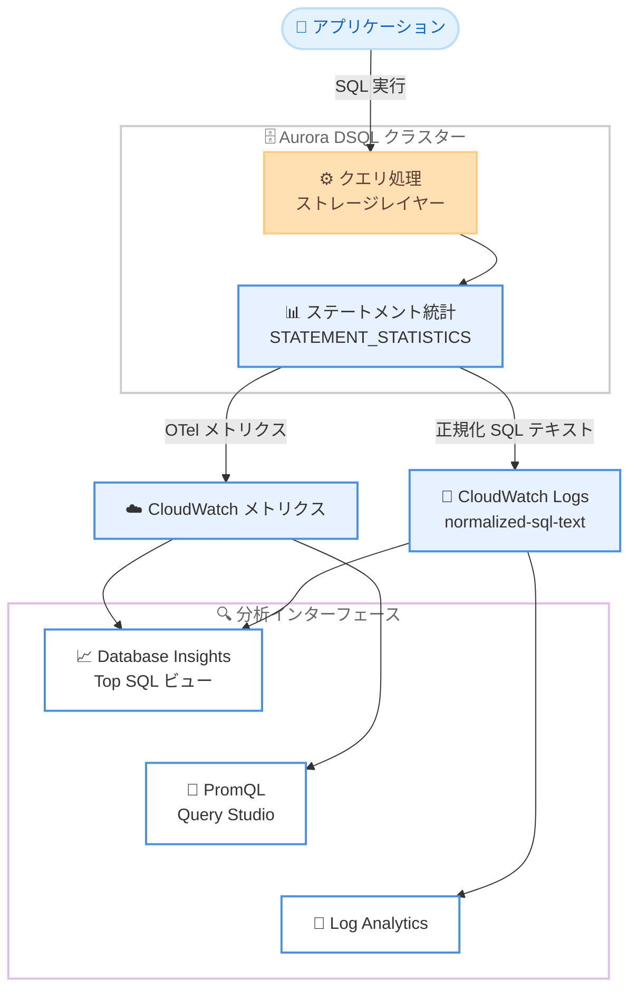

# Amazon Aurora DSQL - Database Insights での SQL ステートメント統計

**リリース日**: 2026 年 11 月 17 日
**サービス**: Amazon Aurora DSQL
**機能**: SQL ステートメント統計 (Statement Statistics)

📊 [このアップデートのインフォグラフィックを見る](https://takech9203.github.io/aws-news-summary/20261117-aurora-dsql-statement-statistics.html)

## 概要

Amazon Aurora DSQL が、クラスターで実行される各 SQL ステートメントの統計を記録し、Amazon CloudWatch の OpenTelemetry (OTel) メトリクスとして発行する機能を提供開始しました。収集された統計は Amazon CloudWatch Database Insights で可視化でき、各ステートメントの実行回数、実行時間、スキャン / 返却 / 変更した行数、使用した DPU (Distributed Processing Unit) を確認できます。

ステートメント統計はサンプリングではなく、成功したすべてのステートメントを計測します。これにより、最も時間がかかるステートメント、最も頻繁に実行されるステートメント、最もコストがかかるステートメントを正確に特定できます。Database Insights の Top SQL からステートメントを選択すると、正規化された SQL テキストと呼び出しごとのチャートを確認でき、CloudWatch の PromQL でメトリクスを直接クエリすることも可能です。

Aurora DSQL を本番ワークロードで運用するユーザーにとって、クエリレベルのパフォーマンス分析とコスト分析を実現する重要なアップデートです。追加の Aurora DSQL 料金は発生せず、標準の CloudWatch メトリクスおよび Logs の料金のみが適用されます。

**アップデート前の課題**

このアップデート以前は、Aurora DSQL でステートメント単位のパフォーマンス分析を行う手段が限られていました。

- クラスターレベルのメトリクスしか確認できず、どの SQL ステートメントが時間や DPU を消費しているかを特定できなかった
- スロークエリやコストの高いクエリの原因調査に、アプリケーション側での計測実装が必要だった
- インデックス追加の必要性など、クエリチューニングの判断材料となるスキャン行数の情報が得られなかった

**アップデート後の改善**

今回のアップデートにより、以下が可能になりました。

- 成功したすべてのステートメントを対象に、実行回数・実行時間・行数・DPU 使用量をステートメント単位で把握できるようになった
- Database Insights の Top SQL ビューで、コードを書かずに問題のあるステートメントを特定できるようになった
- PromQL によるプログラマティックなメトリクス分析や、既存のモニタリングツールとの統合が可能になった
- IAM アイデンティティやアプリケーション名のラベルにより、どの接続元がどのクエリを実行しているかを切り分けられるようになった

## アーキテクチャ図



Aurora DSQL がステートメントごとの統計を OTel メトリクスとして CloudWatch に発行し、正規化 SQL テキストを CloudWatch Logs に書き込みます。収集されたデータは Database Insights、PromQL、Log Analytics の 3 つの方法で分析できます。

## サービスアップデートの詳細

### 主要機能

1. **全ステートメントの統計記録**
   - 成功したすべての `SELECT`、`INSERT`、`UPDATE`、`DELETE` ステートメントをサンプリングなしで計測
   - `BEGIN`、`COMMIT`、`SET` などのユーティリティステートメントや DDL はカウント対象外
   - アプリケーションが直接送信するトップレベルのステートメントのみをカウント
   - コミット時にトランザクションが失敗した場合も、実行されたステートメントはカウントされる

2. **正規化 SQL テキストとクエリ ID**
   - SQL コメントを除去し、リテラル値を `$0` などのプレースホルダーに置換して正規化
   - リテラル値だけが異なるステートメントは同じ正規化テキストとクエリ ID を共有
   - 正規化 SQL テキスト (最大 32 KiB) を CloudWatch Logs の `/aws/dsql/normalized-sql-text` ロググループに書き込み

3. **CloudWatch Database Insights での可視化**
   - Fleet Health ビューから Aurora DSQL クラスターを選択し、Top SQL でステートメントごとの統計を確認
   - Calls/s、Rows/s、平均実行時間、呼び出しあたりの DPU、コンピュート時間とストレージ時間、スキャン行数と返却行数のチャートを表示
   - コードを書かずに問題のあるステートメントを特定可能

4. **PromQL によるプログラマティックなクエリ**
   - CloudWatch Query Studio で PromQL を使用してメトリクスを直接分析
   - `sum_over_time` と `sum by` を組み合わせた集計が基本パターン
   - モニタリングツールとの統合やランキング分析に活用可能

## 技術仕様

### 発行されるメトリクス

| メトリクス | 単位 | 説明 |
|------|------|------|
| `aws.dsql.query.calls` | Count | ステートメントの実行呼び出し回数 |
| `aws.dsql.query.time` | Seconds | プランニングと実行の合計時間 |
| `aws.dsql.query.rows` | Count | 返却または変更した行数 |
| `aws.dsql.query.compute_dpu` | DPU | フィルタリング、ソート、結合などに使用したコンピュート DPU |
| `aws.dsql.query.read_dpu` | DPU | ストレージからのデータ読み取りに使用した読み取り DPU |
| `aws.dsql.query.write_dpu` | DPU | セカンダリインデックスを含む書き込みに使用した書き込み DPU |
| `aws.dsql.query.multi_region_write_dpu` | DPU | マルチリージョンクラスターのピアリージョンで使用した書き込み DPU |
| `aws.dsql.query.compute.time` | Seconds | クエリプロセッサでの処理時間 (ストレージリクエスト時間を除く) |
| `aws.dsql.query.storage.time` | Seconds | 読み取り操作中にストレージサーバーで費やした時間 |
| `aws.dsql.query.scanned_rows` | Count | ストレージスキャンが訪問した推定行数 |

### メトリクスのラベル

| ラベル | 説明 |
|------|------|
| `db.query.id` | 正規化 SQL テキストのフィンガープリント。ステートメント単位のグループ化に使用 |
| `aws.dsql.session.role.arn` | 接続が認証に使用した IAM アイデンティティの ARN |
| `application.name` | 接続パラメータで設定したアプリケーション名 (設定時のみ付与) |
| `@resource.aws.dsql.cluster_id` | クラスター識別子。クラスター単位のフィルタリングに使用 |

### API 変更履歴

| 日付 | サービス | 変更内容 |
|------|----------|----------|
| 2026/11/16 | [dsql](https://awsapichanges.com/archive/changes/f1785c-dsql.html) | 3 updated api methods - `CreateCluster`、`UpdateCluster`、`GetCluster` に `metricGroups` パラメータを追加 |

### データ集計の仕組み

- Aurora DSQL は 1 分ごとのウィンドウで 1 つ以上のデータポイントを CloudWatch に送信する
- 各データポイントは前回のデータポイント以降の作業量のみを保持する (累積値ではなく差分値)
- クラスター、クエリ ID、IAM アイデンティティ、アプリケーション名の組み合わせごとに個別の時系列を保持する
- 差分値のため、PromQL では `rate()` や `increase()` ではなく `sum_over_time` を使用する

## 設定方法

### 前提条件

1. Aurora DSQL クラスターが利用可能であること
2. 設定変更には `dsql:CreateCluster` または `dsql:UpdateCluster` 権限、設定確認には `dsql:GetCluster` 権限が必要
3. PromQL クエリには `cloudwatch:GetMetricData` と `cloudwatch:ListMetrics` 権限が必要

### 手順

#### ステップ 1: 既存クラスターでステートメント統計を有効化

```bash
aws dsql update-cluster \
  --identifier your_cluster_id \
  --metric-groups '[{"metricGroup":"STATEMENT_STATISTICS"}]' \
  --region us-east-1
```

既存クラスターに `STATEMENT_STATISTICS` メトリクスグループを追加して、ステートメント統計を有効化します。コンソールの場合は、クラスターの [Monitoring] タブにある [Advanced monitoring] から設定できます。新規クラスター作成時は `create-cluster` コマンドに同じ `--metric-groups` オプションを指定します。

#### ステップ 2: 設定の確認

```bash
aws dsql get-cluster \
  --identifier your_cluster_id \
  --query 'metricGroups[].metricGroup' --output text \
  --region us-east-1
```

クラスターの現在のメトリクスグループ設定を取得します。有効化されている場合は `STATEMENT_STATISTICS` が出力され、無効の場合は空の出力になります。

#### ステップ 3: Database Insights で統計を確認

1. CloudWatch コンソールで [Database Insights] を開く
2. [Fleet Health] ビューの [Database resources] から Aurora DSQL クラスターの DB Identifier を選択する
3. [Top SQL] でステートメントを選択し、クエリ ID、正規化 SQL テキスト、統計チャートを確認する

#### ステップ 4: PromQL でメトリクスをクエリ

```text
topk(10,
  sum by ("db.query.id") (
    sum_over_time({
      "aws.dsql.query.time",
      "@resource.aws.dsql.cluster_id"="your_cluster_id"
    }[1h])
  )
)
```

CloudWatch Query Studio の PromQL で、過去 1 時間に合計時間が最も長かった上位 10 ステートメントをランキングします。メトリクス名を `aws.dsql.query.calls` や DPU 系メトリクスに変えると、実行回数やコストでのランキングも可能です。

## メリット

### ビジネス面

- **コストの可視化**: ステートメントごとの DPU 使用量 (コンピュート / 読み取り / 書き込み) を確認でき、コストドライバーとなるクエリを特定して最適化の優先順位を付けられる
- **追加料金なしの Aurora DSQL 機能**: Aurora DSQL 側の追加料金は不要で、標準の CloudWatch 料金のみで利用できる
- **運用工数の削減**: アプリケーション側での計測実装なしに、クエリレベルの分析基盤を数分で有効化できる

### 技術面

- **サンプリングなしの完全計測**: 成功したすべてのステートメントを記録するため、低頻度だが高コストなクエリも見逃さない
- **OTel 標準メトリクス**: OpenTelemetry 形式での発行により、PromQL を使った既存のオブザーバビリティツールとの統合が容易
- **多角的な分析ラベル**: クエリ ID に加えて IAM ロール ARN やアプリケーション名で分析でき、マルチテナント環境での切り分けが可能
- **チューニングの判断材料**: スキャン行数と返却行数の比較により、インデックス追加が必要なクエリを特定できる

## デメリット・制約事項

### 制限事項

- デフォルトでは無効であり、クラスターごとに有効化が必要 (マルチリージョンクラスターでは各リージョンのクラスターで個別に有効化が必要)
- 正規化 SQL テキストはステートメントあたり最大 32 KiB まで保存される
- PromQL クエリの時間範囲は最大 24 時間、1 クエリで返される時系列は最大 500 件
- ユーティリティステートメントや DDL、ネストされたステートメントは計測対象外
- 現時点で利用可能なメトリクスグループは `STATEMENT_STATISTICS` のみ

### 考慮すべき点

- CloudWatch メトリクスと CloudWatch Logs の標準料金が発生するため、クエリの種類が非常に多いワークロードでは時系列数とログ量に応じたコストを見積もる必要がある
- リトライされたトランザクション内のステートメントは再度カウントされるため、リトライの多いワークロードでは呼び出し回数が実際のアプリケーションリクエスト数より多く見える
- 無効化後も、オープン中の接続からの統計は数分間、正規化 SQL テキストは最大 1 日間到着する可能性がある
- Aurora DSQL がロググループを新規作成する場合、保持期間は 545 日に設定される (変更可能)

## ユースケース

### ユースケース 1: スロークエリの特定とチューニング

**シナリオ**: Aurora DSQL 上のアプリケーションでレイテンシーが悪化しており、原因となるクエリを特定したい。

**実装例**:
```text
Database Insights の Top SQL で平均実行時間の長いステートメントを確認し、
「Scanned rows per call」と「Returned rows per call」を比較する。
スキャン行数が返却行数を大きく上回る場合はインデックス追加を検討する。
```

**効果**: アプリケーション側の計測実装なしに、フルスキャンに近い動作をしているクエリを特定し、インデックス設計の改善につなげられる。

### ユースケース 2: DPU コストドライバーの分析

**シナリオ**: Aurora DSQL の DPU 料金が想定より高く、どのクエリがコストを押し上げているかを調査したい。

**実装例**:
```text
topk(10,
  sum by ("db.query.id") (
    sum_over_time({
      "aws.dsql.query.compute_dpu",
      "@resource.aws.dsql.cluster_id"="your_cluster_id"
    }[1h])
  )
)
```

**効果**: コンピュート / 読み取り / 書き込みの DPU 使用量をステートメント単位で把握し、最もコストの高いクエリから優先的に最適化できる。

### ユースケース 3: マルチテナント環境でのワークロード切り分け

**シナリオ**: 複数のアプリケーションが同一クラスターを共有しており、どのアプリケーションがどのクエリを実行しているかを把握したい。

**実装例**:
```text
接続パラメータで application.name を設定し、
PromQL で sum by ("application.name") または
sum by ("aws.dsql.session.role.arn") を使用して集計する。
```

**効果**: アプリケーション名や IAM アイデンティティごとにクエリ負荷を切り分け、特定のテナントやサービスに起因する負荷増加を迅速に特定できる。

## 料金

Aurora DSQL 側の追加料金はありません。標準の CloudWatch メトリクスおよび CloudWatch Logs の料金が適用されます。

- OTel メトリクス: CloudWatch のメトリクス料金に基づく (時系列数に依存)
- 正規化 SQL テキスト: CloudWatch Logs の取り込みおよび保存料金に基づく

詳細は [CloudWatch 料金ページ](https://aws.amazon.com/cloudwatch/pricing/) を参照してください。

## 利用可能リージョン

Aurora DSQL が利用可能なすべての AWS リージョンで利用できます。最新のリージョン一覧は [AWS リージョン別サービス一覧](https://aws.amazon.com/about-aws/global-infrastructure/regional-product-services/) を参照してください。

## 関連サービス・機能

- **Amazon CloudWatch Database Insights**: ステートメント統計を可視化するノーコードの UI。Top SQL ビューで正規化 SQL テキストとチャートを確認できる
- **Amazon CloudWatch Query Studio**: PromQL によるメトリクスのインタラクティブな分析環境
- **Amazon CloudWatch Logs / Log Analytics**: 正規化 SQL テキストの保存先。クエリ ID から SQL テキストを検索できる
- **AWS CloudFormation**: `AWS::DSQL::Cluster` リソースの `MetricGroups` プロパティで IaC による設定が可能

## 参考リンク

- 📊 [インフォグラフィック](https://takech9203.github.io/aws-news-summary/20261117-aurora-dsql-statement-statistics.html)
- [公式発表 (What's New)](https://aws.amazon.com/about-aws/whats-new/2026/11/aurora-dsql-statement-statistics/)
- [ドキュメント: Monitoring SQL statements with Aurora DSQL statement statistics](https://docs.aws.amazon.com/aurora-dsql/latest/userguide/dsql-statement-statistics.html)
- [ドキュメント: Query metrics with PromQL](https://docs.aws.amazon.com/AmazonCloudWatch/latest/monitoring/CloudWatch-PromQL.html)
- [ドキュメント: Amazon CloudWatch Database Insights](https://docs.aws.amazon.com/AmazonCloudWatch/latest/monitoring/Database-Insights.html)
- [料金ページ (CloudWatch)](https://aws.amazon.com/cloudwatch/pricing/)

## まとめ

Aurora DSQL のステートメント統計により、サンプリングなしの完全な計測に基づくクエリレベルのパフォーマンス分析と DPU コスト分析が可能になりました。Aurora DSQL を本番運用しているユーザーは、`UpdateCluster` で `STATEMENT_STATISTICS` メトリクスグループを有効化し、Database Insights の Top SQL から高負荷・高コストなステートメントの確認を始めることを推奨します。
