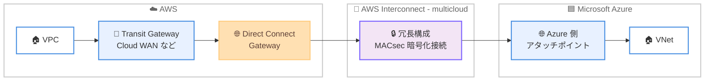

# AWS Interconnect - Microsoft Azure とのマルチクラウド接続が一般提供開始

**リリース日**: 2026 年 11 月 17 日
**サービス**: AWS Interconnect
**機能**: AWS Interconnect - multicloud の Microsoft Azure 対応 (一般提供)

📊 [このアップデートのインフォグラフィックを見る](https://takech9203.github.io/aws-news-summary/20261117-aws-announces-AWS-interconnect-multicloud-azure-ga.html)

## 概要

AWS は、AWS Interconnect - multicloud の Microsoft Azure 対応の一般提供 (GA) を発表しました。AWS Interconnect - multicloud は、AWS の VPC と他のクラウドプロバイダー (CSP) のプライベートネットワークを直接接続するためのマネージド接続サービスで、物理ルーターや仮想ルーターの構成、クロスコネクトの手配、BGP ピアリングの管理を行うことなく、回復性とスケーラビリティを備えたプライベート接続を数分でプロビジョニングできます。

Microsoft Azure は 2026 年 8 月にパブリックプレビューとして AWS Interconnect への対応を開始し、本サービスを支えるオープン仕様 (GitHub で公開) を採用した最新の CSP となりました。今回の GA により、AWS のお客様は Microsoft Azure、Google Cloud、Oracle Cloud Infrastructure (OCI) の 3 つのクラウドに対して、一貫したシンプルな体験でワークロードを相互接続できるようになりました。

マルチクラウド戦略を採用する企業にとって、これまで「自前 (DIY)」で構築する必要があった複雑なマルチクラウドネットワークを、専用のマネージドサービスとして利用できる点が大きな価値です。相互運用性の要件、技術選択の自由度、あらゆる環境へのアプリケーション展開のスピードを重視する組織が主な対象です。

**アップデート前の課題**

- 複数のクラウドプロバイダー間でワークロードを接続する場合、専用線の手配、ルーター構成、BGP ピアリングなどを自前で設計・構築・運用する「DIY 型」のアプローチが必要だった
- グローバルで多層的なネットワークを大規模に構築・管理する複雑さがあり、プロビジョニングに数週間から数か月を要することがあった
- Azure との接続はパブリックプレビューの位置づけで、1 Gbps に制限され、本番利用には適さなかった

**アップデート後の改善**

- Microsoft Azure との Interconnect が一般提供となり、本番ワークロードでの利用が可能になった
- AWS Management Console、CLI、API から数分で回復性のあるプライベート接続をプロビジョニングできるようになった
- Azure、Google Cloud、OCI の 3 つの CSP に対して、同一の一貫したエクスペリエンスでマルチクラウド接続を構成できるようになった

## アーキテクチャ図



AWS 側では Direct Connect Gateway がアタッチポイントとなり、VPC は Transit Gateway、Virtual Private Gateway、または Cloud WAN 経由で接続します。AWS と Azure の間は、2 つ以上の物理的に独立した施設にまたがる冗長なネットワークデバイス上に MACsec で暗号化された接続が自動的にプロビジョニングされ、お客様からは単一の「Interconnect」オブジェクトとして見えます。

## サービスアップデートの詳細

### 主要機能

1. **Microsoft Azure との Interconnect の一般提供**
   - 2026 年 8 月のパブリックプレビューを経て、Azure との multicloud Interconnect が GA となった
   - us-east-1 (バージニア北部)、ap-southeast-2 (シドニー)、eu-central-1 (フランクフルト) の 3 つの AWS リージョンで利用可能
   - AWS Management Console、CLI、API から作成できる

2. **フルマネージドなプロビジョニングと運用**
   - 物理・仮想ルーターの構成、クロスコネクトの手配、VLAN や BGP セッションの設定、継続的なメンテナンスを AWS とプロバイダーが管理する
   - AWS とパートナーが各リージョンに容量を事前プロビジョニングしているため、新しい Interconnect は通常数分で作成される
   - 接続を再プロビジョニングすることなく、コンソールから帯域幅を増減できる

3. **組み込みの回復性とセキュリティ**
   - すべての Interconnect は、独立した電源とネットワークを持つ 2 つ以上の物理施設にまたがる冗長なネットワークデバイス上にプロビジョニングされる
   - デバイス、クロスコネクト、施設の各レベルで単一障害点を排除し、ECMP (等コストマルチパス) による 4 接続モデルで、計画メンテナンス中も少なくとも 1 つのリンクが稼働する
   - AWS とプロバイダーのデバイス間の接続は IEEE 802.1AE MACsec でデフォルト暗号化され、暗号化セッションがアクティブな場合にのみトラフィックを転送する

4. **オープン仕様による CSP 間連携**
   - 本サービスは GitHub で公開されているオープン仕様に基づいており、Azure はこの仕様を採用した最新の CSP
   - 今回の GA により、Azure、Google Cloud、OCI の 3 つの CSP に対して同じ操作体験で接続を作成できる

5. **モニタリング機能**
   - すべての Interconnect に CloudWatch Network Synthetic Monitor が 1 つ追加料金なしで含まれ、ラウンドトリップレイテンシーとパケットロスのメトリクスを取得できる
   - 帯域幅使用率 (%) のメトリクスが CloudWatch で提供され、しきい値アラームを設定して輻輳を未然に防止できる

## 技術仕様

### 主要コンセプト

| 項目 | 詳細 |
|------|------|
| Interconnect | AWS とプロバイダー間にプロビジョニングされるマネージド接続オブジェクト。冗長なインフラを単一の論理オブジェクトとして抽象化 |
| アタッチポイント | 接続の両側で Interconnect を固定する論理識別子。AWS 側は常に Direct Connect Gateway、リモート側は CSP のルーター |
| アクティベーションキー | 接続作成時に生成されるトークン。AWS とプロバイダーの双方がリクエストを検証するために使用 |
| Create/Accept フロー | 一方が Create を実行してアクティベーションキーを生成し、もう一方がそのキーで Accept を実行すると両側で自動プロビジョニングが開始される |
| 暗号化 | IEEE 802.1AE MACsec によるデフォルト暗号化 |
| 対応 AWS ネットワークサービス | Virtual Private Gateway、Transit Gateway、Cloud WAN (いずれも Direct Connect Gateway 経由) |

### 接続スコープに関する考慮事項

| 構成 | 到達範囲 |
|------|----------|
| Virtual Private Gateway / Transit Gateway | Interconnect のローカルリージョン内のみ。リモートリージョンの TGW へは TGW ピアリング経由で到達可能 (リージョン間データ転送料金と TGW データ処理料金が別途発生) |
| Cloud WAN | 同じ Direct Connect Gateway にアタッチされていれば、任意の Core Network Edge からグローバルに任意の Interconnect へ到達可能 |

### API 変更履歴

AWS API Changes フィード (過去 30 日間) には、本アップデートに対応する AWS Interconnect の API 変更エントリは確認できませんでした。Interconnect の操作は AWS Direct Connect コンソールおよび Interconnect の API / CLI 経由で提供されます。

## 設定方法

### 前提条件

1. Virtual Private Gateway、Transit Gateway、Cloud WAN のいずれを使用するかネットワークアーキテクチャを決定する (VGW / TGW はリージョナル、Cloud WAN はグローバルに Interconnect へ到達可能)
2. 既存の IP アドレス割り当てを確認し、Azure 側のアドレス空間と競合しないことを確認する
3. アタッチポイントとして使用する Direct Connect Gateway を新規作成するか、既存のものを再利用する

### 手順

#### ステップ 1: multicloud Interconnect の作成を開始する

AWS Direct Connect コンソールのナビゲーションペインから [AWS Interconnect] を選択し、[Create new multicloud Interconnect] を選択します。接続先の CSP として Microsoft Azure のカードを選択します。

#### ステップ 2: 接続パラメータを指定する

ワークロードが配置されている AWS リージョン (ソース) と、Azure 側のリージョン (デスティネーション) を選択します。続いて、Interconnect の名前、必要な帯域幅、アタッチポイントとなる Direct Connect Gateway (新規作成も可能)、および Azure 側の ID を指定します。この ID は、AWS と Azure が新しい Interconnect のリクエスト元を識別するために使用されます。

#### ステップ 3: 作成リクエストとアクティベーション

内容を確認して [Finish] を選択すると、AWS が Azure へ作成リクエストを送信し、アクティベーションキーが表示されます。Azure 側の手順に従ってこのアクティベーションキーを使用して承認すると、両側で自動プロビジョニングが行われ、Interconnect が指定した Direct Connect Gateway にアタッチされて作成が完了します。以降の操作は不要です。

Azure 側から作成を開始した場合は、AWS Direct Connect コンソールの [Accept multicloud Interconnect] から、Azure 側で生成されたアクティベーションキーを入力して受け入れます。

## メリット

### ビジネス面

- **マルチクラウド戦略の加速**: 相互運用性要件や技術選択の自由度を理由にマルチクラウドを採用する組織が、接続構築の複雑さに妨げられることなくアプリケーションを展開できる
- **リードタイムの大幅な短縮**: 従来数週間から数か月を要した専用接続の構築が、数分でのプロビジョニングに短縮される
- **コストの最適化**: ワークロードの変動に合わせて帯域幅を増減でき、ピーク時にスケールアップし通常時にスケールダウンすることでコストを管理できる

### 技術面

- **運用負荷の削減**: ルーター構成、クロスコネクト、BGP ピアリング、VLAN 設定、メンテナンスを AWS とプロバイダーが管理するフルマネージドモデル
- **高い回復性**: 2 つ以上の物理施設にまたがる冗長デバイスと ECMP による 4 接続モデルにより、デバイス・施設レベルの単一障害点を排除
- **デフォルトのセキュリティ**: MACsec による暗号化がデフォルトで有効化され、暗号化セッションがアクティブな場合のみトラフィックが転送される

## デメリット・制約事項

### 制限事項

- Azure との GA 提供リージョンは us-east-1、ap-southeast-2、eu-central-1 の 3 リージョンに限定される
- Virtual Private Gateway / Transit Gateway を使用する場合、Interconnect のローカルリージョン内の接続に限定される (リモートリージョンへは TGW ピアリングまたは Cloud WAN が必要)
- サポートされる帯域幅はリージョンとプロバイダーの組み合わせによって異なる
- 無料利用枠の Interconnect (500 Mbps) は有料の Interconnect に変換できない

### 考慮すべき点

- 料金は AWS 側のみが対象であり、Azure 側のインフラについては Azure が独自に料金を設定・請求するため、両側の料金を事前に確認する必要がある
- リモートリージョンの TGW から TGW ピアリング経由で Interconnect へ到達する構成では、リージョン間データ転送料金と TGW データ処理料金が別途発生する
- 接続スコープ (Tier) が広がるほど時間料金が高くなるため、ワークロードの配置リージョンと Interconnect のローカルリージョンの関係を設計段階で考慮することが望ましい

## ユースケース

### ユースケース 1: AWS と Azure にまたがるアプリケーション連携

**シナリオ**: 基幹データベースは AWS 上の VPC で運用し、Microsoft Entra ID や Azure 上の SaaS 連携ワークロードと低レイテンシーかつプライベートに通信したい。

**実装例**:
```
1. us-east-1 で multicloud Interconnect を作成し、Azure を接続先 CSP として選択
2. Direct Connect Gateway を Transit Gateway に関連付け
3. VPC を Transit Gateway にアタッチし、Azure VNet とのルーティングを構成
```

**効果**: インターネットを経由しないプライベートで暗号化された接続により、クラウド間のアプリケーション連携をセキュアかつ低運用負荷で実現できる。

### ユースケース 2: Cloud WAN によるグローバルマルチクラウドネットワーク

**シナリオ**: 複数の AWS リージョンにワークロードが分散しており、グローバルネットワーク全体から Azure 上のワークロードへ到達させたい。

**実装例**:
```
1. eu-central-1 で Azure への Interconnect を作成し Direct Connect Gateway にアタッチ
2. その Direct Connect Gateway を Cloud WAN の Core Network セグメントに関連付け
3. 各リージョンの Core Network Edge から最短パスで Interconnect に到達
```

**効果**: 任意のリージョンの Core Network Edge からグローバルに Interconnect へ到達でき、リージョンごとに接続を重複構築する必要がなくなる。

### ユースケース 3: 無料利用枠によるマルチクラウド接続の検証

**シナリオ**: 本格導入の前に、AWS と Azure 間のプライベート接続の動作やレイテンシーを低コストで検証したい。

**実装例**:
```
1. Direct Connect コンソールで AWS Interconnect - multicloud - Free Tier を選択
2. 500 Mbps のローカル Tier 1 Interconnect を作成 (AWS 側は無料)
3. CloudWatch Network Synthetic Monitor でレイテンシーとパケットロスを計測
```

**効果**: AWS 側は追加料金なしで接続を検証でき、CloudWatch メトリクスに基づいて本番導入時の帯域幅を適切にサイジングできる。

## 料金

AWS Interconnect は、選択した帯域幅と接続の地理的スコープという 2 つの入力に基づく単一料金モデルを採用しています。料金は時間単位で計算され、転送データ量に対する個別の課金はありません。各「AWS リージョンと Interconnect のパス」に Tier が割り当てられ、Tier と帯域幅の組み合わせごとに時間料金が決まります。

| Tier | 接続スコープ | 説明 |
|------|--------------|------|
| Tier 1 | ローカル | Interconnect のローカルリージョン内のエンドポイント |
| Tier 2 | リージョナル | 同一の地理的エリア内のリージョンのエンドポイント |
| Tier 3 | 大陸 | 大陸・地理的エリアをまたぐ、より遠方のリージョン |
| Tier 4 | 長距離 | 広大な地理的エリアまたは異なる大陸にまたがるリージョン |
| Tier 5 | 最大スコープ | 最も遠方のリージョン間のパス |

また、一般提供されている CSP ごと・AWS リージョンごとに、ローカル (Tier 1) の 500 Mbps Interconnect を 1 つ無料で利用できます (AWS 側のみ。Azure 側の料金は Azure が独自に設定)。具体的な料金は AWS Interconnect の料金ツールおよび料金ページで確認してください。

## 利用可能リージョン

Microsoft Azure との Interconnect - multicloud は、以下の AWS リージョンで一般提供されています。

- us-east-1 (バージニア北部)
- ap-southeast-2 (シドニー)
- eu-central-1 (フランクフルト)

なお、AWS Interconnect - multicloud 全体としては Google Cloud、Oracle Cloud Infrastructure (OCI) との接続も利用可能です。

## 関連サービス・機能

- **AWS Direct Connect**: Interconnect は Direct Connect コンソールから操作し、Direct Connect Gateway をアタッチポイントとして使用する
- **AWS Transit Gateway**: ローカルリージョン内の複数 VPC を集約して Interconnect に接続するためのリージョナルハブ
- **AWS Cloud WAN**: グローバルネットワークから任意の Interconnect に到達するためのグローバルネットワークサービス
- **Amazon CloudWatch**: Network Synthetic Monitor によるレイテンシー・パケットロス計測と、帯域幅使用率メトリクスの監視

## 参考リンク

- 📊 [インフォグラフィック](https://takech9203.github.io/aws-news-summary/20261117-aws-announces-AWS-interconnect-multicloud-azure-ga.html)
- [公式発表 (What's New)](https://aws.amazon.com/about-aws/whats-new/2026/11/aws-announces-AWS-interconnect-multicloud-azure-ga/)
- [AWS Interconnect 製品ページ](https://aws.amazon.com/interconnect/)
- [ドキュメント: What is AWS Interconnect?](https://docs.aws.amazon.com/interconnect/latest/userguide/what-is-interconnect.html)
- [ドキュメント: Getting started with AWS Interconnect - multicloud](https://docs.aws.amazon.com/interconnect/latest/userguide/getting-started-multicloud.html)
- [ドキュメント: Pricing for AWS Interconnect](https://docs.aws.amazon.com/interconnect/latest/userguide/interconnect-pricing.html)
- [オープン仕様 (GitHub)](https://github.com/aws/Interconnect)

## まとめ

AWS Interconnect - multicloud の Microsoft Azure 対応が GA となり、Azure、Google Cloud、OCI の 3 大クラウドに対して一貫した体験でプライベート接続を数分でプロビジョニングできるようになりました。DIY 型のマルチクラウドネットワーク構築に伴う複雑さと運用負荷を大幅に削減できるため、マルチクラウド戦略を推進する組織は、まず無料利用枠の 500 Mbps Interconnect で接続性とレイテンシーを検証することをお勧めします。
