# AWS Billing and Cost Management - クレジット、Savings Plans、リザーブドインスタンスの一貫した共有コントロール

**リリース日**: 2026 年 11 月 17 日
**サービス**: AWS Billing and Cost Management
**機能**: クレジット、Savings Plans、リザーブドインスタンスに対する対称的できめ細かな共有コントロール

📊 [このアップデートのインフォグラフィックを見る](https://takech9203.github.io/aws-news-summary/20261117-aws-benefits-sharing-capabilities.html)

## 概要

AWS Billing and Cost Management は、クレジット、リザーブドインスタンス (RI)、Savings Plans が組織内でどのように共有されるかを、対称的 (symmetric) かつきめ細かく制御できる新機能を発表しました。すべてのコスト削減ベネフィットに自動的に適用されるデフォルトの共有設定を定義し、ビジネス要件に応じて個々のベネフィット単位でそのデフォルトを上書きできます。

助成金 (グラント) による資金調達、規制上の義務、複数エンティティ構造を持つ組織では、これまで手動のチャージバック (費用配賦) 照合が必要だったベネフィット配分を自動化できるようになります。クレジットについては Billing Preferences ページで Credit Group Sharing を設定すると、新しいクレジットすべてが単一のデフォルト設定を自動的に継承し、クレジットごとの手動設定が不要になります。RI と Savings Plans については、リンクアカウント・支払いアカウントのどちらで購入したかにかかわらず、Savings Plans または Reserved Instances のインベントリページから個々のコミットメント単位で共有設定を構成できます。

すべての共有設定は、Cost Explorer、AWS Budgets、Cost and Usage Report で既に利用されているグルーピング構造である Cost Categories を使用します。あわせて、クレジットの分割・移転を行う SplitCredit / TransferCredit API も追加されています。

**アップデート前の課題**

- クレジットの共有設定はクレジットごとに手動で構成する必要があり、新しいクレジットが付与されるたびに設定作業が発生していた
- RI や Savings Plans の割引共有は組織全体またはアカウント単位の有効化・無効化が中心で、特定のコミットメントを特定のチームやプロジェクトに限定して配分するきめ細かな制御が難しかった
- 助成金や規制要件により特定のアカウント群にのみベネフィットを配分したい組織は、手動のチャージバック照合で対応する必要があった

**アップデート後の改善**

- Billing Preferences ページで Credit Group Sharing のデフォルトを 1 回設定すれば、すべての新規クレジットが自動的にその設定を継承するようになった
- RI と Savings Plans の共有設定を、インベントリページから個々のコミットメント単位 (Level Sharing) で構成できるようになった
- クレジット、RI、Savings Plans のすべてで Cost Categories という同一の仕組みを使う一貫した (対称的な) 共有コントロールが実現し、ベネフィット配分を自動化できるようになった
- SplitCredit / TransferCredit API により、クレジットの分割やアカウント間の移転をプログラムから実行できるようになった

## アーキテクチャ図

```mermaid
flowchart TD
    subgraph Org["🏢 AWS Organizations"]
        Mgmt["👑 管理アカウント<br/>Billing Preferences"]
        subgraph Benefits["💰 コスト削減ベネフィット"]
            direction LR
            CR["🎫 クレジット"]
            SP["📉 Savings Plans"]
            RI["📦 リザーブドインスタンス"]
            CR ~~~ SP ~~~ RI
        end
        CC["🏷️ Cost Categories<br/>アカウントグループを定義"]
        subgraph Members["👥 メンバーアカウント"]
            direction LR
            A1["アカウント A"]
            A2["アカウント B"]
            A3["アカウント C"]
            A1 ~~~ A2 ~~~ A3
        end
    end

    Mgmt -->|"デフォルト共有設定<br/>Credit Group Sharing"| CR
    Mgmt -->|"コミットメント単位の<br/>Level Sharing"| SP
    Mgmt -->|"コミットメント単位の<br/>Level Sharing"| RI
    CR --> CC
    SP --> CC
    RI --> CC
    CC -->|"Prioritized / Restricted モードで<br/>ベネフィットを配分"| Members

    classDef container fill:none,stroke:#CCCCCC,stroke-width:2px,color:#666666
    classDef process fill:#FFFFFF,stroke:#4A90E2,stroke-width:2px,color:#333333
    classDef internal fill:#E8F1FF,stroke:#4A90E2,stroke-width:2px,color:#333333
    classDef decision fill:#F3E5F5,stroke:#7B61FF,stroke-width:2px,color:#333333
    classDef input fill:#E9F7EC,stroke:#66BB6A,stroke-width:2px,color:#333333

    class Org,Benefits,Members container
    class Mgmt process
    class CR,SP,RI internal
    class CC decision
    class A1,A2,A3 input
```



管理アカウントがデフォルトの共有設定とコミットメント単位の Level Sharing を定義し、Cost Categories で定義したアカウントグループに従って各ベネフィットがメンバーアカウントへ配分される構成です。

## サービスアップデートの詳細

### 主要機能

1. **Credit Group Sharing (クレジットのデフォルト共有設定)**
   - Billing Preferences ページで単一のデフォルト設定を構成すると、すべての新規クレジットが自動的にその設定を継承する
   - 共有モードとして Prioritized sharing group または Restricted sharing group を選択し、Benefit group sharing 関連付けを持つ Cost Category でアカウントグループを指定する
   - クレジットごとに手動で共有設定を行うサイクルが不要になる

2. **RI / Savings Plans の Level Sharing (コミットメント単位の共有設定)**
   - Savings Plans または Reserved Instances のインベントリページから、個々のコミットメントの詳細ページで共有設定を構成する
   - リンクアカウントで購入したコミットメントにも、支払いアカウント (管理アカウント) で購入したコミットメントにも設定できる
   - コミットメントに設定した Level Sharing は、組織のグループ共有設定よりも優先される。Level Sharing を設定していないコミットメントは、組織のグループ共有またはオープン共有の設定に従う

3. **共有モード**
   - **Organization-wide (オープン) 共有**: 所有アカウントに適用後、残りの割引を組織内の共有有効化済みアカウント全体で共有する。組織全体の割引額が最大になるモード
   - **Prioritized sharing**: 所有アカウントに適用後、定義したグループ内のアカウントへ優先的に共有し、それでも残った割引は組織内の他の共有有効化済みアカウントへ共有する
   - **Restricted sharing**: 定義したグループ内のアカウントにのみ共有する。未使用のキャパシティが残っていてもグループ外には共有されない

4. **Cost Categories ベースの一貫したグルーピング**
   - グループ共有には Benefit group sharing 関連付け、Level Sharing には Benefit level sharing 関連付けを持つ Cost Category を使用する
   - 1 つの Cost Category を RI、Savings Plans、クレジットで共通して利用できる
   - Cost Explorer、AWS Budgets、Cost and Usage Report で使い慣れた同じ構造で共有先を定義できる

5. **クレジット操作 API の追加**
   - **SplitCredit**: 1 つのクレジットを複数の子クレジットに分割する
   - **TransferCredit**: クレジットを別のアカウントへ移転する
   - 両 API とも dryRun パラメータをサポートし、実行前に影響を確認できる

## 技術仕様

### 共有モードの比較

| 項目 | Organization-wide | Prioritized | Restricted |
|------|-------------------|-------------|------------|
| 所有アカウントへの優先適用 | あり | あり | あり |
| グループ内への共有 | 組織全体 | 優先的に適用 | グループ内のみ |
| グループ外への共有 | あり | 残余分のみあり | なし |
| 組織全体の割引最大化 | 最大 | 高い | グループ定義に依存 |

### API 変更履歴

| 日付 | サービス | 変更内容 |
|------|----------|----------|
| 2026/11/17 | [AWS Billing](https://awsapichanges.com/archive/changes/a370bc-billing.html) | 2 new 2 updated api methods - SplitCredit / TransferCredit API の追加、GetBillingPreferences / UpdateBillingPreferences への BENEFIT_LEVEL_SHARING 機能の追加 |

### 追加・更新された API

| API | 種別 | 内容 |
|------|------|------|
| SplitCredit | 新規 | クレジットを複数の子クレジットに分割。creditId、portions (金額と説明)、clientToken、dryRun を指定 |
| TransferCredit | 新規 | クレジットを destinationAccountId で指定したアカウントへ移転。clientToken、dryRun を指定 |
| GetBillingPreferences | 更新 | features に BENEFIT_LEVEL_SHARING が追加され、ベネフィットレベル共有設定を取得可能に |
| UpdateBillingPreferences | 更新 | feature に BENEFIT_LEVEL_SHARING が追加され、ベネフィットレベル共有設定を更新可能に |

### API 呼び出し例

```python
import boto3

client = boto3.client("billing")

# クレジットを 2 つに分割 (dryRun で事前確認)
response = client.split_credit(
    creditId="credit-id",
    portions=[
        {"amount": "6000", "description": "チーム A 向け"},
        {"amount": "4000", "description": "チーム B 向け"},
    ],
    clientToken="unique-token-1",
    dryRun=True,
)

# ベネフィットレベル共有設定の取得
prefs = client.get_billing_preferences(
    features=["BENEFIT_LEVEL_SHARING"],
)
```

## 設定方法

### 前提条件

1. AWS Organizations の一括請求 (Consolidated Billing) を利用していること
2. 組織の管理アカウントでサインインしていること
3. 共有グループを定義する Cost Category を Billing and Cost Management コンソールで作成できること (グループ共有には Benefit group sharing、Level Sharing には Benefit level sharing の関連付けが必要)

### 手順

#### ステップ 1: クレジットのグループ共有を設定する

1. [AWS Billing and Cost Management コンソール](https://console.aws.amazon.com/costmanagement/) を開く
2. ナビゲーションペインで [Billing preferences] を選択する
3. [Credit sharing preferences] セクションで [Edit] を選択する
4. [Prioritized sharing group] または [Restricted sharing group] を選択する
5. [Cost category] で Benefit group sharing 関連付けを持つ Cost Category を選択するか、[Create cost category] で新規作成する
6. 影響に関する警告を確認し、設定を保存する

この設定がデフォルトとなり、以降に付与されるすべての新規クレジットが自動的にこの共有設定を継承します。

#### ステップ 2: RI / Savings Plans のグループ共有を設定する

1. [Billing preferences] の [Reserved Instances and Savings Plans discount sharing preference] セクションで [Edit] を選択する
2. [Prioritized sharing group] または [Restricted sharing group] を選択する
3. Benefit group sharing 関連付けを持つ Cost Category を選択して保存する

組織全体の RI / Savings Plans 割引共有のデフォルトモードが設定されます。あわせて [Reserved Instances and Savings Plans discount sharing preference by account] でアカウントごとの共有の有効化・無効化を管理します。

#### ステップ 3: 個々のコミットメントに Level Sharing を設定する

1. ナビゲーションペインで [Savings Plans] または [Reservations] 配下の [Inventory] を選択する
2. 対象のコミットメントを選択して詳細ページを開く
3. [Sharing preferences] セクションで [Manage sharing preference] を選択する
4. [Mode] で [Prioritized] または [Restricted] を選択する
5. [Cost category] で Benefit level sharing 関連付けを持つ Cost Category を選択する
6. [Rule] でこのコミットメントを利用できるアカウントを定義するルールを選択する
7. [Selected rule details] で Cost Category、ルール、アカウントを確認し、[Save] を選択する

特定のチームやプロジェクト向けに購入したコミットメントの割引を、定義したアカウント群に限定して配分できます。設定を削除すると、コミットメントは組織の共有設定に従う動作に戻ります。

## メリット

### ビジネス面

- **チャージバック照合の自動化**: 助成金、規制上の義務、複数エンティティ構造を持つ組織が手動で行っていたベネフィット配分の照合作業を自動化できる
- **ガバナンスの強化**: 特定の資金源に紐づくクレジットや、特定の事業部門向けに購入したコミットメントを、意図したアカウント群にのみ配分できる
- **追加コストなし**: 新しい共有コントロールは追加料金なしで利用できる

### 技術面

- **設定の一元化と自動継承**: Credit Group Sharing のデフォルト設定により、クレジットごとの手動設定が不要になる
- **一貫したグルーピング構造**: Cost Explorer、AWS Budgets、Cost and Usage Report と同じ Cost Categories を利用するため、新しい概念を学習するコストが低い
- **API による自動化**: SplitCredit / TransferCredit や UpdateBillingPreferences などのパブリック API により、共有設定やクレジット操作を IaC やスクリプトに組み込める

## デメリット・制約事項

### 制限事項

- 各アカウントは 1 つの共有グループにのみ所属できる
- 組織でグループ共有に関連付けできる Cost Category は同時に 1 つのみ
- 共有用の Cost Category は Billing and Cost Management コンソールで作成・編集する必要があり、ルールで使用できるディメンションは Accounts のみ
- Level Sharing のルールにはコミットメントを所有するアカウントを含める必要があり、Cost Category は管理アカウントに属している必要がある
- 1 つの Cost Category に Benefit group sharing と Benefit level sharing の両方の関連付けを持たせることはできない

### 考慮すべき点

- グループ共有や Level Sharing はオープン共有と比較して、割引が定義したアカウント内に留まるため、組織全体の削減額が低下する可能性がある
- 月の途中で設定を変更すると、その月のこれまでの割引が新しい設定で再適用され、見積もり請求額が変動する。最終的な請求は月末 23:59:59 UTC 時点の設定に基づく
- Savings Plans の割引を共有するには、Savings Plans を所有するアカウント側でも共有が有効化されている必要がある
- 既存の RI / Savings Plans グループ共有に関連付け済みの Cost Category はそのまま動作するが、Benefit group sharing の関連付けへは自動変換されない

## ユースケース

### ユースケース 1: 研究助成金によるクレジットの限定配分

**シナリオ**: 大学や研究機関が複数の研究プロジェクトを別々の AWS アカウントで運用しており、特定の助成金で付与されたクレジットを、その助成金の対象プロジェクトのアカウントにのみ使用させる必要がある。

**実装例**:
```text
1. 助成金対象アカウントを定義する Cost Category を作成 (Benefit group sharing 関連付け)
2. Billing Preferences で Restricted sharing group を選択し、該当 Cost Category を指定
3. 複数の助成金がある場合は SplitCredit でクレジットを分割し、助成金ごとに配分
```

**効果**: 助成金の使途に関する規制・監査要件を満たしつつ、手動のチャージバック照合なしでクレジット配分を自動化できる。

### ユースケース 2: 事業部門専用の Savings Plans

**シナリオ**: 持株会社配下の複数の事業会社が同一の AWS Organizations を利用しており、ある事業会社が自社予算で購入した Savings Plans の割引を他社に流出させたくない。

**実装例**:
```text
1. 事業会社ごとのアカウント群を定義する Cost Category を作成 (Benefit level sharing 関連付け)
2. 対象の Savings Plans の詳細ページで Manage sharing preference を選択
3. Mode に Restricted を選択し、自社アカウント群のルールを指定
```

**効果**: コミットメントの購入元である事業会社内にのみ割引を限定でき、会社間の費用負担の公平性を担保できる。

### ユースケース 3: 優先配分と組織全体の利用率最大化の両立

**シナリオ**: プラットフォームチームが全社向けに RI を購入しているが、まずは基幹システムのアカウント群に割引を優先適用し、余剰分は他チームにも共有して利用率を最大化したい。

**実装例**:
```text
1. 基幹システムのアカウント群を定義する Cost Category を作成
2. 対象の RI の詳細ページで Level Sharing を設定し、Mode に Prioritized を選択
3. 余剰割引は組織内の共有有効化済みアカウントへ自動的に共有される
```

**効果**: 重要ワークロードへの割引適用を優先しつつ、未使用分を組織全体で活用して全体の削減額を最大化できる。

## 料金

追加料金はありません。AWS Billing and Cost Management コンソールおよびパブリック API を通じて無料で利用できます。

## 利用可能リージョン

2026 年 11 月 17 日より、すべての AWS リージョンで利用可能です。

## 関連サービス・機能

- **AWS Cost Categories**: 共有グループの定義に使用するグルーピング構造。Cost Explorer、AWS Budgets、Cost and Usage Report と共通
- **AWS Organizations**: 一括請求 (Consolidated Billing) の基盤であり、ベネフィット共有の前提となるサービス
- **AWS Billing Conductor**: カスタム請求グループを構成するサービス。共有設定の変更は標準の AWS 請求に影響する点に注意
- **Savings Plans / Amazon EC2 リザーブドインスタンス**: 本アップデートで Level Sharing の対象となるコミットメント型割引

## 参考リンク

- 📊 [インフォグラフィック](https://takech9203.github.io/aws-news-summary/20261117-aws-benefits-sharing-capabilities.html)
- [公式発表 (What's New)](https://aws.amazon.com/about-aws/whats-new/2026/11/aws-benefits-sharing-capabilities/)
- [ドキュメント: Billing preferences (Credit Group Sharing)](https://docs.aws.amazon.com/awsaccountbilling/latest/aboutv2/billing-pref.html)
- [ドキュメント: Reserved Instances and Savings Plans discount sharing](https://docs.aws.amazon.com/awsaccountbilling/latest/aboutv2/ri-turn-off.html)
- [AWS API Changes: AWS Billing](https://awsapichanges.com/archive/changes/a370bc-billing.html)

## まとめ

クレジット、RI、Savings Plans の共有を Cost Categories ベースで一貫して制御できるようになり、これまで手動のチャージバック照合に頼っていたベネフィット配分を自動化できます。複数の事業部門や助成金を扱う組織は、まず共有グループを表す Cost Category を設計し、Credit Group Sharing のデフォルト設定と重要なコミットメントの Level Sharing から導入を検討することを推奨します。
