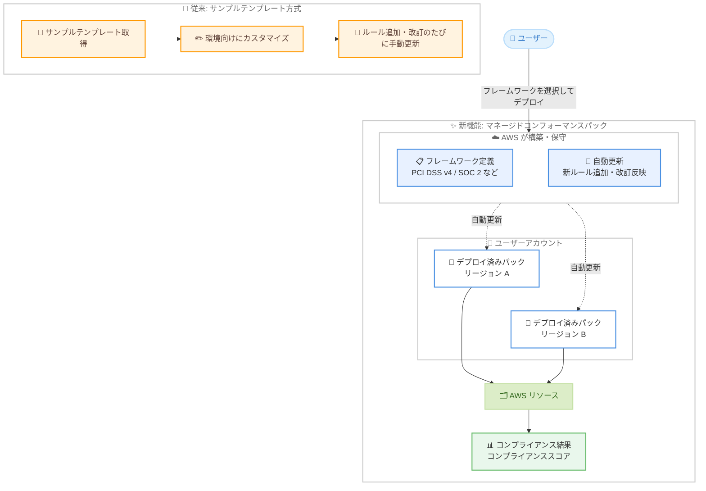

# AWS Config - マネージドコンフォーマンスパック

**リリース日**: 2026 年 11 月 17 日
**サービス**: AWS Config
**機能**: マネージドコンフォーマンスパック (Managed Conformance Packs)

📊 [このアップデートのインフォグラフィックを見る](https://takech9203.github.io/aws-news-summary/20261117-aws-config-managed-conformance-packs.html)

## 概要

AWS Config がマネージドコンフォーマンスパックを発表しました。マネージドコンフォーマンスパックは、特定のコンプライアンスおよびガバナンスフレームワーク向けに AWS が構築・保守する事前定義済みの AWS Config ルールのコレクションです。デプロイ時にフレームワークを選択するだけで、AWS Config がリソースをそのフレームワークに照らして評価します。

最大の特長は、AWS がパックの内容を継続的に最新の状態に保つ点です。フレームワークのコントロールに対応する新しい AWS Config マネージドルールが登場した場合や、フレームワーク自体が改訂された場合、AWS はデプロイ済みのパックを自動的に更新します。また、サポートされるすべてのリージョンで一貫したパック定義が維持されるため、リージョンごとにルールセットを構築・保守することなく、同じフレームワークを複数リージョンに展開できます。

コンプライアンス管理やガバナンスを担当するセキュリティチーム、監査対応チーム、および PCI DSS や SOC 2 などのフレームワークへの準拠状況を継続的に可視化したい組織にとって、運用負荷を大きく削減するアップデートです。

**アップデート前の課題**

マネージドコンフォーマンスパック以前は、フレームワークに対する評価を行うために多くの手作業が必要でした。

- PCI DSS や SOC 2 などのフレームワークに対して評価するには、サンプルコンフォーマンスパックテンプレートを起点に、環境に合わせてカスタマイズする必要があった
- 新しいルールが利用可能になった場合や、フレームワークが変更された場合、テンプレートを自分で更新し続ける必要があった
- リージョンごとに利用可能なルールが異なるため、リージョン別のテンプレート管理が必要になるケースがあった

**アップデート後の改善**

今回のアップデートにより、フレームワーク準拠の評価にかかる保守作業が大幅に削減されました。

- フレームワークを選択してデプロイするだけで、AWS がパックの構築・保守を担うため、テンプレートの作成・更新作業が不要になった
- 新しいマネージドルールのマッピングやフレームワークの改訂に応じて、デプロイ済みパックが自動的に更新されるようになった
- 各パックはデプロイ先リージョンで利用可能なマネージドルールを自動的に含み、新しいルールが利用可能になると自動追加されるため、リージョン別テンプレートが不要になった
- ルールのパラメータは環境に合わせて設定・更新でき、コンプライアンス結果とコンプライアンススコアは AWS Config コンソールで他のルールやコンフォーマンスパックと並べて確認できる

## アーキテクチャ図



従来はサンプルテンプレートのカスタマイズと手動更新が必要でしたが、マネージドコンフォーマンスパックではフレームワークを選択してデプロイするだけで、AWS がパック定義の保守と自動更新を行います。

## サービスアップデートの詳細

### 主要機能

1. **AWS によるパックの構築・保守**
   - AWS がコンプライアンス・ガバナンスフレームワークごとに事前定義されたパックを構築・保守する
   - ユーザーはフレームワークを選択してデプロイするだけで、AWS Config がリソースを評価する
   - テンプレートの作成やカスタマイズは不要

2. **デプロイ済みパックの自動更新**
   - フレームワークのコントロールに対応する新しい AWS Config マネージドルールが登場すると、デプロイ済みのパックに自動追加される
   - フレームワーク自体が改訂された場合も、AWS がパックを自動更新する
   - 新しく追加されたルールはデフォルトのパラメータ値でデプロイされ、作成時に自動的に評価される
   - ルールの追加・更新・削除が行われると、Amazon CloudWatch メトリクスで通知される

3. **リージョン間で一貫したパック定義**
   - AWS がサポートされるすべてのリージョンで一貫したパック定義を維持する
   - 各パックはデプロイ先リージョンで利用可能なマネージドルールを含み、そのリージョンで新しいルールが利用可能になると追加される
   - リージョン別のルールセットを構築・保守することなく、同じフレームワークを複数リージョンに展開できる

4. **ルールパラメータのカスタマイズ**
   - デプロイ時にパック内のルールのパラメータを環境に合わせて設定できる
   - デプロイ後もサポートされるパラメータを更新できる
   - パラメータを指定しない場合はデフォルト値が使用される

5. **コンソールでの統合された可視化**
   - コンプライアンス結果とコンプライアンススコアが AWS Config コンソールに表示される
   - 既存のルールやコンフォーマンスパックと並べて確認できる

### 対応フレームワーク

AWS Config ドキュメントのマネージドコンフォーマンスパックカタログによると、リリース時点で以下のフレームワークに対応しています。

| カテゴリ | フレームワーク |
|------|------|
| AWS ベストプラクティス | AWS Well-Architected Framework v10 (全体および 6 つの柱別パック) |
| セキュリティ標準 | CIS Critical Security Controls v8 (IG1 / IG2 / IG3)、NIST SP 800-53 Rev. 5、NIST SP 800-171 Rev. 2 |
| コンプライアンス・監査 | PCI DSS v4、SOC 2 - AICPA Trust Services Criteria、ISO/IEC 27001:2022 - Annex A |
| 政府・防衛 | FedRAMP Rev. 5 (High / Moderate / Low)、CMMC 2.0 - Level 2 |
| 金融 | Cyber Risk Institute (CRI) Profile v2 |
| AI ガバナンス | EU AI Act、NIST AI RMF、ISO/IEC 42001:2023 |

EU AI Act や NIST AI RMF といった AI ガバナンスフレームワークが含まれている点は、生成 AI ワークロードのガバナンスに取り組む組織にとって注目に値します。

## 技術仕様

### マネージドコンフォーマンスパックの仕様

| 項目 | 詳細 |
|------|------|
| パックの定義 | AWS が構築・保守 (ユーザーによるルールの追加・削除は不可) |
| ルールパラメータ | デプロイ時に設定可能、デプロイ後も更新可能 |
| 自動更新 | 新ルールのマッピング、フレームワーク改訂時に AWS が自動更新 |
| 更新通知 | Amazon CloudWatch メトリクスで通知 |
| デプロイ単位 | 個別の AWS アカウントとリージョン |
| Organizations 対応 | 組織コンフォーマンスパックによる組織全体へのデプロイは非対応 |
| リージョン化 | デプロイ先リージョンでサポートされるルールのみがデプロイされる |
| 前提条件 | 対象リソースタイプの AWS Config レコーディングが有効であること |

### API 変更履歴

| 日付 | サービス | 変更内容 |
|------|----------|----------|
| 2026/11/17 | [AWS Config](https://awsapichanges.com/archive/changes/a370bc-config.html) | 3 updated api methods - マネージドコンフォーマンスパック対応。`PutConformancePack` に `Source` と `Scope` パラメータが追加、`DescribeConformancePacks` と `DescribeConformancePackStatus` に `Type` フィールドと type フィルターが追加、`DescribeConformancePackStatus` にオプションの `StackArn` が追加 |

## 設定方法

### 前提条件

1. AWS Config が有効化されており、コンフィギュレーションレコーダーが実行中であること
2. 評価対象のリソースタイプに対して AWS Config レコーディングが有効であること (すべてのサポート対象リソースタイプの記録が推奨)
3. コンフォーマンスパックのデプロイに必要な IAM 権限 (`config:PutConformancePack` など) があること

### 手順

#### ステップ 1: AWS Config コンソールでコンフォーマンスパックを開く

AWS Config コンソールを開き、ナビゲーションペインから [Conformance packs] を選択します。マネージドコンフォーマンスパックのカタログから、デプロイしたいフレームワークを選択します。

#### ステップ 2: ルールパラメータの設定とデプロイ

デプロイ時に、パックに含まれるルールのパラメータを環境に合わせて設定します。パラメータを指定しない場合はデフォルト値が使用されます。設定後、デプロイを実行します。

#### ステップ 3: CLI でのデプロイ (オプション)

```bash
# マネージドコンフォーマンスパックをデプロイ
# Source パラメータでマネージドパックのフレームワークを指定する
aws configservice put-conformance-pack \
  --conformance-pack-name my-managed-pack \
  --source <マネージドパックのソース指定>

# デプロイ済みコンフォーマンスパックを種類でフィルタリングして確認
aws configservice describe-conformance-packs

# デプロイステータスを確認
aws configservice describe-conformance-pack-status
```

`put-conformance-pack` は今回のアップデートで追加された `Source` パラメータによりマネージドパックのデプロイに対応しました。`describe-conformance-packs` と `describe-conformance-pack-status` では、新しく追加された `Type` フィールドによりマネージドパックとカスタムパックを区別できます。具体的なパラメータ形式は AWS CLI リファレンスを確認してください。

#### ステップ 4: コンプライアンス結果の確認

デプロイ後、AWS Config コンソールの [Conformance packs] ダッシュボードで、コンプライアンス結果とコンプライアンススコアを確認します。結果は既存のルールやコンフォーマンスパックと並べて表示されます。

## メリット

### ビジネス面

- **コンプライアンス運用コストの削減**: フレームワークの変更追跡やルールの手動更新が不要になり、コンプライアンスチームの運用負荷が削減される
- **準拠状況の鮮度維持**: AWS がパックを自動更新するため、フレームワーク改訂への追従漏れによる評価の陳腐化リスクが低減される
- **AI ガバナンスへの対応**: EU AI Act や NIST AI RMF などの AI ガバナンスフレームワークに対する評価を迅速に開始できる

### 技術面

- **マルチリージョン展開の簡素化**: リージョンごとのテンプレート管理が不要になり、同一フレームワークを複数リージョンへ一貫して展開できる
- **新ルールの自動取り込み**: 新しいマネージドルールがフレームワークのコントロールにマッピングされると自動的にパックへ追加され、評価が開始される
- **既存ワークフローとの統合**: コンプライアンス結果とスコアが AWS Config コンソールに統合表示され、既存の運用フローを変えずに利用できる

## デメリット・制約事項

### 制限事項

- マネージドコンフォーマンスパックに含まれるルールの追加・削除はできない (ルール構成を制御したい場合はカスタムコンフォーマンスパックを使用する)
- 組織コンフォーマンスパックによる AWS Organizations 全体への一括デプロイには対応していない (個別のアカウント・リージョン単位でデプロイする)
- 中東 (UAE) と中東 (バーレーン) リージョンでは利用できない
- デプロイされるルールは、リージョンでの AWS Config ルールの利用可否に応じてリージョンごとに異なる場合がある

### 考慮すべき点

- マネージドコンフォーマンスパックは法令・規制・業界標準への準拠を保証するものではなく、準拠の判断はユーザーの責任となる
- 新しいルールはデフォルトパラメータ値で自動デプロイされ即時評価されるため、意図しない非準拠検出が増える可能性がある (CloudWatch メトリクスによる更新通知の監視を推奨)
- ルールの評価対象リソースタイプの AWS Config レコーディングが有効でないと正しく評価されない
- パックのデプロイにより AWS Config ルール評価が発生し、評価数に応じた料金が発生する

## ユースケース

### ユースケース 1: PCI DSS v4 準拠状況の継続的モニタリング

**シナリオ**: 決済システムを運用する企業が、PCI DSS v4 への準拠状況を継続的に評価したい。従来はサンプルテンプレートをカスタマイズし、ルールの追加のたびに手動更新していた。

**実装例**:
```text
1. AWS Config コンソールで [Conformance packs] を開く
2. マネージドコンフォーマンスパックから PCI DSS v4 を選択
3. ルールパラメータを環境に合わせて設定してデプロイ
4. コンプライアンススコアをダッシュボードで継続的に確認
```

**効果**: テンプレートの保守作業が不要になり、PCI DSS v4 の改訂や新ルールの追加にも自動で追従。監査準備の工数を削減できる。

### ユースケース 2: マルチリージョン環境への NIST SP 800-53 の一括適用

**シナリオ**: 複数リージョンでワークロードを運用する組織が、NIST SP 800-53 Rev. 5 に基づくガバナンスをすべてのリージョンで統一的に適用したい。

**実装例**:
```text
1. 各リージョンで NIST SP 800-53 Rev. 5 のマネージドパックをデプロイ
2. 各リージョンではそのリージョンで利用可能なルールが自動的に含まれる
3. 新しいルールがリージョンで利用可能になると自動的に追加される
```

**効果**: リージョン別のテンプレート管理が不要になり、全リージョンで一貫したフレームワーク評価を維持できる。

### ユースケース 3: 生成 AI ワークロードの AI ガバナンス評価

**シナリオ**: 生成 AI アプリケーションを運用する企業が、EU AI Act や NIST AI RMF に基づく AI ガバナンス態勢の評価を開始したい。

**実装例**:
```text
1. マネージドコンフォーマンスパックから EU AI Act または NIST AI RMF を選択
2. AI ワークロードが稼働するリージョンにデプロイ
3. コンプライアンス結果をもとにガバナンス上のギャップを特定
```

**効果**: AI ガバナンスフレームワークに対応するルールセットを自前で構築することなく、評価を迅速に開始できる。

## 料金

マネージドコンフォーマンスパックの評価は、標準のコンフォーマンスパック評価レートで課金されます。コンフォーマンスパック内の AWS Config ルールによるリソース評価 1 回ごとに料金が発生する従量課金で、評価数に応じた段階的な料金体系です。

### 料金例 (米国東部・バージニア北部リージョン)

| 使用量 | 料金 (概算) |
|--------|------------------|
| 最初の 100,000 評価 | 1 評価あたり 0.001 USD |
| パック 5 個 × 各 10 ルール × ルールあたり 300 評価 = 15,000 評価 | 15 USD / 月 |

最新の料金と 100,000 評価を超える場合の段階料金は [AWS Config 料金ページ](https://aws.amazon.com/config/pricing/) を参照してください。

## 利用可能リージョン

中東 (UAE) と中東 (バーレーン) を除くすべての AWS 商用リージョンで利用可能です。東京・大阪リージョンを含みます。サポートされるリージョンの完全なリストは [AWS Capabilities by Region](https://aws.amazon.com/about-aws/global-infrastructure/regional-product-services/) を参照してください。

## 関連サービス・機能

- **AWS Config マネージドルール**: マネージドコンフォーマンスパックを構成する評価ルール。新しいルールがフレームワークのコントロールにマッピングされるとパックに自動追加される
- **カスタムコンフォーマンスパック**: ルール構成を自分で制御したい場合に YAML テンプレートで作成するコンフォーマンスパック。AWS Organizations 全体へのデプロイにも対応
- **AWS Security Hub**: セキュリティ標準に基づくチェックとセキュリティ態勢の統合管理を提供。AWS Config と連携してコンプライアンス可視化を補完する
- **Amazon CloudWatch**: マネージドパック内のルールの追加・更新・削除をメトリクスで通知する

## 参考リンク

- 📊 [インフォグラフィック](https://takech9203.github.io/aws-news-summary/20261117-aws-config-managed-conformance-packs.html)
- [公式発表 (What's New)](https://aws.amazon.com/about-aws/whats-new/2026/11/aws-config-managed-conformance-packs)
- [AWS Config Developer Guide - Conformance Packs](https://docs.aws.amazon.com/config/latest/developerguide/conformance-packs.html)
- [AWS Config Developer Guide - Managed Conformance Packs](https://docs.aws.amazon.com/config/latest/developerguide/managed-conformance-packs.html)
- [AWS Config Developer Guide - Managed Conformance Pack Catalog](https://docs.aws.amazon.com/config/latest/developerguide/managed-conformance-pack-catalog.html)
- [AWS Config 料金ページ](https://aws.amazon.com/config/pricing/)

## まとめ

AWS Config のマネージドコンフォーマンスパックにより、PCI DSS v4 や SOC 2、NIST SP 800-53 などの主要フレームワークに対する評価が、テンプレートの作成・保守なしで利用できるようになりました。AWS がパックを自動更新するため、フレームワーク改訂や新ルール追加への追従作業が不要になります。現在サンプルテンプレートベースのコンフォーマンスパックを手動で保守している場合は、マネージドコンフォーマンスパックへの移行を検討することを推奨します。
