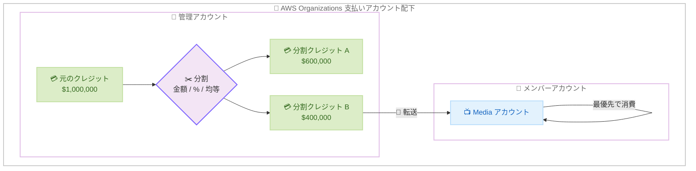

# AWS Billing - クレジットの分割と転送

**リリース日**: 2026 年 11 月 17 日
**サービス**: AWS Billing and Cost Management
**機能**: クレジットの分割と転送 (Credit Splitting and Transfers)

📊 [このアップデートのインフォグラフィックを見る](https://takech9203.github.io/aws-news-summary/20261117-aws-credit-splitting-transfers.html)

## 概要

AWS は、AWS クレジットの分割 (Split) と転送 (Transfer) のサポートを発表しました。お客様は任意の AWS クレジットを複数の小さなクレジットに分割し、支払いアカウント (payer account) 配下のリンクされたアカウントに転送できるようになります。FinOps チームは、金額指定、パーセンテージ指定、均等分割のいずれかの方法でクレジットを分割し、それぞれをクレジットを獲得したチームに転送できます。

分割後の各クレジットは元のクレジットと同じ有効期限および対象サービス (service eligibility) を継承します。また、分割されたクレジットはデフォルトで共有設定を保持するため、未使用の残高は他の対象アカウントに引き続き適用されます。クレジットを転送されたアカウントは、そのクレジットを最優先で消費できます。

本機能は、クレジットレベル共有 (credit-level sharing) やクレジットの一時停止 (credit pausing) といった既存のクレジット管理機能と自然に組み合わせて利用できます。たとえば、1 つの分割クレジットを複数アカウントで共有しつつ、別の分割クレジットは単一アカウントに制限する、将来のプロジェクト用に確保したクレジットを一時停止して必要になったら再開する、といった柔軟な運用が可能です。

**アップデート前の課題**

- 以前は、クレジットはまず所有アカウントに適用され、余剰分が使用量に基づいて他のアカウントに共有される仕組みだったため、大きなクレジットを持つお客様が特定のチームやビジネスユニットに正確な金額を割り当てることが困難だった
- 1 つの大きなクレジットが複数チーム向けである場合、所有アカウントが他チーム分の金額まで消費してしまう可能性があった
- FinOps チームは、チームごとのクレジット配分を管理するために毎月何時間もの手作業によるチャージバック作業が必要だった

**アップデート後の改善**

- 任意のクレジットを金額指定、パーセンテージ指定、均等分割で複数の小さなクレジットに分割できるようになった
- 分割したクレジットを組織内の任意のアカウントに転送し、チームやビジネスユニットごとに予測可能なクレジット予算を提供できるようになった
- 転送先アカウントがクレジットを最優先で消費できるため、意図したチームに確実にクレジットを届けられるようになった
- AWS Billing コンソール、CLI、API のいずれからも操作でき、チャージバックの自動化が可能になった

## アーキテクチャ図



管理アカウントが保有する $1,000,000 のクレジットを $600,000 と $400,000 に分割し、$400,000 分を Media アカウントに転送する例です。転送を受けた Media アカウントはそのクレジットを最優先で消費し、未使用分は各クレジットの共有設定に従って他アカウントに共有されます。

## サービスアップデートの詳細

### 主要機能

1. **クレジットの分割 (Split)**
   - クレジットの残高を同一アカウント内の複数の新しいクレジットに分割する
   - 分割方法は均等分割 (新しいクレジット数を指定)、パーセンテージ指定、金額指定の 3 種類
   - 各新クレジットは独自のクレジット ID、共有設定、消費トラッキングを持つ
   - 分割後、元のクレジットの残高は $0 となり、ステータスが「Expired」として Credits ページに残る
   - 部分的に消費済みのクレジットも分割可能で、残高のみが分割対象となる

2. **クレジットの転送 (Transfer)**
   - クレジットを組織内の別のアカウントに移動し、受領アカウントが新しい所有者となる
   - 転送されたクレジットは受領アカウントの Credits ページに即座に表示される
   - 転送時にクレジットレベルの共有設定は削除される (転送先が従来の共有設定の対象外である可能性があるため)。転送後に管理アカウントが新しい共有設定を構成できる
   - 転送済みクレジットの再転送 (元の所有アカウントへの返却など) も可能
   - 分割と転送は独立した操作であり、分割のみ、転送のみの実行も可能

3. **分割クレジットの継承プロパティ**
   - **有効期限**: 分割しても有効期限は変更・延長されない
   - **対象サービス**: 元のクレジットが Amazon EC2 のみに適用される場合、分割後のクレジットも Amazon EC2 のみに適用される
   - **クレジットレベル共有設定**: デフォルトで継承され、分割後に各クレジットごとに個別変更が可能

4. **既存のクレジット管理機能との組み合わせ**
   - クレジットレベル共有: 分割クレジットごとに共有範囲を制御可能
   - クレジットの一時停止: 将来のプロジェクト用に確保したクレジットを一時停止し、必要なときに再開可能

## 技術仕様

### 操作権限

| アクション | 管理アカウント (支払いアカウント) | メンバーアカウント (リンクされたアカウント) |
|------|------|------|
| 分割 (Split) | 組織内の任意のクレジット | 自身が所有するクレジットのみ |
| 転送 (Transfer) | 任意のクレジットを組織内の任意のアカウントへ | 利用不可 |

アクセス制御には IAM アクション `billing:SplitCredit` および `billing:TransferCredit` を使用します。

### クォータと制限

| 項目 | 制限 |
|------|------|
| クレジットファミリーあたりの分割回数 (累計) | 100 回 |
| 新しいクレジット 1 件あたりの最小金額 | $100 USD |
| 分割後の合計金額 | 分割対象クレジットの残高と正確に一致する必要あり |
| 分割の取り消し | 不可 (分割は恒久的) |
| 組織外への転送 | 不可 |

クレジットファミリーとは、元のクレジットとそこから分割されたすべてのクレジット (分割クレジットからさらに分割されたものを含む) を指します。

### API 変更履歴

| 日付 | サービス | 変更内容 |
|------|----------|----------|
| 2026/11/17 | [AWS Billing](https://awsapichanges.com/archive/changes/a370bc-billing.html) | 2 new 2 updated api methods - クレジットの分割・転送用に `SplitCredit` および `TransferCredit` API を追加。あわせて `GetBillingPreferences` と `UpdateBillingPreferences` に Reserved Instances と Savings Plans のベネフィットレベル共有 (`BENEFIT_LEVEL_SHARING`) を追加 |

### SplitCredit API のリクエスト例

```python
response = client.split_credit(
    creditId='string',
    portions=[
        {
            'amount': 'string',
            'description': 'string'
        },
    ],
    clientToken='string',
    dryRun=True|False
)
```

レスポンスには `parentCreditId` と分割後の `childCredits` (各クレジットの `creditId` と `amount`) が含まれます。`dryRun` パラメータにより、実際に分割を実行する前に検証のみを行うことができます。

### TransferCredit API のリクエスト例

```python
response = client.transfer_credit(
    creditId='string',
    destinationAccountId='string',
    clientToken='string',
    dryRun=True|False
)
```

レスポンスには `sourceCreditId`、転送後の `newCreditId`、`destinationAccountId`、`amount` が含まれます。

## 設定方法

### 前提条件

1. AWS Organizations の管理アカウント、または分割対象クレジットを所有するメンバーアカウントであること (転送は管理アカウントのみ)
2. IAM アクション `billing:SplitCredit` および `billing:TransferCredit` の権限が付与されていること
3. 分割後の各クレジットが $100 以上になること

### 手順

#### ステップ 1: クレジットを分割する

1. [AWS Billing and Cost Management コンソール](https://console.aws.amazon.com/costmanagement/) を開く
2. ナビゲーションペインで [Credits] を選択する
3. 対象のクレジットを選択して詳細ページを開く
4. [Split credit] を選択する
5. 残高の分割方法を選択する。[Equal split] (新しいクレジット数を入力)、[Percentage]、[Amount] のいずれかを指定する
6. サマリーを確認し、分割を確定する

コンソール上でクレジットの残高を指定した方法で分割します。各新クレジットは $100 以上である必要があります。

#### ステップ 2: クレジットを転送する

1. 組織の管理アカウントでコンソールにサインインしていることを確認する
2. ナビゲーションペインで [Credits] を選択する
3. 対象のクレジットを選択して詳細ページを開く
4. [Transfer] を選択する
5. クレジットを受け取るアカウントを選択する
6. 転送を確定する

転送されたクレジットは、受領アカウントの [Credits] ページに即座に表示されます。

#### ステップ 3: 分割・転送の追跡

クレジット詳細ページにはクレジットファミリーが表示されないため、どのクレジットがどの元クレジットから分割されたかを追跡するには、Credits API の `parentCreditId` フィールド、または AWS CloudTrail の `SplitCredit` / `TransferCredit` イベントを使用します。

## メリット

### ビジネス面

- **チャージバック作業の削減**: FinOps チームが毎月行っていた手作業によるチャージバック作業が不要になり、数時間分の工数を削減できる
- **予測可能なクレジット予算**: チームやビジネスユニットごとに正確な金額のクレジット予算を事前に割り当てられる
- **公平なクレジット配分**: クレジットを獲得したチームに、その分の金額を確実に届けられる

### 技術面

- **API による自動化**: AWS Billing コンソールに加え、CLI と API (`SplitCredit` / `TransferCredit`) で操作できるため、クレジット配分の自動化が可能
- **dryRun による事前検証**: 実際の分割・転送を行う前に、操作の妥当性を検証できる
- **CloudTrail との統合**: `SplitCredit` / `TransferCredit` イベントが記録されるため、監査証跡とクレジットファミリーの追跡が可能
- **既存機能との組み合わせ**: クレジットレベル共有やクレジットの一時停止と組み合わせた柔軟な運用が可能

## デメリット・制約事項

### 制限事項

- 分割は恒久的であり、取り消し (Undo) 操作は存在しない。分割したクレジットを 1 つに結合し直すことはできない
- クレジットファミリーあたりの分割回数は累計 100 回まで。上限到達後はファミリー内のどのクレジットも分割できない
- 分割後の各クレジットは最低 $100 必要
- 転送は組織内に限定され、別の組織のアカウントには転送できない
- メンバーアカウントは自身が所有するクレジットの分割のみ可能で、転送は管理アカウントのみ実行できる

### 考慮すべき点

- 転送時にクレジットレベルの共有設定が削除されるため、転送後に必要に応じて管理アカウントが共有設定を再構成する必要がある
- 転送先アカウントでクレジット共有が無効化されており、かつ対象となる使用量が不足している場合、未使用分は有効期限に失効する。これを避けるには、アカウントのクレジット共有を有効のままにするか、使用量の多いアカウントに転送する
- 元のクレジット ID を参照している自動化、予算、アラートがある場合は、新しいクレジット ID を使用するよう更新が必要
- 分割前にどのアカウントがいくら所有すべきかを計画し、クレジットファミリーを追跡しやすく、100 回の分割クォータ内に収まるようにすることが推奨される

## ユースケース

### ユースケース 1: 複数チームへのクレジット配分

**シナリオ**: 管理アカウントが $1,000,000 の大型クレジットを保有しており、プラットフォームチームに $600,000、Media チームに $400,000 を配分したい。

**実装例**:
```
1. 管理アカウントで $1,000,000 のクレジットを金額指定で分割
   - クレジット A: $600,000
   - クレジット B: $400,000
2. クレジット B を Media アカウントに転送
3. Media アカウントがクレジット B を最優先で消費
```

**効果**: 各チームが意図した金額のクレジットを確実に利用でき、所有アカウントによる他チーム分の消費を防止できる。

### ユースケース 2: FinOps チームによるチャージバックの自動化

**シナリオ**: FinOps チームが毎月、クレジット消費実績を集計して各ビジネスユニットに手動でチャージバックを行っており、多くの工数がかかっている。

**実装例**:
```python
# dryRun で検証してからクレジットを均等相当の金額で分割し、各 BU のアカウントに転送
response = client.split_credit(
    creditId='credit-id',
    portions=[
        {'amount': '25000', 'description': 'BU-A'},
        {'amount': '25000', 'description': 'BU-B'},
    ],
    clientToken='unique-token-1',
    dryRun=False
)
for child in response['childCredits']:
    client.transfer_credit(
        creditId=child['creditId'],
        destinationAccountId=bu_account_map[child['creditId']],
        clientToken=f"transfer-{child['creditId']}",
    )
```

**効果**: 毎月の手作業によるチャージバック作業が不要になり、クレジット配分がコードで再現可能かつ監査可能になる。

### ユースケース 3: 将来プロジェクト用クレジットの確保

**シナリオ**: 四半期後に開始する新プロジェクト用にクレジットの一部を確保しておき、それまで他のワークロードに消費されないようにしたい。

**実装例**:
```
1. クレジットをプロジェクト用の金額で分割
2. プロジェクト用の分割クレジットを一時停止 (credit pausing)
3. プロジェクト開始時にクレジットを再開し、担当アカウントに転送
```

**効果**: 将来の用途に向けたクレジットを確実に温存でき、プロジェクト開始時に即座に利用を開始できる。有効期限は分割で延長されないため、期限内の利用計画が前提となる。

## 料金

クレジットの分割と転送に追加料金はかかりません。

## 利用可能リージョン

すべての AWS 商用リージョンで利用可能です。

## 関連サービス・機能

- **AWS Organizations**: 分割・転送の対象は同一組織 (支払いアカウント配下) のアカウントに限定され、管理アカウントとメンバーアカウントで実行可能な操作が異なる
- **クレジットレベル共有 (Credit-Level Sharing)**: 分割後の各クレジットに対して個別に共有範囲を設定でき、分割・転送と組み合わせて柔軟な配分が可能
- **AWS CloudTrail**: `SplitCredit` / `TransferCredit` イベントが記録され、クレジットファミリーの追跡と監査に利用できる
- **AWS Cost and Usage Report**: 各分割クレジットは、使用量に適用された際に独自のクレジット ID を持つ個別の行項目として表示される

## 参考リンク

- 📊 [インフォグラフィック](https://takech9203.github.io/aws-news-summary/20261117-aws-credit-splitting-transfers.html)
- [公式発表 (What's New)](https://aws.amazon.com/about-aws/whats-new/2026/11/aws-credit-splitting-transfers/)
- [ドキュメント: Splitting and transferring AWS credits](https://docs.aws.amazon.com/awsaccountbilling/latest/aboutv2/credits-split-transfer.html)
- [ドキュメント: Applying AWS credits](https://docs.aws.amazon.com/awsaccountbilling/latest/aboutv2/useconsolidatedbilling-credits.html)
- [API 変更履歴 (awsapichanges.com)](https://awsapichanges.com/archive/changes/a370bc-billing.html)

## まとめ

クレジットの分割と転送により、FinOps チームは大型クレジットをチームやビジネスユニット単位の正確な予算として配分できるようになり、毎月の手動チャージバック作業を排除できます。分割は取り消し不可で最小 $100、ファミリーあたり累計 100 回までという制約があるため、分割前に配分計画を立てることが重要です。大型クレジットを保有する組織は、AWS Billing コンソールまたは `SplitCredit` / `TransferCredit` API での運用を検討することを推奨します。
