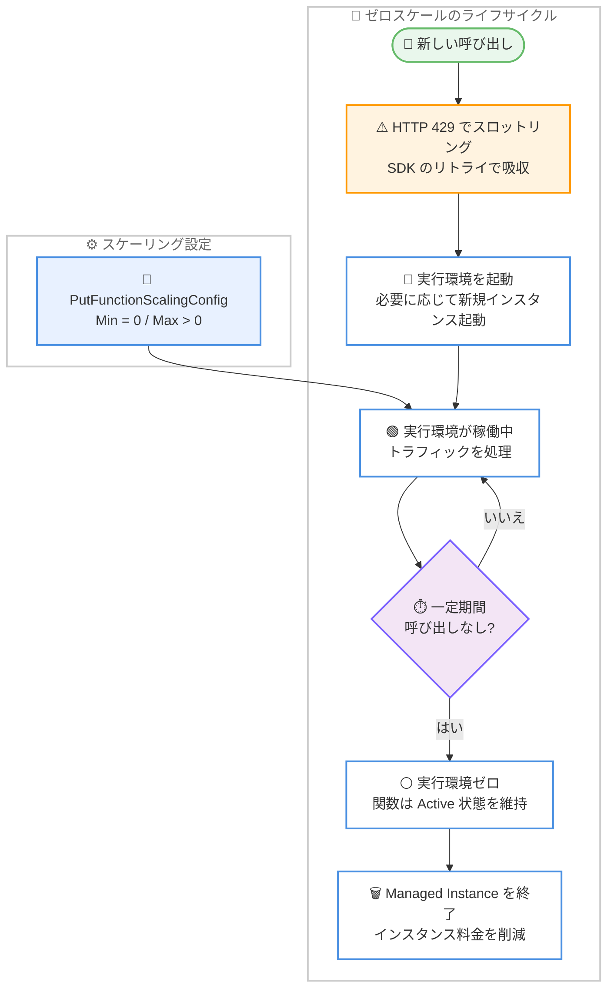

# AWS Lambda - Lambda Managed Instances のゼロスケール対応

**リリース日**: 2026 年 11 月 17 日
**サービス**: AWS Lambda
**機能**: Lambda Managed Instances (LMI) の scale to and from zero

📊 [このアップデートのインフォグラフィックを見る](https://takech9203.github.io/aws-news-summary/20261117-aws-lambda-managed-instances-scale-to-zero.html)

## 概要

AWS Lambda は、Lambda Managed Instances (LMI) 上で動作する Event Functions に対して、ゼロへのスケールインとゼロからのスケールアウト (scale to and from zero) をサポートしました。アイドル期間中は Lambda が実行環境を自動的にゼロまでスケールダウンし、リクエストが到着すると再び実行環境を起動します。最小キャパシティのプロビジョニングが不要になるため、非同期処理や開発・テスト環境のような断続的なワークロードでも LMI をコスト効率よく利用できます。

Lambda Managed Instances は、Lambda のシンプルな運用性を維持しながら、お客様のアカウント内の Amazon EC2 インスタンス上で Lambda 関数を実行できる機能です。特殊なコンピューティング構成へのアクセスや、EC2 の料金面での優位性によるコスト効率化を、インフラストラクチャの管理なしで実現できます。

今回のアップデートにより、トラフィックがない期間が一定時間続くと Lambda が実行環境をゼロまでスケールインし、対応する Managed Instance (EC2 インスタンス) も終了されるため、アイドル期間中のインスタンス料金を削減できます。

**アップデート前の課題**

- 以前はトラフィックがない場合でも、最小数の実行環境を常時稼働させておく必要があった
- アイドル期間中も Managed Instance (EC2 インスタンス) の料金が発生し続けていた
- 開発・テスト環境や非同期処理のような断続的なワークロードでは、LMI のコスト効率が低かった

**アップデート後の改善**

- `MinExecutionEnvironments` を 0 に設定することで、アイドル期間中に実行環境が自動的にゼロまでスケールインされるようになった
- リクエストが到着すると Lambda が実行環境を自動的に再起動するため、手動での再有効化が不要になった
- トラフィックのない期間が存在するワークロードでも、LMI をコスト効率よく利用できるようになった

## アーキテクチャ図



ゼロスケールのライフサイクルを示しています。アイドル期間が続くと実行環境がゼロまでスケールインされてインスタンスが終了し、新しい呼び出しが到着すると実行環境が再起動されます。起動完了までの間、呼び出しは HTTP 429 でスロットリングされます。

## サービスアップデートの詳細

### 主要機能

1. **ゼロへの自動スケールイン**
   - `MinExecutionEnvironments` を 0、`MaxExecutionEnvironments` を 1 以上に設定すると有効になる
   - 一定期間呼び出しがないと、Lambda が最後の実行環境を停止する
   - 実行環境がゼロになっても、関数バージョンは `Active` 状態を維持する
   - キャパシティプロバイダー内のどの関数の実行環境も動いていない Managed Instance は終了され、インスタンス料金が削減される (終了完了までは通常数分かかり、その間は課金が継続する)

2. **ゼロからの自動スケールアウト**
   - ゼロにスケールした関数バージョンを呼び出すと、Lambda は呼び出しを HTTP 429 エラーでスロットリングしつつ、実行環境の起動を開始する
   - 空きのある Managed Instance がない場合は、新しいインスタンスを起動する
   - 最初の実行環境の準備が完了するまで (通常数分) スロットリングが続き、その後は通常どおりスケールする
   - AWS SDK はスロットリングエラーをデフォルトでリトライするが、デフォルト設定では実行環境の準備完了前にリトライを打ち切る可能性があるため、十分なリトライ回数と指数バックオフの設定が推奨される

3. **ゼロスケールと非アクティブ化の使い分け**
   - `Min = 0` かつ `Max > 0`: ゼロスケール。呼び出しがあれば自動で復帰する
   - `Min = 0` かつ `Max = 0`: 非アクティブ化。呼び出しても実行環境は起動されず、復帰には `PutFunctionScalingConfig` の再実行が必要
   - ゼロスケール状態の関数バージョンは、キャパシティプロバイダーごとの関数バージョンクォータにカウントされる点に注意

4. **スケジュールスケーリングとの組み合わせ**
   - Amazon EventBridge Scheduler から `PutFunctionScalingConfig` をユニバーサルターゲットとして呼び出すことで、時間帯に応じた設定変更が可能
   - 例: 営業時間中は `Min = 10` で待機させ、夜間は `Min = 0` にしてゼロスケールを許可する

## 技術仕様

### スケーリング設定の仕様

| 項目 | 詳細 |
|------|------|
| 設定 API | `PutFunctionScalingConfig` (Lambda コンソール、AWS CLI、AWS SDK、AWS CloudFormation、AWS SAM、AWS CDK から設定可能) |
| 設定値の範囲 | `MinExecutionEnvironments`、`MaxExecutionEnvironments` ともに 0 〜 15,000 |
| ゼロスケールの条件 | `Min = 0` かつ `Max > 0` |
| 非アクティブ化の条件 | `Min = 0` かつ `Max = 0` |
| 設定の適用範囲 | 関数の修飾 ARN 単位 (`$LATEST.PUBLISHED` に設定すると以降のバージョンに継承) |
| ゼロスケール中の関数状態 | `Active` 状態を維持 |
| 復帰時間 | 通常数分 (初期化時間が長い関数はさらに時間がかかる) |

### ゼロにスケールしないケース

| ケース | 説明 |
|--------|------|
| 最後の実行環境が CPU を使用中 | バックグラウンドスレッドやポーリングループなど、呼び出し間に処理が動いていると最後の実行環境がスケールインされない場合がある |
| デプロイ進行中 | ローリング更新や重み付きエイリアスによるトラフィックシフト中は、各バージョンで最低 1 つの実行環境が維持される。デプロイ完了後にゼロスケール可能になる |

## 設定方法

### 前提条件

1. Lambda Managed Instances のキャパシティプロバイダーが作成済みであること
2. 対象の関数が LMI 上で動作する Event Function であること
3. `lambda:PutFunctionScalingConfig` を実行できる IAM 権限があること

### 手順

#### ステップ 1: ゼロスケールを有効化する

```bash
aws lambda put-function-scaling-config \
  --function-name my-lmi-function \
  --qualifier '$LATEST.PUBLISHED' \
  --function-scaling-config MinExecutionEnvironments=0,MaxExecutionEnvironments=20 \
  --region us-east-1
```

対象の関数バージョンに対して、実行環境の最小数を 0、最大数を 20 に設定しています。最小値と最大値は必ずペアで指定する必要があり、指定しなかった値はデフォルトにリセットされます。

#### ステップ 2: スケジュールスケーリングを設定する (オプション)

```bash
aws scheduler create-schedule \
  --name "AllowScaleToZeroLambdaManagedInstances" \
  --schedule-expression "cron(0 22 * * ? *)" \
  --flexible-time-window '{"Mode": "OFF"}' \
  --target '{
    "Arn": "arn:aws:scheduler:::aws-sdk:lambda:putFunctionScalingConfig",
    "RoleArn": "arn:aws:iam::111122223333:role/eventbridge-scheduler-role",
    "Input": "{\"FunctionName\": \"my-lmi-function\", \"Qualifier\": \"$LATEST.PUBLISHED\", \"FunctionScalingConfig\": {\"MinExecutionEnvironments\": 0, \"MaxExecutionEnvironments\": 20}}"
  }'
```

EventBridge Scheduler を使用して、毎日 22:00 UTC に最小実行環境数を 0 に変更し、夜間のゼロスケールを許可するスケジュールを作成しています。実行ロールには `lambda:PutFunctionScalingConfig` の権限が必要です。

#### ステップ 3: 動作を確認する

ゼロスケール後に関数を呼び出し、最初の呼び出しが HTTP 429 でスロットリングされた後、数分以内に実行環境が起動して処理が再開されることを確認します。スロットリングの要因を特定するには、`ConcurrencyThrottles`、`CPUThrottles`、`MemoryThrottles`、`DiskThrottles` などのメトリクスを監視します。

## メリット

### ビジネス面

- **コスト削減**: アイドル期間中の Managed Instance が終了されるため、トラフィックのない時間帯のインスタンス料金を削減できる
- **開発・テスト環境の最適化**: 利用時間が限られる環境でも、最小キャパシティの常時確保が不要になり、無駄なコストを排除できる
- **LMI の適用範囲拡大**: 断続的なワークロードにも LMI を適用しやすくなり、EC2 の料金面での優位性を活かせる場面が増える

### 技術面

- **運用の自動化**: スケールインからの復帰に手動操作が不要で、呼び出しをトリガーに自動でスケールアウトする
- **柔軟なスケーリング制御**: スケジュールスケーリングと組み合わせることで、予測可能なトラフィックパターンに合わせた制御が可能
- **関数単位の設定**: 関数バージョン (修飾 ARN) 単位で設定できるため、同じキャパシティプロバイダー内でワークロードごとに挙動を使い分けられる

## デメリット・制約事項

### 制限事項

- ゼロからの復帰時、最初の実行環境が準備できるまで呼び出しは HTTP 429 でスロットリングされる (通常数分、初期化が長い関数はさらに長くなる)
- バックグラウンド処理などで最後の実行環境が CPU を使用し続けていると、ゼロまでスケールインされない場合がある
- デプロイ (ローリング更新や重み付きエイリアスのトラフィックシフト) 中はゼロにスケールしない
- ゼロスケール状態の関数バージョンも、キャパシティプロバイダーごとの関数バージョンクォータにカウントされる
- インスタンス終了が完了するまでの数分間は、インスタンス料金が発生し続ける

### 考慮すべき点

- レイテンシーに敏感なワークロードでは、最小 1 以上 (アベイラビリティーゾーンの冗長性が必要な場合は 3 以上) の実行環境を維持することが推奨される
- 同期呼び出しを行うクライアントでは、実行環境の起動時間をカバーできるリトライ回数と指数バックオフの設定が必要
- トラフィックの到来時刻が予測できる場合は、スケジュールスケーリングで事前に最小値を引き上げておくとスロットリングを回避できる

## ユースケース

### ユースケース 1: 開発・テスト環境のコスト最適化

**シナリオ**: 日中の業務時間帯のみ利用される開発・テスト環境の LMI 関数で、夜間や週末のインスタンス料金を削減したい。

**実装例**:
```bash
aws lambda put-function-scaling-config \
  --function-name dev-api-function \
  --qualifier '$LATEST.PUBLISHED' \
  --function-scaling-config MinExecutionEnvironments=0,MaxExecutionEnvironments=5
```

**効果**: 利用がない時間帯は実行環境とインスタンスが自動的に停止され、開発者が利用を再開すると自動で復帰するため、環境の起動・停止の運用なしでコストを削減できる。

### ユースケース 2: 非同期バッチ処理

**シナリオ**: SQS や EventBridge をトリガーとする非同期処理で、ジョブの到着が断続的であり、数分の起動遅延を許容できる。

**実装例**:
```bash
aws lambda put-function-scaling-config \
  --function-name batch-processor \
  --qualifier '3' \
  --function-scaling-config MinExecutionEnvironments=0,MaxExecutionEnvironments=50
```

**効果**: ジョブがない期間のインスタンス料金をゼロに近づけつつ、ジョブ到着時には自動でスケールアウトして処理できる。非同期呼び出しは Lambda 側でリトライされるため、起動遅延の影響を受けにくい。

### ユースケース 3: 業務時間に合わせたスケジュール制御

**シナリオ**: 業務時間中は低レイテンシーで応答し、夜間はゼロスケールを許可してコストを削減したい社内ツール。

**実装例**:
```bash
# 7:00 UTC に最小値を 10 に引き上げ
aws scheduler create-schedule \
  --name "RaiseMinimumLambdaManagedInstances" \
  --schedule-expression "cron(0 7 * * ? *)" \
  --flexible-time-window '{"Mode": "OFF"}' \
  --target '{
    "Arn": "arn:aws:scheduler:::aws-sdk:lambda:putFunctionScalingConfig",
    "RoleArn": "arn:aws:iam::111122223333:role/eventbridge-scheduler-role",
    "Input": "{\"FunctionName\": \"internal-tool\", \"Qualifier\": \"$LATEST.PUBLISHED\", \"FunctionScalingConfig\": {\"MinExecutionEnvironments\": 10, \"MaxExecutionEnvironments\": 20}}"
  }'
```

**効果**: 業務時間中はウォームな実行環境でスロットリングを回避し、夜間は自動的にゼロスケールしてコストを削減できる。非アクティブ化と異なり、夜間の突発的な利用にも自動で応答できる。

## 料金

Lambda Managed Instances では、関数の実行に使用される EC2 インスタンスの料金と LMI の管理料金が発生します。今回のアップデートにより、アイドル期間中は実行環境がゼロまでスケールインされ、不要になった Managed Instance が終了されるため、トラフィックのない期間のインスタンス料金を削減できます。

なお、インスタンスの終了が完了するまで (通常数分) はインスタンス料金が発生し続けます。詳細は [AWS Lambda 料金ページ](https://aws.amazon.com/lambda/pricing/) を参照してください。

## 利用可能リージョン

Lambda Managed Instances が利用可能なすべての AWS 商用リージョンで利用できます。

## 関連サービス・機能

- **Amazon EC2**: LMI の実行基盤。EC2 の料金面での優位性と多様なインスタンスタイプを活用できる
- **Amazon EventBridge Scheduler**: `PutFunctionScalingConfig` をスケジュール実行し、時間帯に応じたスケーリング制御を実現する
- **Amazon CloudWatch**: `ConcurrencyThrottles`、`CPUThrottles` などのメトリクスでスロットリング要因を監視する
- **AWS CloudFormation / AWS SAM / AWS CDK**: スケーリング設定を IaC として管理できる

## 参考リンク

- 📊 [インフォグラフィック](https://takech9203.github.io/aws-news-summary/20261117-aws-lambda-managed-instances-scale-to-zero.html)
- [公式発表 (What's New)](https://aws.amazon.com/about-aws/whats-new/2026/11/aws-lambda-managed-instances-scale-to-zero/)
- [ドキュメント: Lambda Managed Instances](https://docs.aws.amazon.com/lambda/latest/dg/lambda-managed-instances.html)
- [ドキュメント: Scaling Lambda Managed Instances](https://docs.aws.amazon.com/lambda/latest/dg/lambda-managed-instances-scaling.html)
- [料金ページ](https://aws.amazon.com/lambda/pricing/)

## まとめ

Lambda Managed Instances のゼロスケール対応により、断続的なワークロードでも最小キャパシティの常時確保が不要になり、LMI のコスト効率が大きく向上しました。開発・テスト環境や非同期処理など、アイドル期間のある LMI ワークロードでは、`MinExecutionEnvironments` を 0 に設定してコスト削減効果を確認することを推奨します。復帰時のスロットリングを考慮し、同期呼び出しのリトライ設定やスケジュールスケーリングとの併用も検討してください。
