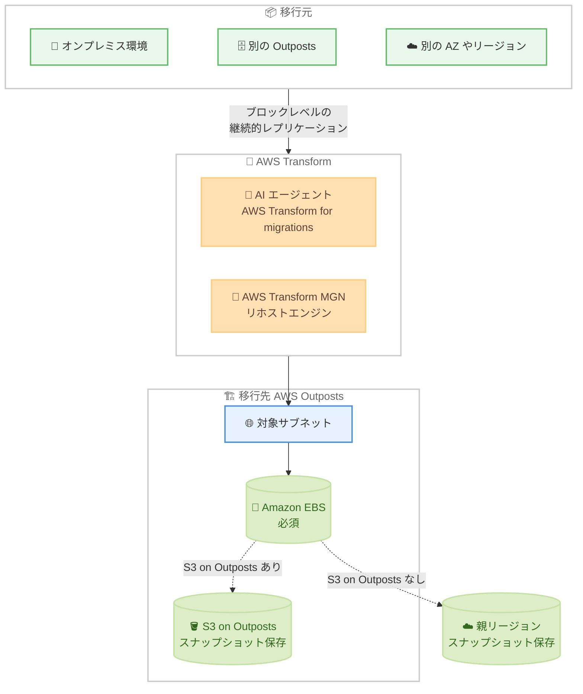

# AWS Transform - AWS Outposts への移行サポート

**リリース日**: 2026 年 11 月 17 日
**サービス**: AWS Transform
**機能**: AWS Outposts を移行先とするワークロード移行のサポート

📊 [このアップデートのインフォグラフィックを見る](https://takech9203.github.io/aws-news-summary/20261117-aws-transform-outposts-migration.html)

## 概要

AWS Transform が、移行先として AWS Outposts をサポートするようになりました。オンプレミス環境、別の Outposts、あるいは別のアベイラビリティゾーンやリージョンで稼働しているワークロードを、AWS Transform を使用して Outposts 上へ直接移行できます。

AWS Transform は、エージェント型 AI を活用したエンタープライズ IT 変革サービスであり、クラウド移行、アプリケーションモダナイゼーション、技術的負債の削減を加速します。今回のアップデートにより、AWS Transform for migrations の AI エージェント経由、または AWS Transform MGN (リホストエンジン) のコンソール経由のいずれかで、Outposts への移行を実行できます。

データレジデンシー要件や低レイテンシー要件により Outposts 上でワークロードを稼働させる必要がある企業にとって、移行作業を大幅に簡素化するアップデートです。

**アップデート前の課題**

このアップデート以前は、Outposts へのワークロード移行に多くの手作業が必要でした。

- Outposts へのワークロード移行には、手作業または従来ツールによる対応が必要だった
- 多くの場合、リージョンを経由して AMI をコピーするという迂回手順が必要だった
- 移行プロセスが複雑になり、ダウンタイムや作業工数が増大していた

**アップデート後の改善**

今回のアップデートにより、Outposts への移行がシンプルになりました。

- 移行先として対象 Outposts 上のサブネットを選択するだけで、ソースサーバーをブロックレベルで Outposts へ直接・継続的にレプリケーションできるようになった
- カットオーバー前にテストインスタンスを起動して検証できるようになった
- 最小限のダウンタイムでカットオーバーを実行できるようになった
- リージョン経由の AMI コピーという迂回手順が不要になった

## アーキテクチャ図



移行元のサーバーは AWS Transform によってブロックレベルで Outposts へ直接レプリケーションされます。スナップショットは S3 on Outposts の有無に応じて、Outposts 上または親リージョンに保存されます。

## サービスアップデートの詳細

### 主要機能

1. **Outposts を移行先とした直接レプリケーション**
   - 移行先として対象 Outposts 上のサブネットを選択可能
   - ソースサーバーを移行元から Outposts へブロックレベルで継続的にレプリケーション
   - リージョンを経由した AMI コピーの迂回手順が不要

2. **複数の移行元に対応**
   - オンプレミス環境からの移行
   - 別の Outposts からの移行
   - 別のアベイラビリティゾーンまたはリージョンからの移行

3. **テストとカットオーバー**
   - カットオーバー前にテストインスタンスを起動して動作検証が可能
   - 最小限のダウンタイムでのカットオーバーを実現

4. **2 つの実行方法**
   - AWS Transform for migrations の AI エージェント経由での実行
   - AWS Transform MGN コンソール経由での実行

## 技術仕様

### 要件とスナップショットの保存先

| 項目 | 詳細 |
|------|------|
| 必須要件 | 移行先の Outposts 上に Amazon EBS が必要 |
| S3 on Outposts がある場合 | スナップショットを Outposts 上に保存 (データレジデンシー対応) または親リージョンに保存 |
| S3 on Outposts がない場合 | スナップショットは親リージョンに保存 |
| レプリケーション方式 | ブロックレベルの継続的レプリケーション |

## 設定方法

### 前提条件

1. 移行先の AWS Outposts がプロビジョニング済みであること
2. 移行先の Outposts 上で Amazon EBS が利用可能であること
3. スナップショットを Outposts 上に保存する場合は、S3 on Outposts が構成されていること

### 手順

#### ステップ 1: 移行方法の選択

AWS Transform for migrations の AI エージェント、または AWS Transform MGN コンソールのいずれかを選択します。エージェント型のワークフローで移行を進める場合は AWS Transform for migrations を、リホストエンジンを直接操作する場合は AWS Transform MGN を使用します。

#### ステップ 2: 移行先サブネットの選択

移行先として、対象 Outposts 上のサブネットを選択します。これにより、ソースサーバーのレプリケーション先が Outposts に設定されます。

#### ステップ 3: レプリケーションとテスト

ソースサーバーのブロックレベルの継続的レプリケーションを開始します。レプリケーション完了後、カットオーバー前にテストインスタンスを起動し、アプリケーションの動作を検証します。

#### ステップ 4: カットオーバー

テストで問題がないことを確認した後、最小限のダウンタイムでカットオーバーを実行します。

## メリット

### ビジネス面

- **データレジデンシー要件への対応**: S3 on Outposts を利用することで、スナップショットを Outposts 上に保持でき、データを特定のロケーション内に留める要件を満たせる
- **移行プロジェクトの迅速化**: 手作業や迂回手順が不要になり、Outposts への移行プロジェクトの期間とコストを削減できる
- **ダウンタイムの最小化**: 継続的レプリケーションとテストインスタンスによる事前検証により、ビジネスへの影響を抑えた移行が可能

### 技術面

- **直接レプリケーション**: リージョン経由の AMI コピーが不要になり、移行元から Outposts へ直接ブロックレベルでレプリケーションできる
- **柔軟な移行元**: オンプレミス、別の Outposts、別の AZ やリージョンといった多様な移行元に対応
- **AI エージェントによる自動化**: AWS Transform for migrations の AI エージェントを活用した移行ワークフローの効率化

## デメリット・制約事項

### 制限事項

- 移行先の Outposts 上に Amazon EBS が必要
- S3 on Outposts がない場合、スナップショットは親リージョンに保存される
- 利用可能なリージョンは、AWS Transform for migrations のターゲットリージョンおよび AWS Transform MGN の対応リージョンに限定される

### 考慮すべき点

- Outposts の EBS 容量やコンピューティング容量が移行対象ワークロードに対して十分か事前に確認が必要
- スナップショットの保存先 (Outposts 上か親リージョンか) をデータレジデンシー要件に応じて設計する必要がある
- 継続的レプリケーションのためのネットワーク帯域を考慮する必要がある

## ユースケース

### ユースケース 1: データレジデンシー要件のあるオンプレミスワークロードの移行

**シナリオ**: 金融機関や公共機関が、データを国内の特定ロケーションに保持する規制要件を満たしながら、オンプレミスのサーバーを AWS へ移行したい。

**実装例**:
```text
1. データセンター内に設置した Outposts に S3 on Outposts を構成
2. AWS Transform MGN で移行先として Outposts のサブネットを選択
3. スナップショットの保存先を Outposts 上に設定してレプリケーションを実行
```

**効果**: データレジデンシー要件を維持したまま、最小限のダウンタイムでクラウド運用モデルへ移行できる。

### ユースケース 2: 旧世代 Outposts から新世代 Outposts への移行

**シナリオ**: 既存の Outposts で稼働しているワークロードを、新しく導入した Outposts へ移行したい。

**実装例**:
```text
1. 新しい Outposts を移行先としてサブネットを選択
2. 既存の Outposts 上のサーバーをソースとしてレプリケーションを構成
3. テストインスタンスで検証後にカットオーバー
```

**効果**: 従来必要だったリージョン経由の AMI コピーが不要になり、Outposts 間の移行を直接実行できる。

### ユースケース 3: リージョンから Outposts へのワークロード再配置

**シナリオ**: リージョンで稼働中のアプリケーションを、低レイテンシー要件のため工場や拠点に設置した Outposts へ再配置したい。

**実装例**:
```text
1. AWS Transform for migrations の AI エージェントで移行計画を作成
2. 移行先として拠点の Outposts サブネットを指定
3. ブロックレベルレプリケーションにより最小限のダウンタイムで移行
```

**効果**: エッジロケーションへの低レイテンシー配置を、自動化されたワークフローで実現できる。

## 料金

今回の発表では、この機能に固有の料金情報は示されていません。AWS Transform および AWS Outposts の料金体系に準じます。詳細は各サービスの料金ページを参照してください。

## 利用可能リージョン

AWS Transform for migrations のすべてのターゲットリージョン、および AWS Transform MGN が利用可能なリージョンで利用できます。対応リージョンの一覧は [公式ドキュメント](https://docs.aws.amazon.com/transform/latest/userguide/transform-vmware-connect-target-account.html#transform-vmware-cta-supported-regions) を参照してください。

## 関連サービス・機能

- **AWS Outposts**: AWS のインフラストラクチャとサービスをオンプレミスに拡張するフルマネージドサービス。今回のアップデートの移行先
- **AWS Transform MGN**: AWS Transform のリホストエンジン。ブロックレベルの継続的レプリケーションによるリフトアンドシフト移行を提供
- **Amazon EBS on Outposts**: Outposts 上のブロックストレージ。今回の移行機能の必須要件
- **Amazon S3 on Outposts**: Outposts 上のオブジェクトストレージ。スナップショットを Outposts 上に保持するために使用

## 参考リンク

- 📊 [インフォグラフィック](https://takech9203.github.io/aws-news-summary/20261117-aws-transform-outposts-migration.html)
- [公式発表 (What's New)](https://aws.amazon.com/about-aws/whats-new/2026/11/aws-transform-outposts-migration/)
- [AWS Transform ドキュメント](https://docs.aws.amazon.com/transform/latest/userguide/transform-app-vmware.html)
- [AWS Transform MGN ドキュメント](https://docs.aws.amazon.com/mgn/latest/ug/what-is-application-migration-service.html)
- [対応ターゲットリージョン](https://docs.aws.amazon.com/transform/latest/userguide/transform-vmware-connect-target-account.html#transform-vmware-cta-supported-regions)
- [AWS Transform for migrations 製品ページ](https://aws.amazon.com/transform/migrations/)

## まとめ

AWS Transform が Outposts を移行先としてサポートしたことで、これまで手作業やリージョン経由の AMI コピーが必要だった Outposts への移行が、ブロックレベルの直接レプリケーションで実行できるようになりました。データレジデンシーや低レイテンシー要件で Outposts を利用する企業は、AWS Transform for migrations または AWS Transform MGN を使用した移行の検討を推奨します。
