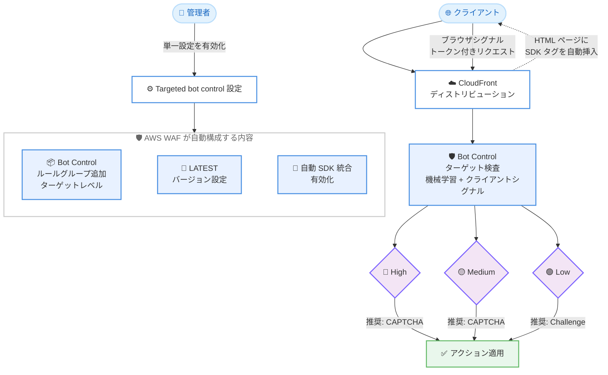

# AWS WAF - Bot Control ターゲット保護の簡素化されたオンボーディング

**リリース日**: 2026 年 11 月 17 日
**サービス**: AWS WAF
**機能**: Targeted bot control 設定、ボット信頼度レベル、LATEST バージョン

📊 [このアップデートのインフォグラフィックを見る](https://takech9203.github.io/aws-news-summary/20261117-aws-waf-bot-control-onboarding.html)

## 概要

AWS WAF は、Bot Control マネージドルールグループのターゲット検査レベルを簡単に有効化できる新しいコンソール体験を発表しました。「Targeted bot control」という単一の設定を有効にするだけで、Amazon CloudFront ディストリビューション向けのプロテクションパック (Web ACL) に対して、AWS が推奨する構成でターゲット保護が有効になります。

今回のアップデートには、Bot Control マネージドルールグループへの 2 つの新機能も含まれます。1 つ目は「ボット信頼度レベル」で、各リクエストに対するターゲット検出の結果を High、Medium、Low の 3 段階に集約します。2 つ目は「LATEST バージョン」で、ルールグループを常に最新バージョンに自動的に維持し、AWS が新しい検出をリリースするたびに手動アップグレードなしで適用されます。これらにより、ラベルマッチルールの作成やアプリケーションコードの変更なしで、巧妙化するボットや AI を活用したボットからアプリケーションを保護できます。

**アップデート前の課題**

ターゲット検査レベルは機械学習とクライアントサイドシグナルを使用して回避型ボットを検出しますが、その検出結果を活用するには多くの作業が必要でした。

- 以前は AWS WAF JavaScript SDK をすべてのページに手動で統合する必要があった
- 以前は数十種類のラベルを理解し、それらを組み合わせるラベルマッチルールを自分で記述する必要があった
- 以前はルールグループのバージョンを手動で管理し、新しい検出を利用するにはアップグレード作業が必要だった

**アップデート後の改善**

- 単一の「Targeted bot control」設定で、ルールグループの追加、各信頼度レベルへの推奨アクションの適用、LATEST バージョンの設定、自動 SDK 統合の有効化が一括で行われるようになった
- ルールグループが検出結果をリクエストごとに 1 つの信頼度レベル (High / Medium / Low) に集約し、レベルごとに 1 つのルールでアクションを選択できるようになった
- 自動 SDK 統合により、CloudFront が配信する HTML ページに JavaScript SDK のスクリプトタグを自動挿入するため、アプリケーションコードの変更が不要になった
- LATEST バージョンにより、手動アップグレードなしで常に最新の検出を利用できるようになった

## アーキテクチャ図



「Targeted bot control」設定を有効にすると、AWS WAF がルールグループの追加、LATEST バージョンの設定、自動 SDK 統合を一括構成します。CloudFront が SDK を自動挿入してブラウザシグナルを収集し、ターゲット検査が各リクエストを High / Medium / Low の信頼度レベルに分類して推奨アクションを適用します。

## サービスアップデートの詳細

### 主要機能

1. **Targeted bot control 設定 (単一設定でのオンボーディング)**
   - CloudFront スコープのプロテクションパック (Web ACL) で利用可能な単一のコンソール設定
   - Bot Control マネージドルールグループが未追加の場合は追加し、検査レベルを「Targeted」に設定して機械学習を有効化。すでに Common レベルで使用中の場合は Targeted レベルに変更
   - 各信頼度レベルに推奨アクション (High: CAPTCHA、Medium: CAPTCHA、Low: Challenge) を適用。Allow、Block、CAPTCHA、Challenge、Count、Monetize に変更可能
   - ルールグループを既存ルールの後に追加するため、他の保護ルールが先に評価され、ブロック済みリクエストがボット検査に到達せず検査コストを抑制
   - トラフィックへの影響を観察したい場合は、すべてのアクションを Count に設定して開始可能

2. **ボット信頼度レベル (Bot Confidence Levels)**
   - ルールグループのバージョン 8.0 以降で、ターゲット検出シグナルをリクエストごとに単一の信頼度レベルに集約
   - High: 単独で自動化を強く示すシグナル、または相互に裏付ける 2 つ以上のシグナルが存在
   - Medium: 自動化を示すシグナルが 1 つ存在するが、他のシグナルによる裏付けがない状態
   - Low: 単一クライアントセッションからの大量リクエストなど、弱いシグナルのみが存在
   - 各レベルに対応するルール `TGT_SignalBotHigh`、`TGT_SignalBotMedium`、`TGT_SignalBotLow` はデフォルトで Count アクションを使用し、ラベルとメトリクスのみを追加
   - 個々の検出ラベルも引き続きリクエストに付与されるため、ログでどのシグナルが信頼度レベルに寄与したかを確認可能

3. **LATEST バージョン**
   - Bot Control ルールグループの最新バージョンを常に指す新しいバージョン指定
   - AWS が新しい検出をリリースすると、手動アップグレードなしで自動的に適用される
   - ボット信頼度レベルにはバージョン 8.0 以降が必要であり、LATEST は常にこの要件を満たす

4. **自動 SDK 統合 (Automatic SDK Integration)**
   - CloudFront がディストリビューションの配信する HTML ページに AWS WAF JavaScript SDK のスクリプトタグを自動追加
   - アプリケーションコードを変更せずに、ターゲット検出に必要なブラウザシグナルを収集可能
   - 新規プロテクションパック (Web ACL) 作成時はデフォルトで有効、既存のものに対してはデフォルトで無効 (自分で SDK を統合済みの場合はオフのまま利用可能)

## 技術仕様

### ボット信頼度レベルの詳細

| 信頼度レベル | ルール名 | デフォルトアクション | 推奨アクション | ラベル |
|------|------|------|------|------|
| High | TGT_SignalBotHigh | Count | CAPTCHA | `awswaf:managed:aws:bot-control:targeted:signal:bot_signal:high` |
| Medium | TGT_SignalBotMedium | Count | CAPTCHA | `awswaf:managed:aws:bot-control:targeted:signal:bot_signal:medium` |
| Low | TGT_SignalBotLow | Count | Challenge | `awswaf:managed:aws:bot-control:targeted:signal:bot_signal:low` |

### Targeted bot control 設定が構成する内容

| 項目 | 詳細 |
|------|------|
| 検査レベル | Targeted (機械学習有効) |
| 信頼度レベルのアクション | High: CAPTCHA、Medium: CAPTCHA、Low: Challenge (変更可能) |
| ルールグループバージョン | LATEST (常に最新バージョンを自動適用) |
| ルール順序 | 既存ルールの後に追加 (検査コスト抑制のため) |
| 自動 SDK 統合 | CloudFront が HTML ページに SDK スクリプトタグを自動挿入 |

### 動的ラベル補間によるアプリケーション連携

信頼度レベルをアプリケーションに渡すには、カスタムリクエスト処理と動的ラベル補間を使用してリクエストヘッダーに挿入できます。

```text
ヘッダー値: ${awswaf:managed:aws:bot-control:targeted:signal:bot_signal:}
→ "high"、"medium"、"low" のいずれか、または信頼度レベルラベルがない場合は空文字列に解決される
```

## 設定方法

### 前提条件

1. CloudFront スコープのプロテクションパック (Web ACL) を使用していること (リージョナルの場合はルールグループを自分で追加し、信頼度レベルルールのアクションをオーバーライドする)
2. CloudFront のフラットレート料金プランを使用していないこと (当該プランにはターゲット保護レベルが含まれないため、本設定は利用不可)
3. AWS WAF コンソールへのアクセス権限があること

### 手順

#### ステップ 1: プロテクションパック (Web ACL) を選択

AWS WAF コンソール (https://console.aws.amazon.com/wafv2/homev2) を開き、ナビゲーションペインで [Protection packs (web ACLs)] を選択し、CloudFront スコープのプロテクションパックを選択します。新規作成の場合は、[Choose initial protections] で [Recommended] または [Essentials] を選択すると Targeted bot control セクションが表示されます。

#### ステップ 2: Targeted bot control を有効化

パネルで [Configure Targeted bot control] を選択し、[Enable Targeted bot control] を選択します。検査レベルが Common から Targeted に変わる、バージョンが LATEST に変わるなど、プロテクションパックへの変更内容のサマリーが表示されるため確認します。

#### ステップ 3: 信頼度レベルごとのアクションを確認・調整

[Confidence level actions] で各信頼度レベルのアクションを確認します。本番適用前にトラフィックの分類状況を観察したい場合は、[Set all actions to Count] を選択してすべてのアクションを Count に設定します。

#### ステップ 4: 自動 SDK 統合の設定を確認して保存

[Automatic SDK integration] 設定を確認します。既存のプロテクションパックではデフォルトで無効のため、CloudFront に SDK スクリプトタグを追加させる場合は有効にします。[Save] を選択し、バージョンが LATEST に移行する場合は確認ダイアログで現在のバージョンと新しいバージョンを確認して確定します。

#### ステップ 5: 結果の確認

[Configure Targeted bot control] ページで、トラフィックが各信頼度レベルにどのように分布しているか、High 信頼度リクエストの緩和数やチャレンジ発行数などの統計を確認します。より詳細な分析には、ページ内のリンクからプロテクションパックのダッシュボードに移動します。信頼度レベルラベルは Amazon CloudWatch メトリクスおよび AWS WAF ログでも確認できます。

## メリット

### ビジネス面

- **導入までの時間短縮**: 従来は SDK 統合、ラベルの学習、ラベルマッチルールの作成が必要だったターゲット保護を、単一の設定で有効化できるため、ボット対策の導入リードタイムが大幅に短縮される
- **運用負荷の軽減**: LATEST バージョンにより手動アップグレードが不要になり、AI を活用した新しいボット手法への対応が自動で継続される
- **誤検知の影響を最小化**: 推奨アクションの CAPTCHA と Challenge は、誤分類された正規ユーザーが CAPTCHA を解いたり、ブラウザが自動でチャレンジを完了したりできるため、ビジネスへの影響が小さい

### 技術面

- **アプリケーションコード変更不要**: 自動 SDK 統合により CloudFront が SDK スクリプトタグを挿入するため、各ページへの手動統合が不要
- **シンプルな運用モデル**: 数十のラベルの組み合わせではなく、レベルごとに 1 つのルールでアクションを管理できる
- **可観測性の維持**: 集約された信頼度レベルに加えて個々の検出ラベルも付与されるため、ログで判定根拠を詳細に追跡できる
- **段階的な適用が可能**: すべてのアクションを Count に設定して分類状況を観察してから、本番のアクションに切り替えられる

## デメリット・制約事項

### 制限事項

- Targeted bot control 設定は CloudFront スコープのプロテクションパック (Web ACL) でのみ利用可能。リージョナルのプロテクションパックでは、ルールグループを自分で追加して信頼度レベルルールのアクションをオーバーライドする必要がある
- CloudFront のフラットレート料金プランに関連付けられたディストリビューションでは、本設定を利用できない
- ボット信頼度レベルにはターゲット保護レベルとルールグループバージョン 8.0 以降が必要
- LATEST 以外のバージョンに後から変更すると、コンソール上で Targeted bot control がオフになる (ルールグループ自体は選択したバージョンで評価を継続するが、コンソールによる信頼度レベルアクションの管理は行われなくなる)

### 考慮すべき点

- ターゲット検査レベルの標準料金が適用されるため、トラフィック量に応じたコストを事前に見積もる必要がある
- 監視ツールやパートナー連携などの正規の自動クライアントが信頼度ラベルとアクションの対象になる場合は、パス、ヘッダー、IP セットなどによるスコープダウンステートメントで除外する (信頼済みトラフィックの検査コスト削減にもなる)
- 多くのターゲット検出は AWS WAF トークンのクライアントサイドシグナルに依存するため、SDK 統合なしではシグナルが減少し、信頼度レベルの精度に影響する
- 信頼度レベルルール以外のターゲットルールは、引き続き各自のラベルに対して独自のアクションで動作する

## ユースケース

### ユースケース 1: EC サイトの AI ボット対策の迅速な導入

**シナリオ**: CloudFront で配信する EC サイトで、AI を活用したスクレイピングボットや在庫買い占めボットの被害が増加しているが、開発リソースが限られており SDK 統合やルール作成に時間をかけられない。

**実装例**:
```text
1. AWS WAF コンソールで対象のプロテクションパック (Web ACL) を選択
2. [Configure Targeted bot control] から [Enable Targeted bot control] を選択
3. 推奨アクション (High/Medium: CAPTCHA、Low: Challenge) のまま保存
4. 自動 SDK 統合を有効化し、CloudFront に SDK タグを挿入させる
```

**効果**: アプリケーションコードの変更やラベルマッチルールの作成なしで、機械学習ベースのターゲット保護を即日導入できる。

### ユースケース 2: 本番適用前のトラフィック分類の観察

**シナリオ**: 正規ユーザーへの影響を懸念しており、ボット対策のアクションを適用する前に、自社トラフィックがどのように分類されるかを確認したい。

**実装例**:
```text
1. Targeted bot control を有効化する際に [Set all actions to Count] を選択
2. CloudWatch の信頼度レベルラベルメトリクスとサンプルリクエストを一定期間観察
3. 分類結果に問題がないことを確認後、各レベルのアクションを CAPTCHA / Challenge に変更
4. 正規の自動クライアントが検出される場合はスコープダウンステートメントで除外
```

**効果**: 誤検知のリスクを把握してから段階的に保護を強化でき、正規ユーザーへの影響を最小限に抑えられる。

### ユースケース 3: 信頼度レベルに応じたアプリケーション側の制御

**シナリオ**: WAF でのブロックに加えて、アプリケーション側でもボットの疑いがあるリクエストに対してレート制限や追加検証を行いたい。

**実装例**:
```text
カスタムリクエスト処理でヘッダーを挿入:
  ヘッダー名: x-bot-confidence
  ヘッダー値: ${awswaf:managed:aws:bot-control:targeted:signal:bot_signal:}

アプリケーション側で "high" / "medium" / "low" の値に応じて
レート制限の強化や追加の検証ロジックを実行
```

**効果**: 動的ラベル補間により信頼度レベルをアプリケーションに伝搬し、WAF とアプリケーションの多層防御を実現できる。

## 料金

ターゲット検査レベルの標準料金が適用されます。Targeted bot control 設定自体および自動 SDK 統合に追加料金はかかりません。Bot Control マネージドルールグループの使用には追加料金が発生するため、詳細は [AWS WAF 料金ページ](https://aws.amazon.com/waf/pricing/) を参照してください。

なお、ルールグループが既存ルールの後に評価される構成のため、他のルールでブロックされたリクエストはボット検査に到達せず、検査コストの抑制につながります。

## 利用可能リージョン

- **Targeted bot control 設定**: Amazon CloudFront で使用するプロテクションパック (Web ACL) で本日から利用可能
- **ボット信頼度レベルと LATEST バージョン**: AWS WAF Bot Control が利用可能なすべての AWS リージョンで利用可能

## 関連サービス・機能

- **Amazon CloudFront**: Targeted bot control 設定の対象スコープ。自動 SDK 統合により配信ページへ SDK スクリプトタグを挿入する
- **AWS WAF JavaScript SDK**: ターゲット検出に必要なブラウザシグナル (トークン) を収集するクライアントサイド SDK。自動 SDK 統合により手動組み込みが不要になる
- **Amazon CloudWatch**: 信頼度レベルラベルをメトリクスとして可視化し、分類状況の観察やアラート設定に利用できる
- **AWS WAF ログ**: 信頼度レベルラベルと個々の検出ラベルを記録し、判定根拠の詳細な分析に利用できる

## 参考リンク

- 📊 [インフォグラフィック](https://takech9203.github.io/aws-news-summary/20261117-aws-waf-bot-control-onboarding.html)
- [公式発表 (What's New)](https://aws.amazon.com/about-aws/whats-new/2026/11/aws-waf-bot-control-onboarding/)
- [AWS Security Blog: Introducing simplified onboarding for AWS WAF Bot Control at the targeted inspection level](https://aws.amazon.com/blogs/security/introducing-simplified-onboarding-for-aws-waf-bot-control-at-the-targeted-inspection-level/)
- [ドキュメント: Turning on Targeted bot control in the console](https://docs.aws.amazon.com/waf/latest/developerguide/waf-bot-control-targeted-console.html)
- [ドキュメント: Bot confidence levels](https://docs.aws.amazon.com/waf/latest/developerguide/aws-managed-rule-groups-bot-confidence.html)
- [料金ページ](https://aws.amazon.com/waf/pricing/)

## まとめ

今回のアップデートにより、従来は SDK 統合、ラベルの学習、ラベルマッチルールの作成が必要だった AWS WAF Bot Control のターゲット保護を、単一のコンソール設定で有効化できるようになりました。ボット信頼度レベルによる直感的なアクション管理と LATEST バージョンによる自動更新により、AI を活用した高度なボットへの対策を低い運用負荷で継続できます。CloudFront でアプリケーションを配信している場合は、まずすべてのアクションを Count に設定してトラフィックの分類状況を観察し、段階的に推奨アクションへ移行することを推奨します。
