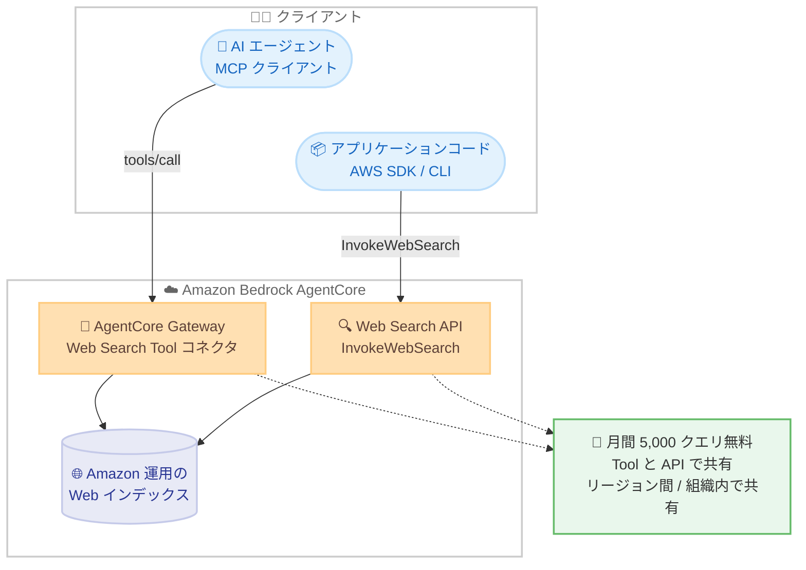

# Amazon Bedrock AgentCore - Web 検索クエリの月間無料利用枠

**リリース日**: 2026 年 11 月 17 日
**サービス**: Amazon Bedrock AgentCore
**機能**: Web Search Tool / Web Search API の月間 5,000 クエリ無料利用枠

📊 [このアップデートのインフォグラフィックを見る](https://takech9203.github.io/aws-news-summary/20261117-bedrock-agentcore-free-web-search-queries.html)

## 概要

Amazon Bedrock AgentCore が、AgentCore Gateway の Web Search Tool および Web Search API を通じて、毎月 5,000 件の無料 Web 検索クエリを提供するようになりました。AgentCore は、開発者が高い効果を発揮するエージェントを安全かつ大規模に構築、デプロイ、運用することを支援するサービスです。今回のアップデートにより、開発者は毎月最初の 5,000 クエリまで無料で Web 検索機能を持つエージェントを構築、テストできます。

無料利用枠は自動的に適用され、セットアップは不要です。サポート対象のすべての AWS リージョン間、および AWS Organizations 配下のすべてのアカウント間で共有され、毎月リセットされます。無料枠を超過した場合も、エージェントが中断されることなく、追加クエリは標準料金で課金されます。

Web Search Tool は、Amazon が自ら構築、運用する数百億ドキュメント規模の Web インデックスを基盤とするフルマネージドの MCP 準拠 Web 検索機能です。検索クエリが AWS の外部に出ることはなく、サードパーティの検索エンジンにルーティングされないため、データガバナンスの観点でも安心して利用できます。

**アップデート前の課題**

- 以前は Web 検索クエリに対して初回から標準料金 ($7/1,000 クエリ) が発生し、エージェントの開発、テスト段階でもコストがかかっていた
- 以前は Web 検索機能の PoC や評価を始める際に、少量の検証でも課金を前提とした予算確保が必要だった
- 以前は複数リージョンや複数アカウントで試験的に利用する場合、コスト管理の考慮事項が多かった

**アップデート後の改善**

- 今回のアップデートにより、毎月最初の 5,000 クエリが無料になり、エージェントの構築とテストをコストゼロで開始できるようになった
- 今回のアップデートにより、無料枠は自動適用されるため、有効化や設定作業が不要になった
- 今回のアップデートにより、無料枠はサポート対象リージョン全体および組織内の全アカウントで共有され、柔軟に消費できるようになった
- 今回のアップデートにより、無料枠超過後もエージェントは停止、スロットリングされることなく、標準料金での課金に自動移行するようになった

## アーキテクチャ図



エージェントは AgentCore Gateway 経由の Web Search Tool (MCP ツール) として、アプリケーションコードは Web Search API (InvokeWebSearch) として Web 検索を利用できます。月間 5,000 クエリの無料枠は両者で共有され、超過分のみ標準料金で課金されます。

## サービスアップデートの詳細

### 主要機能

1. **月間 5,000 クエリの無料利用枠**
   - Web Search Tool (AgentCore Gateway コネクタ) と Web Search API の両方に適用され、両者で無料枠を共有する
   - すべての AWS アカウントに自動的に適用され、有効化やセットアップは不要
   - 毎月の初め (暦月、UTC) にリセットされ、未使用分は翌月に繰り越されない

2. **リージョン間、アカウント間での共有**
   - 無料枠は Web 検索が利用可能なすべての AWS リージョン間で共有される (AWS GovCloud (US) を除く)
   - 例えば、米国東部 (バージニア北部) と欧州 (アイルランド) でエージェントが実行したクエリは、同じ月間無料枠から消費される
   - AWS Organizations 配下のアカウントの場合、AWS 無料利用枠と同様に、組織内のすべてのアカウントで無料枠を共有する

3. **超過時もエージェントは中断されない**
   - 無料枠を使い切った後は、その月の残りのクエリが標準料金で課金される
   - AgentCore はリクエストのスロットリング、一時停止、停止を行わないため、エージェントは動作し続ける
   - 使用状況は AWS Billing and Cost Management コンソールで確認でき、無料クエリは請求額 $0 として表示される

## 技術仕様

### Web Search Tool と Web Search API の比較

| 項目 | Web Search Tool (Gateway コネクタ) | Web Search API |
|------|-----------------------------------|----------------|
| 呼び出し方法 | AgentCore Gateway 経由の MCP ツール (`tools/call`) | AgentCore データプレーンの `InvokeWebSearch` API |
| 主な利用者 | MCP クライアントとして動作するエージェント | 独自のコード、データパイプライン |
| 認可 | IAM に加えて JWT も利用可能 | IAM のみ |
| 検索テキストのパラメータ | `query` | `searchQuery` |
| デフォルトの最大結果数 | 10 件 (最大 25 件) | 25 件 |
| ドメインフィルタ | ターゲットレベルとリクエストレベルの両方 | リクエストごとに指定 |
| GovCloud (US-West) | 利用可能 (無料枠は対象外) | 利用不可 |

### 無料利用枠の仕様

| 項目 | 詳細 |
|------|------|
| 無料クエリ数 | 月間 5,000 クエリ |
| 適用方法 | 自動適用、セットアップ不要 |
| 共有範囲 | Web Search Tool と Web Search API で共有、対応リージョン間で共有、組織内全アカウントで共有 |
| リセット | 毎月初 (UTC) にリセット、未使用分の繰り越しなし |
| 超過時 | 標準料金 ($7/1,000 クエリ) で課金、エージェントは中断されない |
| 除外 | AWS GovCloud (US) は無料枠の対象外 |

### サービスクォータ

Web Search API は、デフォルトでリージョンごとに毎秒 10 件の `InvokeWebSearch` リクエストを送信できます。クォータの引き上げは AWS Support への連絡により申請できます。

## 設定方法

### 前提条件

1. Web Search Tool / Web Search API をサポートするリージョンの AWS アカウント
2. AgentCore Gateway および Cognito 等のリソースを作成できる IAM 権限 (Gateway コネクタを利用する場合)
3. 呼び出し元に対する適切な IAM 権限 (API を直接利用する場合)

### 手順

#### ステップ 1: 無料枠の確認 (設定不要)

無料利用枠は自動的に適用されるため、有効化の操作は不要です。Web Search Tool または Web Search API を呼び出すだけで、毎月最初の 5,000 クエリが無料になります。

#### ステップ 2: Gateway に Web Search Tool ターゲットを追加する (コネクタを利用する場合)

```bash
# Gateway に Web Search Tool コネクタのターゲットを追加
agentcore add gateway-target \
  --name amazon-web-search \
  --gateway my-gateway \
  --type connector \
  --connector web-search

# プロジェクトをデプロイ
agentcore deploy -y
```

AgentCore CLI を使用して、既存の Gateway に `web-search` コネクタをターゲットとして追加し、デプロイしています。エージェントは `tools/list` で `WebSearch` ツールを検出し、`tools/call` で呼び出せるようになります。

#### ステップ 3: Web Search API を直接呼び出す (コードから利用する場合)

```bash
# AWS CLI で Web 検索を実行
aws bedrock-agentcore invoke-web-search \
  --search-query "AWS re:Invent 2026 announcements" \
  --max-results 10 \
  --region us-east-1
```

AWS CLI から `InvokeWebSearch` API を呼び出し、検索クエリに対するランク付けされた結果 (テキスト抜粋、タイトル、URL、公開日時) を取得しています。リソースの作成や管理は不要です。

#### ステップ 4: 使用状況の監視と通知の設定

AWS Billing and Cost Management コンソールで使用状況を確認できます。無料クエリは請求額 $0 として表示されます。課金が発生する前に通知を受け取りたい場合は、AWS Budgets でゼロ支出予算 (zero-spend budget) を作成します。

## メリット

### ビジネス面

- **初期コストゼロでの検証**: 月間 5,000 クエリまで無料のため、Web 検索機能を持つエージェントの PoC や評価を予算確保なしで開始できる
- **予測可能なコスト管理**: 無料枠超過後も標準料金での従量課金に自動移行するため、急な利用停止リスクなしにコストを管理できる
- **組織全体での効率的な活用**: AWS Organizations 配下の全アカウントで無料枠を共有できるため、組織として無駄なく消費できる

### 技術面

- **セットアップ不要**: 無料枠は自動適用されるため、有効化作業や設定変更なしで即座に恩恵を受けられる
- **エージェントの継続稼働**: 無料枠超過時もスロットリングや停止が発生せず、本番ワークロードに影響を与えない
- **2 つの利用形態をカバー**: MCP ツールとしての Web Search Tool と、コードから直接呼び出す Web Search API の両方が同じ無料枠を共有するため、利用形態を問わず適用される

## デメリット・制約事項

### 制限事項

- 無料枠は月間 5,000 クエリまでで、未使用分は翌月に繰り越されない
- AWS GovCloud (US) は無料枠の対象外
- AWS Organizations 配下では組織全体で無料枠を共有するため、複数アカウントで活発に利用すると想定より早く無料枠を消費する可能性がある
- AWS は不正や悪用を防止するため、アカウントの無料利用を制限する場合がある

### 考慮すべき点

- 無料枠超過後は自動的に標準料金 ($7/1,000 クエリ) で課金されるため、意図しない課金を避けたい場合は AWS Budgets のゼロ支出予算で通知を設定することが推奨される
- Gateway 経由で利用する場合、Gateway の `InvokeTool` API 呼び出し ($0.005/1,000 回) は別途課金される
- 検索結果 (Search Results) を利用する際は、出典の引用とリンクを保持、表示する必要があり、検索結果の大量抽出や競合インデックスの構築は許容利用規約で禁止されている

## ユースケース

### ユースケース 1: Web 検索エージェントの低コストな PoC

**シナリオ**: 社内ナレッジだけでは回答できない最新情報 (製品リリース、ニュース、価格動向) への質問に対応するエージェントを検証したいが、検証段階でのコスト発生を避けたい。

**実装例**:
```bash
# Gateway と Web Search Tool ターゲットを作成して検証環境を構築
agentcore create --name WebSearchPoC --project-name WebSearchPoC --no-agent
agentcore add gateway --name poc-gateway --protocol-type MCP
agentcore add gateway-target --name amazon-web-search \
  --gateway poc-gateway --type connector --connector web-search
agentcore deploy -y
```

**効果**: 月間 5,000 クエリまで無料のため、検証フェーズのクエリコストをゼロに抑えながら、エージェントの検索品質や回答精度を評価できる。

### ユースケース 2: 開発、ステージング環境での継続的テスト

**シナリオ**: 複数の開発チームが別々の AWS アカウントでエージェントを開発しており、CI/CD パイプラインで Web 検索を含む結合テストを定期実行している。

**実装例**:
```python
import boto3

client = boto3.client("bedrock-agentcore", region_name="ap-northeast-1")

response = client.invoke_web_search(
    searchQuery="最新の Python セキュリティアドバイザリ",
    maxResults=5,
)
for result in response["results"]:
    print(result["title"], result["url"])
```

**効果**: 組織内の全アカウントで無料枠を共有するため、各チームのテスト実行分を組織全体の 5,000 クエリ無料枠でまかなえ、テストコストを削減できる。

### ユースケース 3: 小規模な本番エージェントの無料運用

**シナリオ**: 社内向けのリサーチアシスタントエージェントを少人数のチームで利用しており、Web 検索の利用量は月間数千クエリ程度にとどまる。

**実装例**:
```text
1. AgentCore Gateway に Web Search Tool ターゲットを追加
2. エージェントフレームワーク (Strands Agents、LangChain 等) から MCP 経由で接続
3. AWS Budgets でゼロ支出予算を作成し、無料枠超過前に通知を受信
```

**効果**: 月間利用量が 5,000 クエリ以内であれば Web 検索コストは発生せず、超過した場合も通知を受けた上で従量課金に移行するため、安心して本番運用できる。

## 料金

Web 検索クエリは、毎月最初の 5,000 クエリが無料です。無料枠は Web Search Tool と Web Search API で共有され、超過分は標準料金 $7/1,000 クエリ ($0.007/クエリ) で課金されます。Gateway 経由で利用する場合は、Gateway の `InvokeTool` API 呼び出し ($0.005/1,000 回) が別途発生します。

### 料金例

| 使用量 | 月額料金 (概算) |
|--------|------------------|
| 月間 5,000 クエリ以下 | $0 (無料枠内) |
| 月間 10,000 クエリ | $35 (超過分 5,000 クエリ × $0.007) |
| 月間 50,000 クエリ | $315 (超過分 45,000 クエリ × $0.007) |

最新の料金は [AgentCore 料金ページ](https://aws.amazon.com/bedrock/agentcore/pricing/) を参照してください。

## 利用可能リージョン

無料 Web 検索クエリは、Web Search Tool および Web Search API をサポートする以下のすべての AWS リージョンで利用できます。

- 米国東部 (バージニア北部) `us-east-1`
- 米国東部 (オハイオ) `us-east-2`
- 米国西部 (オレゴン) `us-west-2`
- 欧州 (アイルランド) `eu-west-1`
- アジアパシフィック (シドニー) `ap-southeast-2`
- アジアパシフィック (東京) `ap-northeast-1`

Web Search Tool コネクタは AWS GovCloud (US-West) でも利用できますが、無料枠の対象外です。

## 関連サービス・機能

- **Amazon Bedrock AgentCore Gateway**: Web Search Tool をマネージドコネクタとして追加し、エージェントに MCP ツールとして公開するゲートウェイ機能
- **AgentCore Web Answer**: ランク付けされた検索結果ではなく、引用付きの完成した回答を返すツール。回答生成までを任せたい場合に利用
- **AWS Budgets**: ゼロ支出予算を作成することで、無料枠を超えて課金が発生する前に通知を受け取れる
- **AWS Organizations**: 組織内の全アカウントで無料枠を共有する仕組みの基盤となるサービス

## 参考リンク

- 📊 [インフォグラフィック](https://takech9203.github.io/aws-news-summary/20261117-bedrock-agentcore-free-web-search-queries.html)
- [公式発表 (What's New)](https://aws.amazon.com/about-aws/whats-new/2026/11/bedrock-agentcore-free-web-search-queries/)
- [ドキュメント: AgentCore Web Search (Web Search API)](https://docs.aws.amazon.com/bedrock-agentcore/latest/devguide/web-search-api.html)
- [ドキュメント: Web Search Tool (Gateway コネクタ)](https://docs.aws.amazon.com/bedrock-agentcore/latest/devguide/gateway-target-connector-web-search-tool.html)
- [料金ページ: Amazon Bedrock AgentCore pricing](https://aws.amazon.com/bedrock/agentcore/pricing/)
- [製品ページ: Amazon Bedrock AgentCore](https://aws.amazon.com/bedrock/agentcore/)

## まとめ

Amazon Bedrock AgentCore の Web 検索機能に月間 5,000 クエリの無料利用枠が追加され、Web 検索機能を持つエージェントの構築とテストをコストゼロで開始できるようになりました。無料枠は自動適用で、リージョン間および組織内の全アカウントで共有され、超過後もエージェントが中断されることはありません。エージェントに最新の Web 情報へのアクセスを追加することを検討しているチームは、まず無料枠の範囲内で Web Search Tool または Web Search API を試し、AWS Budgets のゼロ支出予算で課金発生前の通知を設定することを推奨します。
