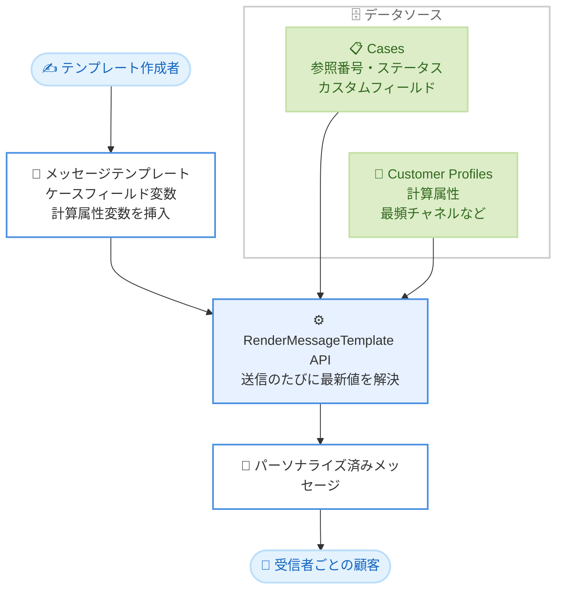

# Amazon Connect Customer - メッセージテンプレートでのケースフィールド・計算属性サポート

**リリース日**: 2026 年 11 月 17 日
**サービス**: Amazon Connect Customer
**機能**: メッセージテンプレートにおけるケースフィールドおよび計算属性のサポート

📊 [このアップデートのインフォグラフィックを見る](https://takech9203.github.io/aws-news-summary/20261117-connect-case-and-calculated-attributes.html)

## 概要

Amazon Connect Customer のメッセージテンプレートが、Cases のケースフィールドと Customer Profiles の計算属性 (例: 顧客が最も頻繁に利用するコンタクトチャネル) をメッセージ変数としてサポートするようになりました。メッセージテンプレートは、受信者ごとの情報でメッセージをパーソナライズする機能であり、保険金請求、注文、申請などに関する更新通知を送信する企業は、各メッセージにその顧客自身のレコードを反映させる必要があります。

テンプレート作成者は、管理者が定義したカスタムフィールドを含むケースフィールドをテンプレートに挿入でき、Connect Customer はテンプレートを使用したメッセージを送信するたびに、受信者ごとの最新の値を自動的に埋め込みます。開発者は [RenderMessageTemplate](https://docs.aws.amazon.com/connect/latest/APIReference/API_amazon-q-connect_RenderMessageTemplate.html) API でテンプレートをレンダリングする際にこれらの値を渡すことができます。

**アップデート前の課題**

このアップデート以前は、メッセージテンプレートで利用できる変数が限られていました。

- テンプレート変数として利用できるのはシステム属性、エージェント属性、顧客プロファイルの標準属性などに限られ、ケースの参照番号やステータスといったケース情報を変数として埋め込めなかった
- 過去 1 年間の注文回数のような、顧客プロファイルから導出される計算属性をテンプレートで参照できなかった
- ケースごとの情報を含むメッセージを送るには、顧客ごとにカスタマイズした複数のメッセージを個別に作成・管理する必要があった

**アップデート後の改善**

今回のアップデートにより、1 つのテンプレートで顧客ごと・ケースごとにパーソナライズされたメッセージを送信できるようになりました。

- ケースのシステムフィールド (タイトル、ステータス、参照番号など) と、管理者が定義したカスタムフィールドをテンプレート変数として挿入できるようになった
- Customer Profiles のデフォルト計算属性 (最頻チャネルなど) とカスタム計算属性をテンプレート変数として参照できるようになった
- メッセージ送信のたびに受信者ごとの最新値が自動で埋め込まれるため、テンプレートを 1 つ作成するだけで全受信者に正確な情報を届けられるようになった

## アーキテクチャ図



テンプレートに挿入したケースフィールド変数と計算属性変数は、メッセージ送信時に Cases および Customer Profiles の最新値で自動的に置き換えられます。

## サービスアップデートの詳細

### 主要機能

1. **ケースフィールドのテンプレート変数サポート**
   - Cases のフィールド値をメッセージテンプレート内で参照可能
   - システムフィールドは読みやすいスラグで参照する (例: `{{Attributes.Case.title}}`、`{{Attributes.Case.status}}`、`{{Attributes.Case.reference_number}}`)
   - 管理者が定義したカスタムフィールドは UUID 識別子で参照する (例: `{{Attributes.Case.12345678-aaaa-bbbb-cccc-123456789012}}`)

2. **計算属性のテンプレート変数サポート**
   - Customer Profiles で定義された計算属性 (顧客プロファイルデータから導出される値) を参照可能
   - デフォルト計算属性はアンダースコア接頭辞付きの名前で参照する (例: `{{Attributes.Customer.CalculatedAttributes._most_frequent_channel}}`)
   - カスタム計算属性は Customer Profiles で定義した名前で参照し、名前にスペースを含む場合はブラケット形式を使用する (例: `{{Attributes.Customer.CalculatedAttributes.[Average Ticket Size]}}`)

3. **送信時の自動値解決**
   - テンプレートを使用したメッセージを送信するたびに、受信者ごとの現在の値で変数を置き換え
   - 複数のカスタマイズ版メッセージを作成することなく、常に最新の情報を各受信者に配信
   - コンソールの Attribute finder から属性を選択してテンプレートに挿入可能

## 技術仕様

### メッセージテンプレートで利用できる属性タイプ

| 属性タイプ | 内容 | 記法の例 |
|------|------|------|
| システム属性 | 顧客のメールアドレス、送信先アドレス、表示名 | `{{Attributes.CustomerEndpointAddress}}` |
| エージェント属性 | エージェントの姓・名 | `{{Attributes.Agent.FirstName}}` |
| 顧客プロファイル属性 | Customer Profiles の標準属性 | `{{Attributes.Customer.FirstName}}` |
| 計算属性 (今回追加) | プロファイルデータから導出される値 | `{{Attributes.Customer.CalculatedAttributes._most_frequent_channel}}` |
| ケースフィールド (今回追加) | Cases のシステム・カスタムフィールド | `{{Attributes.Case.status}}` |
| レコメンデーション属性 | アウトバウンドキャンペーンの商品レコメンデーション | `{{Attributes.Customer.Recommendations.[0].CatalogItem.Name}}` |

### API変更履歴

| 日付 | サービス | 変更内容 |
|------|----------|----------|
| 2026/11/13 | [Amazon Q Connect](https://awsapichanges.com/archive/changes/b4312b-wisdom.html) | 6 updated api methods - メッセージテンプレートで追加の属性をサポート。ケースフィールド、Customer Profiles の計算属性、商品レコメンデーションによるパーソナライズが可能に |

## 設定方法

### 前提条件

1. Amazon Connect インスタンスでメッセージテンプレート機能を利用できること
2. ケースフィールドを使用する場合は Cases が有効化されており、参照するフィールドが定義されていること
3. 計算属性を使用する場合は Customer Profiles が有効化されており、参照する計算属性が定義されていること

### 手順

#### ステップ1: テンプレートの作成または編集

1. ナビゲーションペインで [メッセージテンプレート] を選択する
2. 新規作成する場合は [テンプレートを作成] を選択し、テンプレート名と説明を入力する
3. 既存テンプレートに変数を追加する場合は対象テンプレートを選択して [編集] を選択し、ベースとするバージョンを選択する

#### ステップ2: メッセージ変数の挿入

1. メッセージ詳細セクションで変数を追加する位置にカーソルを置く (E メールテンプレートは件名と本文、SMS テンプレートは本文に追加可能)
2. Attribute finder を開き、追加したい属性タイプまでスクロールする
3. ケースフィールドまたは計算属性を選択すると、変数が二重中括弧で囲まれた形式でメッセージに自動挿入される

#### ステップ3: 保存とレンダリング確認

テンプレートを [保存] または [新しいバージョンとして保存] する。開発者はテンプレートのレンダリング結果を RenderMessageTemplate API で確認できます。

```bash
# メッセージテンプレートをレンダリングして変数の解決結果を確認する
aws qconnect render-message-template \
  --knowledge-base-id <knowledge-base-id> \
  --message-template-id <message-template-id> \
  --attributes '{"caseAttributes": {"caseId": "<case-id>"}}'
```

このコマンドは、指定したテンプレートに属性値を渡してレンダリングし、変数が実際の値に置き換えられたメッセージ本文を返します (パラメータの詳細は API リファレンスを参照)。

## メリット

### ビジネス面

- **顧客体験の向上**: 保険金請求や注文、申請に関する通知が、各顧客自身のケース情報を正確に反映したものになり、問い合わせの削減につながる
- **運用コストの削減**: 顧客ごとにカスタマイズしたメッセージを個別に作成・管理する必要がなくなり、テンプレート 1 つで全顧客に対応できる
- **情報の正確性**: 送信のたびに最新値が埋め込まれるため、古い情報を送信するリスクを低減できる

### 技術面

- **既存データの活用**: Cases や Customer Profiles にすでに蓄積されているデータを、追加の連携開発なしでメッセージに組み込める
- **カスタムフィールド対応**: 管理者が定義したカスタムケースフィールドやカスタム計算属性も参照でき、業種固有の要件に対応できる
- **API による自動化**: RenderMessageTemplate API を通じてプログラムからテンプレートをレンダリングでき、自動送信ワークフローに組み込める

## デメリット・制約事項

### 制限事項

- 利用可能なリージョンは 10 リージョンに限定されている (後述の「利用可能リージョン」を参照)
- カスタムケースフィールドは UUID 識別子で参照する必要があり、システムフィールドのような読みやすいスラグは使用できない
- 計算属性の名前にスペースを含む場合はブラケット形式での記述が必要になる

### 考慮すべき点

- 既存テンプレートに変数を追加した場合、未送信メッセージへの変更の反映は、変数を追加したテンプレートのバージョンとメッセージの設定方法に依存する
- ケースフィールドや計算属性に値が存在しない受信者への送信時の表示を考慮し、テンプレート設計時にデータの充足状況を確認しておく必要がある

## ユースケース

### ユースケース1: 保険会社の保険金請求ステータス通知

**シナリオ**: 保険会社の請求管理者が、各契約者に自身の請求に関する最新状況をメールで通知したい。

**実装例**:
```
{{Attributes.Customer.FirstName}} 様

お客様の保険金請求 (参照番号: {{Attributes.Case.reference_number}}) の
現在のステータスは「{{Attributes.Case.status}}」です。
```

**効果**: 1 つのメールテンプレートで、各契約者がそれぞれ自身の請求の参照番号とステータスを受け取れるようになり、個別メッセージ作成の手間を削減できる。

### ユースケース2: 小売業者のロイヤルティメール

**シナリオ**: 小売業者が、顧客ごとの年間注文回数を記載したロイヤルティメールを送信したい。

**実装例**:
```
いつもご利用ありがとうございます。
過去 1 年間のご注文回数: {{Attributes.Customer.CalculatedAttributes.[Orders Last Year]}} 回
```

**効果**: カスタム計算属性を定義するだけで、全顧客にそれぞれ自身の実績値が記載されたメールを届けられ、エンゲージメントを向上できる。

### ユースケース3: チャネル嗜好に合わせたフォローアップ

**シナリオ**: コンタクトセンターが、顧客が最も頻繁に利用するチャネルを案内文に含めたフォローアップメッセージを送信したい。

**実装例**:
```
次回のお問い合わせは、普段ご利用の
{{Attributes.Customer.CalculatedAttributes._most_frequent_channel}} からも承ります。
```

**効果**: デフォルト計算属性をそのまま利用でき、顧客の行動データに基づいたパーソナライズを追加開発なしで実現できる。

## 料金

このアップデート自体に関する追加料金の発表はありません。Amazon Connect は従量課金制であり、メッセージの送信 (E メール、SMS) や Cases、Customer Profiles の利用には、それぞれの機能に応じた料金が適用されます。詳細は [Amazon Connect の料金ページ](https://aws.amazon.com/connect/pricing/) を参照してください。

## 利用可能リージョン

以下の 10 リージョンで利用可能です。

- 米国東部 (バージニア北部)
- 米国西部 (オレゴン)
- アフリカ (ケープタウン)
- アジアパシフィック (ソウル)
- アジアパシフィック (シンガポール)
- アジアパシフィック (シドニー)
- アジアパシフィック (東京)
- カナダ (中部)
- 欧州 (フランクフルト)
- 欧州 (ロンドン)

## 関連サービス・機能

- **Amazon Connect Cases**: ケースの参照番号、ステータス、カスタムフィールドなど、テンプレート変数として参照するケースデータを管理する
- **Amazon Connect Customer Profiles**: 計算属性 (デフォルト・カスタム) を定義し、顧客プロファイルデータから導出された値を提供する
- **Amazon Q in Connect**: メッセージテンプレートのレンダリングを担う RenderMessageTemplate API を提供する
- **Amazon Connect アウトバウンドキャンペーン**: レコメンデーション属性と組み合わせて、イベントトリガー型キャンペーンでパーソナライズされたメッセージを配信できる

## 参考リンク

- 📊 [インフォグラフィック](https://takech9203.github.io/aws-news-summary/20261117-connect-case-and-calculated-attributes.html)
- [公式発表 (What's New)](https://aws.amazon.com/about-aws/whats-new/2026/11/connect-case-and-calculated-attributes/)
- [ドキュメント: Add personalized content to message templates](https://docs.aws.amazon.com/connect/latest/adminguide/personalize-templates.html)
- [API リファレンス: RenderMessageTemplate](https://docs.aws.amazon.com/connect/latest/APIReference/API_amazon-q-connect_RenderMessageTemplate.html)
- [料金ページ](https://aws.amazon.com/connect/pricing/)

## まとめ

Amazon Connect Customer のメッセージテンプレートがケースフィールドと計算属性をサポートしたことで、1 つのテンプレートから顧客ごと・ケースごとに正確でパーソナライズされた通知を送信できるようになりました。Cases や Customer Profiles をすでに利用している場合は、Attribute finder から新しい変数を既存テンプレートに追加し、顧客通知のパーソナライズ強化を検討することを推奨します。
