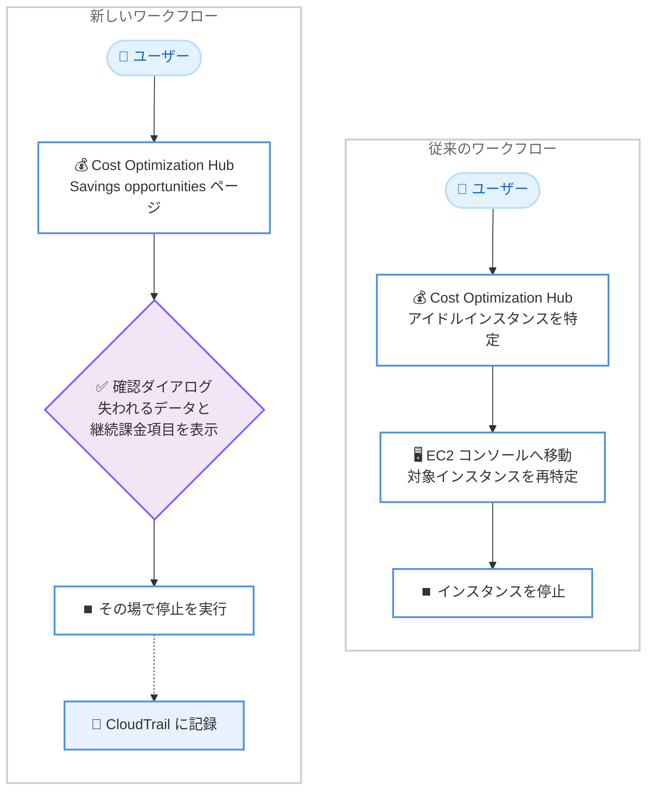

# AWS Cost Optimization Hub - アイドル状態の Amazon EC2 インスタンスの停止機能

**リリース日**: 2026 年 11 月 17 日
**サービス**: AWS Cost Optimization Hub (AWS Billing and Cost Management)
**機能**: アイドル状態の Amazon EC2 インスタンスを推奨事項から直接停止

📊 [このアップデートのインフォグラフィックを見る](https://takech9203.github.io/aws-news-summary/20261117-cost-hub-stop-idle-ec2.html)

## 概要

AWS Cost Optimization Hub で、アイドル状態の Amazon EC2 インスタンスを推奨事項から直接停止できるようになりました。Cost Optimization Hub は、AWS アカウントとリージョンをまたいでコスト最適化の推奨事項を集約・優先順位付けする機能であり、アイドルリソースの検出も行います。今回のアップデートにより、Savings opportunities ページ上の [Stop] ボタンから、その場でインスタンスを停止できます。

停止時には確認ダイアログが表示され、対象インスタンスとそのアカウント・リージョン、停止によって失われるもの (インスタンスストアのデータやメモリ上のデータなど)、停止後も課金が継続するもの (EBS ボリュームや Elastic IP アドレスなど) が明示されます。停止は終了 (terminate) ではないため、EBS ボリュームは削除されず、EC2 コンソールからいつでも再起動できます。追加のセットアップは不要で、操作はユーザー自身の既存の IAM 権限で実行されます。

コスト最適化を推進する FinOps チームや管理者にとって、推奨事項の確認からアクションの実行までを単一のコンソールで完結できるようになる、実用性の高いアップデートです。

**アップデート前の課題**

このアップデート以前は、推奨事項の確認と実行が別々のコンソールに分かれていました。

- アイドルインスタンスを停止するには、Cost Optimization Hub を離れて EC2 コンソールに移動する必要があった
- EC2 コンソールで該当インスタンスを自分で特定し直す必要があり、アカウントやリージョンをまたぐ場合は特に手間がかかった
- コンソールの行き来により、推奨事項への対応が後回しになり、削減機会を逃しやすかった

**アップデート後の改善**

今回のアップデートにより、推奨事項からのワンストップな対応が可能になりました。

- Savings opportunities ページの [Stop] ボタンから、アイドルインスタンスをその場で停止できるようになった
- 確認ダイアログで、失われるデータと継続課金される項目を停止前に把握できるようになった
- 追加のセットアップが不要で、既存の IAM 権限のみで利用できる
- 各停止操作は AWS CloudTrail に記録され、誰がいつ停止したかを追跡できる

## アーキテクチャ図



従来は Cost Optimization Hub と EC2 コンソールを行き来する必要がありましたが、今回のアップデートで Savings opportunities ページから確認ダイアログを経てその場で停止できるようになりました。

## サービスアップデートの詳細

### 主要機能

1. **推奨事項からの直接停止**
   - Savings opportunities ページの Actions 列にある [Stop]、または行を選択して表示される分割ビューパネルの [Stop instance] から停止を実行できる
   - 停止対象はアイドル状態の EC2 インスタンスの推奨事項のみで、ライトサイジングなど他の推奨事項には適用されない
   - 停止後は Actions 列の表示が [Stopped] に変わり、次の推奨事項の対応へ進める

2. **停止前の確認ダイアログ**
   - 対象インスタンス、所属アカウント、リージョンを表示する
   - 停止により失われるもの (インスタンスストアのデータ、メモリ上のデータ、自動割り当てのパブリック IPv4 アドレス) を明示する
   - 停止後も課金が継続するもの (EBS ボリューム、Elastic IP アドレス) を明示する

3. **既存権限での実行とガバナンス**
   - 追加のセットアップは不要で、ユーザー自身の認証情報で停止が実行される
   - IAM ポリシーとサービスコントロールポリシー (SCP) がそのまま適用され、許可されていない場合は停止が失敗する
   - すべての停止操作は AWS CloudTrail に記録され、監査証跡として利用できる

4. **安全な停止動作**
   - 停止は終了 (terminate) ではなく、EBS ボリュームは削除されない
   - 停止したインスタンスは EC2 コンソールからいつでも再起動できる
   - 停止保護が有効なインスタンスは停止できず、エラーバナーで理由が表示される

## 技術仕様

### 必要な権限

| 操作 | 必要な権限 |
|------|------------|
| 推奨事項の閲覧 | `CostOptimizationHubReadOnlyAccess` 管理ポリシーなど |
| インスタンス状態の確認 | インスタンスの状態を参照する EC2 権限 |
| インスタンスの停止 | `ec2:StopInstances` アクション |

`CostOptimizationHubReadOnlyAccess` 管理ポリシーには EC2 の権限は含まれないため、停止には別途 EC2 のアクションを許可する必要があります。

### 停止時の影響

| 項目 | 停止時の扱い |
|------|--------------|
| コンピューティング料金 | 課金が停止する |
| インスタンスストアのデータ | 失われる |
| メモリ上のデータ | 失われる |
| 自動割り当てのパブリック IPv4 アドレス | 解放される |
| EBS ボリューム | 削除されず、課金が継続する |
| Elastic IP アドレス | 課金が継続する |
| Reserved Instance / Savings Plans | コミットメントの課金は継続する |

### 停止ボタンが利用できないケース

以下の場合、[Stop] ボタンは無効化され、理由が表示されます。

- インスタンスが Auto Scaling グループに所属している、または他のサービスに管理されている (Karpenter ノード、Amazon EMR ノード、Amazon EKS Auto Mode や Amazon ECS Managed Instances が使用する EC2 マネージドインスタンスなど)
- インスタンスがすでに存在しない
- インスタンスが別のアカウントに属している
- 対象リージョンが応答しない

### IAM ポリシー例

停止操作に必要な EC2 権限を追加で付与するポリシーの例です。

```json
{
  "Version": "2012-10-17",
  "Statement": [
    {
      "Effect": "Allow",
      "Action": [
        "ec2:DescribeInstances",
        "ec2:DescribeInstanceStatus",
        "ec2:StopInstances"
      ],
      "Resource": "*"
    }
  ]
}
```

## 設定方法

### 前提条件

1. Cost Optimization Hub を有効化していること
2. AWS Compute Optimizer にオプトインしていること (アイドルリソースの推奨事項は Compute Optimizer が提供)
3. 推奨事項の閲覧権限と `ec2:StopInstances` を含む EC2 権限を持っていること

### 手順

#### ステップ 1: Cost Optimization Hub を開く

AWS Billing and Cost Management コンソールから Cost Optimization Hub を開き、Savings opportunities ページに移動します。

```text
https://console.aws.amazon.com/costmanagement/home#/cost-optimization-hub
```

上記 URL は Billing and Cost Management コンソール内の Cost Optimization Hub ページを直接開くリンクです。

#### ステップ 2: アイドルインスタンスの推奨事項を特定する

フィルターを使用して、アイドル状態の EC2 インスタンスの推奨事項を絞り込みます。Actions 列に [Stop] ボタンが表示されているものが停止可能なインスタンスです。

#### ステップ 3: 停止を実行する

Actions 列の [Stop] を選択するか、行を選択して分割ビューパネルの [Stop instance] を選択します。確認ダイアログで以下を確認してから [Stop] を選択します。

- 対象インスタンス、アカウント、リージョン
- 停止により失われるデータ
- 停止後も課金が継続する項目

確認バナーが表示され、通常は数分以内にインスタンスが停止します。

#### ステップ 4: 停止結果を確認する

停止後、Actions 列の表示が [Stopped] に変わります。アイドルリソースの推奨事項は 1 日 1 回更新されるため、推奨事項自体は最大 24 時間ページに残る場合があります。テーブルヘッダーの更新ボタンでインスタンスの状態を最新化できます。

## メリット

### ビジネス面

- **削減機会への即時対応**: 推奨事項の確認からアクションまでが単一画面で完結し、コスト削減の実行までのリードタイムが短縮される
- **追加コストなし**: 本機能は追加料金なしで利用できる
- **監査性の確保**: すべての停止操作が CloudTrail に記録され、誰がいつ停止したかを追跡できる

### 技術面

- **セットアップ不要**: Cost Optimization Hub と Compute Optimizer を有効化済みであれば、追加の設定なしで利用できる
- **既存のガバナンスを継承**: ユーザー自身の認証情報で実行されるため、IAM ポリシーや SCP による統制がそのまま機能する
- **安全な操作設計**: 終了ではなく停止であり、EBS ボリュームは保持される。停止前に影響範囲が明示され、停止保護も尊重される

## デメリット・制約事項

### 制限事項

- 停止できるのはアイドル状態の EC2 インスタンスの推奨事項のみで、ライトサイジングなど他の推奨事項には対応していない
- 管理アカウントからメンバーアカウントの推奨事項を閲覧できるが、他アカウントのインスタンスは停止できない (インスタンスを所有するアカウントにサインインする必要がある)
- Auto Scaling グループ所属のインスタンスや、Karpenter、Amazon EMR、EKS Auto Mode、ECS Managed Instances などが管理するインスタンスは停止できない
- スケジュール実行や自動停止の機能ではなく、停止のタイミングは都度ユーザーが判断する
- AWS GovCloud (US) リージョンと中国リージョンでは利用できない

### 考慮すべき点

- 停止してもインスタンスは削除されないため、EBS ボリュームや Elastic IP アドレス、Reserved Instance / Savings Plans のコミットメントの課金は継続する
- アイドルリソースの推奨事項は 1 日 1 回の更新であるため、停止済みインスタンスが最大 24 時間ページに表示され続ける場合がある
- 停止保護が有効なインスタンスや、オプトインリージョンが未有効の場合など、停止が完了しないケースがある (エラーバナーに理由と EC2 コンソールへのリンクが表示される)
- しきい値ベースの自動的なコスト制御が必要な場合は、AWS Budgets アクションの利用を検討する

## ユースケース

### ユースケース 1: FinOps チームによる定期的なコスト削減レビュー

**シナリオ**: FinOps チームが週次でコスト最適化レビューを実施し、複数リージョンにまたがるアイドルインスタンスを棚卸ししている。

**実装例**:
```text
1. Cost Optimization Hub の Savings opportunities ページを開く
2. 推奨タイプを「アイドルリソース」でフィルタリング
3. 推定削減額の大きい順にソートし、影響を確認のうえ [Stop] で順次停止
```

**効果**: EC2 コンソールへの移動や対象の再特定が不要になり、レビュー会の場でそのまま削減アクションを完了できる。

### ユースケース 2: 開発・検証環境の放置インスタンスの整理

**シナリオ**: 開発者が検証用に起動した EC2 インスタンスが使われないまま放置され、コストが積み上がっている。

**実装例**:
```text
1. Compute Optimizer のアイドル判定に基づく推奨事項を確認
2. 確認ダイアログでインスタンスストアやメモリ上のデータ消失の影響を確認
3. 問題なければ停止。再度必要になった場合は EC2 コンソールから再起動
```

**効果**: 終了 (terminate) ではないため EBS 上のデータは保持され、安全にコンピューティング料金のみを削減できる。

### ユースケース 3: ガバナンスを維持したコスト最適化の権限委譲

**シナリオ**: コスト管理担当者に推奨事項への対応を委譲したいが、操作範囲は統制したい。

**実装例**:
```json
{
  "Effect": "Allow",
  "Action": "ec2:StopInstances",
  "Resource": "*",
  "Condition": {
    "StringEquals": { "aws:ResourceTag/Environment": "dev" }
  }
}
```

**効果**: 停止はユーザー自身の権限で実行されるため、タグ条件付きの IAM ポリシーや SCP により停止可能な範囲を統制しつつ、CloudTrail で操作を監査できる。

## 料金

本機能は追加料金なしで利用できます。Cost Optimization Hub 自体も無料で利用できます。

なお、インスタンス停止後も EBS ボリューム、Elastic IP アドレス、および対象インスタンスをカバーしていた Reserved Instance / Savings Plans の課金は継続する点に注意してください。

## 利用可能リージョン

AWS GovCloud (US) リージョンと中国リージョンを除く、すべての AWS リージョンで利用できます。

## 関連サービス・機能

- **AWS Compute Optimizer**: アイドルリソースとライトサイジングの推奨事項の提供元。本機能の利用にはオプトインが必要
- **Amazon EC2**: 停止対象のインスタンス。停止後の再起動は EC2 コンソールから実行する
- **AWS CloudTrail**: 各停止操作を記録し、誰がインスタンスを停止したかの監査証跡を提供
- **AWS Budgets**: しきい値ベースの自動アクションが必要な場合に利用するコスト制御機能

## 参考リンク

- 📊 [インフォグラフィック](https://takech9203.github.io/aws-news-summary/20261117-cost-hub-stop-idle-ec2.html)
- [公式発表 (What's New)](https://aws.amazon.com/about-aws/whats-new/2026/11/cost-hub-stop-idle-ec2/)
- [Cost Optimization Hub 製品ページ](https://aws.amazon.com/aws-cost-management/cost-optimization-hub/)
- [ユーザーガイド: Identifying opportunities with Cost Optimization Hub](https://docs.aws.amazon.com/cost-management/latest/userguide/cost-optimization-hub.html)
- [ユーザーガイド: Stopping idle resources](https://docs.aws.amazon.com/cost-management/latest/userguide/coh-stop-idle-resources.html)

## まとめ

Cost Optimization Hub のアイドル EC2 インスタンス停止機能により、コスト最適化の「発見」から「実行」までが単一のコンソールで完結するようになりました。追加のセットアップが不要で既存の IAM 権限と CloudTrail によるガバナンスがそのまま機能するため、導入障壁は低く、すぐに活用できます。Cost Optimization Hub と Compute Optimizer を有効化し、Savings opportunities ページでアイドルインスタンスの推奨事項を確認することから始めることを推奨します。
