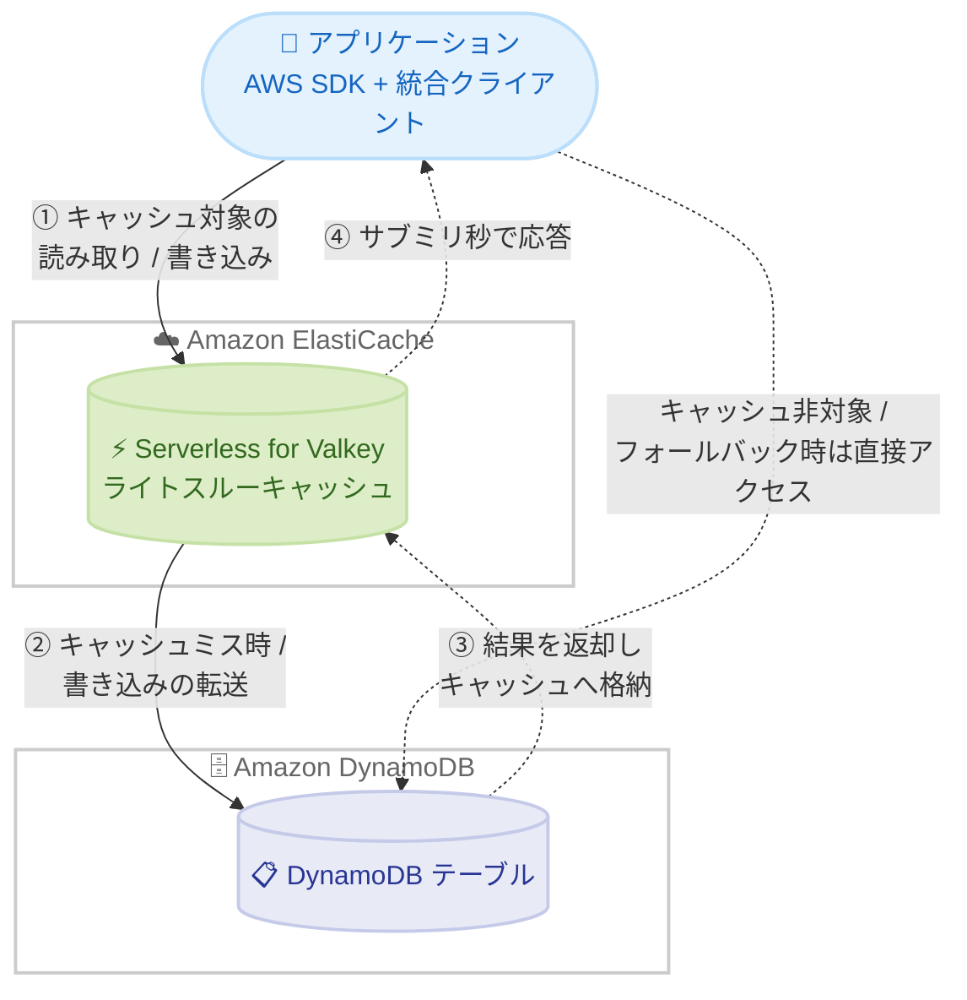

# Amazon DynamoDB - Amazon ElastiCache Serverless for Valkey による DynamoDB キャッシング

**リリース日**: 2026 年 11 月 17 日
**サービス**: Amazon DynamoDB / Amazon ElastiCache
**機能**: DynamoDB caching with Amazon ElastiCache Serverless for Valkey

📊 [このアップデートのインフォグラフィックを見る](https://takech9203.github.io/aws-news-summary/20261117-dynamodb-caching-elasticache.html)

## 概要

AWS は、Amazon ElastiCache Serverless for Valkey による DynamoDB キャッシングの一般提供を発表しました。これは Amazon DynamoDB Accelerator (DAX) のサーバーレスな代替手段であり、頻繁にアクセスされる DynamoDB データに対してサブミリ秒の読み取りレイテンシーを実現します。書き込み時にキャッシュが自動更新されるライトスルーキャッシュとして動作し、ワークロードの変化に応じて自動的にスケールするため、クラスターやノードの管理は不要です。

アプリケーションコードのロジック変更は不要で、最小限の設定で利用を開始できます。キャッシュ対象とする DynamoDB テーブルと API、およびキャッシュデータの保持期間 (TTL) を選択するだけで、アプリケーションは従来どおり AWS SDK 経由で DynamoDB API を呼び出し続けられます。アプリケーション起動時に設定する ElastiCache 統合クライアントが、キャッシュ可能なリクエストをサーバーレス Valkey キャッシュへ自動的にルーティングします。

アクセス制御にはアプリケーションの IAM 認証情報がそのまま使用されるため、既存の DynamoDB アクセス制御ポリシーが自動的に適用されます。ホットキーによる DynamoDB のスロットリング影響の軽減や、頻繁に読み取られるデータの読み取りコスト削減にも有効です。

**アップデート前の課題**

- DynamoDB の 1 桁ミリ秒レイテンシーより高速な読み取りが必要な場合、DAX ノードのプロビジョニングとスケーリング管理が必要だった
- または独自のキャッシュを構築し、DynamoDB との同期をアプリケーション側で実装・維持する必要があった
- キャッシュと DynamoDB の整合性維持のためのカスタムコードが運用負荷になっていた

**アップデート後の改善**

- クラスターやノードの管理が不要なサーバーレスのライトスルーキャッシュを利用できるようになった
- データ変更時にキャッシュが自動更新され、同期用のカスタムコードが不要になった
- アプリケーションロジックの変更なしで、サブミリ秒の読み取りレイテンシーを実現できるようになった
- 既存の IAM ポリシーがそのまま適用され、追加のアクセス制御設定が不要になった

## アーキテクチャ図



統合クライアントがキャッシュ対象テーブルへのリクエストを ElastiCache Serverless for Valkey に自動ルーティングし、キャッシュヒット時はサブミリ秒で応答、キャッシュミスや書き込みは DynamoDB へ転送してキャッシュを更新します。キャッシュが一時的に利用できない場合は DynamoDB へ直接フォールバックします。

## サービスアップデートの詳細

### 主要機能

1. **ライトスルーキャッシング**
   - キャッシュ対象テーブルへの書き込みは ElastiCache 経由で DynamoDB へ転送され、成功後にキャッシュ内の関連プロジェクションが自動更新される
   - DeleteItem 成功時は該当アイテムのキャッシュエントリが無効化される
   - UpdateItem は ReturnValues が ALL_NEW の場合にキャッシュを更新し、それ以外の場合はキャッシュエントリを無効化する

2. **アプリケーションロジック変更不要の統合クライアント**
   - ElastiCache 統合クライアントライブラリをインストールし、起動時に設定するだけで有効化できる
   - DynamoDB にアクセスする既存コードの変更は不要
   - キャッシュ対象外のテーブルや非対応 API へのリクエストは DynamoDB へ直接ルーティングされる
   - 複数言語向けのクライアントライブラリが GitHub (awslabs/elasticache-integration-client) で提供される

3. **3 種類のキャッシュエントリ**
   - **アイテムキャッシュ**: プライマリキーごとに Valkey ハッシュとして格納され、ProjectionExpression ごとにフィールドが作成される
   - **クエリキャッシュ**: 一意の Query リクエストごとに 1 エントリが作成される
   - **スキャンキャッシュ**: 一意の Scan リクエストごとに 1 エントリが作成される

4. **ネガティブキャッシング**
   - テーブルに存在しないデータへのリクエストに対してネガティブキャッシュエントリを作成し、以降の同一リクエストに空の結果を返す
   - 存在しないデータへの頻繁なアクセスによる応答時間と DynamoDB 読み取りトラフィックを削減できる
   - デフォルトで有効であり、テーブル単位で無効化できる

5. **自動フォールバック**
   - サーバーレスキャッシュが一時的に利用不可またはタイムアウトした場合、統合クライアントは DynamoDB へ直接リクエストを送信する
   - キャッシュ復旧後は自動的にキャッシュ経由のルーティングに戻る
   - フォールバックのタイムアウト期間の設定や、フォールバック自体の無効化も可能

## 技術仕様

### キャッシュ動作仕様

| 項目 | 詳細 |
|------|------|
| 対応 API | GetItem、BatchGetItem、PutItem、BatchWriteItem、UpdateItem、DeleteItem、Query、Scan、TransactGetItems、TransactWriteItems |
| 通常 TTL | デフォルト 5 分 (1〜86,400 秒で設定可能) |
| ネガティブキャッシュ TTL | デフォルト 60 秒 (0〜86,400 秒で設定可能、0 で無効化) |
| 整合性モデル | 結果整合性読み取りはキャッシュから返却。ConsistentRead を true にした強力な整合性読み取りは DynamoDB へルーティングされ、結果でキャッシュが更新される |
| キャッシュキー形式 | アイテム: `aws:ddb:item:<table>:<primarykey>`、クエリ: `aws:ddb:query:<table>:<params>`、スキャン: `aws:ddb:scan:<table>:<params>` |
| 必要エンジンバージョン | ElastiCache Serverless for Valkey バージョン 9 以降 |

### API 変更履歴

| 日付 | サービス | 変更内容 |
|------|----------|----------|
| 2026/11/17 | [Amazon ElastiCache](https://awsapichanges.com/archive/changes/a370bc-elasticache.html) | 8 updated api methods - DynamoDB テーブルデータのライトスルーキャッシングをサポートするサーバーレス Valkey キャッシュの作成が可能に |

## 設定方法

### 前提条件

1. ElastiCache Serverless for Valkey バージョン 9 以降を使用すること
2. DynamoDB キャッシングはサーバーレスキャッシュの**作成時**に有効化すること (既存キャッシュへの後付けは不可)
3. アクセス制御として IAM 認証を使用すること

### 手順

#### ステップ 1: DynamoDB キャッシングを有効にしたサーバーレスキャッシュを作成

```bash
aws elasticache create-serverless-cache \
    --serverless-cache-name my-ddb-cache \
    --engine valkey \
    --major-engine-version 9 \
    --integrations IntegrationType=DYNAMODB \
    --user-group-id default.iam-user-group
```

`create-serverless-cache` コマンドで、Valkey エンジンバージョン 9 を指定し、`--integrations IntegrationType=DYNAMODB` オプションで DynamoDB キャッシングを有効化したサーバーレスキャッシュを作成します。アクセス制御には IAM 認証のユーザーグループを指定します。コンソールの場合は、キャッシュ作成画面の [Integrations] セクションで [DynamoDB caching] を選択します。

#### ステップ 2: アプリケーションに ElastiCache 統合クライアントを設定

```python
import boto3
# ElastiCache 統合クライアントをインポート
import aws_elasticache_integration_client

ddb = boto3.client("dynamodb", region_name="us-east-1")

# すべてのテーブルで DynamoDB キャッシングを有効化
aws_elasticache_integration_client.install(
    client=ddb, endpoint="my-cache:6379", cache_name="my-cache"
)
```

統合クライアントライブラリをインストールし、アプリケーション起動時に DynamoDB クライアントへ適用します。キャッシュ対象のテーブルやテーブルごとの TTL 設定もここで構成します。

#### ステップ 3: 既存コードをそのまま実行

```python
# DynamoDB にアクセスするコードの変更は不要
response = ddb.get_item(
    TableName="my-table",
    Key={"id": {"S": "1"}},
    ProjectionExpression="myattr_1, myattr_2"
)
```

DynamoDB にアクセスする既存コードの変更は不要です。キャッシュ対象テーブルへの対応 API リクエストは自動的にキャッシュ経由となり、アイテムのプロジェクションがキャッシュから返却されます。

## メリット

### ビジネス面

- **運用コストの削減**: DAX ノードのプロビジョニングやキャパシティ管理が不要になり、インフラ管理の工数を削減できる
- **読み取りコストの最適化**: 頻繁に読み取られるデータをキャッシュから返すことで、DynamoDB の読み取りコストを削減できる
- **追加料金なし**: DynamoDB キャッシング機能自体は無料で、使用した ElastiCache Serverless と DynamoDB のリソース分のみの支払いで済む

### 技術面

- **サブミリ秒レイテンシー**: DynamoDB の 1 桁ミリ秒を超える読み取り性能が必要なワークロードに対応できる
- **ホットキー対策**: 特定アイテムへの読み取り集中による DynamoDB スロットリングの影響を軽減できる
- **自動スケーリングと高可用性**: キャッシュはワークロードに応じて自動スケールし、キャッシュ障害時は DynamoDB への自動フォールバックで可用性を維持できる
- **既存の IAM ポリシーを継承**: アプリケーションの IAM 認証情報で DynamoDB にアクセスするため、アクセス制御の二重管理が不要

## デメリット・制約事項

### 制限事項

- ElastiCache Serverless for Valkey バージョン 9 以降が必要
- ノードベースの ElastiCache クラスターでは利用できない
- DynamoDB キャッシングはサーバーレスキャッシュの作成時にのみ有効化できる (既存キャッシュへの追加は不可)
- 一度有効化したキャッシュで DynamoDB キャッシングを無効化することはできない (バックアップから新規キャッシュを作成して既存キャッシュを削除する必要がある)

### 考慮すべき点

- アイテムデータの更新はクエリキャッシュ・スキャンキャッシュには自動反映されない (最新データが必要な場合は ConsistentRead を true にして再実行する)
- トランザクション API の結果は個別のアイテムキャッシュエントリとして格納され、キャッシュエントリ間のトランザクション整合性は保証されない
- 結果整合性読み取りではキャッシュの TTL 内に古いデータが返る可能性があるため、要件に応じた TTL 設定が必要
- テーブル名指定と ARN 指定のリクエストは別々のキャッシュエントリになるため、アプリケーション内で指定方法を統一することが望ましい

## ユースケース

### ユースケース 1: 読み取り集中型 Web アプリケーションの高速化

**シナリオ**: EC サイトの商品カタログなど、同じアイテムへの読み取りが集中するワークロードで、サブミリ秒の応答時間を実現したい。

**実装例**:
```python
aws_elasticache_integration_client.install(
    client=ddb, endpoint="catalog-cache:6379", cache_name="catalog-cache"
)
response = ddb.get_item(
    TableName="ProductCatalog",
    Key={"product_id": {"S": "12345"}}
)
```

**効果**: 人気商品 (ホットキー) への読み取りがキャッシュから返却され、サブミリ秒レイテンシーの実現と DynamoDB スロットリングの回避、読み取りコストの削減が期待できる。

### ユースケース 2: DAX からのサーバーレス移行

**シナリオ**: DAX クラスターを運用しているが、ノードのサイジングやスケーリング管理の負荷を削減し、サーバーレス構成に統一したい。

**実装例**:
```bash
aws elasticache create-serverless-cache \
    --serverless-cache-name dax-replacement \
    --engine valkey \
    --major-engine-version 9 \
    --integrations IntegrationType=DYNAMODB \
    --user-group-id default.iam-user-group
```

**効果**: ノード管理が不要になり、ワークロード変動に応じた自動スケーリングによって、キャパシティの過不足を気にせず運用できる。

### ユースケース 3: 自前キャッシュ同期ロジックの廃止

**シナリオ**: アプリケーション側で Redis OSS / Valkey キャッシュと DynamoDB の同期ロジック (キャッシュアサイド) を独自実装しており、整合性維持のコードが保守負担になっている。

**実装例**:
```python
# Before: 独自のキャッシュアサイド実装
# cached = redis.get(key)
# if not cached:
#     item = ddb.get_item(...)
#     redis.set(key, item, ex=300)

# After: 統合クライアントの設定のみで書き込み時の自動更新を実現
aws_elasticache_integration_client.install(
    client=ddb, endpoint="my-cache:6379", cache_name="my-cache"
)
```

**効果**: ライトスルー方式によりデータ変更時にキャッシュが自動更新されるため、同期用カスタムコードを廃止でき、キャッシュと DynamoDB の不整合リスクを低減できる。

## 料金

DynamoDB キャッシング機能自体に追加料金はありません。アプリケーションが使用する ElastiCache Serverless と DynamoDB のリソースに対してのみ料金が発生します。

- **ElastiCache Serverless**: 保存データ量 (GB 時間) と処理量 (ElastiCache Processing Units、ECPU) に基づく従量課金
- **DynamoDB**: キャッシュミス時の読み取りと書き込みに対する通常の DynamoDB 料金

キャッシュヒット率が高いワークロードでは、DynamoDB の読み取りリクエストが削減されるため、全体のコスト最適化につながる可能性があります。詳細は各サービスの料金ページを参照してください。

## 利用可能リージョン

すべての商用リージョンおよび AWS GovCloud (US) リージョンで利用可能です。

## 関連サービス・機能

- **Amazon DynamoDB Accelerator (DAX)**: 従来のノードベースの DynamoDB 専用キャッシュ。本機能はそのサーバーレスな代替手段に位置づけられる
- **Amazon ElastiCache Serverless**: 本機能の基盤となるサーバーレスキャッシュサービス。Valkey エンジンバージョン 9 以降で DynamoDB キャッシングをサポート
- **Valkey**: Redis OSS からフォークされたオープンソースのインメモリデータストア。ElastiCache でサポートされるエンジンの 1 つ
- **AWS IAM**: 本機能のアクセス制御に使用され、アプリケーションの既存 IAM ポリシーがそのまま適用される

## 参考リンク

- 📊 [インフォグラフィック](https://takech9203.github.io/aws-news-summary/20261117-dynamodb-caching-elasticache.html)
- [公式発表 (What's New)](https://aws.amazon.com/about-aws/whats-new/2026/11/dynamodb-caching-elasticache/)
- [ドキュメント: DynamoDB caching (ElastiCache Developer Guide)](https://docs.aws.amazon.com/AmazonElastiCache/latest/dg/ddb-caching.html)
- [ドキュメント: How DynamoDB caching works](https://docs.aws.amazon.com/AmazonElastiCache/latest/dg/ddb-caching-how-it-works.html)
- [ドキュメント: Getting started with DynamoDB caching](https://docs.aws.amazon.com/AmazonElastiCache/latest/dg/ddb-caching-getting-started.html)
- [ElastiCache 統合クライアント (GitHub)](https://github.com/awslabs/elasticache-integration-client)
- [料金ページ (Amazon ElastiCache)](https://aws.amazon.com/elasticache/pricing/)

## まとめ

DynamoDB キャッシングは、DAX のサーバーレスな代替手段として、インフラ管理なしでサブミリ秒の読み取りレイテンシーを実現する重要なアップデートです。アプリケーションロジックの変更が不要で、既存の IAM ポリシーがそのまま適用されるため、導入障壁が低い点も魅力です。DAX の運用負荷や独自キャッシュの同期ロジックに課題を抱えているチームは、新規のサーバーレス Valkey キャッシュで本機能を評価することを推奨します。
