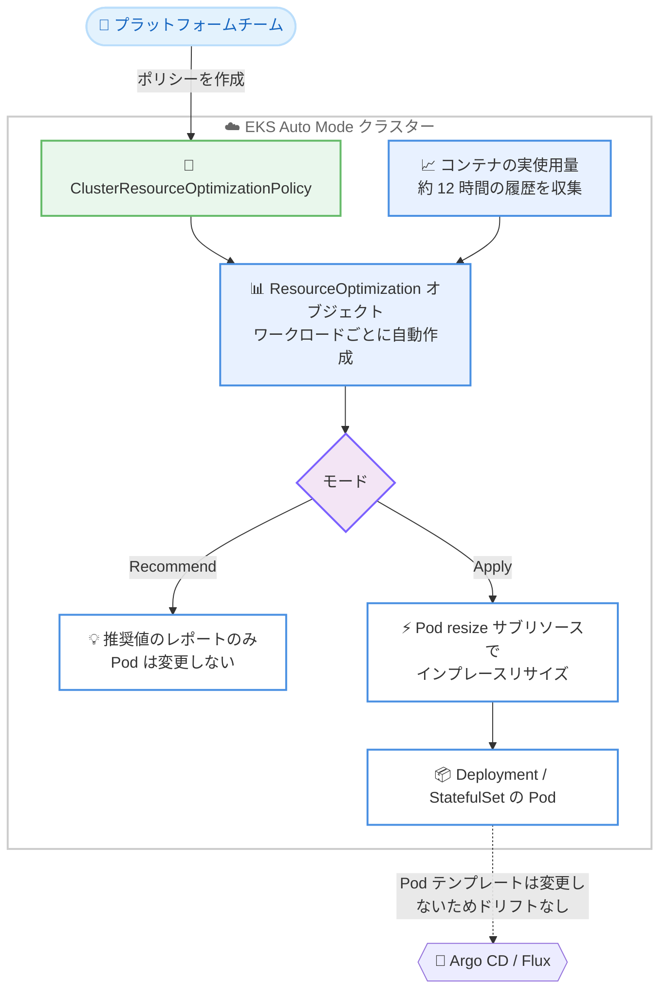

# Amazon EKS - Auto Mode リソース最適化による Pod の自動ライトサイジング (プレビュー)

**リリース日**: 2026 年 11 月 17 日
**サービス**: Amazon Elastic Kubernetes Service (Amazon EKS)
**機能**: EKS Auto Mode リソース最適化 (Pod ライトサイジング、プレビュー)

📊 [このアップデートのインフォグラフィックを見る](https://takech9203.github.io/aws-news-summary/20261117-eks-auto-mode-pod-rightsizing-preview.html)

## 概要

Amazon EKS は、EKS Auto Mode の新機能として「リソース最適化 (resource optimization)」をプレビューリリースしました。実行中の Pod の実際の使用量に基づいて、CPU とメモリのリクエスト値を自動的にライトサイジング (適正化) する機能です。これにより、同じ Deployment や StatefulSet をより少ない、またはより小さい EC2 インスタンスで実行でき、手動チューニングなしでコンピューティングコストを削減できます。追加料金なしで利用できます。

CPU とメモリのリクエスト値はデプロイ時に設定されたまま見直されないことが多く、Auto Mode はそのリクエスト値に合わせて EC2 インスタンスをプロビジョニングします。リクエスト値が実際の使用量より大きいと、必要以上に多くの、または大きいインスタンスが稼働することになります。リソース最適化を使用すると、リクエスト値が各ワークロードの実際の使用量に追従するようになります。

有効化は、クラスターに `ClusterResourceOptimizationPolicy` を作成するだけです。デフォルトの `Recommend` モードで推奨値を確認し、準備ができたら `Apply` モードに切り替えることで、実行中の Pod を再作成せずにインプレースでリサイズできます。Pod テンプレートは一切変更されないため、Argo CD や Flux などの GitOps ツールでドリフトが発生しません。

**アップデート前の課題**

- CPU / メモリのリクエスト値はデプロイ時に設定されたまま見直されず、過剰なリクエスト値のまま放置されがちだった
- リクエスト値の適正化には、使用量の計測、Pod テンプレートの編集、再デプロイといった手動チューニングが必要だった
- Vertical Pod Autoscaler (VPA) などで自動調整する場合も、マニフェストの変更が GitOps ツールのドリフトとして検出される懸念があった
- 過剰なリクエスト値により、実際の使用量に対して多すぎる、または大きすぎる EC2 インスタンスが稼働し、コストが増大していた

**アップデート後の改善**

- 実際の使用量に基づく CPU / メモリリクエストの推奨値が、ワークロードごとに自動生成されるようになった
- `Apply` モードでは、Kubernetes の Pod `resize` サブリソースにより、Pod を再作成せずインプレースでリサイズできるようになった
- Deployment / StatefulSet の Pod テンプレートは変更されないため、GitOps ツールにドリフトが発生しなくなった
- メモリ不足 (OOM kill) が発生した場合はメモリ推奨値を引き上げ、Java ヒープなどの要件を下回らないように調整される
- 追加料金なしで、Auto Mode が同じワークロードをより少ない / 小さいインスタンスに集約できるようになった

## アーキテクチャ図



ポリシーを作成すると、選択されたワークロードごとに `ResourceOptimization` オブジェクトが自動作成され、約 12 時間の使用量履歴に基づいて推奨値が生成されます。`Apply` モードでは Pod テンプレートを変更せず、実行中の Pod をインプレースでリサイズします。

## サービスアップデートの詳細

### 主要機能

1. **ポリシーベースの有効化 (ClusterResourceOptimizationPolicy)**
   - クラスタースコープの Kubernetes オブジェクトを `kubectl` や GitOps ツールで作成するだけで有効化できる (EKS API の設定は不要)
   - `namespaceSelector` と `workloadSelector` (標準の Kubernetes ラベルセレクター) で、対象の名前空間とワークロードを柔軟に選択できる
   - 複数のポリシーが同じワークロードを選択した場合、フィールドごとに結合され、より具体的なポリシーが優先される
   - 空の `spec` を持つポリシーは、システム名前空間を除くすべての Deployment / StatefulSet を `Recommend` モードで選択する

2. **2 つの動作モード (Recommend / Apply)**
   - `Recommend` (デフォルト): 使用量を収集して推奨値を生成するのみで、Pod は一切変更しない
   - `Apply`: 推奨値に合わせて実行中の Pod をリサイズする
   - モードを切り替えても収集済みの使用量履歴はリセットされず、再収集は不要

3. **インプレースリサイズと GitOps 親和性**
   - Kubernetes の Pod `resize` サブリソースを使用し、Pod を再作成せずにリサイズする
   - Deployment / StatefulSet の Pod テンプレートは編集しないため、Argo CD や Flux はドリフトを検出せず、リバートも発生しない
   - スケールアウト、ノード統合、ロールアウトなどで作成される新しい Pod は、Pod テンプレートのサイズではなく推奨サイズで起動する

4. **Balanced 最適化プロファイル**
   - CPU: 観測された使用量の 95 パーセンタイルがリクエスト値の約 87% になるようにサイジング
   - メモリ: 95 パーセンタイルがリクエスト値の約 70% になるようにサイジング (メモリ不足はコンテナ停止につながるため、CPU より大きいヘッドルームを確保)
   - 推奨値は Pod テンプレートで宣言された最小リクエストの半分から最大リミットの 2 倍までの範囲内に収まる (リミット未宣言の場合は上限なし)
   - Java サービスではメモリ推奨値が各 Java ヒープを下回らないよう維持され、OOM kill 発生後はメモリを引き上げる

5. **オートスケーラーとの共存**
   - Horizontal Pod Autoscaler (HPA) や KEDA がスケーリングの基準とするリソースは変更しない
   - Vertical Pod Autoscaler (VPA) が既に管理しているワークロードは除外できる
   - `optimization.eks.amazonaws.com/enabled: "false"` アノテーションで、個別のワークロードをオプトアウトできる

## 技術仕様

### 要件とスコープ

| 項目 | 詳細 |
|------|------|
| クラスター | Kubernetes 1.36 以降の EKS Auto Mode クラスター (既存クラスターも対象、クラスター更新や EKS API 呼び出しは不要) |
| 対象ワークロード | Deployment、StatefulSet |
| 対象リソース | CPU、メモリ (GPU、エフェメラルストレージ、レプリカ数は対象外) |
| 除外名前空間 | `kube-system`、`kube-public`、`kube-node-lease` はポリシーで選択しても管理対象外 |
| 推奨値の生成 | コンテナごとに約 12 時間の使用量履歴が必要 |
| 最適化プロファイル | プレビューでは `Balanced` のみ |
| 料金 | 追加料金なし |

### API 変更履歴

今回のアップデートに関連する EKS API の変更はありません。リソース最適化は `ClusterResourceOptimizationPolicy` という Kubernetes カスタムリソース (apiVersion: `eks.amazonaws.com/v1beta1`) で管理され、EKS API の設定は存在しません。

### ClusterResourceOptimizationPolicy の例

```yaml
apiVersion: eks.amazonaws.com/v1beta1
kind: ClusterResourceOptimizationPolicy
metadata:
  name: team-search
spec:
  namespaceSelector:
    matchLabels:
      team: search
  workloadSelector:
    matchLabels:
      tier: stateless
  mode: Apply
```

`team: search` ラベルを持つ名前空間のうち、`tier: stateless` ラベルを持つワークロードのみを `Apply` モードで管理するポリシーの例です。

## 設定方法

### 前提条件

1. Kubernetes バージョン 1.36 以降で稼働する EKS Auto Mode クラスター
2. クラスターと通信できるように設定された `kubectl`
3. クラスタースコープのリソースを作成できる権限

### 手順

#### ステップ 1: デフォルト設定でリソース最適化を有効化

```bash
cat <<EOF > ro-default-policy.yaml
apiVersion: eks.amazonaws.com/v1beta1
kind: ClusterResourceOptimizationPolicy
metadata:
  name: default
spec: {}
EOF

kubectl apply -f ro-default-policy.yaml
```

空の `spec` を持つポリシーを作成します。システム名前空間を除くすべての Deployment / StatefulSet が、デフォルトの `Recommend` モードと `Balanced` プロファイルで選択されます。この時点では Pod は一切変更されません。

#### ステップ 2: ポリシーの状態と推奨値を確認

```bash
# ポリシーの状態を確認 (crop は ClusterResourceOptimizationPolicy の短縮名)
kubectl get crop

# ワークロードごとの ResourceOptimization オブジェクトを確認 (ro は短縮名)
kubectl get ro --all-namespaces
```

`READY` が `True` であればセレクターは有効で、`SELECTED` は現在選択されているワークロード数を示します。推奨値は、約 12 時間の使用量履歴が収集された後に各 `ResourceOptimization` オブジェクトに表示されます。

#### ステップ 3: Apply モードに切り替えてリサイズを開始

```bash
kubectl patch crop default --type merge -p '{"spec":{"mode":"Apply"}}'
```

ポリシーのモードを `Apply` に変更し、実行中の Pod のインプレースリサイズを開始します。モード切り替え時に使用量履歴はリセットされないため、既に推奨値があるワークロードは即座にリサイズ対象となります。

#### ステップ 4: 必要に応じて個別ワークロードをオプトアウト

```bash
# ワークロードを管理対象から除外
kubectl annotate deployment my-app -n my-namespace optimization.eks.amazonaws.com/enabled="false"

# 適用済みの値を Pod テンプレートの値に戻す場合
kubectl rollout restart deployment my-app -n my-namespace
```

アノテーションを追加すると、ポリシーの選択に関係なくそのワークロードが管理対象から除外されます。適用済みの値は自動では戻らないため、Pod テンプレートの値に戻すにはロールアウト再起動が必要です。GitOps ツールで管理している場合は、リポジトリ内のマニフェストにアノテーションを追加してください。

## メリット

### ビジネス面

- **コンピューティングコストの削減**: 過剰なリクエスト値が実使用量に合わせて適正化され、同じワークロードをより少ない / 小さい EC2 インスタンスで実行できる
- **追加料金なし**: リソース最適化自体に費用は発生せず、導入の障壁が低い
- **運用工数の削減**: デプロイ後に放置されがちなリクエスト値の見直しが自動化され、手動チューニングが不要になる

### 技術面

- **GitOps とのドリフトレスな統合**: Pod テンプレートを変更しないため、Argo CD や Flux がドリフトを検出せず、テンプレートの編集も不要
- **無停止のリサイズ**: Pod `resize` サブリソースによるインプレースリサイズで、Pod の再作成を伴わない
- **安全性を考慮した推奨値**: メモリには CPU より大きいヘッドルームを確保し、Java ヒープの維持や OOM kill 後のメモリ引き上げなど、ワークロードの安定性に配慮した動作をする
- **段階的な導入が可能**: デフォルトの `Recommend` モードで影響なく推奨値を確認してから、ポリシー単位・ワークロード単位で `Apply` に移行できる

## デメリット・制約事項

### 制限事項

- プレビューリリースであり、仕様は変更される可能性がある
- Kubernetes 1.36 以降の EKS Auto Mode クラスターのみで利用可能 (Auto Mode 以外のクラスターでは利用不可)
- 対象は Deployment と StatefulSet のみで、CPU とメモリのみをサイジングする (GPU、エフェメラルストレージ、レプリカ数は対象外)
- `kube-system`、`kube-public`、`kube-node-lease` 名前空間のワークロードは管理されない
- 最適化プロファイルはプレビューでは `Balanced` のみ
- 利用可能リージョンは 7 リージョンに限定される

### 考慮すべき点

- **自動ロールバックなし**: 適用した推奨値がワークロードを劣化させても自動では元に戻らない。問題発生時はオプトアウトまたは `Recommend` モードへの切り替えが必要
- **適用済みの値は残存する**: ポリシーの削除やモード変更をしても、実行中の Pod には最後に適用された値が残る。Pod テンプレートの値に戻すには `kubectl rollout restart` などの再起動が必要
- **コスト削減額のレポートなし**: プレビューでは削減額の推定値は表示されないため、コスト効果の計測には AWS Cost Explorer などの既存ツールを使用する
- **コンソールは読み取り専用**: EKS コンソールに専用ページはなく、Kubernetes リソースビューアーで `ClusterResourceOptimizationPolicy` と `ResourceOptimization` を読み取り専用で確認できるのみ
- 最初の推奨値の生成には約 12 時間の使用量履歴が必要。オプトアウトすると使用量履歴が削除され、再度有効化した場合は約 12 時間の再収集が必要

## ユースケース

### ユースケース 1: Argo CD 管理下の Java サービス群の一括ライトサイジング

**シナリオ**: プラットフォームチームが Argo CD で多数の Java サービスを管理しており、各チームのテンプレートを編集せずに全アプリケーション名前空間をライトサイジングしたい。

**実装例**:
```yaml
apiVersion: eks.amazonaws.com/v1beta1
kind: ClusterResourceOptimizationPolicy
metadata:
  name: default
spec:
  mode: Apply
```

**効果**: テンプレートの編集や GitOps ドリフトを発生させずに全名前空間をライトサイジングできる。リソース最適化はメモリ推奨値を各 Java ヒープより上に維持し、OOM kill 発生後はメモリを引き上げるため、Java ワークロードでも安全に適用できる。

### ユースケース 2: 本番名前空間を除外した段階的導入

**シナリオ**: まず本番以外の環境で推奨値を適用し、本番の `payments-prod` 名前空間は対象外にしたい。

**実装例**:
```yaml
apiVersion: eks.amazonaws.com/v1beta1
kind: ClusterResourceOptimizationPolicy
metadata:
  name: all-but-payments
spec:
  namespaceSelector:
    matchExpressions:
      - key: kubernetes.io/metadata.name
        operator: NotIn
        values: [payments-prod]
```

**効果**: Kubernetes が全名前空間に自動設定する `kubernetes.io/metadata.name` ラベルを利用し、ラベル付け作業なしで特定の名前空間を除外できる。本番環境への影響を避けながら段階的に導入できる。

### ユースケース 3: 特定チームのステートレスワークロードのみ自動適用

**シナリオ**: 検索チームのステートレスなワークロードだけ自動リサイズを有効にし、その他のワークロードは推奨値の確認にとどめたい。

**実装例**:
```yaml
apiVersion: eks.amazonaws.com/v1beta1
kind: ClusterResourceOptimizationPolicy
metadata:
  name: team-search
spec:
  namespaceSelector:
    matchLabels:
      team: search
  workloadSelector:
    matchLabels:
      tier: stateless
  mode: Apply
```

**効果**: より具体的なポリシーが優先されるルールにより、デフォルトポリシー (`Recommend`) と共存しながら、対象を絞った `Apply` モードの適用が可能。HPA や KEDA のスケーリング基準リソースは変更されないため、既存のオートスケーリング構成とも共存できる。

## 料金

リソース最適化は追加料金なしで利用できます。EKS Auto Mode 自体の料金 (管理対象インスタンスに対する Auto Mode 料金と EC2 インスタンス料金) は従来どおり発生します。

ライトサイジングにより必要な EC2 インスタンスの数やサイズが削減されるため、コンピューティングコストの削減が期待できます。プレビューでは削減額の推定値は提供されないため、効果測定には AWS Cost Explorer などを使用してください。

## 利用可能リージョン

以下の AWS リージョンで利用可能です。

- 米国東部 (バージニア北部)
- 米国東部 (オハイオ)
- 米国西部 (オレゴン)
- 欧州 (フランクフルト)
- 欧州 (アイルランド)
- アジアパシフィック (ソウル)
- アジアパシフィック (東京)

## 関連サービス・機能

- **EKS Auto Mode**: 本機能の前提となる EKS のフルマネージドな実行モード。コンピューティング、ネットワーク、ストレージのプロビジョニングと管理を自動化する
- **Horizontal Pod Autoscaler (HPA) / KEDA**: 水平スケーリングの仕組み。リソース最適化は HPA や KEDA がスケーリング基準とするリソースを変更しないため共存できる
- **Vertical Pod Autoscaler (VPA)**: 垂直スケーリングの仕組み。VPA が既に管理しているワークロードはリソース最適化から除外できる
- **AWS Cost Explorer**: ライトサイジングによるコスト削減効果の計測に使用できる

## 参考リンク

- 📊 [インフォグラフィック](https://takech9203.github.io/aws-news-summary/20261117-eks-auto-mode-pod-rightsizing-preview.html)
- [公式発表 (What's New)](https://aws.amazon.com/about-aws/whats-new/2026/11/eks-auto-mode-pod-rightsizing-preview/)
- [ドキュメント: Rightsize workloads with resource optimization](https://docs.aws.amazon.com/eks/latest/userguide/auto-resource-optimization.html)
- [ドキュメント: Turn on and configure EKS Auto Mode resource optimization](https://docs.aws.amazon.com/eks/latest/userguide/auto-ro-enable.html)
- [EKS Auto Mode 製品ページ](https://aws.amazon.com/eks/auto-mode/)

## まとめ

EKS Auto Mode のリソース最適化は、デプロイ後に放置されがちな CPU / メモリリクエストの適正化を、GitOps ドリフトや Pod 再作成なしで自動化する機能です。追加料金なしで利用でき、まず `Recommend` モードで推奨値を確認してから `Apply` モードに移行する段階的な導入が可能です。Kubernetes 1.36 以降の EKS Auto Mode クラスターを運用しているチームは、まずデフォルトポリシーを作成して推奨値を確認し、コスト削減の余地を把握することをお勧めします。
