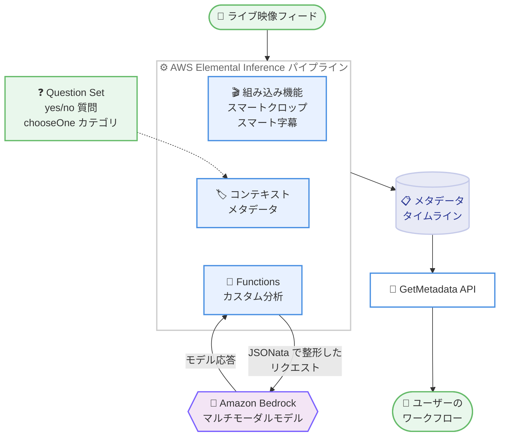

# AWS Elemental Inference - カスタムモデル・プロンプト・決定によるカスタマイズ

**リリース日**: 2026 年 11 月 17 日
**サービス**: AWS Elemental Inference
**機能**: Functions (カスタム分析) と Customer Decisions (コンテキストメタデータのカスタム決定)

📊 [このアップデートのインフォグラフィックを見る](https://takech9203.github.io/aws-news-summary/20261117-elemental-inference-functions-decisions.html)

## 概要

AWS Elemental Inference で、ライブ映像の分析方法を 2 つの方法でカスタマイズできるようになりました。1 つ目は **Functions** で、Amazon Bedrock のマルチモーダル基盤モデルを使用して映像に対する独自の質問 (カスタムプロンプト) を実行できます。2 つ目は **Customer Decisions (コンテキストメタデータ決定)** で、ユーザーが定義したラベルや質問に基づくコンテキストメタデータの判定を追加できます。

どちらの機能も、縦型動画作成 (スマートクロップ) やスマート字幕などの組み込み機能と同じパイプライン上で動作し、結果は既存の GetMetadata API を通じて返されます。別のパイプラインを構築する必要はありません。放送事業者やストリーミング事業者は、ライブ映像に対する独自の分析要件 (スポンサーロゴの露出測定、独自ジャンル分類など) を、追加のインフラなしで実現できます。

**アップデート前の課題**

- コンテキストメタデータの分類は IAB カテゴリ、GARM レーティング、ラベル、ムードなどの組み込みフィールドに限定されており、独自の分類基準 (例: 自社定義のジャンルや「天気予報のシーンか」といった判定) を追加できなかった
- ライブ映像に対して独自の AI 分析 (スポンサーロゴ露出の測定など) を行うには、映像の取り込み、フレーム抽出、モデル呼び出し、結果の統合を含む独自パイプラインを別途構築する必要があった
- 組み込み機能の分析結果と独自分析の結果が別々の場所に出力され、タイムライン上で統合して扱うことが困難だった

**アップデート後の改善**

- Question Set に yes/no 質問や「1 つを選ぶ」カテゴリを定義するだけで、モデル選択やプロンプト作成なしに独自の判定と信頼度スコアをシーンごとに取得できるようになった
- Functions により、Amazon Bedrock モデルと JSONata 式を指定するだけで、オープンエンドな回答やカスタムレスポンス形式の独自分析を同一パイプライン上で実行できるようになった
- 組み込み機能と独自分析の結果が同じメタデータタイムラインに書き込まれ、既存の GetMetadata API だけで一括取得できるようになった

## アーキテクチャ図



組み込み機能、Question Set による決定、Functions によるカスタム分析がすべて同じパイプライン上で動作し、結果は単一のメタデータタイムラインに統合されて GetMetadata API から取得できます。

## サービスアップデートの詳細

### 主要機能

1. **Customer Decisions (コンテキストメタデータ決定)**
   - yes/no 質問 (例: 「このシーンは天気予報か」) や「1 つを選ぶ」カテゴリ (例: ジャンル分類) を Question Set として定義する
   - 各シーンに対して、定義したすべてのラベルと質問について判定結果と信頼度スコアが返される
   - 標準の IAB カテゴリ、GARM レーティング、ムードフィールドと並んで `customQuestions` オブジェクトとして返されるため、設定したしきい値を信頼度が満たした時点でワークフローをトリガーできる
   - モデルの選択やプロンプトの記述は不要
   - Question Set は DRAFT の更新とバージョン発行によって管理し、フィードの `customQuestions` 設定で参照する

2. **Functions (カスタム分析)**
   - Amazon Bedrock モデルと、リクエストおよびレスポンスを整形する JSONata 式を指定して関数を定義する
   - 関数をフィードにアタッチし、実行頻度を選択する。1 つの関数を同一アカウント内の複数のフィードにアタッチできる
   - モデルはユーザー自身のアカウント内で、ユーザーが制御するロールの下で実行されるため、モデルの選択、アクセス許可、スループットクォータを自身で管理できる
   - オープンエンドな回答、カスタムレスポンス形式、コンテキストメタデータでカバーされない分析 (スポンサーロゴ露出の測定など) に適している
   - **パススルー関数**: モデルを呼び出さず、Elemental Inference が生成済みのメタデータを独自のスキーマに整形するだけの関数も定義できる (モデルコストなし)

3. **既存パイプラインとの統合**
   - どちらの機能も縦型動画作成やスマート字幕などの組み込み機能と同じパイプラインで動作する
   - 結果は同じメタデータタイムラインに書き込まれ、既存の GetMetadata API で取得できる
   - 関数が失敗してもフィードの他の出力は正常に継続し、該当ウィンドウの関数メタデータが存在しないだけで済む (フィード全体に影響しない)

## 技術仕様

### 2 つのカスタマイズ方法の比較

| 項目 | Customer Decisions | Functions |
|------|-------------------|-----------|
| 用途 | ラベルと yes/no 質問で答えられる判定 | オープンエンドな回答、カスタム形式、独自分析 |
| 質問タイプ | yesNo、yesNoPerOption、chooseOne | 自由 (プロンプト次第) |
| モデル選択 | 不要 | 必要 (Amazon Bedrock モデルを指定) |
| プロンプト記述 | 不要 | 必要 (JSONata 式でリクエスト/レスポンスを整形) |
| 出力 | 判定結果 + 信頼度スコア | モデル応答を JSONata で整形した結果 |
| 結果の取得 | GetMetadata API の `customQuestions` オブジェクト | GetMetadata API (同一タイムライン) |
| 追加料金 | コンテキストメタデータ料金に含まれる | 追加料金なし (Bedrock 使用料は別途) |

### API 変更履歴

| 日付 | サービス | 変更内容 |
|------|----------|----------|
| 2026/11/17 | [AWS Elemental Inference](https://awsapichanges.com/archive/changes/a370bc-elemental-inference.html) | 13 new 4 updated api methods - Functions (フィードメディアへの独自分析) と Question Sets (ショット/シーンへのカスタム決定) のサポートを追加 |

**主な新規 API:**

- Question Set 関連: `CreateQuestionSet`、`CreateQuestionSetVersion`、`GetQuestionSet`、`UpdateQuestionSet`、`ListQuestionSets`、`ListQuestionSetVersions`、`DeleteQuestionSet`、`DeleteQuestionSetVersion`
- Function 関連: `CreateFunction`、`GetFunction`、`UpdateFunction`、`ListFunctions`、`DeleteFunction`
- 更新された API: `CreateFeed`、`UpdateFeed`、`GetFeed`、`AssociateFeed`

### Question Set の質問タイプ

```json
{
  "name": "my-question-set",
  "yesNo": [
    {
      "name": "is-weather-report",
      "question": "Is this scene a weather report?"
    }
  ],
  "chooseOne": [
    {
      "name": "genre",
      "question": "What is the genre of this scene?",
      "options": [
        { "name": "news", "text": "News" },
        { "name": "sports", "text": "Sports" },
        { "name": "drama", "text": "Drama" }
      ]
    }
  ]
}
```

`CreateQuestionSet` API では、yes/no 質問 (`yesNo`)、選択肢ごとの yes/no 判定 (`yesNoPerOption`)、単一選択 (`chooseOne`) の 3 種類の質問タイプを定義できます。

## 設定方法

### 前提条件

1. AWS Elemental Inference のフィードが作成済みであること
2. Customer Decisions を使用する場合、フィードでコンテキストメタデータ出力が有効であること
3. Functions でモデルを呼び出す場合、Amazon Bedrock で使用するモデルへのアクセスが有効化されており、Elemental Inference がモデルを呼び出すための IAM ロールが用意されていること

### 手順

#### ステップ 1: Question Set の作成 (Customer Decisions の場合)

```bash
aws elemental-inference create-question-set \
  --name "my-decisions" \
  --yes-no '[{"name": "is-weather-report", "question": "Is this scene a weather report?"}]' \
  --choose-one '[{"name": "genre", "question": "What is the genre?", "options": [{"name": "news", "text": "News"}, {"name": "sports", "text": "Sports"}]}]'
```

yes/no 質問と単一選択カテゴリを含む Question Set を作成しています。作成後、`CreateQuestionSetVersion` でバージョンを発行し、フィードの `customQuestions` 設定から参照します。

#### ステップ 2: Function の作成 (Functions の場合)

```bash
aws elemental-inference create-function \
  --name "sponsor-logo-exposure" \
  --cli-input-json file://function-definition.json
```

Amazon Bedrock モデルの指定と、リクエスト/レスポンスを整形する JSONata 式を含む関数定義から関数を作成しています。作成した関数はフィードにアタッチし、実行頻度を選択します。

#### ステップ 3: GetMetadata API で結果を取得

```bash
aws elemental-inference get-metadata \
  --feed-id "my-feed-id"
```

組み込み機能のメタデータと同じタイムラインから、Customer Decisions の判定結果 (`customQuestions` オブジェクト) と Functions の分析結果を取得しています。信頼度スコアがしきい値を満たした場合に後続ワークフローを実行する、といった制御が可能です。

## メリット

### ビジネス面

- **独自分析の迅速な実現**: スポンサーロゴ露出の測定や自社基準のコンテンツ分類など、ビジネス固有の分析要件を専用パイプラインの構築なしで実現できる
- **広告ターゲティングの精緻化**: IAB や GARM などの標準分類に加えて、自社定義のカテゴリや判定でシーンを分類し、コンテキスト広告の精度を高められる
- **コスト効率**: Functions 自体は追加料金なしで利用でき、パススルー関数ならモデルコストもかからないため、小さく始めて拡張できる

### 技術面

- **単一パイプラインへの統合**: 組み込み機能と独自分析が同じパイプライン・同じメタデータタイムラインで動作し、GetMetadata API だけで結果を取得できる
- **信頼度スコアによる制御**: Customer Decisions はすべてのラベルと質問に信頼度スコアを返すため、しきい値ベースの自動化ワークフローを構築しやすい
- **障害の分離**: 関数が失敗してもフィードの他の出力は正常に継続するため、独自分析の追加が本番配信の安定性に影響しない
- **モデルとコストの自己管理**: Functions の Bedrock モデルはユーザー自身のアカウントとロールで実行されるため、モデル選択・アクセス許可・クォータを自身で制御できる

## デメリット・制約事項

### 制限事項

- Customer Decisions の利用には、フィードでコンテキストメタデータ出力が有効であることが必要
- Customer Decisions はラベルと yes/no・単一選択形式で答えられる判定に限定される (オープンエンドな回答には Functions が必要)
- Question Set にはテキストルールや数の制限がある (詳細はユーザーガイドの「Limits and text rules for question sets」を参照)
- Functions の実行には、フィードで少なくとも 1 つの機能がアクティブであることが必要

### 考慮すべき点

- Functions で Amazon Bedrock モデルを呼び出す場合、Bedrock の使用料金が別途発生するため、実行頻度の設定がコストに直結する
- Functions のリクエスト/レスポンス整形には JSONata 式の記述が必要で、学習コストがある
- モデルはユーザーアカウントの Bedrock スループットクォータを消費するため、他ワークロードとのクォータ競合に注意が必要

## ユースケース

### ユースケース 1: スポンサーロゴ露出の測定

**シナリオ**: スポーツ中継の放送事業者が、スポンサー契約の価値を証明するために、ライブ配信中のスポンサーロゴの露出時間を測定したい。

**実装例**:
```
1. Amazon Bedrock のマルチモーダルモデルを指定した Function を作成
2. JSONata 式で「フレーム内に表示されているスポンサーロゴと表示位置を列挙する」
   プロンプトを構成し、レスポンスを独自スキーマに整形
3. 中継フィードにアタッチし、実行頻度を設定
4. GetMetadata API で露出データを取得し、レポーティング基盤に集計
```

**効果**: 専用の映像分析パイプラインを構築せずに、スポンサーレポートを自動生成できる。

### ユースケース 2: 自社基準によるコンテキスト広告ターゲティング

**シナリオ**: ストリーミング事業者が、標準の IAB カテゴリに加えて自社定義のジャンル分類と「天気予報のシーンか」という判定に基づいて広告を出し分けたい。

**実装例**:
```
1. chooseOne でジャンル (ニュース/スポーツ/ドラマなど)、
   yesNo で「天気予報か」を定義した Question Set を作成
2. バージョンを発行し、フィードの customQuestions 設定にアタッチ
3. GetMetadata API のレスポンスで各シーンの判定と信頼度スコアを取得
4. 信頼度がしきい値を超えた場合に、広告デシジョニングサーバーへ
   カスタムパラメータとして連携
```

**効果**: モデル選択やプロンプト作成なしで、自社基準のコンテキスト広告が実現できる。

### ユースケース 3: 既存メタデータの独自スキーマへの変換

**シナリオ**: 自社の MAM (メディアアセット管理) システムが独自のメタデータスキーマを採用しており、Elemental Inference の出力をそのまま取り込めない。

**実装例**:
```
1. モデルを呼び出さないパススルー Function を作成
2. JSONata 式で、組み込みのコンテキストメタデータを
   MAM システムのスキーマに整形
3. GetMetadata API から整形済みメタデータを取得し、MAM に直接取り込み
```

**効果**: モデルコストゼロで、変換レイヤーの開発・運用なしにスキーマ変換を実現できる。

## 料金

- **Customer Decisions (コンテキストメタデータ決定)**: コンテキストメタデータの料金に含まれており、追加料金なしで利用できます
- **Functions**: 少なくとも 1 つの機能がアクティブなフィードでは追加料金なしで利用できます。ただし、Amazon Bedrock の使用料金は別途発生します (ユーザー自身の Bedrock アカウントに課金)
- パススルー関数はモデルを呼び出さないため、モデルコストは発生しません

詳細は [AWS Elemental Inference 料金ページ](https://aws.amazon.com/elemental-inference/pricing/) を参照してください。

## 利用可能リージョン

どちらの機能も、AWS Elemental Inference が利用可能なすべての AWS リージョンで利用できます。

## 関連サービス・機能

- **Amazon Bedrock**: Functions が呼び出すマルチモーダル基盤モデルを提供。モデルアクセスとスループットはユーザーアカウントで管理
- **AWS Elemental MediaLive**: ライブ映像フィードのソースとして Elemental Inference と連携 (ユーザーガイドに MediaLive との併用手順あり)
- **AWS Elemental MediaTailor**: コンテキストメタデータの判定結果を活用したサーバーサイド広告挿入との組み合わせが可能

## 参考リンク

- 📊 [インフォグラフィック](https://takech9203.github.io/aws-news-summary/20261117-elemental-inference-functions-decisions.html)
- [公式発表 (What's New)](https://aws.amazon.com/about-aws/whats-new/2026/11/elemental-inference-functions-decisions/)
- [AWS Elemental Inference ユーザーガイド](https://docs.aws.amazon.com/elemental-inference/latest/userguide/what-is.html)
- [Using functions in Elemental Inference](https://docs.aws.amazon.com/elemental-inference/latest/userguide/functions.html)
- [Customer decisions for contextual metadata](https://docs.aws.amazon.com/elemental-inference/latest/userguide/custom-questions.html)
- [料金ページ](https://aws.amazon.com/elemental-inference/pricing/)

## まとめ

AWS Elemental Inference のカスタマイズ性が大きく向上し、Question Set による簡易な判定追加から、Bedrock モデルと JSONata によるフルカスタム分析まで、要件に応じた 2 段階の選択肢が提供されました。独自パイプラインを構築せずにライブ映像の独自分析を同一のメタデータタイムラインに統合できるため、コンテキスト広告やスポンサー分析に取り組む放送・ストリーミング事業者は、まず Customer Decisions で判定を追加し、より高度な要件には Functions を検討することを推奨します。
