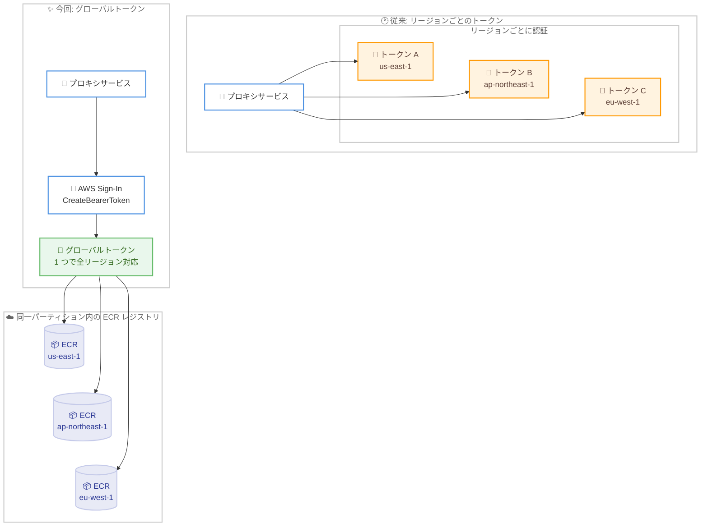

# Amazon ECR - プライベートレジストリ向けグローバル認証トークン

**リリース日**: 2026 年 11 月 17 日
**サービス**: Amazon Elastic Container Registry (Amazon ECR)
**機能**: プライベートレジストリ向けグローバル認証トークン (Global Authentication Tokens)

📊 [このアップデートのインフォグラフィックを見る](https://takech9203.github.io/aws-news-summary/20261117-global-authentication-amazon-ecr.html)

## 概要

Amazon Elastic Container Registry (Amazon ECR) が、プライベートレジストリ向けのグローバル認証トークンをサポートしました。AWS Sign-In の CreateBearerToken API で単一のトークンを取得し、同一 AWS パーティション内のすべての ECR プライベートレジストリに対して利用できます。

これまで、コンテナイメージのプッシュやプルを行う際は、対象の AWS リージョンごとに個別の認証トークンを取得する必要がありました。レイテンシーや可用性の最適化を目的として、複数リージョンにまたがるコンテナプルをルーティングするプロキシサービスを運用するチームでは、プロキシの背後にあるリージョンごとにトークンの取得、更新、調整が必要でした。グローバルトークンにより、プロキシは AWS パーティション内のすべてのリージョンに対して 1 つのトークンを管理するだけで済むようになります。

グローバルトークンの有効期間はデフォルトで 12 時間ですが、最短 5 分まで設定可能です。Docker CLI および Amazon ECR Docker Credential Helper で利用でき、既存のリージョン別認証トークンも従来どおり引き続き動作します。

**アップデート前の課題**

- イメージをプッシュまたはプルする AWS リージョンごとに、Amazon ECR の GetAuthorizationToken API で個別の認証トークンを取得する必要があった
- クロスリージョンのコンテナプルをルーティングするプロキシサービスでは、リージョンごとにトークンの取得、更新、有効期限の調整が必要で、運用負荷が高かった
- マルチリージョン構成の CI/CD パイプラインやデプロイツールで、リージョン数に比例して認証処理が増加していた

**アップデート後の改善**

- AWS Sign-In の CreateBearerToken API で取得した単一のトークンを、同一 AWS パーティション内のすべての ECR プライベートレジストリで利用可能になった
- プロキシサービスは 1 つのトークンを管理するだけでよく、トークン管理の運用負荷が大幅に軽減された
- トークンの有効期間を 5 分から 12 時間 (デフォルト) の範囲で設定でき、セキュリティ要件に応じた短命トークンの運用が可能になった

## アーキテクチャ図



従来はリージョンごとに個別のトークンを取得・管理する必要がありましたが、今回のアップデートにより、AWS Sign-In の CreateBearerToken API で取得した 1 つのグローバルトークンで、同一パーティション内のすべての ECR プライベートレジストリに認証できるようになりました。

## サービスアップデートの詳細

### 主要機能

1. **グローバル認証トークンの発行**
   - AWS Sign-In の CreateBearerToken API または `aws signin create-bearer-token` CLI コマンドでトークンを取得
   - `ecr.amazonaws.com` リソース向けのベアラートークンとして発行される
   - 同一 AWS パーティション内のすべてのリージョンの ECR プライベートレジストリで有効

2. **設定可能なトークン有効期間**
   - デフォルトの有効期間は 12 時間
   - 最短 5 分まで短縮可能で、セキュリティ要件に応じた短命トークンの運用が可能

3. **既存ツールとの互換性**
   - Docker CLI の `docker login` でユーザー名 `AWS` と組み合わせて利用可能
   - Amazon ECR Docker Credential Helper はリージョントークンとグローバルトークンの両方を取得可能
   - Docker Registry HTTP API でも HTTP Basic 認証ヘッダーとして利用可能

4. **セキュリティと監査機能**
   - CloudTrail イベントの `userIdentity.sessionContext` 内の `signInSessionArn` フィールドで、トークンを要求した AWS セッションとトークンの使用を関連付け可能
   - IntrospectOAuth2TokenWithIAM API でトークンのアクティブ状態とメタデータを確認可能

## 技術仕様

### リージョントークンとグローバルトークンの比較

| 項目 | グローバルトークン | リージョントークン |
|------|------|------|
| トークンの取得 | AWS Sign-In CreateBearerToken または `aws signin create-bearer-token` | Amazon ECR GetAuthorizationToken または `aws ecr get-login-password` |
| リージョンスコープ | 同一パーティション内のすべての AWS リージョンで有効 | トークンを発行したリージョンのみで有効 |
| 有効期間 | デフォルト 12 時間 (最短 5 分まで設定可能) | 12 時間 (固定) |
| 権限スコープ | 要求した IAM プリンシパルの権限に準拠 | 要求した IAM プリンシパルの権限に準拠 |

**注意**: どちらのトークンも、権限スコープは IAM 権限と一致します。認証トークンによって追加の Amazon ECR 権限が付与されることはなく、要求する ECR 操作の権限を別途保有している必要があります。

### 必要な IAM 権限

グローバルトークンを取得するには、`signin:CreateBearerToken` 権限と、イメージまたはリポジトリ操作に必要な Amazon ECR 権限が必要です。

```json
{
    "Version": "2012-10-17",
    "Statement": [
        {
            "Sid": "CreateECRGlobalToken",
            "Effect": "Allow",
            "Action": "signin:CreateBearerToken",
            "Resource": "arn:aws:signin:*:*:service-principal/ecr.amazonaws.com"
        }
    ]
}
```

## 設定方法

### 前提条件

1. AWS CLI が設定済みであること
2. IAM プリンシパルに `signin:CreateBearerToken` 権限が付与されていること
3. 対象の ECR 操作 (プッシュ、プルなど) に必要な Amazon ECR 権限が付与されていること

### 手順

#### ステップ 1: グローバルトークンの取得

```bash
TOKEN=$(aws signin create-bearer-token \
     --grant-type client_credentials \
     --resource ecr.amazonaws.com \
     --region us-east-1 \
     --query accessToken \
     --output text)
```

AWS Sign-In の `create-bearer-token` コマンドで、Amazon ECR 向けのグローバルトークンを取得し、環境変数に格納します。デフォルトでは 12 時間有効なトークンが発行されます。

#### ステップ 2: Docker への認証

```bash
printf '%s' "$TOKEN" | docker login \
     --username AWS \
     --password-stdin \
     123456789012.dkr.ecr.ap-northeast-1.amazonaws.com
```

取得したグローバルトークンをユーザー名 `AWS` とともに `docker login` に渡します。トークンを発行したリージョンに関係なく、同一パーティション内の任意のリージョンのレジストリエンドポイントに認証できます。

#### ステップ 3: HTTP API での利用 (オプション)

```bash
GLOBAL_TOKEN=$(aws signin create-bearer-token \
     --grant-type client_credentials \
     --resource ecr.amazonaws.com \
     --query accessToken \
     --output text)
TOKEN=$(printf 'AWS:%s' "$GLOBAL_TOKEN" | base64 | tr -d '\n')

curl -i \
     -H "Authorization: Basic $TOKEN" \
     https://123456789012.dkr.ecr.ap-northeast-1.amazonaws.com/v2/my-repo/tags/list
```

Docker Registry HTTP API を直接利用する場合は、ユーザー名 `AWS`、コロン、グローバルトークンを連結して Base64 エンコードし、HTTP Basic 認証ヘッダーとして渡します。

## メリット

### ビジネス面

- **運用コストの削減**: リージョンごとのトークン管理が不要になり、マルチリージョン環境でのプロキシサービスや CI/CD パイプラインの運用負荷が軽減される
- **可用性向上の支援**: クロスリージョンのイメージプルをルーティングするプロキシ構成が簡素化され、レイテンシーや可用性の最適化パターンを導入しやすくなる
- **追加費用なし**: 既存の Amazon ECR の料金体系のまま利用可能

### 技術面

- **認証処理の一元化**: 単一の CreateBearerToken 呼び出しで、同一パーティション内のすべてのリージョンに対する認証が完結する
- **柔軟な有効期間**: 最短 5 分の短命トークンから最長 12 時間まで、セキュリティ要件に応じた設定が可能
- **監査性の向上**: CloudTrail の `signInSessionArn` によるトークン使用の追跡や、IntrospectOAuth2TokenWithIAM API によるトークン状態の確認が可能
- **既存環境との互換性**: 既存のリージョントークンは従来どおり動作するため、段階的な移行が可能

## デメリット・制約事項

### 制限事項

- グローバルトークンの有効範囲は同一 AWS パーティション内に限定される (パーティションをまたぐ利用は不可)
- Amazon ECR Docker Credential Helper は現時点で多要素認証 (MFA) をサポートしていない
- グローバルトークンの取得には、従来の ECR 権限に加えて `signin:CreateBearerToken` 権限の付与が必要

### 考慮すべき点

- トークンの権限スコープは IAM 権限と一致するため、トークン自体が追加の ECR 権限を付与することはない
- 1 つのトークンが全リージョンで有効になるため、トークン漏えい時の影響範囲が広がる。短い有効期間の設定や CloudTrail による監査の活用を検討する
- 既存のリージョントークンベースの運用を直ちに変更する必要はなく、ユースケースに応じて使い分けが可能

## ユースケース

### ユースケース 1: クロスリージョンプルを行うプロキシサービスの認証簡素化

**シナリオ**: レイテンシーや可用性を最適化するため、複数リージョンの ECR レジストリへのコンテナプルをルーティングするプロキシサービスを運用している。従来はリージョンごとにトークンを取得・更新する必要があった。

**実装例**:
```bash
# プロキシサービス側で単一のグローバルトークンを定期更新
TOKEN=$(aws signin create-bearer-token \
     --grant-type client_credentials \
     --resource ecr.amazonaws.com \
     --query accessToken \
     --output text)
# このトークンを全リージョンのレジストリエンドポイントへのリクエストに使用
```

**効果**: リージョンごとのトークン取得・更新・調整が不要になり、プロキシの実装と運用が大幅に簡素化される。

### ユースケース 2: マルチリージョン CI/CD パイプラインでのイメージ配布

**シナリオ**: ビルドしたコンテナイメージを複数リージョンの ECR リポジトリにプッシュするデプロイパイプラインを運用している。

**実装例**:
```bash
TOKEN=$(aws signin create-bearer-token \
     --grant-type client_credentials \
     --resource ecr.amazonaws.com \
     --query accessToken \
     --output text)

for REGION in us-east-1 ap-northeast-1 eu-west-1; do
  printf '%s' "$TOKEN" | docker login --username AWS --password-stdin \
       123456789012.dkr.ecr.${REGION}.amazonaws.com
  docker push 123456789012.dkr.ecr.${REGION}.amazonaws.com/my-app:latest
done
```

**効果**: 1 回の認証トークン取得で全リージョンへのプッシュが可能になり、パイプラインの認証ステップが削減される。

### ユースケース 3: 短命トークンによるセキュアな一時アクセス

**シナリオ**: 自動化ジョブや一時的な作業で ECR へのアクセスが必要だが、長時間有効なトークンの発行はセキュリティポリシー上避けたい。

**実装例**:
```bash
# 有効期間を短く設定したグローバルトークンを取得
# 最短 5 分まで設定可能
aws signin create-bearer-token \
     --grant-type client_credentials \
     --resource ecr.amazonaws.com \
     --query accessToken \
     --output text
```

**効果**: ジョブの実行時間に合わせた短命トークンを利用することで、トークン漏えい時の影響を最小化できる。

## 料金

グローバル認証トークンの利用に追加料金はかかりません。Amazon ECR の料金は、従来どおりストレージ使用量とインターネットへのデータ転送量に基づいて課金されます。

## 利用可能リージョン

Amazon ECR がサポートされているすべての商用 AWS リージョンで利用可能です。グローバルトークンは、同一 AWS パーティション内のすべてのリージョンで有効です。

## 関連サービス・機能

- **AWS Sign-In**: グローバルトークンを発行する CreateBearerToken API を提供するサービス。トークンの状態確認には IntrospectOAuth2TokenWithIAM API を利用できる
- **Amazon ECR Docker Credential Helper**: Docker の認証情報管理を簡素化するツール。リージョントークンとグローバルトークンの両方に対応
- **AWS CloudTrail**: `signInSessionArn` フィールドにより、グローバルトークンの使用をトークンを要求した AWS セッションと関連付けて監査できる
- **AWS IAM**: トークンの権限スコープは IAM 権限と一致するため、最小権限の原則に基づいたポリシー設計が重要

## 参考リンク

- 📊 [インフォグラフィック](https://takech9203.github.io/aws-news-summary/20261117-global-authentication-amazon-ecr.html)
- [公式発表 (What's New)](https://aws.amazon.com/about-aws/whats-new/2026/11/global-authentication-amazon-ecr)
- [Private registry authentication - Amazon ECR User Guide](https://docs.aws.amazon.com/AmazonECR/latest/userguide/registry_auth.html)
- [CreateBearerToken API リファレンス](https://docs.aws.amazon.com/signin/latest/APIReference/API_dataplane-signin_CreateBearerToken.html)
- [Amazon ECR Docker Credential Helper (GitHub)](https://github.com/awslabs/amazon-ecr-credential-helper)
- [Amazon ECR 料金ページ](https://aws.amazon.com/ecr/pricing/)

## まとめ

Amazon ECR のグローバル認証トークンにより、単一のトークンで同一 AWS パーティション内のすべてのプライベートレジストリに認証できるようになりました。特にクロスリージョンのイメージプルをルーティングするプロキシサービスや、マルチリージョンの CI/CD パイプラインを運用するチームにとって、トークン管理の運用負荷を大きく削減できるアップデートです。既存のリージョントークンは引き続き利用できるため、まずは `signin:CreateBearerToken` 権限の付与とトークン有効期間の設計を検討した上で、段階的な導入をお勧めします。
