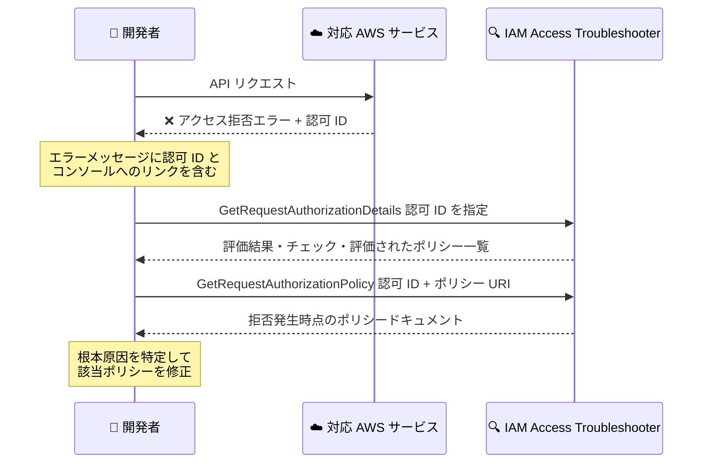

# AWS IAM - Access Troubleshooter

**リリース日**: 2026 年 11 月 17 日
**サービス**: AWS Identity and Access Management (IAM)
**機能**: Access Troubleshooter

📊 [このアップデートのインフォグラフィックを見る](https://takech9203.github.io/aws-news-summary/20261117-iam-access-troubleshooter.html)

## 概要

AWS Identity and Access Management (IAM) は、アクセス拒否 (Access Denied) エラーの背後にある認可コンテキスト全体を可視化する新機能「Access Troubleshooter」を発表しました。対応サービスの API でリクエストが拒否されると、エラーメッセージに一意の認可 ID (Authorization ID) が含まれるようになり、この ID を使って該当リクエストで評価されたポリシー、認可コンテキスト、評価結果の詳細を取得できます。

これまで開発者は、拒否したポリシーの ARN だけを手がかりにデバッグする必要があり、リクエストで評価された他のポリシーや認可コンテキストを確認する手段がありませんでした。Access Troubleshooter により、1 回の API 呼び出しで拒否の根本原因を特定できるようになり、試行錯誤による時間のかかるトラブルシューティングが不要になります。

IAM ポリシー、SCP、RCP、Permissions Boundary、セッションポリシーなど複数のポリシータイプを組み合わせて運用する組織の管理者や、権限エラーの解決に時間を費やしている開発者にとって、アクセス管理ワークフローを大幅に効率化するアップデートです。

**アップデート前の課題**

このアップデート以前は、アクセス拒否エラーの調査に以下の課題がありました。

- エラーメッセージには拒否したポリシーの ARN しか含まれず、評価された他のポリシーを確認できなかった
- リクエスト時の認可コンテキスト (条件コンテキストキーの値など) を確認する手段がなかった
- 暗黙的な拒否 (Implicit Deny) の場合、どのポリシータイプに Allow を追加すべきか特定が困難だった
- ポリシーを修正して再実行する試行錯誤を繰り返す必要があり、拒否を 1 つずつしか解決できなかった

**アップデート後の改善**

今回のアップデートにより、以下が可能になりました。

- アクセス拒否エラーに含まれる認可 ID を使い、`GetRequestAuthorizationDetails` API で評価の詳細を 1 回の呼び出しで取得できるようになった
- リクエストで評価されたすべてのポリシー (マッチしなかったポリシーを含む)、認可コンテキスト、チェックごとの評価結果を確認できるようになった
- `GetRequestAuthorizationPolicy` API で、拒否発生時点のポリシードキュメントそのものを取得できるようになった
- エラーメッセージ内のリンクから IAM コンソールで認可詳細を直接確認できるようになった
- 満たされなかったすべてのチェックが表示されるため、明示的な拒否と暗黙的な拒否を同時に解決できるようになった

## アーキテクチャ図



アクセス拒否エラーに含まれる認可 ID を起点に、評価の詳細と拒否時点のポリシードキュメントを取得して根本原因を特定するフローです。

## サービスアップデートの詳細

### 主要機能

1. **認可 ID によるエラー詳細の参照**
   - 対応サービスの API でアクセスが拒否されると、エラーレスポンスに一意の認可 ID が自動的に含まれる
   - エラーメッセージには IAM コンソールの認可詳細ページへのリンクも含まれる
   - 認可詳細は非同期に記録されるため、直後に取得できない場合は少し待って再試行する
   - 認可詳細は拒否発生から少なくとも 24 時間保持される

2. **GetRequestAuthorizationDetails API**
   - 認可 ID を指定して、拒否されたリクエストの認可評価の詳細を取得する
   - リクエストコンテキスト (評価された条件コンテキストキーの値)、アクション / リソースのペアごとの評価結果 (`ALLOW`、`EXPLICIT_DENY`、`IMPLICIT_DENY`)、評価されたすべてのポリシーの一覧を返す
   - 評価はチェック (Check) 単位にグループ化され、SCP、RCP、VPC エンドポイントポリシー、リソースベースポリシー、プリンシパル、Permissions Boundary、セッションの各認可要件の結果を個別に確認できる

3. **GetRequestAuthorizationPolicy API**
   - 認可 ID と `GetRequestAuthorizationDetails` が返すポリシー URI を指定して、拒否発生時点に AWS が評価したポリシードキュメントを取得する
   - 現在のバージョンではなく、評価時点のポリシーを返すため、その後ポリシーが変更されていても拒否の原因を正確に調査できる

4. **IAM コンソールでのトラブルシューティング**
   - エラーメッセージ内のリンクからコンソールを開くと、アクション / リソースのペアごとの評価結果と考慮されたポリシーが表示される
   - 拒否されたペアと原因となったポリシー、該当する Deny ステートメント名まで特定できる

### チェックの仕組み

AWS はリクエスト評価時に、適用されるすべての認可要件 (チェック) を確認し、すべてのチェックが許可した場合のみリクエストを許可します。各チェックの結果は `Allow`、`Implicit deny`、`Explicit deny`、`No impact` のいずれかです。

| チェックタイプ | 確認すべきポリシータイプ | 説明 |
|------|------|------|
| `RESOURCE_CONTROL_POLICY` | RCP | リソースに適用される組織ターゲット (ルート、OU、アカウント) ごとの RCP |
| `SERVICE_CONTROL_POLICY` | SCP | プリンシパルに適用される組織ターゲットごとの SCP |
| `VPC_ENDPOINT` | VPC エンドポイントポリシー | リクエストが経由した VPC エンドポイント |
| `RESOURCE` | リソースベースポリシー | リソースに付与されたポリシー |
| `PRINCIPAL` | アイデンティティベースポリシー、リソースベースポリシー | 呼び出し元の権限 |
| `PERMISSIONS_BOUNDARY` | Permissions Boundary | 境界が適用されるロールまたはユーザー |
| `SESSION` | セッションポリシー、リソースベースポリシー | セッションポリシーでスコープされたセッション |

## 技術仕様

### 主な仕様

| 項目 | 詳細 |
|------|------|
| 認可 ID の付与 | 対応サービスおよび API のアクセス拒否エラーレスポンスに自動的に含まれる (保証はされない) |
| 認可詳細の保持期間 | 拒否発生から少なくとも 24 時間 |
| API のスコープ | リージョナル API。拒否が発生したリージョンと同じリージョンで呼び出す必要がある |
| 必要な権限 | `iam:GetRequestAuthorizationDetails` および `iam:GetRequestAuthorizationPolicy` |
| 組織をまたぐリクエスト | 複数の AWS Organizations が関係する場合、自組織に関する詳細のみ参照可能 |
| CLI コマンド | `aws iam-toolbox` 名前空間で提供 |

### API 変更履歴

| 日付 | サービス | 変更内容 |
|------|----------|----------|
| 2026/11/16 | [IAM Toolbox (Preview)](https://awsapichanges.com/archive/changes/f1785c-iam-toolbox.html) | 1 new 1 updated api methods - `GetRequestAuthorizationPolicy` の追加、`GetRequestAuthorizationDetails` へのチェック単位の認可結果 (`checks`) とリソースベースポリシーのメタデータ (`policySource`) の追加 |

### アクセス拒否エラーメッセージの例

```text
User: arn:aws:iam::000111222333:user/janedoe is not authorized to perform: iam:CreateInstanceProfile
on resource: arn:aws:iam::000111222333:instance-profile/my-instance-profile
with an explicit deny in an identity-based policy: arn:aws:iam::000111222333:policy/ExampleDenyPolicy.
Go to https://us-east-1.console.aws.amazon.com/iam/home?region=us-east-1#/authorization-details/EXAMPLE1a2b3c4d5e6f7g8h9i0j for complete details,
or call the GetRequestAuthorizationDetails API with the following authorization id: EXAMPLE1a2b3c4d5e6f7g8h9i0j
```

## 設定方法

### 前提条件

1. 呼び出し元に `iam:GetRequestAuthorizationDetails` 権限が付与されていること
2. ポリシードキュメントの取得には `iam:GetRequestAuthorizationPolicy` 権限が付与されていること
3. 拒否が発生したリージョンと同じリージョンで API を呼び出すこと
4. 拒否されたリクエストに組織が記録されている場合、その組織内のアカウントから呼び出すこと

### 手順

#### ステップ 1: 認可 ID の確認

アクセス拒否エラーのレスポンスに含まれる認可 ID (例: `EXAMPLE1a2b3c4d5e6f7g8h9i0j`) を確認します。コンソールのリンクが含まれる場合は、リンクを開くだけで認可詳細を確認できます。

#### ステップ 2: 認可詳細の取得

```bash
aws iam-toolbox get-request-authorization-details \
    --region us-east-1 \
    --authorization-id EXAMPLE1a2b3c4d5e6f7g8h9i0j
```

認可 ID を指定して、拒否されたリクエストの評価詳細を取得します。`evaluatedEffect` が `EXPLICIT_DENY` または `IMPLICIT_DENY` の評価を確認し、拒否されたチェックの `relevantPolicyTypes` から確認すべきポリシータイプを特定します。明示的な拒否の場合は、チェックの `matchedPolicies` から拒否したポリシーとステートメントを特定します。

#### ステップ 3: 拒否時点のポリシードキュメントの取得

```bash
aws iam-toolbox get-request-authorization-policy \
    --region us-east-1 \
    --authorization-id EXAMPLE1a2b3c4d5e6f7g8h9i0j \
    --policy-uri arn:aws:iam::000111222333:policy/InstanceProfilePermissions
```

認可 ID と、ステップ 2 の `policies` リストに含まれる `uri` を指定して、拒否発生時点に評価されたポリシードキュメントを取得します。レスポンスの `policyDocument` に JSON 形式でポリシー本文が含まれます。

#### ステップ 4: ポリシーの修正

特定した原因に応じてポリシーを修正します。明示的な拒否の場合は該当する `Deny` ステートメントを削除または範囲を絞り、暗黙的な拒否の場合は該当するポリシータイプに `Allow` ステートメントを追加します。修正前に、拒否が意図したものでないか (セッションタグの欠落や想定外のネットワーク経路など、リクエストコンテキスト側に原因がないか) を必ず確認します。

## メリット

### ビジネス面

- **トラブルシューティング時間の短縮**: 試行錯誤による調査が不要になり、権限問題の解決にかかる時間とコストを削減できる
- **開発者の生産性向上**: 開発者自身が拒否の原因を特定できるため、セキュリティ管理者へのエスカレーションを減らせる
- **運用負荷の軽減**: アクセス管理ワークフローが効率化され、権限関連の問い合わせ対応を削減できる

### 技術面

- **完全な認可コンテキストの可視化**: 評価されたすべてのポリシー、条件コンテキストキーの値、チェックごとの結果を 1 回の API 呼び出しで確認できる
- **暗黙的な拒否の原因特定**: どのチェックに Allow が不足しているかを `relevantPolicyTypes` で特定でき、複数の不足を同時に解決できる
- **拒否時点のポリシー取得**: その後ポリシーが変更されていても、評価時点のポリシードキュメントで正確に原因を調査できる

## デメリット・制約事項

### 制限事項

- 認可 ID の付与は保証されない。評価されたポリシーが多すぎる場合、未対応のサービス / API / リクエストタイプ (サービスによる代理リクエストや匿名リクエストなど) の場合は認可 ID が返されない
- 対応サービスは段階的に拡大中で、現時点では AWS CodeDeploy、IAM、AWS KMS、AWS STS、AWS Step Functions、Amazon EC2、Amazon ECR、Amazon Kinesis Data Streams、Amazon SQS の一部 API に限られる
- 認可詳細の保持期間は少なくとも 24 時間であり、長期保存はされない
- リージョナル API のため、拒否が発生したリージョンと同じリージョンで呼び出す必要がある

### 考慮すべき点

- 認可詳細は非同期に記録されるため、拒否直後は取得できない場合がある (Not Found の場合は少し待って再試行する)
- `iam:GetRequestAuthorizationDetails` 権限を持つユーザーは、単一アカウントまたは単一組織内のリクエストの認可詳細を参照できるため、権限の付与範囲を適切に設計する必要がある
- 組織をまたぐリクエストでは、自組織に関する詳細のみが返され、他組織のポリシーやコンテキストキーの値は参照できない
- 評価レベルの `matchedPolicies` フィールドは非推奨となっており、`checks` を使用する必要がある

## ユースケース

### ユースケース 1: 開発中のアクセス拒否エラーの迅速な解決

**シナリオ**: 開発者が新しいアプリケーションのデプロイ中に `iam:CreateInstanceProfile` でアクセス拒否エラーに遭遇した。どのポリシーが原因か不明で、従来は管理者に調査を依頼していた。

**実装例**:
```bash
aws iam-toolbox get-request-authorization-details \
    --region us-east-1 \
    --authorization-id EXAMPLE1a2b3c4d5e6f7g8h9i0j
```

**効果**: 評価結果からインラインポリシーの `DenyCreateInstanceProfile` ステートメントによる明示的な拒否であることを即座に特定でき、管理者へのエスカレーションなしで該当ステートメントの修正を依頼できる。

### ユースケース 2: SCP / RCP が原因の暗黙的な拒否の切り分け

**シナリオ**: マルチアカウント環境で、アイデンティティベースポリシーでは許可されているはずの操作が拒否される。SCP、RCP、Permissions Boundary のどれが原因か切り分けに時間がかかっていた。

**実装例**:
```bash
aws iam-toolbox get-request-authorization-details \
    --region ap-northeast-1 \
    --authorization-id <認可 ID> \
    --query 'evaluations[].checks[?checkResult!=`ALLOW`]'
```

**効果**: チェック単位の結果から、どの組織ターゲット (ルート、OU、アカウント) の SCP が暗黙的な拒否を発生させているかを特定でき、組織レベルのポリシー修正箇所を即座に把握できる。

### ユースケース 3: 拒否発生時点のポリシー内容の監査

**シナリオ**: 一時的に発生していたアクセス拒否の原因を調査したいが、その後ポリシーが更新されており、現在のポリシーからは原因を再現できない。

**実装例**:
```bash
aws iam-toolbox get-request-authorization-policy \
    --region us-east-1 \
    --authorization-id <認可 ID> \
    --policy-uri <ポリシー URI>
```

**効果**: 拒否発生時点に評価されたポリシードキュメントを取得でき、現在のポリシーと比較して変更の影響や拒否の原因を正確に監査できる。

## 料金

公式発表および現時点のドキュメントに追加料金に関する記載はありません。最新の情報は AWS IAM の料金に関するページを参照してください。

## 利用可能リージョン

Access Troubleshooter のサポートは、AWS のサービスおよびリージョン全体に段階的に展開されています。`GetRequestAuthorizationDetails` と `GetRequestAuthorizationPolicy` はリージョナル API であり、拒否が発生したリージョンと同じリージョンで呼び出す必要があります。対応サービスおよび API の最新情報は公式ドキュメントを参照してください。

## 関連サービス・機能

- **AWS Organizations**: SCP や RCP による組織レベルの拒否もチェック単位で可視化され、組織ターゲットごとに評価結果を確認できる
- **IAM Policy Simulator**: 事前にポリシーの効果をシミュレートするツール。Access Troubleshooter は実際に発生した拒否の事後分析を担い、相互に補完する
- **IAM Access Analyzer**: 外部アクセスや未使用アクセスの分析を行うサービス。Access Troubleshooter と組み合わせて権限の最小化と問題解決の両面をカバーできる
- **AWS CloudTrail**: API 呼び出しの記録を提供する。Access Troubleshooter は CloudTrail では見えない認可評価の内部詳細を提供する

## 参考リンク

- 📊 [インフォグラフィック](https://takech9203.github.io/aws-news-summary/20261117-iam-access-troubleshooter.html)
- [公式発表 (What's New)](https://aws.amazon.com/about-aws/whats-new/2026/11/iam-access-troubleshooter/)
- [ドキュメント: Troubleshoot access denied error messages with authorization ID](https://docs.aws.amazon.com/IAM/latest/UserGuide/troubleshoot_access-denied-authorization-id.html)
- [ドキュメント: 対応サービス一覧](https://docs.aws.amazon.com/IAM/latest/UserGuide/troubleshoot_access-denied-authorization-id.html#access-troubleshooter-supported-services)
- [API 変更履歴 (IAM Toolbox)](https://awsapichanges.com/archive/changes/f1785c-iam-toolbox.html)

## まとめ

IAM Access Troubleshooter により、これまでブラックボックスだったアクセス拒否時の認可評価の全体像を、認可 ID を使って 1 回の API 呼び出しで確認できるようになりました。SCP や Permissions Boundary を含む複雑なポリシー構成を運用する環境では、権限トラブルの解決時間を大幅に短縮できます。まずは対応サービス (IAM、STS、EC2、SQS など) でアクセス拒否エラーが発生した際に、エラーメッセージの認可 ID と `GetRequestAuthorizationDetails` API を活用することを推奨します。
