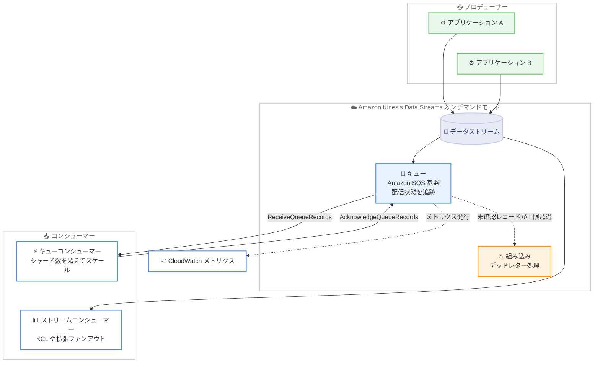

# Amazon Kinesis Data Streams - キュー機能によるリアルタイム処理の簡素化とコスト削減

**リリース日**: 2026 年 11 月 17 日
**サービス**: Amazon Kinesis Data Streams
**機能**: Queues (キュー) によるストリーム消費

📊 [このアップデートのインフォグラフィックを見る](https://takech9203.github.io/aws-news-summary/20261117-kinesis-data-streams-queues.html)

## 概要

Amazon Kinesis Data Streams が、ストリームをよりシンプルかつ低コストで処理するための新しい消費方式「キュー (Queues)」のサポートを発表しました。キューは各レコードの配信状態を追跡するため、コンシューマーインスタンスはシャードをリースするのではなくレコードを直接受信し、処理完了時に各レコードを確認応答 (acknowledge) し、シャード数を超えてスケールできます。Kinesis Client Library (KCL) の代わりにキューを使用することで、データ処理コストを最大 43% 削減できます。

キューは Amazon SQS を基盤として構築されており、レコードの少なくとも 1 回の配信 (at-least-once)、未確認レコードの再配信、繰り返し失敗するレコードの組み込みデッドレター処理を提供します。各キューは独自の CloudWatch メトリクスを発行するため、受信待ちレコード数に基づいてコンシューマーインスタンスをスケールしたり、繰り返し失敗するレコードに対してアラームを設定したりできます。

プロデューサーや既存のストリームコンシューマーに変更を加えることなく、データを 1 回取り込むだけで、各アプリケーションがキュー経由またはストリームから直接レコードを消費できます。ログ処理、注文処理、通知のように各レコードを独立して処理するアプリケーションにはキューが、ライブ分析、パーソナライゼーション、異常検知のように前のレコードに依存する処理にはストリームコンシューマーが適しています。

**アップデート前の課題**

- KCL を使用する場合、シャードリースの管理用に DynamoDB テーブルを運用し、カスタムメトリクスを管理する必要があった
- コンシューマーインスタンス数がシャード数に制約され、コンピューティングリソースを効率的に使用できないケースがあった
- レコード単位の配信状態追跡、再配信、デッドレター処理を自前で実装する必要があった

**アップデート後の改善**

- DynamoDB テーブルやカスタムメトリクスの運用が不要になり、コンシューマー実装が大幅に簡素化された
- コンシューマーインスタンスがシャード数を超えてスケールできるようになり、KCL と比較して処理コストを最大 43% 削減できるようになった
- at-least-once 配信、未確認レコードの自動再配信、組み込みデッドレター処理、キュー単位の CloudWatch メトリクスが標準で提供されるようになった

## アーキテクチャ図



プロデューサーは従来どおりストリームにデータを書き込み、キューコンシューマーは `ReceiveQueueRecords` でレコードを受信して `AcknowledgeQueueRecords` で確認応答します。既存のストリームコンシューマーと併用でき、未確認のまま受信回数が上限を超えたレコードは組み込みのデッドレター処理に移行します。

## サービスアップデートの詳細

### 主要機能

1. **レコード単位の配信状態追跡**
   - キューが各レコードの配信状態を追跡し、コンシューマーはシャードをリースせずにレコードを受信する
   - 処理完了したレコードを確認応答すると、そのレコードは再配信されない
   - 可視性タイムアウト内に確認応答されなかったレコードは自動的に再配信される (at-least-once 配信)
   - 配信順序は保証されないため、順序に依存しない処理に適する

2. **シャード数を超えたスケーリング**
   - コンシューマーインスタンス数がシャード数に制約されず、ワークロードに応じてスケールできる
   - 受信スループットは実質無制限で、多数のコンシューマーインスタンスによる大量レコードの受信に対応
   - DynamoDB テーブルやカスタムメトリクスの運用が不要になり、コンピューティングを効率的に利用できる

3. **組み込みデッドレター処理**
   - 確認応答されないまま最大受信回数 (MaxReceiveCount、デフォルト 6 回) を超えたレコードはデッドレターレコードになる
   - `ReceiveDeadLetterQueueRecords`、`AcknowledgeDeadLetterQueueRecords`、`RestoreDeadLetterQueueRecords` などの専用 API で処理・復元できる
   - レコードはストリームの保持期間が終了すると失効する

4. **キュー単位の CloudWatch メトリクス**
   - 各キューが独自のメトリクス (VisibleQueueRecords、InFlightQueueRecords、VisibleDeadLetterQueueRecords など) を発行
   - 受信待ちレコード数に基づくコンシューマーインスタンスのオートスケーリングが可能
   - 繰り返し失敗するレコードに対するアラーム設定が可能

5. **既存環境への無停止導入**
   - プロデューサーや既存のストリームコンシューマーに変更は不要
   - 同一ストリームに対してキューと拡張ファンアウトコンシューマーを併用可能
   - Agent Toolkit for AWS の Kinesis Data Streams スキルも提供

## 技術仕様

### クォータと制限

| 項目 | 詳細 |
|------|------|
| 対応キャパシティモード | オンデマンドのみ (On-demand Standard / On-demand Advantage)。プロビジョンドモードは非対応 |
| ストリームあたりのキュー数 | On-demand Standard: 20、On-demand Advantage: 50 (拡張ファンアウトコンシューマーと登録済みコンシューマー上限を共有) |
| キューあたりのストリーム数 | 1 (複数ストリームを消費する場合はキューを追加) |
| 1 回の受信あたりのレコード数 | 最大 10 件 (確認応答・可視性変更・復元も 1 回あたり最大 10 エントリ) |
| キューあたりの最大インフライトレコード数 | 120,000 件 |
| 可視性タイムアウト | 0〜43,200 秒 (最大 12 時間)。キュー単位または受信呼び出し単位で設定可能 |
| MaxReceiveCount | 1〜1,000 (未指定時のデフォルトは 6) |
| 受信待機時間 | 1〜20 秒 (デフォルト 9 秒) |
| 配信可能な最大レコードサイズ | ストリームの最大レコードサイズ (最大 10 MiB) |

### API変更履歴

| 日付 | サービス | 変更内容 |
|------|----------|----------|
| 2026/11/17 | [Amazon Kinesis](https://awsapichanges.com/archive/changes/a370bc-kinesis.html) | 12 new 1 updated api methods - オンデマンドストリームのキューをサポートする CreateQueue、UpdateQueue、DeleteQueue、DescribeQueue、ListQueues、ReceiveQueueRecords、AcknowledgeQueueRecords、UpdateQueueRecordsVisibility の各 API と、デッドレター用 4 API (ReceiveDeadLetterQueueRecords、AcknowledgeDeadLetterQueueRecords、UpdateDeadLetterQueueRecordsVisibility、RestoreDeadLetterQueueRecords) を追加 |

### 主要な新 API

```text
データ受信・確認応答:
  ReceiveQueueRecords            - キューからレコードを受信 (最大 10 件)
  AcknowledgeQueueRecords        - 処理完了レコードを確認応答
  UpdateQueueRecordsVisibility   - インフライトレコードの可視性タイムアウトを変更

キュー管理:
  CreateQueue / UpdateQueue / DeleteQueue / DescribeQueue / ListQueues

デッドレター処理:
  ReceiveDeadLetterQueueRecords
  AcknowledgeDeadLetterQueueRecords
  UpdateDeadLetterQueueRecordsVisibility
  RestoreDeadLetterQueueRecords  - デッドレターレコードをキューに復元
```

## 設定方法

### 前提条件

1. オンデマンドキャパシティモード (On-demand Standard または On-demand Advantage) のデータストリームが存在すること
2. キューの作成・操作に必要な IAM 権限 (kinesis:CreateQueue、kinesis:ReceiveQueueRecords など) が付与されていること
3. サポート対象リージョンでストリームを運用していること

### 手順

#### ステップ1: キューの作成

```bash
aws kinesis create-queue \
  --queue-name my-app-queue \
  --stream-configuration-list '[{"StreamARN": "arn:aws:kinesis:ap-northeast-1:123456789012:stream/my-stream"}]'
```

対象ストリームを指定してキューを作成します。キューは登録済みコンシューマー 1 つとしてカウントされます。デッドレター設定を省略した場合、MaxReceiveCount は 6 になります。

#### ステップ2: レコードの受信と確認応答

```bash
# キューからレコードを受信 (最大 10 件)
aws kinesis receive-queue-records \
  --queue-arn arn:aws:kinesis:ap-northeast-1:123456789012:stream/my-stream/queue/my-app-queue \
  --limit 10 \
  --wait-time-seconds 9

# 処理が完了したレコードを確認応答
aws kinesis acknowledge-queue-records \
  --queue-arn arn:aws:kinesis:ap-northeast-1:123456789012:stream/my-stream/queue/my-app-queue \
  --entries '[{"ReceiptHandle": "<受信時に取得した ReceiptHandle>"}]'
```

`receive-queue-records` でレコードを受信し、処理完了後に `acknowledge-queue-records` で確認応答します。可視性タイムアウト内に確認応答しなかったレコードは自動的に再配信されます。

#### ステップ3: モニタリングとデッドレター処理

```bash
# デッドレターレコードを受信して内容を確認
aws kinesis receive-dead-letter-queue-records \
  --queue-arn arn:aws:kinesis:ap-northeast-1:123456789012:stream/my-stream/queue/my-app-queue

# 修正後にデッドレターレコードをキューへ復元
aws kinesis restore-dead-letter-queue-records \
  --queue-arn arn:aws:kinesis:ap-northeast-1:123456789012:stream/my-stream/queue/my-app-queue \
  --entries '[{"ReceiptHandle": "<デッドレター受信時の ReceiptHandle>"}]'
```

繰り返し失敗したレコードはデッドレターレコードとして分離されます。原因を修正した後、`restore-dead-letter-queue-records` で通常の配信に戻せます。CloudWatch の VisibleQueueRecords メトリクスでコンシューマーのスケーリング、VisibleDeadLetterQueueRecords でアラーム設定を行うことを推奨します。

## メリット

### ビジネス面

- **コスト削減**: KCL と比較してデータ処理コストを最大 43% 削減。DynamoDB テーブルの運用コストも不要になる
- **開発速度の向上**: シャードリース管理、チェックポイント処理、再試行ロジックの自前実装が不要になり、ビジネスロジックに集中できる
- **運用負荷の軽減**: 配信状態追跡、再配信、デッドレター処理がマネージドで提供され、運用コンポーネントが削減される

### 技術面

- **柔軟なスケーリング**: コンシューマーインスタンスがシャード数に制約されず、受信待ちレコード数に基づいてスケールできる
- **堅牢なエラーハンドリング**: at-least-once 配信、可視性タイムアウトによる自動再配信、組み込みデッドレター処理を標準装備
- **既存環境との共存**: プロデューサーや既存ストリームコンシューマーの変更なしに、同一データを複数アプリケーションがキューまたはストリーム経由で消費できる

## デメリット・制約事項

### 制限事項

- オンデマンドキャパシティモードのストリームでのみ利用可能 (プロビジョンドモードは非対応)
- レコードの配信順序は保証されない (順序依存の処理にはストリームコンシューマーを使用)
- 1 回の受信・確認応答呼び出しで扱えるのは最大 10 レコード
- キューは拡張ファンアウトコンシューマーと登録済みコンシューマー上限 (Standard: 20、Advantage: 50) を共有する
- レコードはストリームの保持期間が終了すると、未確認・デッドレターであっても失効する

### 考慮すべき点

- at-least-once 配信のため、確認応答後でもまれに同一レコードが再配信される可能性があり、コンシューマーは冪等に設計する必要がある
- 課金はレコード受信のたびに発生するため、再配信やデッドレター受信が多いワークロードではコストが増加する (1 KB 未満のレコードは 1 KB として課金)
- 前のレコードに依存する処理 (ライブ分析、異常検知など) にはキューではなくストリームコンシューマーが適する
- アプリケーションコンポーネント間のポイントツーポイントメッセージングには Amazon SQS が第一の選択肢であり、同一レコードを複数アプリケーションで必要とする場合にキューを選択する

## ユースケース

### ユースケース1: ログ処理パイプラインの簡素化

**シナリオ**: 大量のアプリケーションログをストリームに取り込み、複数のワーカーで並列に加工・保存している。KCL と DynamoDB テーブルの運用が負担になっている。

**実装例**:
```text
ログプロデューサー → オンデマンドストリーム → キュー → ワーカー群 (ECS / Lambda)
- VisibleQueueRecords メトリクスでワーカー数をオートスケール
- 解析失敗ログはデッドレター処理で分離し、修正後に復元
```

**効果**: DynamoDB テーブルとシャードリース管理が不要になり、処理コストを最大 43% 削減。ワーカー数をシャード数と無関係にスケールできる。

### ユースケース2: 注文処理と通知の並列ファンアウト

**シナリオ**: EC サイトの注文イベントを、注文処理サービスと通知サービスの両方が消費する。各レコードは独立して処理可能で、失敗時の確実な再処理が求められる。

**実装例**:
```text
注文イベント → オンデマンドストリーム
  ├─ キュー A → 注文処理サービス
  └─ キュー B → 通知サービス
- 各キューが独立して配信状態を追跡し、未確認レコードを再配信
```

**効果**: 同一データを 1 回の取り込みで複数アプリケーションに配信。アプリケーションごとに独立した再配信・デッドレター処理が行われ、信頼性が向上する。

### ユースケース3: ストリーム分析とレコード単位処理の共存

**シナリオ**: クリックストリームデータに対して、リアルタイム分析 (順序依存) とアーカイブ処理 (レコード独立) の両方を実行したい。

**実装例**:
```text
クリックストリーム → オンデマンドストリーム
  ├─ 拡張ファンアウトコンシューマー → Managed Service for Apache Flink (リアルタイム分析)
  └─ キュー → アーカイブワーカー (S3 への保存)
```

**効果**: プロデューサーを変更せずに、処理特性に応じた最適な消費方式を使い分けられる。登録済みコンシューマーの枠内でキューと拡張ファンアウトを併用できる。

## 料金

キューの利用料金は、キューコンシューマーが受信したデータ量 (GB 単位) に基づく従量課金です。再配信やデッドレターレコードの受信を含め、受信のたびに課金されます。1 KB 未満のレコードは 1 KB として課金され、空の受信には課金されません。

### 料金例 (米国東部リージョン)

| キャパシティモード | キュー受信料金 |
|--------|------------------|
| On-demand Standard | 0.040 USD/GB |
| On-demand Advantage | 0.016 USD/GB |

参考: 毎秒 1,000 レコード (各 3 KB、約 7,413 GB/月) をキューで処理した場合、On-demand Standard ではキュー料金約 296.50 USD/月 (データ取り込みやストリーム時間料金は別途)、On-demand Advantage では約 118.61 USD/月となります。最新の情報は [料金ページ](https://aws.amazon.com/kinesis/data-streams/pricing/) を参照してください。

## 利用可能リージョン

アジアパシフィック (東京、大阪、ソウル、シンガポール、シドニー、ムンバイなど)、米国東部 (バージニア北部、オハイオ)、米国西部 (北カリフォルニア、オレゴン)、欧州 (フランクフルト、アイルランド、ロンドンなど) を含む 32 リージョンで利用可能です。最新のリージョン一覧は [Supported AWS Regions](https://docs.aws.amazon.com/streams/latest/dev/consuming-with-queues.html#queues-supported-regions) を参照してください。

## 関連サービス・機能

- **Amazon SQS**: キュー機能の基盤サービス。ポイントツーポイントメッセージングには SQS を直接使用し、同一レコードを複数アプリケーションで必要とする場合に Kinesis のキューを選択する
- **Kinesis Client Library (KCL)**: 従来のシャードベース消費ライブラリ。順序依存の処理では引き続き有効だが、レコード独立の処理ではキューへの移行でコスト削減が可能
- **Amazon CloudWatch**: キューごとのメトリクス (VisibleQueueRecords、InFlightQueueRecords など) によるスケーリングとアラーム設定
- **Amazon DynamoDB**: KCL のリーステーブルとして必要だったが、キュー利用時は不要になる

## 参考リンク

- 📊 [インフォグラフィック](https://takech9203.github.io/aws-news-summary/20261117-kinesis-data-streams-queues.html)
- [公式発表 (What's New)](https://aws.amazon.com/about-aws/whats-new/2026/11/kinesis-data-streams-queues/)
- [AWS Blog (launch blog)](https://aws.amazon.com/blogs/big-data/reduce-the-complexity-and-cost-of-real-time-processing-with-queues-in-amazon-kinesis-data-streams/)
- [開発者ガイド - Consume records from a stream with queues](https://docs.aws.amazon.com/streams/latest/dev/consuming-with-queues.html)
- [クォータと制限](https://docs.aws.amazon.com/streams/latest/dev/queues-quotas.html)
- [Agent Toolkit for AWS - Kinesis Data Streams スキル](https://github.com/aws/agent-toolkit-for-aws/tree/main/skills/specialized-skills/analytics-skills/managing-amazon-kinesis-data-streams)
- [料金ページ](https://aws.amazon.com/kinesis/data-streams/pricing/)

## まとめ

Kinesis Data Streams のキュー機能は、KCL と DynamoDB テーブルの運用なしに、レコード単位の配信追跡・再配信・デッドレター処理を備えたストリーム消費を実現し、処理コストを最大 43% 削減します。ログ処理や注文処理のようにレコードを独立して処理するワークロードでは、既存のプロデューサーを変更することなく導入できるため、オンデマンドモードのストリームを運用している場合はキューへの移行を検討する価値があります。
