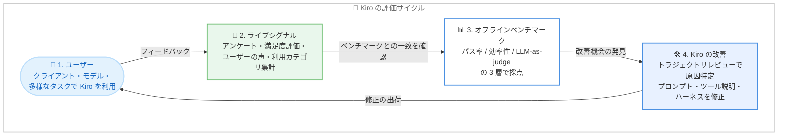

# Kiro - 100 万回の評価から学んだ教訓 (Lessons learned from one million evaluations)

**リリース日**: 2026 年 11 月 17 日
**サービス**: Kiro
**機能**: コーディングエージェント評価 (Evals) の運用に関するエンジニアリング知見の公開

📊 [このアップデートのインフォグラフィックを見る](https://takech9203.github.io/aws-news-summary/20261117-kiro-1m-evals-lessons.html)

## 概要

Kiro チームは、エージェント開発の過程で実施してきた 100 万回を超える評価 (Evals) から得られた教訓をまとめたエンジニアリングブログ記事を公開しました。本記事では、固定されたベンチマークセットを合否 (pass/fail) のみで採点する一般的な評価アプローチの限界と、Kiro が顧客価値を正しく測定するために構築した評価の仕組みが解説されています。

記事の出発点となったのは、Kiro に新しいモデルを追加した際の実体験です。Terminal Bench 2.1 のパス率は期待どおりだったにもかかわらず、社内テストユーザーからは「他のモデルより体験が悪い」という声が上がりました。詳細を調査すると、他のモデルでは問題なく機能していたツール説明 (tool description) が原因で、新モデルではツール呼び出しの 40% が無効な入力で失敗していたことが判明しました。モデルは試行錯誤の末にタスクを完了できたためパス率には表れませんでしたが、その間にトークン消費と遅延が増大し、顧客価値は低下していました。

本記事は、コーディングエージェントを開発・評価するすべてのエンジニアにとって、ベンチマークの飽和 (saturation)、合否シグナルの粗さ、顧客体験との乖離という 3 つの問題にどう向き合うかを示す実践的な知見となっています。

**従来の評価アプローチの課題**

固定的な pass/fail ベンチマークには、以下の問題がありました。

- **ベンチマークの飽和**: エージェントやモデルの性能向上に伴い固定セットのパス率が上限に近づき、残る差分はノイズに起因するようになり、本来測定したいシグナルが得られなくなる
- **pass/fail シグナルの不十分さ**: 合否のみの採点では、タスクをどのように解決したかが見えず、トークン消費、遅延、コード品質といった顧客が重視するシグナルが隠れてしまう
- **顧客体験との乖離**: 公開ベンチマークは入手可能性や知名度で選ばれがちで、多様なプログラミング言語、DevOps ユースケース、コード理解など、実際の顧客ユースケースを十分に反映していない

**Kiro が構築したアプローチ**

これらの課題に対し、Kiro は以下の仕組みを導入しました。

- **静的セットから動的ベンチマークへ**: 社内ユーザーの利用状況を 20 以上のタスクカテゴリ、25 以上のドメイン、プログラミング言語、セッションあたりのプロンプト数で集計・分類し、実際の利用状況に合わせてシナリオを継続的に補充するバージョン管理されたベンチマークスイートを構築
- **合否から段階的な判定へ**: pass/fail に加えて、遅延・トークン使用量などの出力シグナル、および LLM-as-judge によるコード品質や応答トーンの評価という 3 層の粒度で測定
- **ライブシグナルによる信頼構築**: アンケート、満足度評価、ユーザーの生の声を用いて、ベンチマーク自体が顧客体験と一致しているかを継続的に検証

## アーキテクチャ図

Kiro の評価サイクルは、ユーザーのフィードバックをライブシグナルとして収集し、オフラインベンチマークとの一致を検証した上で改善を出荷する 4 ステップのループで構成されています。

## 記事の詳細

### 主要なポイント

1. **ベンチマーク飽和の実例と教訓**
   - Terminal Bench 2.1 が飽和に近づいていることを認識しつつも、大きなリグレッションは検出できると想定していた
   - 実際には、ツール呼び出しの 40% が失敗していてもパス率は正常に見えた
   - モデルがリトライで正しい呼び出し方法を見つけるため、合否には表れないがトークン・遅延・顧客価値が悪化していた

2. **評価がエージェント開発に不可欠な理由**
   - プロンプト、ツール説明、モデル自体への小さな変更が、誰も予期しない形で挙動を変える可能性がある
   - サブエージェントの使い方、AGENTS.md に何を書くべきか、ツール数の上限、メモリの有効性、スキルとカスタム MCP ツールのどちらを重視すべきかなど、経験豊富なエンジニアでも意見が分かれるトレードオフの判断には、信頼できる評価結果が必要

3. **動的ベンチマークスイートの構築**
   - 社内 Amazon ユーザーの利用状況を集計カテゴリとして測定し、ベンチマークシナリオに同じカテゴリでラベル付け
   - シナリオは「自作シナリオ」「他の Amazon チームのシナリオ」「公開ベンチマーク」の 3 つのソースから補充
   - 実際の利用状況に比べてシナリオが少ないカテゴリを特定し、優先的に追加する仕組み

4. **3 層の粒度による採点**
   - 第 1 層: pass/fail (性能の複合的な指標として最初に確認)
   - 第 2 層: 出力シグナル (遅延、トークン使用量、場合によってはコード複雑度や生成成果物のサイズ)
   - 第 3 層: LLM-as-judge によるトラジェクトリ評価 (コード品質や応答トーンなど、決定的な測定が難しいシグナル)

5. **ライブシグナルによる評価システム自体の検証**
   - Jeff Bezos 氏の「データと逸話が食い違うときは、たいてい逸話が正しい」という言葉を指針として採用
   - アンケート、集計された満足度評価、ユーザーとの対話から得られる逸話を活用
   - 外部顧客へのアンケートと対話により、社内ユーザーと同様の体験であることを確認

6. **実際の測定結果**
   - コンタミネーション (学習データ混入) リスクを避けるための複数のプライベートベンチマークに加え、Terminal Bench 4.0、Deep SWE、SWE Marathon などで測定
   - ツール失敗率のデータにより、前述のツール説明の不整合問題を修正
   - 効率性データと充実した評価セットにより、機能改善、Kiro ハーネスのバグ修正、顧客のコスト削減に直結する効率改善など数十件の変更を実施

### 今後の研究課題

- **ベンチマークキュレーションのスケール**: マージされ 5 つ星評価を得た社内プルリクエストをベンチマーク候補としたところ、次のコミットでそのプルリクエストが混入させたバグが修正されていた事例を紹介。このような「成功に見えて誤ったシナリオ」を検出しながらスイートを更新し続ける仕組みの研究
- **複雑な顧客構成での評価**: MCP サーバー、ステアリングファイル、冗長なスキル、コメントの多いコードベースなど、複雑な顧客構成における Kiro の性能評価

## 技術仕様

### 評価の 3 層構造

| 層 | 測定内容 | 目的 |
|------|------|------|
| pass/fail | タスクの合否 | 性能の複合的な第一指標 |
| 出力シグナル | 遅延、トークン使用量、コード複雑度、成果物サイズ | 顧客体験に影響する定量指標の追跡 |
| LLM-as-judge | コード品質、応答トーン | 決定的に測定しにくいシグナルの評価 |

### 利用状況の分類軸

| 分類軸 | 規模 |
|------|------|
| タスクカテゴリ | 20 以上 |
| ドメイン | 25 以上 |
| プログラミング言語 | 利用状況に応じて集計 |
| セッションあたりのプロンプト数 | 利用状況に応じて集計 |

### 使用されたベンチマーク

| ベンチマーク | 備考 |
|------|------|
| プライベートベンチマーク | コンタミネーションリスク回避のため複数使用 |
| Terminal Bench 2.1 / 4.0 | 2.1 は飽和に近づいていたため 4.0 などへ拡充 |
| Deep SWE | 測定対象に含まれる |
| SWE Marathon | 測定対象に含まれる |

## メリット

### ビジネス面

- **顧客価値に直結する測定**: パス率だけでは見えないトークンコスト、遅延、コード品質を測定することで、顧客が実際に体感する価値の改善につながる
- **効率改善によるコスト削減**: トークン効率の改善は顧客のコスト削減に直接つながる変更として実際に出荷されている
- **意思決定の信頼性向上**: トレードオフの判断を経験や勘ではなく、信頼できる評価結果に基づいて行える

### 技術面

- **リグレッションの早期検出**: ツール失敗率などの詳細メトリクスにより、パス率に表れない品質低下を検出できる
- **改善オプションの再テスト**: ベンチマークにより、複数の改善案を再テストして最も効果的なものを選択できる
- **評価システム自体の継続的検証**: ライブシグナルとの突き合わせにより、ベンチマークが顧客体験から乖離していないかを常に確認できる

## デメリット・制約事項

### 制限事項

- 本記事は機能リリースではなく、エンジニアリング知見の共有であるため、ユーザーが直接利用できる新機能は含まれない
- 記事で紹介されている評価の仕組みは Kiro 内部のものであり、評価スイート自体は公開されていない
- 現在の評価プロセスは、モデル選択と Kiro クライアントについては顧客利用に合わせているが、MCP サーバーやステアリングファイルなどの複雑な顧客構成はまだカバーされていない (今後の研究課題)

### 考慮すべき点

- 利用カテゴリに合わせたスイートであっても、適切なシナリオの選定は難しく、成功に見えるシグナル (マージ済み・高評価のプルリクエスト) が誤ったシナリオである場合がある
- ベンチマークがカテゴリ、ドメイン、言語で一致していても、飽和やカテゴリ粒度の不足により顧客体験を反映しない可能性が残る

## ユースケース

### ユースケース 1: 自社エージェント製品の評価設計

**シナリオ**: 社内でコーディングエージェントや LLM アプリケーションを開発しており、評価基盤の設計方針を検討している。

**適用方法**: pass/fail に加えて、遅延・トークン使用量などの出力シグナルと LLM-as-judge による品質評価の 3 層構造を採用し、実際のユーザー利用カテゴリに合わせてシナリオを補充する。

**効果**: ベンチマーク飽和によるシグナル喪失を防ぎ、顧客体験に直結する指標でリグレッションを早期検出できる。

### ユースケース 2: 新モデル導入時の品質検証

**シナリオ**: エージェント製品に新しい基盤モデルを追加する際、既存ベンチマークのパス率だけで品質を判断している。

**適用方法**: パス率に加えてツール呼び出しの失敗率、トークン効率、遅延を測定し、社内テストユーザーの逸話的フィードバックと突き合わせる。

**効果**: パス率が正常でもツール説明との相性問題などで顧客体験が悪化しているケースを、リリース前に検出できる。

### ユースケース 3: ベンチマークシナリオのキュレーション

**シナリオ**: 実際の開発タスク (プルリクエストなど) をベンチマークシナリオとして採用したい。

**適用方法**: マージ済み・高評価という表面的なシグナルだけでなく、リポジトリ履歴を確認し、後続コミットでバグ修正が行われていないかを検証する。

**効果**: 誤った「正解」を基準とするベンチマークの混入を防ぎ、評価の信頼性を維持できる。

## 利用可能リージョン

グローバル (Kiro はグローバルに提供されています)

## 関連サービス・機能

- **Kiro**: AWS が提供するエージェンティックエンジニアリングシステム。計画、実装、レビュー、検証をローカルマシンまたはクラウド上で実行する
- **Terminal Bench / Deep SWE / SWE Marathon**: 記事中で言及されているコーディングエージェント向けベンチマーク
- **LLM-as-judge**: LLM を評価者として用いる手法。コード品質や応答トーンなど決定的に測定しにくいシグナルの評価に使用

## 参考リンク

- 📊 [インフォグラフィック](https://takech9203.github.io/aws-news-summary/20261117-kiro-1m-evals-lessons.html)
- [Kiro Blog: Lessons learned from one million evaluations](https://kiro.dev/blog/1m-evals-lessons/)
- [Kiro Blog: Continuous Prompt Evaluation](https://kiro.dev/blog/continuous-prompt-evaluation/) (LLM-judge のルーブリック、A/B 設定、測定結果の詳細)
- [Kiro Blog: Are AI coding agents actually getting better?](https://kiro.dev/blog/diagnostics-over-time/)
- [Kiro 公式サイト](https://kiro.dev/)

## まとめ

本記事は、100 万回を超える評価の実践から得られた「ベンチマーク飽和」「pass/fail シグナルの限界」「顧客体験との乖離」という 3 つの課題と、それに対する動的ベンチマーク、3 層採点、ライブシグナル検証という解決アプローチを示したエンジニアリング知見です。コーディングエージェントや LLM アプリケーションを開発・評価するチームは、自社の評価基盤設計の参考として本記事と関連記事 (Continuous Prompt Evaluation) を確認することを推奨します。
