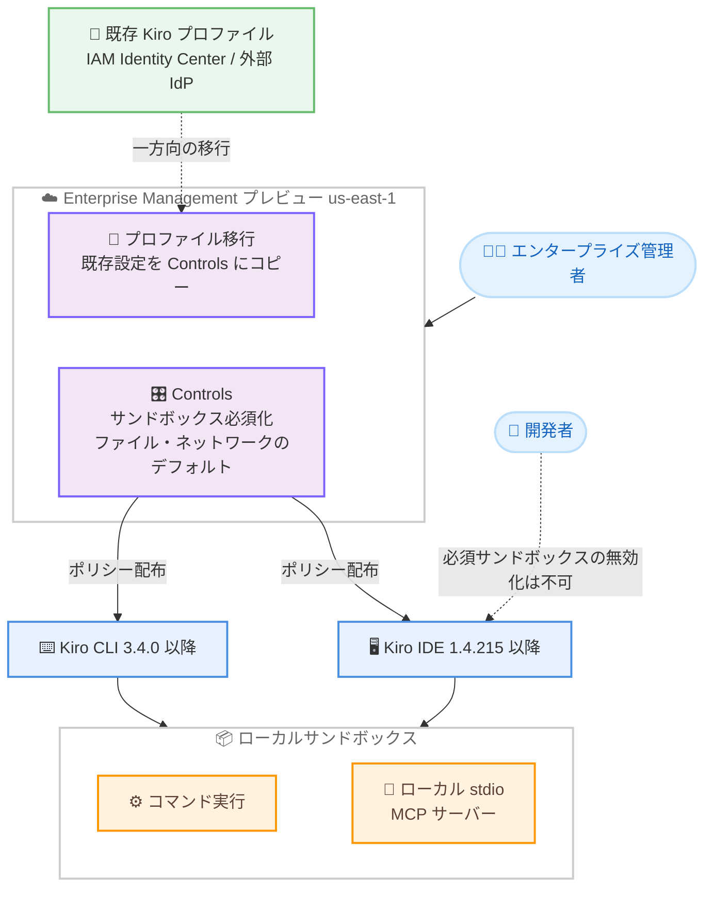

# Kiro - Enterprise Management アップデート (ローカルサンドボックス制御と既存プロファイルの移行)

**リリース日**: 2026 年 11 月 17 日
**サービス**: Kiro
**機能**: Enterprise Management におけるローカルサンドボックス制御、既存プロファイルの Controls への移行

📊 [このアップデートのインフォグラフィックを見る](https://takech9203.github.io/aws-news-summary/20261117-kiro-changelog-2026-11-17.html)

## 概要

Kiro の Enterprise Management に 2 つのアップデートが発表されました。1 つ目は、エンタープライズ管理者が Kiro IDE および Kiro CLI のローカルサンドボックス制御を組織レベルで設定できる機能です。Controls から、コマンドやローカル stdio MCP サーバーに対するサンドボックスの必須化、ファイルアクセスとネットワークアクセスのデフォルト設定を一元的に指定できます。開発者はクライアント側の設定で必須サンドボックスを無効化したり、組織が設定したモードを変更したりすることはできません。

2 つ目は、既存の Kiro プロファイルを Enterprise Management へ移行できる機能です。設定画面に「Migrate to the new experience」が表示された場合、マッピングをプレビューしたうえで、現在の設定を Controls にコピーできます。これにより、Enterprise Management の提供開始前から Kiro を利用していた組織も、新しい一元管理の仕組みへ移行できるようになりました。

いずれも Enterprise Management のプレビューの一部として、米国東部 (バージニア北部) us-east-1 で提供されます。対象は IAM Identity Center または外部 ID プロバイダーを使用するプロファイルです。

**アップデート前の課題**

- 以前はサンドボックスの利用有無やモードが開発者個人のクライアント設定に委ねられており、組織として一貫したサンドボックスポリシーを強制できなかった
- 以前はコマンド実行やローカル stdio MCP サーバーに対するファイル・ネットワークアクセスのデフォルトを組織レベルで統一する手段がなかった
- 以前は既存の Kiro プロファイルを Enterprise Management の Controls へ移行する手段がなく、新しい一元管理の仕組みを既存環境に適用できなかった

**アップデート後の改善**

- 今回のアップデートにより、管理者が Controls からサンドボックスを必須化でき、開発者側で無効化や組織設定モードの変更ができなくなった
- 今回のアップデートにより、ファイルアクセスとネットワークアクセスのデフォルトを組織レベルで選択できるようになった
- 今回のアップデートにより、開発者の許可ルールが組織の拒否ルールを上書きできないことが保証され、ガバナンスが強化された
- 今回のアップデートにより、既存プロファイルの設定をプレビュー付きで Controls にコピーし、Enterprise Management へ移行できるようになった

## アーキテクチャ図



エンタープライズ管理者が Controls で設定したサンドボックスポリシーが Kiro IDE と Kiro CLI に配布され、コマンド実行とローカル stdio MCP サーバーがサンドボックス内で動作する流れを示しています。既存プロファイルは一方向の移行によって Enterprise Management に取り込めます。

## サービスアップデートの詳細

### 主要機能

1. **ローカルサンドボックスの必須化**
   - Controls から、コマンドおよびローカル stdio MCP サーバーに対するサンドボックスを必須に設定できる
   - 開発者はクライアント設定から必須サンドボックスを無効化できず、組織が設定したモードも変更できない
   - ツール権限 (tool permissions) は引き続き、どのコマンドを実行できるかの判断に使用される

2. **ファイル・ネットワークアクセスのデフォルト設定**
   - サンドボックスのファイルアクセスとネットワークアクセスのデフォルトを組織レベルで選択できる
   - 開発者の許可ルールは組織の拒否ルールを上書きできない
   - 認証情報ストアはデフォルトで閉じられているが、それらをカバーするファイル許可ルールがあれば開くことができる点に注意が必要

3. **既存プロファイルの Enterprise Management への移行**
   - 設定画面に「Migrate to the new experience」が表示された場合、移行マッピングをプレビューできる
   - 移行を実行すると、現在の設定が Controls にコピーされる
   - 超過分 (Overages)、暗号化キー、メンバーアカウントのサブスクリプションは従来の Settings 側に残る
   - 移行は一方向であり、元に戻すことはできない

## 技術仕様

### 前提条件と対象環境

| 項目 | 詳細 |
|------|------|
| 提供ステータス | プレビュー |
| 対象リージョン | 米国東部 (バージニア北部) us-east-1 |
| 対象プロファイル | IAM Identity Center または外部 ID プロバイダーを使用するプロファイル |
| 必要クライアントバージョン | Kiro CLI 3.4.0 以降、または Kiro IDE 1.4.215 以降 |
| サンドボックス対象 | コマンド実行、ローカル stdio MCP サーバー |
| 移行の方向性 | 一方向 (Settings から Controls へ。移行後は戻せない) |

### ポリシーの優先関係

| 設定主体 | 可能な操作 | 制約 |
|----------|------------|------|
| エンタープライズ管理者 | サンドボックスの必須化、モード設定、ファイル・ネットワークのデフォルト設定 | - |
| 開発者 | 自身の許可ルールの追加 | 必須サンドボックスの無効化は不可。組織の拒否ルールを上書き不可 |

## 設定方法

### 前提条件

1. Enterprise Management プレビュー (us-east-1) を利用していること
2. プロファイルが IAM Identity Center または外部 ID プロバイダーを使用していること
3. 開発者のクライアントが Kiro CLI 3.4.0 以降、または Kiro IDE 1.4.215 以降であること

### 手順

#### ステップ 1: ローカルサンドボックス制御の設定

Enterprise Management の Controls を開き、Kiro IDE と Kiro CLI に対するサンドボックスの必須化を設定します。あわせて、ファイルアクセスとネットワークアクセスのデフォルトを選択します。詳細は [Enterprise Management リファレンスのサンドボックス](https://kiro.dev/docs/enterprise/enterprise-management/reference/#sandbox) を参照してください。

#### ステップ 2: 既存プロファイルの移行

既存プロファイルの Settings に「Migrate to the new experience」が表示されたら、移行マッピングをプレビューします。内容を確認のうえ移行を実行すると、現在の設定が Controls にコピーされます。手順の詳細は [Enterprise Management の開始方法 (既存プロファイルの移行)](https://kiro.dev/docs/enterprise/enterprise-management/getting-started/#migrate-an-existing-profile) を参照してください。

#### ステップ 3: クライアント側での適用確認

開発者のクライアントが必要バージョン (Kiro CLI 3.4.0 以降、Kiro IDE 1.4.215 以降) を満たしていることを確認し、組織が設定したサンドボックスポリシーが適用されていることを確認します。

## メリット

### ビジネス面

- **ガバナンスの強化**: 組織全体でサンドボックスポリシーを強制でき、開発者個人の設定に依存しないセキュリティ統制を実現できる
- **移行パスの提供**: 既存の Kiro 利用組織が設定を失うことなく Enterprise Management へ移行でき、新しい管理機能を段階的に導入できる
- **コンプライアンス対応**: 組織の拒否ルールを開発者が上書きできないため、監査要件やセキュリティポリシーへの準拠を担保しやすい

### 技術面

- **一元管理**: サンドボックスの必須化とファイル・ネットワークのデフォルトを Controls から一括設定でき、クライアントごとの個別設定が不要になる
- **多層防御**: サンドボックスとツール権限が独立して機能し、サンドボックス内であってもツール権限によるコマンド実行制御が維持される
- **認証情報の保護**: 認証情報ストアはデフォルトで閉じられており、明示的なファイル許可ルールがない限りアクセスできない

## デメリット・制約事項

### 制限事項

- Enterprise Management はプレビュー段階であり、米国東部 (バージニア北部) us-east-1 のみで提供される
- 対象は IAM Identity Center または外部 ID プロバイダーを使用するプロファイルに限定される
- サンドボックス制御の適用には Kiro CLI 3.4.0 以降、または Kiro IDE 1.4.215 以降が必要
- プロファイルの移行は一方向であり、Controls への移行後に元の Settings 管理へ戻すことはできない

### 考慮すべき点

- 認証情報ストアをカバーするファイル許可ルールを設定すると、デフォルトで閉じられている認証情報ストアが開かれるため、許可ルールの範囲を慎重に設計する必要がある
- 移行後も超過分、暗号化キー、メンバーアカウントのサブスクリプションは Settings 側に残るため、移行後の管理箇所が一時的に分かれる点を把握しておく必要がある
- 移行前にマッピングのプレビューで設定内容を必ず確認することが推奨される

## ユースケース

### ユースケース 1: 開発組織全体でのサンドボックス必須化

**シナリオ**: 金融系企業のプラットフォームチームが、全開発者の Kiro IDE と Kiro CLI でコマンド実行とローカル stdio MCP サーバーのサンドボックス化を必須にしたい。

**実装例**:
```text
1. Enterprise Management の Controls を開く
2. Kiro IDE / Kiro CLI のサンドボックスを必須に設定
3. ファイルアクセスのデフォルトをワークスペース限定に設定
4. ネットワークアクセスのデフォルトを制限モードに設定
```

**効果**: 開発者がクライアント設定でサンドボックスを無効化できなくなり、組織として一貫したセキュリティ統制を実現できる。

### ユースケース 2: 既存プロファイルの段階的な移行

**シナリオ**: Enterprise Management の提供前から Kiro を利用している組織が、既存の設定を維持しつつ新しい一元管理へ移行したい。

**実装例**:
```text
1. Settings の「Migrate to the new experience」を選択
2. 移行マッピングをプレビューし、設定の対応関係を確認
3. 移行を実行し、現在の設定を Controls にコピー
4. 超過分・暗号化キー・サブスクリプションは Settings 側で継続管理
```

**効果**: 設定を再構築することなく Enterprise Management の Controls へ移行でき、サンドボックス制御などの新機能を利用できる。

### ユースケース 3: 組織の拒否ルールによるデータ保護

**シナリオ**: セキュリティチームが、機密ディレクトリへのアクセスを組織レベルで拒否し、開発者が個人設定で回避できないようにしたい。

**実装例**:
```text
1. Controls でファイルアクセスの拒否ルールに機密ディレクトリを指定
2. 認証情報ストアを開くファイル許可ルールが存在しないことを確認
3. 開発者の許可ルールが組織の拒否ルールを上書きできないことを周知
```

**効果**: 開発者の許可ルールでは組織の拒否ルールを上書きできないため、機密データへのアクセスを確実に遮断できる。

## 利用可能リージョン

Enterprise Management はプレビューとして米国東部 (バージニア北部) us-east-1 で提供されています。Kiro クライアント自体はグローバルに利用可能です。

## 関連サービス・機能

- **Kiro IDE**: サンドボックス制御の適用対象。1.4.215 以降が必要
- **Kiro CLI**: サンドボックス制御の適用対象。3.4.0 以降が必要
- **AWS IAM Identity Center**: Enterprise Management プレビューの対象となるプロファイルの認証基盤の 1 つ
- **MCP (Model Context Protocol)**: ローカル stdio MCP サーバーがサンドボックス制御の対象に含まれる

## 参考リンク

- 📊 [インフォグラフィック](https://takech9203.github.io/aws-news-summary/20261117-kiro-changelog-2026-11-17.html)
- [Kiro Changelog](https://kiro.dev/changelog/)
- [Enterprise Management リファレンス: サンドボックス](https://kiro.dev/docs/enterprise/enterprise-management/reference/#sandbox)
- [Enterprise Management の開始方法: 既存プロファイルの移行](https://kiro.dev/docs/enterprise/enterprise-management/getting-started/#migrate-an-existing-profile)

## まとめ

今回のアップデートにより、エンタープライズ管理者は Kiro IDE と Kiro CLI のローカルサンドボックスを組織レベルで必須化し、既存プロファイルを Enterprise Management へ移行できるようになりました。AI コーディングエージェントのエンタープライズ導入において重要となるガバナンス機能の強化であり、組織で Kiro を利用している場合は、プレビュー対象環境でのサンドボックス制御の設定と、既存プロファイルの移行マッピングのプレビュー確認から始めることを推奨します。
