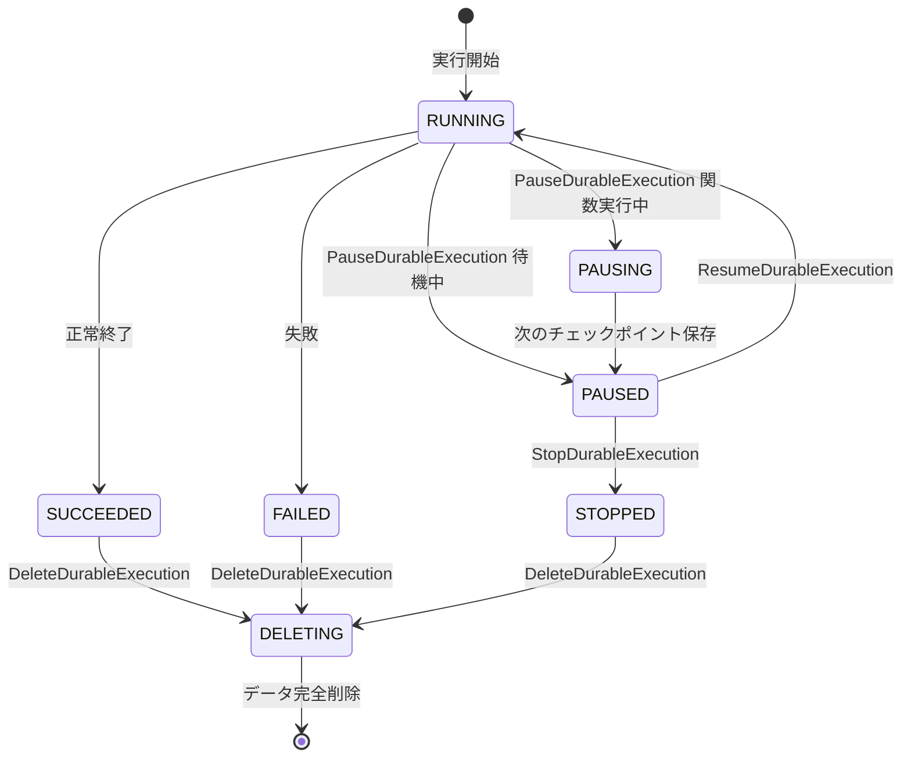

# AWS Lambda - durable functions の実行の一時停止・再開・削除サポート

**リリース日**: 2026 年 11 月 17 日
**サービス**: AWS Lambda
**機能**: durable functions における実行 (durable execution) の一時停止・再開・削除

📊 [このアップデートのインフォグラフィックを見る](https://takech9203.github.io/aws-news-summary/20261117-lambda-durable-pause-delete.html)

## 概要

AWS Lambda durable functions で、実行中の durable execution を一時停止 (Pause) し、進捗を失うことなく後から再開 (Resume) できるようになりました。再開した実行は、最後のチェックポイントから同じ関数バージョン上で処理を継続します。デフォルトでは、一時停止中の時間は実行タイムアウトにカウントされません。また、保持期間 (retention period) が終了する前に、完了した実行のデータを削除 (Delete) できるようになりました。

Lambda durable functions は、組み込みのチェックポイントと自動リトライにより、最長 1 年間実行できる耐障害性の高いマルチステップアプリケーションや AI ワークフローを構築できる機能です。今回のアップデートにより、ダウンストリームサービスの劣化やモデルプロバイダーのレート制限到達時に、リトライを使い果たす前に影響を受ける実行を一時停止し、問題解決後に再開するという運用が可能になります。また、個人データを含む入力を持つ実行の削除や、バグが残した失敗実行のクリーンアップなど、コンプライアンス要件への対応も容易になります。

一時停止・再開・削除は、Lambda コンソール、AWS CLI、AWS SDK から利用でき、AWS Lambda durable functions が利用可能なすべての AWS リージョンで提供されます。

**アップデート前の課題**

- ダウンストリームサービスの障害時に実行を止める手段が Stop しかなく、停止した実行は再開できないため、進捗を失うか、リトライが尽きるまで放置するしかなかった
- 障害対応や調査のために実行を安全に保留する手段がなかった
- 完了した実行のデータは保持期間が終了するまで残り続け、個人データを含む入力ペイロードなどを早期に削除できなかった

**アップデート後の改善**

- 実行を一時停止し、最後のチェックポイントから同じ関数バージョンで再開できるようになった
- デフォルトでは一時停止中の時間が実行タイムアウトにカウントされないため、長時間の障害対応でもタイムアウトを気にせず保留できるようになった
- 成功・失敗・停止・タイムアウトした実行の履歴、チェックポイントデータ、入出力ペイロードを保持期間の終了前に削除できるようになった

## アーキテクチャ図



durable execution のステータス遷移を示しています。今回のアップデートで PAUSING、PAUSED、DELETING の 3 つのステータスが追加され、一時停止からの再開と、終了状態 (SUCCEEDED、FAILED、STOPPED、TIMED_OUT) からの削除が可能になりました。

## サービスアップデートの詳細

### 主要機能

1. **実行の一時停止 (PauseDurableExecution)**
   - 実行 ARN を指定して 1 件ずつ一時停止し、理由 (Reason) を実行履歴に記録できる
   - 関数が実行中でない場合 (wait、コールバック、リトライ遅延、子実行の待機中) は即座に PAUSED になる
   - 関数が実行中の場合は PAUSING となり、次のチェックポイント保存後に PAUSED へ遷移する
   - 一時停止中も、待機時間の経過、外部システムからのコールバック完了、子実行の継続などの保留中の操作は進行し、再開時にまとめて処理される

2. **実行の再開 (ResumeDurableExecution)**
   - PAUSED または PAUSING 状態の実行を再開でき、最後のチェックポイントから同じ関数バージョンで継続する
   - デフォルト (`ExecutionTimeoutPaused=true`) では一時停止中に実行タイムアウトが停止し、再開時に一時停止していた時間分だけタイムアウトが延長される (ただし開始から 366 日が上限)
   - `--no-execution-timeout-paused` を指定すると、一時停止中もタイムアウトが進行する

3. **実行の削除 (DeleteDurableExecution)**
   - SUCCEEDED、FAILED、STOPPED、TIMED_OUT の終了状態に達した実行を保持期間の終了前に削除できる
   - 履歴、チェックポイントデータ、入出力ペイロードを含むすべての実行データが完全に削除される
   - 削除は非同期で行われ、削除中は DELETING ステータスとなり、完了後は `ResourceNotFoundException` が返る
   - 削除後は同じ実行名を再利用でき、新しい実行を開始できる

4. **モニタリングの拡張**
   - `GetDurableExecutionHistory` に `ExecutionPaused` / `ExecutionResumed` イベントが追加され、一時停止・再開の履歴を確認できる
   - `ListDurableExecutionsByFunction` のステータスフィルタに PAUSED、PAUSING、DELETING が追加された

## 技術仕様

### 一時停止・再開・削除の仕様

| 項目 | 詳細 |
|------|------|
| 一時停止対象 | RUNNING 状態の実行 (1 リクエストにつき 1 実行) |
| 再開対象 | PAUSED または PAUSING 状態の実行 |
| 削除対象 | SUCCEEDED、FAILED、STOPPED、TIMED_OUT 状態の実行 |
| タイムアウト動作 | デフォルトで一時停止中は実行タイムアウトが停止 (上限は開始から 366 日) |
| 一時停止中の動作 | wait の経過、コールバック完了、子実行、リトライ遅延は継続して進行 |
| 削除されるデータ | 実行履歴、チェックポイントデータ、入出力ペイロード |
| 削除されないデータ | CloudWatch Logs、CloudTrail 記録、CloudWatch メトリクス、子実行のデータ |
| 必要な IAM 権限 | `lambda:PauseDurableExecution`、`lambda:ResumeDurableExecution`、`lambda:DeleteDurableExecution` |
| KMS 要件 | カスタマーマネージドキー使用時、一時停止・再開には `kms:Decrypt` が必要 (削除には不要) |

### 対応 SDK バージョン

実行中の呼び出しを一時停止するには、以下のバージョン以降の AWS Durable Execution SDK が必要です。

| 言語 | パッケージ | 最低バージョン |
|------|-----------|---------------|
| JavaScript / TypeScript | `@aws/durable-execution-sdk-js` | 2.5.0 |
| Python | `aws-durable-execution-sdk-python` | 2.1.0 |
| Java | `aws-durable-execution-sdk-java` | 2.3.0 |
| Go | `github.com/aws/aws-durable-execution-sdk-go` | 1.0.0 |
| C# (.NET) | `Amazon.Lambda.DurableExecution` | 2.2.0 |

### API 変更履歴

| 日付 | サービス | 変更内容 |
|------|----------|----------|
| 2026/11/17 | [AWS Lambda](https://awsapichanges.com/archive/changes/a370bc-lambda.html) | 3 new 3 updated api methods - PauseDurableExecution、ResumeDurableExecution、DeleteDurableExecution の新規追加。GetDurableExecution、GetDurableExecutionHistory、ListDurableExecutionsByFunction に PAUSED / PAUSING / DELETING ステータスと関連イベントを追加 |

## 設定方法

### 前提条件

1. AWS Lambda durable functions を使用する Lambda 関数が作成済みであること
2. 対象の durable execution ARN に対する `lambda:PauseDurableExecution`、`lambda:ResumeDurableExecution`、`lambda:DeleteDurableExecution` 権限があること
3. カスタマーマネージド KMS キーを使用している場合、一時停止・再開には `kms:Decrypt` 権限があること

### 手順

#### ステップ 1: 実行を一時停止する

```bash
aws lambda pause-durable-execution \
  --durable-execution-arn arn:aws:lambda:us-east-1:123456789012:function:myDurableFunction:1/durable-execution/my-execution-name/my-execution-id \
  --reason "Payment service outage"
```

指定した durable execution を一時停止します。`--reason` は任意で、実行履歴に記録されます。デフォルトでは実行タイムアウトも一時停止します。タイムアウトを進行させたい場合は `--no-execution-timeout-paused` を追加します。

#### ステップ 2: ステータスを確認する

```bash
aws lambda get-durable-execution \
  --durable-execution-arn arn:aws:lambda:us-east-1:123456789012:function:myDurableFunction:1/durable-execution/my-execution-name/my-execution-id
```

実行のステータスを確認します。PAUSING または PAUSED の間は、レスポンスに `PauseRequestTimestamp`、`Reason`、`ExecutionTimeoutPaused` を含む `PauseDetails` が返されます。

#### ステップ 3: 実行を再開する

```bash
aws lambda resume-durable-execution \
  --durable-execution-arn arn:aws:lambda:us-east-1:123456789012:function:myDurableFunction:1/durable-execution/my-execution-name/my-execution-id \
  --reason "Payment service recovered"
```

一時停止中の実行を再開します。ステータスが RUNNING に戻り、最後のチェックポイントから処理を継続します。一時停止中に完了した操作がある場合、再開時の呼び出しでまとめて処理されます。

#### ステップ 4: 完了した実行を削除する

```bash
aws lambda delete-durable-execution \
  --durable-execution-arn arn:aws:lambda:us-east-1:123456789012:function:myDurableFunction:1/durable-execution/my-execution-name/my-execution-id
```

終了状態に達した実行のデータを削除します。レスポンスには削除リクエストを受け付けた時刻 (`DeletionRequestTimestamp`) が返されます。削除は非同期で行われ、完了後は `get-durable-execution` が `ResourceNotFoundException` を返します。

## メリット

### ビジネス面

- **障害時の損失防止**: ダウンストリームサービスの障害時に、それまでの処理進捗を失わずにワークフローを保留できるため、長時間ワークフローのやり直しコストを削減できる
- **コンプライアンス対応**: 個人データを含む実行データを保持期間の終了を待たずに削除でき、GDPR などのデータ削除要件に対応しやすくなる
- **運用コストの最小化**: 一時停止中は関数が呼び出されないため、呼び出し課金が発生しない

### 技術面

- **チェックポイントからの正確な再開**: 再開時は最後のチェックポイントから同じ関数バージョンで継続するため、デプロイ中の予期しないバージョン混在を回避できる
- **柔軟なタイムアウト制御**: `ExecutionTimeoutPaused` により、一時停止中の実行タイムアウトの扱いをユースケースに応じて選択できる
- **可観測性の確保**: 一時停止・再開イベントは実行履歴に理由付きで記録され、CloudWatch メトリクスや EventBridge ステータス変更イベントでも監視できる

## デメリット・制約事項

### 制限事項

- 一時停止・削除は 1 リクエストにつき 1 実行が対象であり、複数の実行をまとめて操作するには `ListDurableExecutionsByFunction` で一覧を取得して個別に API を呼び出す必要がある
- 一時停止しても新しい実行の開始は防げないため、新規実行も止めたい場合はイベントソースマッピングの無効化などが別途必要になる
- 実行タイムアウトを一時停止しても、実行開始から 366 日が経過するとタイムアウトする
- 削除できるのは終了状態の実行のみで、実行中や一時停止中の実行は先に `StopDurableExecution` で停止する必要がある
- 親実行を一時停止・削除しても、子実行は一時停止・削除されない

### 考慮すべき点

- 実行を削除しても保存データの課金は減らない。Lambda は保持期間全体に対して課金するため、ストレージコスト削減には保持期間自体の短縮が必要
- 一時停止中の実行は実行中の durable execution のクォータにカウントされ、保存データの課金も継続する
- 削除は永続的であり、削除後は実行の詳細、履歴、結果を取得できない。CloudTrail データイベントで削除操作を監査することが推奨される
- 一時停止中も wait の経過やコールバックの完了・タイムアウトは進行するため、再開時の処理内容に注意が必要
- 実行中の呼び出しを一時停止するには、対応バージョン以降の AWS Durable Execution SDK が必要

## ユースケース

### ユースケース 1: ダウンストリームサービス障害時のワークフロー保全

**シナリオ**: 決済サービスの障害により、注文処理ワークフローのリトライが失敗し続けている。リトライを使い果たして実行が失敗する前に、影響を受ける実行を保留したい。

**実装例**:
```bash
# 実行中の実行を一覧表示
aws lambda list-durable-executions-by-function \
  --function-name order-workflow \
  --statuses RUNNING

# 影響を受ける実行を一時停止
aws lambda pause-durable-execution \
  --durable-execution-arn <execution-arn> \
  --reason "Payment service outage"

# 障害復旧後に再開
aws lambda resume-durable-execution \
  --durable-execution-arn <execution-arn> \
  --reason "Payment service recovered"
```

**効果**: それまでの処理進捗を失わずに障害をやり過ごし、復旧後に最後のチェックポイントから処理を再開できる。

### ユースケース 2: AI ワークフローにおけるレート制限対応

**シナリオ**: AI エージェントワークフローで、モデルプロバイダーのレート制限に到達した。制限が解除されるまで実行を保留し、無駄なリトライを避けたい。

**実装例**:
```bash
aws lambda pause-durable-execution \
  --durable-execution-arn <execution-arn> \
  --reason "Model provider rate limit reached"
```

**効果**: デフォルトで実行タイムアウトも一時停止するため、レート制限の解除を待つ時間がワークフローの実行期限を圧迫しない。

### ユースケース 3: 個人データを含む実行データの早期削除

**シナリオ**: 個人データを入力に含む実行が完了した。コンプライアンス要件により、保持期間の終了を待たずにデータを削除する必要がある。

**実装例**:
```bash
# 完了した実行を削除
aws lambda delete-durable-execution \
  --durable-execution-arn <execution-arn>

# 削除完了の確認 (ResourceNotFoundException が返れば削除完了)
aws lambda get-durable-execution \
  --durable-execution-arn <execution-arn>
```

**効果**: 実行履歴、チェックポイントデータ、入出力ペイロードが完全に削除され、データ削除要件に対応できる。バグが残した失敗実行のクリーンアップにも利用できる。

## 料金

一時停止・再開・削除の API 呼び出し自体に追加料金はありません。durable functions の既存の料金体系が適用されます。

- 一時停止中は関数が呼び出されないため、呼び出しに伴う課金は発生しない
- 一時停止中の実行は保存データの課金が継続する
- 実行を削除しても保存データの課金は減らない (保持期間全体に対して課金されるため、コスト削減には保持期間の短縮が有効)

詳細は [AWS Lambda 料金ページ](https://aws.amazon.com/lambda/pricing/) を参照してください。

## 利用可能リージョン

AWS Lambda durable functions が利用可能なすべての AWS リージョンで利用できます。

## 関連サービス・機能

- **AWS Lambda durable functions**: 本アップデートの対象機能。チェックポイントと自動リトライを備えた最長 1 年間のマルチステップワークフローを実行できる
- **AWS Step Functions**: 同様に長時間ワークフローを扱うサービス。Step Functions にも実行の停止や Redrive などの運用機能があり、ワークフロー管理の選択肢となる
- **AWS CloudTrail**: `DeleteDurableExecution` の呼び出しをデータイベントとして記録でき、削除操作の監査に利用できる
- **Amazon EventBridge**: durable execution のステータス変更イベントを受信して、一時停止・再開の監視を自動化できる (削除はイベント発行対象外)

## 参考リンク

- 📊 [インフォグラフィック](https://takech9203.github.io/aws-news-summary/20261117-lambda-durable-pause-delete.html)
- [公式発表 (What's New)](https://aws.amazon.com/about-aws/whats-new/2026/11/lambda-durable-pause-delete/)
- [ドキュメント: Managing durable executions](https://docs.aws.amazon.com/lambda/latest/dg/durable-managing-executions.html)
- [ドキュメント: Pausing and resuming durable executions](https://docs.aws.amazon.com/lambda/latest/dg/durable-pause-resume.html)
- [ドキュメント: Deleting durable executions](https://docs.aws.amazon.com/lambda/latest/dg/durable-delete.html)
- [AWS Lambda durable functions 製品ページ](https://aws.amazon.com/lambda/lambda-durable-functions/)
- [料金ページ](https://aws.amazon.com/lambda/pricing/)

## まとめ

今回のアップデートにより、Lambda durable functions の長時間ワークフローに対する運用コントロールが大幅に強化されました。障害時には進捗を失わずに実行を保留でき、完了後は保持期間を待たずにデータを削除できるため、本番運用とコンプライアンス対応の両面で実用性が向上しています。durable functions を利用中の場合は、障害対応 Runbook への一時停止・再開手順の組み込みと、個人データを扱うワークフローにおける削除運用の整備を検討することを推奨します。
