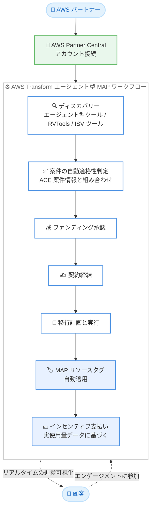

# AWS Transform - Migration Acceleration Program (MAP) 統合による移行案件の加速

**リリース日**: 2026 年 11 月 17 日
**サービス**: AWS Transform
**機能**: Migration Acceleration Program (MAP) のエンドツーエンドなエージェント型ワークフロー統合

📊 [このアップデートのインフォグラフィックを見る](https://takech9203.github.io/aws-news-summary/20261117-map-integration-with-aws-transform.html)

## 概要

AWS パートナーが、Migration Acceleration Program (MAP) の案件を、適格性判定からインセンティブの支払いまで、AWS Transform 内のエンドツーエンドなエージェント型ワークフローで迅速に進められるようになりました。パートナーは AWS Transform から離れることなく、案件の適格性判定、ファンディング承認、契約締結、移行計画と実行、リソースタグ付け、インセンティブの支払いまで、MAP ライフサイクル全体を管理できます。

パートナーは AWS Partner Central アカウントを AWS Transform に接続し、顧客を同じエンゲージメントに招待します。組み込みのエージェント型ディスカバリーツールで顧客環境をスコーピングするか、RVTools や AWS Marketplace に掲載されている AWS 検証済み ISV ツールからデータをインポートして開始できます。AWS Transform はこのディスカバリーデータと APN Customer Engagements (ACE) の案件情報を組み合わせ、ガイド付きフローでパートナー起点の案件を自動的に適格性判定するため、パートナーはより早く判定結果を得て、案件をより速くクローズできます。

移行の進行に応じて MAP リソースタグが自動的に適用され、パートナーへのキャッシュインセンティブと顧客クレジットは実際の使用量データに基づいて支払われます。全工程を通じて、顧客はパートナーとともに移行プロジェクトのリアルタイムな可視性を共有できます。

**アップデート前の課題**

- 案件発掘、アセスメント、適格性判定、ファンディング承認、契約締結、リソースタグ付け、インセンティブ支払いのそれぞれで、別々のシステムを行き来する必要があった
- ステップ間の手動の引き継ぎが発生し、適格性判定のサイクルが長期化していた
- 顧客とパートナーの間で移行プロジェクトの進捗状況をリアルタイムに共有する一元的な手段がなかった

**アップデート後の改善**

- AWS Transform 内で MAP ライフサイクル全体 (適格性判定からインセンティブ支払いまで) を完結できるようになった
- ディスカバリーデータと ACE の案件情報を組み合わせた自動的な適格性判定により、判定結果を早期に取得し、案件のクローズを加速できるようになった
- MAP リソースタグが移行の進行に合わせて自動適用され、インセンティブは実使用量データに基づいて支払われるようになった
- 顧客とパートナーが同一エンゲージメント上で移行プロジェクトをリアルタイムに共有できるようになった

## アーキテクチャ図



AWS Transform 内で MAP ライフサイクル全体が完結する流れを示しています。パートナーは Partner Central アカウントを接続し、ディスカバリーから適格性判定、移行実行、インセンティブ支払いまでを単一のワークフローで進め、顧客はリアルタイムで進捗を共有できます。

## サービスアップデートの詳細

### 主要機能

1. **MAP ライフサイクル全体の一元管理**
   - 案件の適格性判定、ファンディング承認、契約締結、移行計画と実行、リソースタグ付け、インセンティブ支払いを AWS Transform 内で完結
   - 複数システム間の行き来や手動の引き継ぎが不要になり、適格性判定サイクルを短縮
   - パートナーは AWS Partner Central アカウントを接続し、顧客を同じエンゲージメントに招待して開始

2. **エージェント型ディスカバリーとデータインポート**
   - 組み込みのエージェント型ディスカバリーツールで顧客環境をスコーピング
   - RVTools からのデータインポートに対応
   - AWS Marketplace に掲載されている AWS 検証済み ISV ツールからのデータインポートに対応

3. **案件の自動適格性判定**
   - ディスカバリーデータと APN Customer Engagements (ACE) の案件情報を自動的に組み合わせ
   - パートナー起点の案件をガイド付きフローで自動的に適格性判定
   - 判定結果を早期に取得でき、案件のクローズを加速

4. **自動タグ付けと使用量ベースのインセンティブ支払い**
   - 移行の進行に応じて MAP リソースタグを自動適用
   - パートナーへのキャッシュインセンティブと顧客クレジットを実際の使用量データに基づいて支払い
   - 顧客とパートナーが移行プロジェクトのリアルタイムな可視性を共有

## 技術仕様

### MAP ワークフローの比較

| 項目 | アップデート前 | アップデート後 |
|------|----------------|----------------|
| 管理システム | 工程ごとに別々のシステム | AWS Transform で一元管理 |
| 適格性判定 | 手動の引き継ぎを伴う長い判定サイクル | ディスカバリーデータと ACE 情報による自動判定 |
| ディスカバリー | 個別のアセスメントツール | エージェント型ツール、RVTools、検証済み ISV ツール |
| リソースタグ付け | 手動 | 移行の進行に応じて自動適用 |
| インセンティブ支払い | 別システムでの手続き | 実使用量データに基づく支払い |
| 顧客との情報共有 | 限定的 | 同一エンゲージメント上でリアルタイムに共有 |

### API 変更履歴

本アップデートに関連する API 変更は、発表時点で AWS API Changes には公開されていません (2026 年 11 月 17 日時点)。

## 設定方法

### 前提条件

1. AWS Partner Central アカウント (パートナーの場合)
2. AWS Transform がサポートされているリージョンのワークスペース
3. ACE への案件登録 (パートナー起点の案件の自動適格性判定に使用)

### 手順

#### ステップ 1: AWS Partner Central アカウントの接続

AWS Transform にサインインし、AWS Partner Central アカウントを接続します。詳細な手順は AWS Partner Central のユーザーガイド (ログインが必要) を参照するか、担当の Partner Development Manager に問い合わせます。

#### ステップ 2: 顧客のエンゲージメントへの招待

顧客を同じエンゲージメントに招待します。これにより、顧客とパートナーが移行プロジェクトのリアルタイムな可視性を共有できます。

#### ステップ 3: 顧客環境のディスカバリー

組み込みのエージェント型ディスカバリーツールで顧客環境をスコーピングするか、RVTools または AWS Marketplace に掲載されている AWS 検証済み ISV ツールからデータをインポートします。

#### ステップ 4: 適格性判定から移行実行まで

AWS Transform がディスカバリーデータと ACE の案件情報を組み合わせて、ガイド付きフローで案件を自動的に適格性判定します。その後、ファンディング承認、契約締結、移行計画と実行を同じワークフロー内で進めます。移行の進行に応じて MAP リソースタグが自動適用され、インセンティブは実使用量データに基づいて支払われます。

## メリット

### ビジネス面

- **案件クローズの加速**: 適格性判定の結果を早期に取得でき、MAP 案件をより速くクローズできる
- **運用負荷の削減**: 複数システム間の行き来と手動の引き継ぎが不要になり、パートナーの管理工数を削減できる
- **顧客との信頼関係強化**: 顧客が移行プロジェクトの進捗をリアルタイムで共有でき、透明性が向上する

### 技術面

- **エージェント型ワークフロー**: ディスカバリーから適格性判定までをエージェントが自動化し、ガイド付きフローで進められる
- **柔軟なディスカバリー手段**: エージェント型ツールに加え、RVTools や AWS 検証済み ISV ツールのデータをインポートできる
- **自動タグ付けの正確性**: MAP リソースタグが自動適用されるため、タグ漏れによるインセンティブ対象外のリスクを低減できる

## デメリット・制約事項

### 制限事項

- パートナーが利用を開始するには、AWS Partner Central アカウントの接続が必要
- AWS Partner Central ユーザーガイドの参照にはログインが必要
- AWS Transform がサポートされているリージョンでのみ利用可能

### 考慮すべき点

- パートナー起点の案件の自動適格性判定には、ACE への案件情報の登録が前提となる
- インセンティブの支払いは実際の使用量データに基づくため、移行後の使用状況が反映されるまでの期間を考慮する必要がある
- 既存の MAP 案件管理プロセスからの移行手順については、担当の Partner Development Manager への確認を推奨

## ユースケース

### ユースケース 1: パートナー主導の大規模データセンター移行

**シナリオ**: パートナーが顧客のオンプレミス VMware 環境の AWS 移行を提案しており、MAP インセンティブを活用して案件を推進したい。

**実装例**:
```
1. AWS Transform に Partner Central アカウントを接続
2. 顧客をエンゲージメントに招待
3. RVTools のエクスポートデータをインポートして環境をスコーピング
4. ACE の案件情報と組み合わせて自動適格性判定を実行
5. ファンディング承認、契約締結、移行実行を同一ワークフローで進行
```

**効果**: 従来は複数システムを行き来していた適格性判定プロセスを短縮し、案件のクローズと移行開始を早められる。

### ユースケース 2: MAP タグ付けとインセンティブ管理の自動化

**シナリオ**: 移行後の MAP リソースタグの付与漏れにより、インセンティブ申請に手戻りが発生していた。

**実装例**:
```
1. AWS Transform の MAP ワークフローで移行を実行
2. 移行の進行に応じて MAP リソースタグが自動適用されることを確認
3. 実使用量データに基づくパートナーキャッシュと顧客クレジットの
   支払い状況をワークフロー上で追跡
```

**効果**: タグ付けの自動化により手作業のミスを排除し、インセンティブ支払いまでのプロセスを効率化できる。

### ユースケース 3: 顧客とパートナーの共同プロジェクト管理

**シナリオ**: 顧客が移行プロジェクトの進捗を把握できず、パートナーへの個別の状況確認が頻発していた。

**実装例**:
```
1. パートナーが顧客を AWS Transform のエンゲージメントに招待
2. 顧客はパートナーと同じ画面で移行プロジェクトの進捗を
   リアルタイムに確認
```

**効果**: 進捗報告のための個別のやり取りが減り、双方が同じ情報に基づいて意思決定できる。

## 料金

MAP 統合機能自体の追加料金は発表に記載されていません。MAP のインセンティブ (パートナーキャッシュ、顧客クレジット) は実際の使用量データに基づいて支払われます。AWS Transform の料金の詳細は、AWS Transform の料金ページを参照してください。

## 利用可能リージョン

AWS Transform がサポートされているすべての AWS リージョンで利用可能です。ドキュメントによると、AWS Transform は以下のリージョンでワークスペースを作成できます (2026 年 11 月 18 日時点)。

- 米国東部 (バージニア北部)
- アジアパシフィック (ムンバイ)
- アジアパシフィック (ソウル)
- アジアパシフィック (シンガポール) - 移行機能のみ
- アジアパシフィック (シドニー)
- アジアパシフィック (東京)
- カナダ (中部)
- 欧州 (フランクフルト)
- 欧州 (ロンドン)
- 南米 (サンパウロ) - メインフレームモダナイゼーション機能のみ
- AWS GovCloud (US-West) - 移行機能のみ

## 関連サービス・機能

- **AWS Partner Central**: パートナーが案件管理に使用するポータル。AWS Transform に接続することで MAP ワークフローを開始できる
- **APN Customer Engagements (ACE)**: パートナーの案件情報を管理する仕組み。ディスカバリーデータと組み合わせて自動適格性判定に使用される
- **AWS Marketplace**: AWS 検証済み ISV ディスカバリーツールの入手元。ディスカバリーデータのインポートに利用できる
- **AWS Migration Acceleration Program (MAP)**: 移行を加速するための AWS のプログラム。本アップデートによりライフサイクル全体が AWS Transform に統合された

## 参考リンク

- 📊 [インフォグラフィック](https://takech9203.github.io/aws-news-summary/20261117-map-integration-with-aws-transform.html)
- [公式発表 (What's New)](https://aws.amazon.com/about-aws/whats-new/2026/11/map-integration-with-aws-transform/)
- [AWS Migration Acceleration Program (MAP)](https://aws.amazon.com/migration-acceleration-program/)
- [AWS Transform サポートリージョン](https://docs.aws.amazon.com/transform/latest/userguide/regions.html)

## まとめ

MAP 案件のライフサイクル全体が AWS Transform のエージェント型ワークフローに統合され、パートナーは適格性判定からインセンティブ支払いまでを単一の環境で完結できるようになりました。複数システム間の手動の引き継ぎが不要になることで、適格性判定サイクルの短縮と案件クローズの加速が期待できます。移行案件を扱うパートナーは、AWS Partner Central ユーザーガイドを確認するか、担当の Partner Development Manager に問い合わせて利用を開始することを推奨します。
