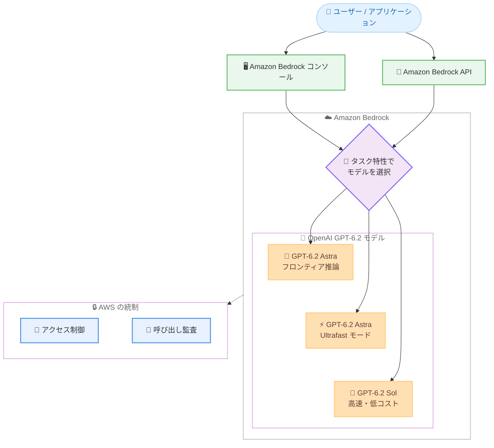

# Amazon Bedrock - OpenAI GPT-6.2 Astra および GPT-6.2 Sol の一般提供開始

**リリース日**: 2026 年 11 月 17 日
**サービス**: Amazon Bedrock
**機能**: OpenAI GPT-6.2 Astra / GPT-6.2 Sol の一般提供 (GA)

📊 [このアップデートのインフォグラフィックを見る](https://takech9203.github.io/aws-news-summary/20261117-openai-gpt-6-2-astra-sol-amazon-bedrock.html)

## 概要

AWS は、OpenAI の最新モデルである GPT-6.2 Astra と GPT-6.2 Sol が Amazon Bedrock で一般提供 (GA) されたことを発表しました。GPT-6.2 Astra はフロンティアレベルの推論力と判断力を備え、複雑なビジネス課題、高度なリサーチ、先進的なコーディングやエージェントワークフローといった要求の高いタスクに対応します。さらに Astra には、低レイテンシーが求められるアプリケーション向けの Ultrafast モードが用意されています。

GPT-6.2 Sol は、明確な成果が求められる反復的なコーディング、エージェント処理、プロフェッショナルワークフロー向けに設計されており、タスクあたりの速度とコストを重視するユースケースに適しています。ソフトウェアの実装とデバッグ、ドキュメントやデータの分析、マルチステップワークフローの自動化など、検証可能な成果を伴う大量処理に向いています。

両モデルとも Amazon Bedrock コンソールまたは対応する Amazon Bedrock API から利用でき、既存の AWS のセキュリティ、アクセスガバナンス、モデル呼び出しの監査の仕組みをそのまま適用できます。

**アップデート前の課題**

このアップデート以前に存在していた課題や制限は以下のとおりです。

- Amazon Bedrock で利用できる OpenAI モデルは GPT-6.1 世代 (GPT-6.1 Sol、GPT-6.1 Terra など) までであり、最新世代のモデルを利用するには Bedrock 以外の環境を検討する必要があった
- フロンティアレベルの推論力と低レイテンシー応答を 1 つのモデルで両立させる選択肢が限られていた
- 高度な推論モデルを大量の反復タスクに適用すると、タスクあたりのコストと速度の面で最適化が難しかった

**アップデート後の改善**

今回のアップデートにより以下が可能になりました。

- OpenAI の最新世代モデル GPT-6.2 Astra / GPT-6.2 Sol を Amazon Bedrock 上で AWS のセキュリティ、ガバナンス、監査の仕組みとともに利用可能になった
- Astra の Ultrafast モードにより、対話型コーディングアシスタントやリアルタイムエージェントなど、レイテンシーが顧客体験を左右するアプリケーションにもフロンティアモデルを適用できるようになった
- タスク特性に応じて Astra (高度な判断が必要な仕事) と Sol (速度とコスト重視の反復処理) を使い分けることで、品質とコストのバランスを最適化できるようになった

## アーキテクチャ図



Amazon Bedrock のコンソールまたは API からタスク特性に応じて GPT-6.2 Astra (Ultrafast モード含む) と GPT-6.2 Sol を選択して利用し、AWS の既存の統制の仕組みでアクセス管理と監査を行う構成を示しています。

## サービスアップデートの詳細

### 主要機能

1. **GPT-6.2 Astra: フロンティアレベルの推論と判断**
   - 複雑なビジネス課題、要求の高いリサーチ、高度なコーディングおよびエージェントワークフローに対応
   - 相反する入力の整合、複雑なコードベースの調査、テキストと画像をまたぐマルチモーダル推論、プロフェッショナルな成果物の作成など、専門家レベルの判断と完成度の高いアウトプットが求められるタスクに適する

2. **GPT-6.2 Astra Ultrafast モード: 低レイテンシー応答**
   - 高速な応答が必要なレイテンシーセンシティブなアプリケーション向けの動作モード
   - 対話型コーディングアシスタント、リアルタイムエージェント、顧客向けアプリケーションなど、レイテンシーが顧客体験を左右する場面での利用が推奨される

3. **GPT-6.2 Sol: 速度とタスクあたりコストの最適化**
   - 成果が明確で検証可能な、反復的かつ大量のワークロード向けに設計
   - ソフトウェアの実装とデバッグ、ドキュメントとデータの分析、マルチステップワークフローの自動化などに適する

4. **AWS の統制との統合**
   - 既存の AWS の仕組みにより、ワークロードの保護、アクセスのガバナンス、モデル呼び出しアクティビティの監査が可能
   - Amazon Bedrock コンソールまたは対応する Amazon Bedrock API からすぐに利用を開始できる

## 技術仕様

### モデルの使い分け

| 項目 | GPT-6.2 Astra | GPT-6.2 Astra Ultrafast | GPT-6.2 Sol |
|------|---------------|------------------------|-------------|
| 位置づけ | フロンティアレベルの推論・判断 | Astra の低レイテンシーモード | 速度とコスト重視 |
| 適したタスク | 複雑な課題解決、リサーチ、高度なコーディング、エージェントワークフロー | 対話型アシスタント、リアルタイムエージェント、顧客向けアプリ | 反復的な大量処理、検証可能な成果を伴うタスク |
| 入力モダリティ | テキストと画像にまたがる推論に対応 | 同左 | テキスト中心のコーディング・分析・自動化 |
| 重視する指標 | 成果物の品質と判断の正確さ | 応答レイテンシー | タスクあたりの速度とコスト |

なお、対応リージョン、エンドポイント、API、機能、推論プロファイル、料金の詳細は [Amazon Bedrock ドキュメントの OpenAI モデルカード](https://docs.aws.amazon.com/bedrock/latest/userguide/model-cards-openai.html)で確認できます。

## 設定方法

### 前提条件

1. AWS アカウントを保有し、Amazon Bedrock へのアクセス権限 (IAM ポリシー) が設定されていること
2. 利用するリージョンで GPT-6.2 Astra / GPT-6.2 Sol へのモデルアクセスが有効化されていること
3. プログラムから利用する場合は、AWS CLI または AWS SDK がセットアップされていること

### 手順

#### ステップ 1: モデルアクセスの有効化

Amazon Bedrock コンソールの [モデルアクセス] ページで、OpenAI GPT-6.2 Astra および GPT-6.2 Sol へのアクセスをリクエストして有効化します。

#### ステップ 2: コンソールでの動作確認

Amazon Bedrock コンソールのプレイグラウンドで GPT-6.2 Astra または GPT-6.2 Sol を選択し、プロンプトを入力して応答を確認します。タスクの特性に応じて Astra と Sol の出力品質や応答速度を比較します。

#### ステップ 3: API からの呼び出し

```bash
# 利用可能な OpenAI モデルの一覧を確認する例
aws bedrock list-foundation-models \
  --by-provider openai \
  --region <リージョン>
```

AWS CLI で Amazon Bedrock の基盤モデル一覧を OpenAI プロバイダーで絞り込んで表示し、GPT-6.2 Astra / GPT-6.2 Sol のモデル ID を確認します。確認したモデル ID を指定して、Amazon Bedrock の対応 API (Converse API など) からアプリケーションに組み込みます。モデル ID と推論プロファイルの詳細は公式ドキュメントを参照してください。

## メリット

### ビジネス面

- **最新モデルへの迅速なアクセス**: OpenAI の最新世代モデルを AWS 環境内でそのまま利用でき、新たな契約や別基盤の運用を追加することなく最先端の AI 機能を事業に取り込める
- **コスト効率の最適化**: 高度な判断が必要な業務には Astra、反復的な大量処理には Sol と使い分けることで、品質を維持しながらタスクあたりのコストを抑制できる
- **顧客体験の向上**: Ultrafast モードにより、応答速度が重要な顧客向けアプリケーションでもフロンティアモデルの品質を活用できる

### 技術面

- **統一されたガバナンス**: 既存の AWS の仕組みでワークロードの保護、アクセス制御、モデル呼び出しの監査を一元的に適用できる
- **既存 API との互換性**: Amazon Bedrock の対応 API を通じて利用できるため、既存の Bedrock ベースのアプリケーションからモデルを切り替えやすい
- **マルチモーダル推論**: Astra はテキストと画像をまたぐ推論に対応しており、ドキュメントや図面を含む複合的なタスクに適用できる

## デメリット・制約事項

### 制限事項

- 対応リージョン、エンドポイント、推論プロファイル、料金の詳細は発表文には含まれておらず、公式ドキュメントでの確認が必要
- 利用開始前にモデルアクセスの有効化が必要
- Ultrafast モードは Astra 向けの機能として案内されており、利用方法の詳細はドキュメントの確認が必要

### 考慮すべき点

- タスク特性 (品質重視か、速度・コスト重視か) に応じた Astra と Sol の使い分け方針を事前に整理することが望ましい
- 既存の GPT-6 / GPT-6.1 世代モデルを利用中の場合は、評価用ワークロードで出力品質・レイテンシー・コストを比較してから移行を判断することが推奨される

## ユースケース

### ユースケース 1: 複雑なコードベースの調査とリファクタリング支援

**シナリオ**: 大規模なレガシーコードベースの依存関係を調査し、リファクタリング方針をまとめた技術ドキュメントを作成したい。

**実装例**:
```
GPT-6.2 Astra を使用し、エージェントワークフローでコードベースを解析。
相反する設計方針を整理し、専門家レベルの判断を含む成果物を生成する。
```

**効果**: 専門家の判断を要する調査作業を効率化し、完成度の高いドキュメントを短時間で得られる。

### ユースケース 2: 対話型コーディングアシスタント

**シナリオ**: 開発者向けの IDE 連携アシスタントで、入力に対して即座に補完や修正案を返したい。

**実装例**:
```
GPT-6.2 Astra の Ultrafast モードを選択し、
リアルタイム性が求められる対話型アプリケーションに組み込む。
```

**効果**: フロンティアモデルの品質を保ちながら低レイテンシーの応答を実現し、開発者体験を向上できる。

### ユースケース 3: ドキュメント処理の大量自動化

**シナリオ**: 日次で大量の帳票やレポートを解析し、定型的なマルチステップワークフローを自動実行したい。

**実装例**:
```
GPT-6.2 Sol を使用し、検証可能な成果を伴う反復タスク
(ドキュメント分析、データ抽出、ワークフロー自動化) をバッチ処理する。
```

**効果**: タスクあたりのコストと処理速度を最適化しながら、大量の定型業務を安定して自動化できる。

## 料金

料金は利用するモデルとリージョンによって異なります。GPT-6.2 Astra / GPT-6.2 Sol の具体的な料金は発表文には記載されていないため、[Amazon Bedrock の料金ページ](https://aws.amazon.com/bedrock/pricing/)および [Amazon Bedrock ドキュメント](https://docs.aws.amazon.com/bedrock/latest/userguide/model-cards-openai.html)で最新情報を確認してください。

## 利用可能リージョン

対応 AWS リージョン、エンドポイント、推論プロファイルの詳細は、[Amazon Bedrock ドキュメントの OpenAI モデルカード](https://docs.aws.amazon.com/bedrock/latest/userguide/model-cards-openai.html)を参照してください。

## 関連サービス・機能

- **Amazon Bedrock**: 複数の基盤モデルを単一の API で利用できるフルマネージドサービス。本アップデートの提供基盤
- **Amazon Bedrock の既存 OpenAI モデル**: GPT-6 Astra、GPT-6.1 Sol、GPT-6.1 Terra、gpt-oss シリーズなどが提供済みであり、GPT-6.2 世代はこれらの後継の選択肢となる
- **AWS IAM / AWS CloudTrail**: モデルへのアクセス制御と呼び出しアクティビティの監査に利用

## 参考リンク

- 📊 [インフォグラフィック](https://takech9203.github.io/aws-news-summary/20261117-openai-gpt-6-2-astra-sol-amazon-bedrock.html)
- [公式発表 (What's New)](https://aws.amazon.com/about-aws/whats-new/2026/11/openai-gpt-6-2-astra-sol-amazon-bedrock/)
- [ドキュメント (OpenAI モデルカード)](https://docs.aws.amazon.com/bedrock/latest/userguide/model-cards-openai.html)
- [料金ページ](https://aws.amazon.com/bedrock/pricing/)

## まとめ

OpenAI の最新世代モデル GPT-6.2 Astra と GPT-6.2 Sol が Amazon Bedrock で一般提供され、フロンティアレベルの推論から低レイテンシー応答、コスト効率の高い大量処理までを AWS の統制の下で使い分けられるようになりました。生成 AI ワークロードを運用中のチームは、公式ドキュメントで対応リージョンと料金を確認のうえ、タスク特性に応じた Astra / Sol の使い分けを評価することを推奨します。
