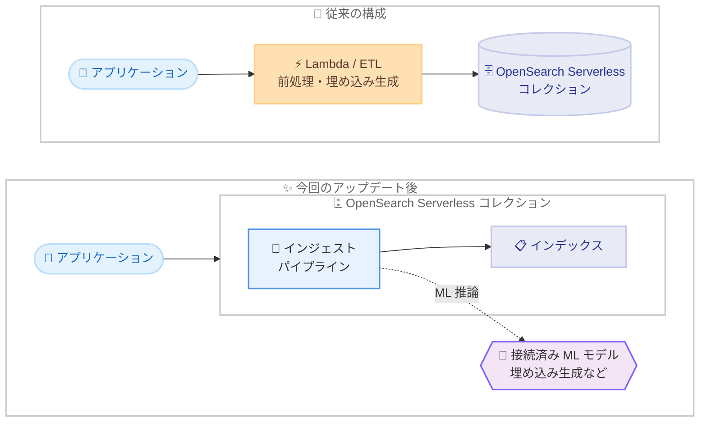

# Amazon OpenSearch Serverless - インジェストパイプラインのサポート

**リリース日**: 2026 年 11 月 17 日
**サービス**: Amazon OpenSearch Serverless
**機能**: インジェストパイプライン (Ingest Pipelines)

📊 [このアップデートのインフォグラフィックを見る](https://takech9203.github.io/aws-news-summary/20261117-opensearch-serverless-support-ingest-pipelines.html)

## 概要

Amazon OpenSearch Serverless がインジェストパイプラインをサポートしました。インジェストパイプラインは、ドキュメントがインデックスされる際にコレクション内部でクリーニング、エンリッチメント、ベクトル化を実行する、順序付けられたプロセッサのシーケンスです。これにより、別途前処理用のインフラストラクチャを用意することなく、データ変換をコレクション側で統一的に適用できます。

これまで Lambda 関数や ETL ジョブに実装していたデータ前処理コードを、パイプライン定義に置き換えることができます。パイプラインはコレクション内で実行されるため、どのクライアントやインテグレーションからドキュメントが送信されても、同じ変換が一貫して適用されます。

特にセマンティック検索や AI 検索のワークロードでは、`text_chunking` による長文の分割や、`text_embedding` などによるインデックス時の埋め込みベクトル生成が可能になり、ベクトル検索基盤の構築が大幅に簡素化されます。

**アップデート前の課題**

これまで OpenSearch Serverless ではインジェストパイプラインが利用できず、以下の課題がありました。

- データの正規化やエンリッチメントを行うには、Lambda 関数や ETL ジョブなどの外部前処理インフラを構築・運用する必要があった
- クライアントごとに前処理コードを実装するため、変換ロジックの重複や不整合が発生しやすかった
- 埋め込みベクトルの生成をアプリケーション側で行う必要があり、セマンティック検索の実装が複雑だった

**アップデート後の改善**

今回のアップデートにより、以下が可能になりました。

- コレクション内部でインデックス時にドキュメントの変換・エンリッチメントを実行できるようになった
- `copy`、`date`、`lowercase`、`rename`、`set`、`trim` などのプロセッサでデータ正規化を宣言的に定義できるようになった
- `text_chunking`、`text_embedding`、`text_image_embedding`、`sparse_encoding`、`ml_inference` プロセッサにより、インデックス時のチャンキングと埋め込み生成が可能になった
- 標準の OpenSearch `_ingest/pipeline` API で管理でき、`_simulate` API で適用前のテストが可能になった

## アーキテクチャ図



従来はアプリケーションと OpenSearch Serverless の間に前処理用の Lambda や ETL が必要でしたが、今回のアップデートにより変換処理をコレクション内部のインジェストパイプラインに集約できます。

## サービスアップデートの詳細

### 主要機能

1. **データ変換プロセッサ**
   - `copy`: ソースフィールドの値をターゲットフィールドにコピー (ソースフィールドは保持)
   - `date`: 日付文字列をパースして正規化されたタイムスタンプを書き込み
   - `dot_expander`: ドットを含むフィールド名をネストされたオブジェクト構造に展開
   - `join`: 配列フィールドの要素をセパレータで連結して 1 つの文字列に変換
   - `lowercase` / `uppercase`: 文字列フィールドの小文字化・大文字化
   - `remove` / `rename` / `set` / `trim`: フィールドの削除、リネーム、静的な値の設定、前後の空白除去

2. **機械学習プロセッサ (ニューラル検索・セマンティックエンリッチメント)**
   - `text_chunking`: 長いテキストを埋め込みモデルのトークン制限に収まるパッセージに分割
   - `text_embedding`: テキストフィールドからセマンティック検索用の密ベクトル埋め込みを生成
   - `text_image_embedding`: テキストと画像からマルチモーダル検索用の結合ベクトル埋め込みを生成
   - `sparse_encoding`: ニューラルスパース検索用のスパースベクトル表現を生成
   - `ml_inference`: 接続済みの任意の ML モデルを呼び出し、入出力フィールドのマッピングをユーザー自身で定義可能
   - ML プロセッサの利用には、設定済みの機械学習モデル接続が必要

3. **パイプラインの管理と適用**
   - 標準の OpenSearch REST API (`_ingest/pipeline`) でパイプラインの作成・更新・取得・一覧・削除が可能
   - `_simulate` API により、本番トラフィックへの適用前にサンプルドキュメントで変換結果をテスト可能
   - インデックスの `index.default_pipeline` 設定によるデフォルト適用、または個別のインデックス / バルクリクエストの `pipeline` クエリパラメータによる指定が可能

## 技術仕様

### サポートされるプロセッサと制限事項

| 項目 | 詳細 |
|------|------|
| データ変換プロセッサ | copy, date, dot_expander, join, lowercase, remove, rename, set, trim, uppercase |
| 機械学習プロセッサ | text_chunking, text_embedding, text_image_embedding, sparse_encoding, ml_inference |
| スクリプト | `script` プロセッサと Painless スクリプトは非サポート |
| Mustache テンプレート | 非サポート。プロセッサの設定値はリテラル値のみ (他フィールド参照は `copy` プロセッサを使用) |
| 非サポートプロセッサ | サポート一覧にないプロセッサを含むパイプラインの作成・更新リクエストは拒否される |
| 反映遅延 | パイプラインの新規作成・更新から反映まで最大 15 秒程度の遅延が発生 |
| リクエスト署名 | サービス名 `aoss` を使用した AWS Signature Version 4 署名が必要 |

### 必要なデータアクセスポリシー権限

パイプライン操作は、`collection` リソースタイプに対する以下の権限にマッピングされます。

- `aoss:CreateCollectionItems`: パイプラインの作成・更新
- `aoss:DescribeCollectionItems`: パイプラインの取得・一覧・シミュレート
- `aoss:DeleteCollectionItems`: パイプラインの削除

```json
[
    {
        "Description": "Manage pipelines",
        "Rules": [
            {
                "ResourceType": "collection",
                "Resource": ["collection/my-collection"],
                "Permission": [
                    "aoss:CreateCollectionItems",
                    "aoss:DescribeCollectionItems",
                    "aoss:DeleteCollectionItems"
                ]
            }
        ],
        "Principal": [
            "arn:aws:iam::123456789012:role/pipeline-admin-role"
        ]
    }
]
```

## 設定方法

### 前提条件

1. OpenSearch Serverless コレクションが作成済みであること
2. データアクセスポリシーでパイプライン操作に必要な権限 (`aoss:CreateCollectionItems` など) が付与されていること
3. ML プロセッサ (`text_embedding` など) を使用する場合は、ニューラル検索用の ML モデル接続が設定済みであること

### 手順

#### ステップ 1: パイプラインの作成

```bash
PUT _ingest/pipeline/my-pipeline
{
  "description": "Normalizes the category field",
  "processors": [
    { "trim": { "field": "category" } },
    { "lowercase": { "field": "category" } },
    { "rename": { "field": "category", "target_field": "category_normalized" } }
  ]
}
```

コレクションエンドポイントに対して `PUT` リクエストを送信し、`category` フィールドの空白除去、小文字化、リネームを順番に実行するパイプラインを作成しています。プロセッサは定義された順序で実行されます。

#### ステップ 2: パイプラインのシミュレート

```bash
POST _ingest/pipeline/my-pipeline/_simulate
{
  "docs": [
    {
      "_index": "my-index",
      "_id": "1",
      "_source": { "category": "  Home Appliances  " }
    }
  ]
}
```

本番トラフィックに適用する前に、サンプルドキュメントに対してパイプラインを実行し、変換結果を確認しています。レスポンスには変換後のドキュメントが含まれ、この例では `category_normalized: "home appliances"` が返されます。

#### ステップ 3: インデックスへの適用

```bash
PUT my-index
{
  "settings": {
    "index.default_pipeline": "my-pipeline"
  }
}
```

インデックス作成時に `index.default_pipeline` を設定し、このインデックスに送信されるすべてのドキュメントにパイプラインを適用しています。個別のリクエストに適用する場合は、`POST my-index/_doc?pipeline=my-pipeline` のように `pipeline` クエリパラメータを指定します。なお、クエリパラメータはインデックスのデフォルトパイプライン設定を上書きし、両者は組み合わされない点に注意してください。

## メリット

### ビジネス面

- **インフラコストの削減**: 前処理専用の Lambda 関数や ETL ジョブが不要になり、構築・運用コストを削減できる
- **開発速度の向上**: セマンティック検索や RAG 向けのベクトル化パイプラインを宣言的な定義だけで構築でき、開発期間を短縮できる
- **データ品質の向上**: すべての取り込み経路で同一の変換が適用されるため、データの一貫性が保証される

### 技術面

- **OpenSearch 標準 API との互換性**: `_ingest/pipeline` API をそのまま利用でき、マネージドドメインやオープンソース OpenSearch の知識を活かせる
- **インデックス時のベクトル生成**: `text_chunking` と `text_embedding` の組み合わせにより、チャンキングと埋め込み生成をコレクション内で完結できる
- **事前テストが可能**: `_simulate` API により、本番適用前に変換結果を安全に検証できる

## デメリット・制約事項

### 制限事項

- オープンソース版 OpenSearch と比較して、利用できるプロセッサは限定されたセットのみ (非サポートプロセッサを含むパイプラインは作成・更新時に拒否される)
- `script` プロセッサおよび Painless スクリプトは利用できない
- Mustache テンプレート (`{{{field_name}}}` 形式の他フィールド参照) は利用できず、設定値はリテラル値のみ
- パイプラインの作成・更新が反映されるまで最大 15 秒程度の遅延がある

### 考慮すべき点

- パイプラインの処理時間はコレクションのインデックス用 OCU を消費するため、プロセッサ数が多い、または計算負荷の高いパイプラインはインデックスキャパシティの消費が増加する
- 自動セマンティックエンリッチメントなどのサービス機能がインデックスのデフォルトパイプラインを管理している場合、`pipeline` クエリパラメータでの上書きや置き換えにより、その機能の処理が実行されなくなる可能性がある
- ML プロセッサで使用するリモートモデルの推論は、モデルプロバイダーから別途課金される

## ユースケース

### ユースケース 1: セマンティック検索向けのインデックス時ベクトル化

**シナリオ**: ドキュメント検索システムで、長文ドキュメントをチャンク分割し、埋め込みベクトルを生成してセマンティック検索を実現したい。

**実装例**:
```json
PUT _ingest/pipeline/nlp-ingest-pipeline
{
  "description": "Chunks text and generates embeddings",
  "processors": [
    {
      "text_chunking": {
        "algorithm": { "fixed_token_length": { "token_limit": 384 } },
        "field_map": { "body": "body_chunks" }
      }
    },
    {
      "text_embedding": {
        "model_id": "my-model-id",
        "field_map": { "body_chunks": "body_embedding" }
      }
    }
  ]
}
```

**効果**: アプリケーション側で埋め込み生成コードを実装することなく、インデックス時に自動でチャンキングとベクトル化が行われ、RAG やセマンティック検索の基盤構築が簡素化される。

### ユースケース 2: ログ・イベントデータの正規化

**シナリオ**: 複数のシステムから送信されるログデータのフィールド名や形式が統一されておらず、検索や集計の精度に問題がある。

**実装例**:
```json
PUT _ingest/pipeline/log-normalize
{
  "description": "Normalizes log fields",
  "processors": [
    { "date": { "field": "event_time", "formats": ["ISO8601"], "target_field": "@timestamp" } },
    { "lowercase": { "field": "log_level" } },
    { "rename": { "field": "src_ip", "target_field": "source.ip" } },
    { "remove": { "field": "debug_info" } }
  ]
}
```

**効果**: 送信元システムごとの前処理実装が不要になり、タイムスタンプの正規化、フィールド名の統一、不要フィールドの削除がコレクション側で一元的に行われる。

### ユースケース 3: Lambda 前処理層の置き換え

**シナリオ**: 現在、データ投入前の整形処理を Lambda 関数で実装しており、その運用・保守の負担を削減したい。

**実装例**:
```json
PUT my-index
{
  "settings": {
    "index.default_pipeline": "my-normalize-pipeline"
  }
}
```

**効果**: インデックスのデフォルトパイプラインとして変換処理を設定することで、Lambda 関数の運用が不要になり、どのクライアントから投入してもデータの一貫性が保たれる。

## 料金

インジェストパイプラインの処理は、コレクションのインデックスリクエストを処理するコンピューティング上で実行されます。パイプラインが消費する処理時間はコレクションのインデックス用 OpenSearch Compute Unit (OCU) にカウントされ、他のインデックス処理と同じ方法で課金されます。プロセッサ数が多いパイプラインや計算負荷の高いプロセッサを含むパイプラインは、シンプルなパイプラインよりも多くのインデックスキャパシティを消費します。

`text_embedding` などの ML プロセッサは、設定したリモートモデルを追加で呼び出すため、モデルの推論はモデルプロバイダーから別途課金されます。

## 利用可能リージョン

Amazon OpenSearch Serverless が利用可能なすべての AWS リージョンで利用できます。詳細は [リージョン別の利用可否一覧](https://docs.aws.amazon.com/general/latest/gr/opensearch-service.html) を参照してください。

## 関連サービス・機能

- **Amazon OpenSearch Service (マネージドドメイン)**: マネージドドメインでは以前からインジェストパイプラインが利用可能であり、今回のアップデートで Serverless でも同等の機能 (サブセット) が利用できるようになった
- **OpenSearch Serverless ニューラル検索 / ハイブリッド検索**: ML プロセッサの利用には ML モデル接続の設定が必要であり、ニューラル検索機能と組み合わせて使用する
- **AWS Lambda / AWS Glue**: これまで前処理に使用していた Lambda 関数や ETL ジョブをインジェストパイプラインに置き換えることで、アーキテクチャを簡素化できる

## 参考リンク

- 📊 [インフォグラフィック](https://takech9203.github.io/aws-news-summary/20261117-opensearch-serverless-support-ingest-pipelines.html)
- [公式発表 (What's New)](https://aws.amazon.com/about-aws/whats-new/2026/11/opensearch-serverless-support-ingest-pipelines)
- [ドキュメント: Ingest pipelines in Amazon OpenSearch Serverless](https://docs.aws.amazon.com/opensearch-service/latest/developerguide/serverless-ingest-pipelines.html)
- [Amazon OpenSearch Serverless 製品ページ](https://aws.amazon.com/opensearch-service/features/serverless/)
- [料金ページ](https://aws.amazon.com/opensearch-service/pricing/)

## まとめ

Amazon OpenSearch Serverless のインジェストパイプラインサポートにより、データの正規化からインデックス時のベクトル化までをコレクション内で完結でき、前処理インフラの構築・運用が不要になります。特にセマンティック検索や RAG を構築しているチームは、`text_chunking` と `text_embedding` プロセッサの活用を検討する価値があります。まずは `_simulate` API でパイプラインの動作を検証し、既存の前処理ロジックの置き換えを評価することを推奨します。
