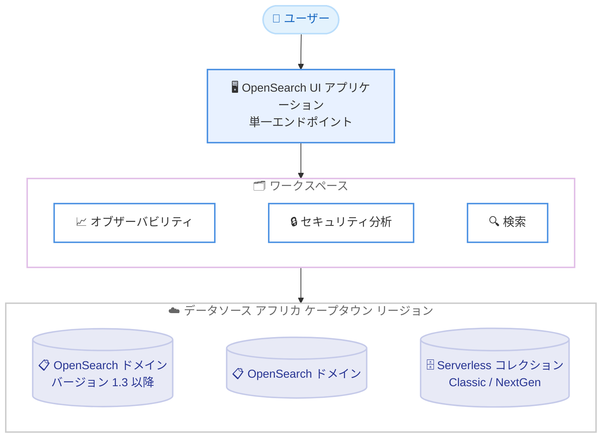

# Amazon OpenSearch Service - OpenSearch UI がアフリカ (ケープタウン) リージョンで利用可能に

**リリース日**: 2026 年 11 月 17 日
**サービス**: Amazon OpenSearch Service
**機能**: OpenSearch UI のアフリカ (ケープタウン) リージョン対応

📊 [このアップデートのインフォグラフィックを見る](https://takech9203.github.io/aws-news-summary/20261117-opensearch-ui-available-africa-cape-town-region.html)

## 概要

Amazon OpenSearch UI が AWS アフリカ (ケープタウン) リージョンに拡大し、利用可能リージョンが 25 リージョンになりました。OpenSearch UI は、OpenSearch バージョン 1.3 以降を実行する Amazon OpenSearch Service ドメインと、OpenSearch Serverless コレクション (Classic および NextGen) をまたいでデータをクエリ、可視化、分析するための単一エンドポイントを提供するマネージドなユーザーインターフェイスです。

1 つの OpenSearch UI アプリケーションは複数のドメインとコレクションに接続できます。ワークスペース機能によりダッシュボード、保存済みクエリなどのコンテンツを整理でき、オブザーバビリティ、セキュリティ分析、検索といった用途別のエクスペリエンスが用意されています。Discover インターフェイスは複数のデータソースと、Piped Processing Language (PPL) や SQL を含む複数のクエリ言語をサポートします。OpenSearch UI はドメインやコレクションとは独立して動作するため、クラスターをアップグレードすることなく最新の UI 機能を利用できます。

**アップデート前の課題**

アフリカ (ケープタウン) リージョンのユーザーには、以下の課題がありました。

- アフリカ (ケープタウン) リージョンでは OpenSearch UI を利用できず、従来の OpenSearch Dashboards を使用する必要があった
- OpenSearch Dashboards はホストする 1 つのドメインまたはコレクションにしか接続できず、複数データソースの横断分析が困難だった
- 最新の UI 機能を利用するには、クラスター自体のバージョンアップグレードが必要だった

**アップデート後の改善**

今回のアップデートにより、以下が可能になりました。

- アフリカ (ケープタウン) リージョンでも OpenSearch UI アプリケーションを作成し、モダンな分析エクスペリエンスを利用できるようになった
- 単一のエンドポイントから複数のドメインとコレクションを横断してクエリ、可視化、分析ができるようになった
- クラスターのアップグレードなしで、常に最新の UI 機能を利用できるようになった

## アーキテクチャ図



OpenSearch UI はドメインやコレクションとは独立した単一エンドポイントとして動作し、1 つのアプリケーションから複数のドメインと Serverless コレクションに接続して、ワークスペース単位で分析エクスペリエンスを提供します。

## サービスアップデートの詳細

### 主要機能

1. **複数データソースへの単一エンドポイント接続**
   - 1 つの OpenSearch UI アプリケーションから複数の OpenSearch ドメインと Serverless コレクションに接続可能
   - OpenSearch バージョン 1.3 以降のドメインと、Classic および NextGen の Serverless コレクションをサポート
   - クロスクラスター検索により、クロスリージョン・クロスアカウントの横断分析にも対応

2. **ワークスペースによるコンテンツ整理**
   - ダッシュボード、保存済みクエリなどのコンテンツをワークスペース単位で整理
   - オブザーバビリティ、セキュリティ分析、検索の用途別エクスペリエンスを提供
   - ワークスペースごとにプライバシー設定とコラボレーターの権限を管理可能

3. **強化された Discover インターフェイス**
   - 複数のデータソースを対象としたクエリに対応
   - Piped Processing Language (PPL) と SQL を含む複数のクエリ言語をサポート
   - データセレクター、クエリオートコンプリート、刷新されたデザインを搭載

4. **クラスターから独立した UI 基盤**
   - OpenSearch UI は AWS クラウド上でホストされ、ドメインやコレクションとは独立して動作
   - クラスターのアップグレード中も UI は稼働を継続
   - クラスターをアップグレードすることなく最新の UI 機能を利用可能

## 技術仕様

### OpenSearch UI の主な仕様

| 項目 | 詳細 |
|------|------|
| 対応データソース | OpenSearch ドメイン (バージョン 1.3 以降)、OpenSearch Serverless コレクション (Classic / NextGen) |
| クエリ言語 | PPL、SQL、Lucene、Dashboards Query Language (DQL) |
| 認証 | AWS IAM Identity Center、IAM フェデレーションによる SAML |
| アプリケーション数の上限 | 1 アカウント・1 リージョンあたり 30 (Service Quotas で 50 まで自動承認、それ以上はサポートチケット) |
| ワークスペース数の上限 | 1 アプリケーションあたり 100 (引き上げ可能) |
| 作成方法 | Amazon OpenSearch Service コンソール、AWS CLI、AWS SDK |

### 必要な IAM 権限

OpenSearch UI アプリケーションへのアクセスには、以下の IAM 権限が必要です。

```json
{
  "Version": "2012-10-17",
  "Statement": [
    {
      "Effect": "Allow",
      "Action": [
        "es:GetApplication",
        "es:DescribeApplication",
        "es:ListApplications"
      ],
      "Resource": "*"
    }
  ]
}
```

## 設定方法

### 前提条件

1. アフリカ (ケープタウン) リージョン (af-south-1) が AWS アカウントで有効化されていること
2. 接続対象の OpenSearch ドメイン (バージョン 1.3 以降) または Serverless コレクションが存在すること
3. OpenSearch UI アプリケーションの作成とアクセスに必要な IAM 権限があること

### 手順

#### ステップ 1: OpenSearch UI アプリケーションの作成

```bash
aws opensearch create-application \
  --region af-south-1 \
  --name my-opensearch-ui \
  --data-sources '[{"dataSourceArn": "arn:aws:es:af-south-1:123456789012:domain/my-domain"}]'
```

アフリカ (ケープタウン) リージョンに OpenSearch UI アプリケーションを作成し、既存の OpenSearch ドメインをデータソースとして関連付けます。コンソールからは Amazon OpenSearch Service の [Applications] メニューからも作成できます。

#### ステップ 2: アプリケーションの状態確認

```bash
aws opensearch list-applications --region af-south-1

aws opensearch get-application \
  --region af-south-1 \
  --id <application-id>
```

作成したアプリケーションの一覧と詳細を取得し、ステータスが `ACTIVE` になっていること、およびアクセス用のエンドポイント URL を確認します。

#### ステップ 3: ワークスペースの作成と利用

アプリケーションのエンドポイント URL にアクセスし、用途 (オブザーバビリティ、セキュリティ分析、検索など) に応じたワークスペースを作成します。ワークスペース内でデータソースを選択し、Discover インターフェイスから PPL や SQL でクエリを実行して、ダッシュボードや保存済みクエリをチームで共有します。

## メリット

### ビジネス面

- **データレジデンシー要件への対応**: アフリカ (ケープタウン) リージョン内で完結した分析環境を構築でき、データ主権やコンプライアンス要件を満たしやすくなる
- **追加コストなし**: OpenSearch UI 自体は無料で利用でき、接続先のドメインとコレクションの料金のみが発生する
- **チームコラボレーションの促進**: ワークスペースによる権限管理とコンテンツ整理で、チーム単位の分析業務を効率化できる

### 技術面

- **運用負荷の軽減**: UI がクラスターから独立しているため、クラスターアップグレード時も UI は稼働を継続し、UI の最新機能のためにアップグレードする必要がない
- **横断分析の実現**: 単一エンドポイントから複数のドメインとコレクションに接続し、統合されたビューで分析できる
- **柔軟なクエリ言語**: PPL、SQL、Lucene、DQL から用途に応じたクエリ言語を選択できる

## デメリット・制約事項

### 制限事項

- 接続できるドメインは OpenSearch バージョン 1.3 以降に限られる
- OpenSearch UI アプリケーションは 1 アカウント・1 リージョンあたりデフォルト 30 個まで (Service Quotas で引き上げ可能)
- ワークスペースは 1 アプリケーションあたり最大 100 個 (引き上げにはサポートチケットが必要)

### 考慮すべき点

- 既存の OpenSearch Dashboards から移行する場合、保存済みオブジェクトの移行手順 (エクスポート / インポート) を検討する必要がある
- ユーザーに `es:GetApplication`、`es:DescribeApplication`、`es:ListApplications` の IAM 権限を付与しないとアクセス拒否エラーになる

## ユースケース

### ユースケース 1: 複数ドメインを横断するオブザーバビリティ基盤

**シナリオ**: アフリカ (ケープタウン) リージョンで複数の OpenSearch ドメインにアプリケーションログとメトリクスを分散して保存しており、障害調査のたびに各ドメインの Dashboards を行き来している。

**実装例**:
```
1. af-south-1 に OpenSearch UI アプリケーションを作成
2. ログ用ドメインとメトリクス用ドメインをデータソースとして関連付け
3. オブザーバビリティ用ワークスペースを作成し、PPL で横断クエリを実行
```

**効果**: 単一エンドポイントからすべてのドメインを横断して調査でき、障害対応の時間を短縮できる。

### ユースケース 2: セキュリティ分析チームの統合ビュー

**シナリオ**: セキュリティログを OpenSearch Serverless コレクションに、監査ログをプロビジョンドドメインに保存しており、セキュリティチームが統合的に分析したい。

**実装例**:
```
1. OpenSearch UI アプリケーションに Serverless コレクションとドメインの両方を関連付け
2. セキュリティ分析用ワークスペースを作成し、チームメンバーに権限を付与
3. 共有ダッシュボードと保存済みクエリで分析結果を共有
```

**効果**: Serverless とプロビジョンドの両環境を 1 つの UI で分析でき、セキュリティ運用を一元化できる。

### ユースケース 3: クラスターアップグレード中も止まらない分析環境

**シナリオ**: OpenSearch ドメインのバージョンアップグレード中に Dashboards が利用できず、分析業務が中断してしまう。

**実装例**:
```
1. OpenSearch Dashboards から OpenSearch UI へ利用を移行
2. 保存済みオブジェクトを OpenSearch UI のワークスペースへ移行
3. アップグレード作業中も OpenSearch UI 経由で他のデータソースを分析
```

**効果**: UI がクラスターから独立しているため、アップグレード中も分析環境が稼働を継続する。

## 料金

OpenSearch UI は追加料金なしで利用できます。料金は OpenSearch UI が接続するドメインおよびコレクションに対してのみ発生します。

## 利用可能リージョン

今回のアフリカ (ケープタウン) リージョン追加により、OpenSearch UI は 25 の AWS リージョンで利用可能になりました。主なリージョンは以下のとおりです。

- **新規追加**: アフリカ (ケープタウン)
- 米国東部 (バージニア北部、オハイオ)、米国西部 (北カリフォルニア、オレゴン)
- アジアパシフィック (東京、大阪、ソウル、シンガポール、シドニー、ムンバイ、ハイデラバード、香港)
- 欧州 (アイルランド、ロンドン、パリ、フランクフルト、ストックホルム、ミラノ、スペイン、チューリッヒ)
- カナダ (中部)、南米 (サンパウロ)
- AWS GovCloud (米国東部、米国西部)

最新の対応リージョン一覧は [OpenSearch UI endpoints and quotas](https://docs.aws.amazon.com/opensearch-service/latest/developerguide/opensearch-ui-endpoints-quotas.html) を参照してください。

## 関連サービス・機能

- **Amazon OpenSearch Service**: OpenSearch UI が接続するマネージド検索・分析サービス。ドメインのプロビジョニングと運用を担う
- **Amazon OpenSearch Serverless**: サーバーレスの検索・分析環境。Classic および NextGen コレクションを OpenSearch UI から分析できる
- **AWS IAM Identity Center**: OpenSearch UI のシングルサインオンを実現する ID 管理サービス
- **Amazon Q Developer**: OpenSearch UI と連携し、自然言語によるクエリ生成や可視化の支援を提供

## 参考リンク

- 📊 [インフォグラフィック](https://takech9203.github.io/aws-news-summary/20261117-opensearch-ui-available-africa-cape-town-region.html)
- [公式発表 (What's New)](https://aws.amazon.com/about-aws/whats-new/2026/11/opensearch-ui-available-africa-cape-town-region)
- [ドキュメント: Using OpenSearch UI in Amazon OpenSearch Service](https://docs.aws.amazon.com/opensearch-service/latest/developerguide/application.html)
- [ドキュメント: OpenSearch UI endpoints and quotas](https://docs.aws.amazon.com/opensearch-service/latest/developerguide/opensearch-ui-endpoints-quotas.html)
- [料金ページ: Amazon OpenSearch Service](https://aws.amazon.com/opensearch-service/pricing/)

## まとめ

OpenSearch UI がアフリカ (ケープタウン) リージョンに対応し、利用可能リージョンが 25 に拡大しました。同リージョンで OpenSearch Service を利用しているユーザーは、追加料金なしで複数データソースの横断分析とモダンな UI を利用できるようになります。OpenSearch Dashboards を利用中の場合は、クラスターから独立して稼働する OpenSearch UI への移行を検討することを推奨します。
