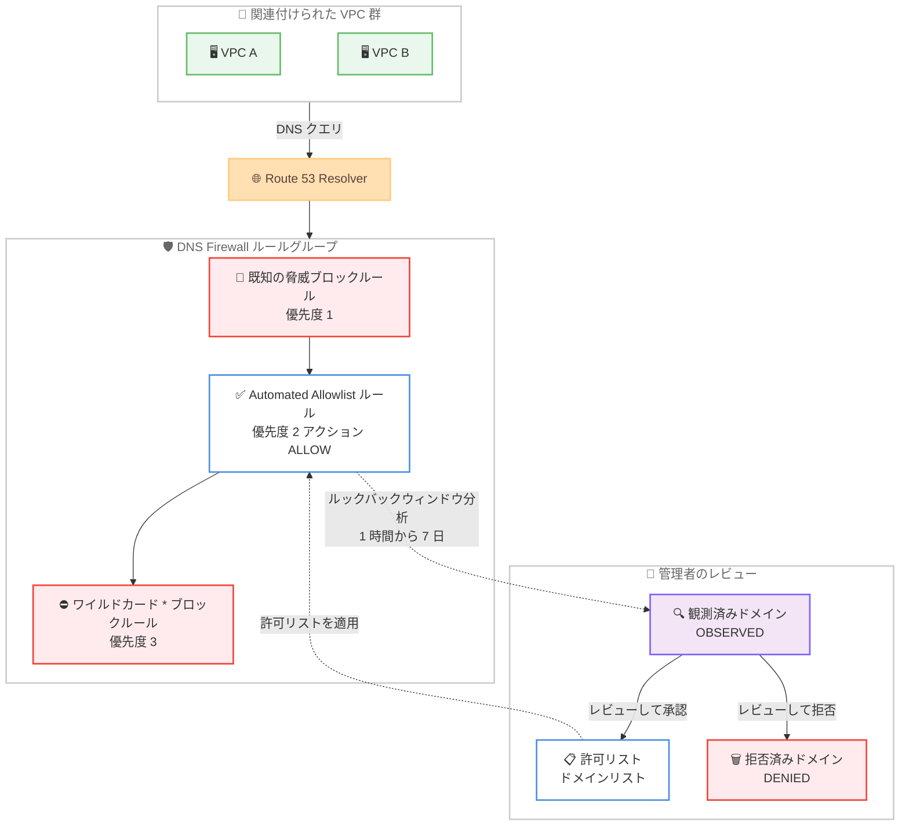

# Amazon Route 53 Resolver DNS Firewall - 自動許可リスト生成のサポート

**リリース日**: 2026 年 11 月 17 日
**サービス**: Amazon Route 53 Resolver DNS Firewall
**機能**: Automated Allowlists (自動許可リスト生成)

📊 [このアップデートのインフォグラフィックを見る](https://takech9203.github.io/aws-news-summary/20261117-route-53-dns-firewall-auto-allowlists.html)

## 概要

Amazon Route 53 Resolver DNS Firewall が、VPC で観測された DNS クエリトラフィックからドメイン許可リスト (Allow List) を自動生成する機能をサポートしました。これにより、最小権限の DNS アクセス制御を容易に実現し、DNS を悪用したデータ漏えい (DNS Exfiltration) のリスクを低減できます。

本機能では、1 時間から 7 日間で設定可能なルックバックウィンドウを使用して DNS クエリトラフィックを分析し、観測されたドメインの一覧を作成します。その後も DNS クエリを継続的にモニタリングし、新たに観測されたドメインをフラグ付けするため、管理者はレビューしてから許可リストに追加できます。許可されたドメイン以外をすべてブロックする「ウォールドガーデン (walled-garden)」構成への移行を、運用負荷を抑えながら段階的に進められます。

本機能は DNS Firewall Advanced の利用者向けに追加料金なしで提供され、AWS Firewall Manager や Route 53 Profiles を使用して複数の VPC やアカウントに展開できます。セキュリティチームや、マルチアカウント環境で DNS セキュリティポリシーを統制するプラットフォームチームに特に有用なアップデートです。

**アップデート前の課題**

- 最小権限モデルを実装するには、セキュリティチームが DNS クエリログを手動で分析し、VPC が依存するドメインを特定してから許可リストルールを展開する必要があった
- 手動分析による運用負荷が大きく、デフォルト拒否 (deny-by-default) 体制の適用が遅延していた
- ワークロードが必要とするすべてのドメインを事前に把握することが困難で、正規の通信を誤ってブロックするリスクがあった

**アップデート後の改善**

- DNS Firewall が VPC の DNS クエリトラフィックを自動分析し、観測されたドメインの許可リスト候補を自動生成できるようになった
- 新たに観測されたドメインが自動的にフラグ付けされ、管理者はレビュー後に許可リストへ追加するワークフローを実現できるようになった
- AWS Firewall Manager や Route 53 Profiles を使用して、複数の VPC やアカウントへルールを一括展開できるようになった

## アーキテクチャ図



VPC からの DNS クエリを DNS Firewall が分析して観測済みドメインを生成し、管理者がレビューして許可リストに追加します。既知の脅威ブロックルールを最も高い優先度、ワイルドカードのブロックルールを最も低い優先度に配置することで、ウォールドガーデン構成を実現します。

## サービスアップデートの詳細

### 主要機能

1. **ルックバックウィンドウによる初期許可リストの自動生成**
   - ルール作成時に 1 時間から 7 日間 (1 週間) のルックバックウィンドウ (分析タイムフレーム) を指定する
   - DNS Firewall が、ルールグループに関連付けられたすべての VPC の DNS クエリトラフィックを分析し、クエリされたドメインを「観測済みドメイン (OBSERVED)」として一覧化する
   - Route 53 Profiles 経由で関連付けられた VPC や、AWS Firewall Manager / AWS RAM で共有された他アカウントの VPC のトラフィックも分析対象に含まれる
   - ルックバックウィンドウはルール作成後に変更できない

2. **新規ドメインの継続的な検出とレビューワークフロー**
   - ルール作成後は、関連付けられた VPC からのクエリをいずれかの DNS Firewall ルールがブロックした際に、そのドメインが観測済みドメインに追加される
   - 観測済みドメインには、総リクエスト数、日次頻度、初回観測日時が表示され、フィルタリングやソートが可能
   - 管理者はレビュー後に「許可リストに追加 (ADD)」または「拒否 (DENY)」を選択できる
   - ドメインは `OBSERVED` (観測済み)、`ALLOWED` (許可済み)、`DENIED` (拒否済み) の 3 つのステータスで管理される

3. **既存の許可リストからのインポート**
   - すでに独自の許可リストでウォールドガーデン構成を運用している場合、既存のドメインリストから Automated Allowlist ルールへドメインを一度だけコピーして開始できる
   - インポート元は自身が所有する完成済みのリージョナルなドメインリストである必要がある (AWS マネージドドメインリストは不可)
   - インポート後、2 つのリストは独立して管理される

4. **ワイルドカードドメインのサポート**
   - ルールのドメインリストには `*.example.com` のようなワイルドカードドメインを追加でき、サブドメインを一括で許可できる
   - 観測されていないドメインを手動で許可リストに追加することも可能 (1 回あたり最大 1,000 ドメイン)

5. **マルチアカウント・マルチ VPC への展開**
   - AWS Firewall Manager または Route 53 Profiles を使用して、複数の VPC やアカウントにルールを展開できる
   - 共有ルールグループでは、すべての VPC のトラフィックが統合されて分析される

## 技術仕様

### Automated Allowlist ルールの仕様

| 項目 | 詳細 |
|------|------|
| ルールアクション | 常に `ALLOW` (すべての DNS クエリタイプに適用) |
| ルックバックウィンドウ | 1 時間から 7 日間 (作成後の変更不可) |
| ルールグループあたりのルール数 | Automated Allowlist ルールは 1 つのみ |
| ステータスごとのドメイン保持数 | 最大 10,000 ドメイン |
| ドメインステータス | `OBSERVED` / `ALLOWED` / `DENIED` |
| スコープ | リージョナル |
| ドメインリスト名 | `AutoAllowlist - {ルール名}` として自動作成 |
| 展開方法 | AWS Firewall Manager、Route 53 Profiles、AWS RAM |
| 必要なティア | DNS Firewall Advanced |

### 許可リストの更新オペレーション

| オペレーション | 説明 |
|------|------|
| `ADD` | ドメインを承認して許可リストに追加 (未観測ドメインやワイルドカードも追加可能) |
| `REMOVE` | 許可リストからドメインを削除 |
| `DENY` | 観測済みドメインを拒否 (完全一致のドメイン名のみ、ワイルドカード不可) |

## 設定方法

### 前提条件

1. DNS Firewall Advanced を利用できること (Automated Allowlist ルールは Advanced ルールとして課金される)
2. 1 つ以上の VPC に関連付けられた DNS Firewall ルールグループが存在すること
3. ルールの作成・更新に必要な Route 53 Resolver の IAM 権限があること

### 手順

#### ステップ 1: Automated Allowlist ルールの作成

```bash
aws route53resolver create-firewall-rule \
    --creator-request-id my-request-id \
    --firewall-rule-group-id rslvr-frg-0123456789example \
    --name my-automated-allowlist \
    --priority 100 \
    --action ALLOW \
    --firewall-rule-type '{"AutoAllowlist":{"InitialDataTimeframeHours":24}}'
```

ルールグループに Automated Allowlist ルールを作成します。`InitialDataTimeframeHours` でルックバックウィンドウ (この例では 24 時間) を指定します。レスポンスにはルールの `FirewallThreatProtectionId` と、ルール用に作成されたドメインリストの `AutoAllowlistFirewallDomainListId` が含まれ、以降のドメインのレビューと更新に使用します。既存のドメインリストからインポートする場合は、`AutoAllowlist` に `"ImportFromFirewallDomainListId":"{ドメインリスト ID}"` を追加します。

#### ステップ 2: 観測済みドメインのレビュー

```bash
aws route53resolver list-firewall-rule-domains \
    --firewall-rule-group-id rslvr-frg-0123456789example \
    --firewall-threat-protection-id 0123456789example \
    --query-options DomainStatus=OBSERVED,SortBy=TOTAL_REQUESTS,SortOrder=DESC
```

観測済みドメインを総リクエスト数の多い順に一覧表示します。各ドメインには直近 24 時間のリクエスト数、総リクエスト数、追加日時が含まれます。`DomainStatus` を `ALLOWED` または `DENIED` に変更すると、許可済み・拒否済みドメインを確認できます。

#### ステップ 3: ドメインの承認・拒否

```bash
aws route53resolver update-firewall-domains \
    --firewall-domain-list-id rslvr-fdl-0123456789example \
    --operation ADD \
    --domains example.com "*.example.org"
```

レビューしたドメインを許可リストに追加します。ワイルドカードドメインを指定するとサブドメインを一括で許可できます。ドメインを拒否する場合は `--operation DENY`、許可リストから削除する場合は `--operation REMOVE` を指定します。許可の反映には最大 1 時間かかる場合があります。

#### ステップ 4: ワイルドカードブロックルールの追加

必要なドメインをすべて許可リストに追加した後、ワイルドカード `*` を含むドメインリストを使用した `BLOCK` アクションのルールを、Automated Allowlist ルールより低い優先度 (大きい優先度番号) で追加します。これにより、許可リストにないドメインへの DNS クエリがすべてブロックされるウォールドガーデン構成が完成します。追加前に、コンソールの Analysis タブと許可済みドメインを比較し、Resolver クエリログで CNAME などのリダイレクト先ドメインも許可リストに追加されていることを確認してください。

## メリット

### ビジネス面

- **セキュリティ体制の迅速な強化**: 手動のログ分析が不要になり、デフォルト拒否のウォールドガーデン体制への移行を大幅に加速できる
- **運用コストの削減**: DNS クエリログの手動分析と許可リストのメンテナンスにかかるセキュリティチームの工数を削減できる
- **追加コストなし**: DNS Firewall Advanced の利用者は追加料金なしで利用できる

### 技術面

- **最小権限の DNS アクセス制御**: 実際に観測されたトラフィックに基づく許可リストにより、DNS 経由のデータ漏えいや C2 通信のリスクを低減できる
- **継続的なモニタリング**: ルール作成後も新規ドメインが自動的にフラグ付けされ、レビューワークフローに組み込める
- **スケーラブルな展開**: AWS Firewall Manager や Route 53 Profiles により、マルチアカウント・マルチ VPC 環境へ一貫したポリシーを展開できる

## デメリット・制約事項

### 制限事項

- DNS Firewall Advanced の利用者のみが対象 (Advanced ルールとしての課金が発生する)
- 1 つのルールグループに作成できる Automated Allowlist ルールは 1 つのみ
- ルックバックウィンドウはルール作成後に変更できない
- 各ステータス (`OBSERVED` / `ALLOWED` / `DENIED`) で保持されるドメインは最大 10,000 件で、上限に達すると既存ドメインへのクエリが止まるまで新しいドメインは追加されない
- ルール用のドメインリストは直接削除や他ルールでの再利用、内容の置き換えができず、ドメインリストのクォータにカウントされる
- AWS GovCloud (US) および中国リージョンでは利用できない

### 考慮すべき点

- CNAME レコードなどのリダイレクトチェーンに含まれるドメインも検査対象となるため、ワイルドカードブロックルールを追加する前に Resolver クエリログでリダイレクト先を確認し、許可リストに追加する必要がある
- 観測済みドメインには他のルール (既知の脅威ブロックルールなど) がブロックしたドメインも含まれるため、脅威ブロックルールを Automated Allowlist ルールより高い優先度に配置し、脅威ドメインを誤って許可しないようにする必要がある
- ルール作成後に関連付けた VPC の過去のトラフィックは分析されず、関連付け以降のクエリのみが対象となる
- 共有ルールグループでは全 VPC のトラフィックが統合され、どの VPC やアカウントがクエリしたかは表示されない
- ルールを削除するとドメインリストも削除され、観測済み・拒否済みドメインは新しいルールに引き継がれない
- ルックバックウィンドウ期間のドメインのうち、VPC がクエリし続けていてブロックされないドメインは、ルール作成から約 1 日で `ALLOWED` に移行するため、作成後は早めに観測済みドメインをレビューする必要がある

## ユースケース

### ユースケース 1: 本番 VPC のウォールドガーデン化

**シナリオ**: 金融系ワークロードを稼働する本番 VPC で、承認済みドメイン以外へのすべての DNS 解決をブロックし、DNS 経由のデータ漏えいを防止したい。しかし、ワークロードが依存する外部ドメインを網羅的に把握できていない。

**実装例**:
```bash
# 7 日間のルックバックウィンドウで Automated Allowlist ルールを作成
aws route53resolver create-firewall-rule \
    --creator-request-id prod-allowlist-request \
    --firewall-rule-group-id rslvr-frg-0123456789example \
    --name prod-auto-allowlist \
    --priority 100 \
    --action ALLOW \
    --firewall-rule-type '{"AutoAllowlist":{"InitialDataTimeframeHours":168}}'
```

**効果**: 7 日分の実トラフィックに基づく許可リストが自動生成され、正規の通信を遮断するリスクを抑えながらデフォルト拒否体制へ移行できる。

### ユースケース 2: マルチアカウント環境への一括展開

**シナリオ**: 組織内の数十アカウントにまたがる VPC に対して、統一された DNS 許可リストポリシーを適用したい。

**実装例**:
```
1. セキュリティアカウントで Automated Allowlist ルールを含むルールグループを作成
2. Route 53 Profiles にルールグループを追加し、AWS RAM で組織内に共有
3. 各アカウントの VPC に Profile を関連付け
4. 全 VPC の統合トラフィックから観測済みドメインをレビューし、許可リストを整備
```

**効果**: アカウントごとの個別設定が不要になり、組織全体で一貫した最小権限の DNS ポリシーを運用できる。

### ユースケース 3: 新規ドメインの検出による不審な通信の早期発見

**シナリオ**: ウォールドガーデン構成の運用中に、マルウェア感染などによる未知のドメインへの DNS クエリを早期に検出し、対応したい。

**実装例**:
```bash
# 新たに観測されブロックされたドメインを定期的に確認
aws route53resolver list-firewall-rule-domains \
    --firewall-rule-group-id rslvr-frg-0123456789example \
    --firewall-threat-protection-id 0123456789example \
    --query-options DomainStatus=OBSERVED,SortBy=ADDED_TIME,SortOrder=DESC
```

**効果**: ブロックされた新規ドメインがフラグ付けされるため、正規のドメインは承認し、不審なドメインは拒否するトリアージ運用を確立でき、インシデントの早期発見につながる。

## 料金

Automated Allowlist ルールは DNS Firewall Advanced ルールとして課金されます。本機能自体は DNS Firewall Advanced の利用者に追加料金なしで提供されます。詳細は [Amazon Route 53 の料金ページ](https://aws.amazon.com/route53/pricing/) を参照してください。

## 利用可能リージョン

Route 53 DNS Firewall がサポートされているすべての AWS リージョンで利用可能です。ただし、AWS GovCloud (US) および中国リージョンは除きます。

## 関連サービス・機能

- **Amazon Route 53 Resolver DNS Firewall Advanced**: 本機能の前提となるティア。DGA や DNS トンネリングなどの高度な DNS 脅威の検出も提供する
- **AWS Firewall Manager**: 組織内の複数アカウントと VPC へのルールグループの一括展開と統制に使用する
- **Amazon Route 53 Profiles**: DNS 関連設定 (ルールグループ、Resolver ルール、プライベートホストゾーンなど) を複数 VPC へまとめて適用する
- **AWS Resource Access Manager (AWS RAM)**: ルールグループやクエリログ設定を他アカウントと共有する
- **Route 53 Resolver クエリログ**: CNAME などのリダイレクト先ドメインの確認や、許可リストの網羅性検証に使用する

## 参考リンク

- 📊 [インフォグラフィック](https://takech9203.github.io/aws-news-summary/20261117-route-53-dns-firewall-auto-allowlists.html)
- [公式発表 (What's New)](https://aws.amazon.com/about-aws/whats-new/2026/11/route-53-dns-firewall-auto-allowlists/)
- [ドキュメント: Automated Allowlists](https://docs.aws.amazon.com/Route53/latest/DeveloperGuide/firewall-advanced-automated-allowlists.html)
- [ドキュメント: DNS Firewall Advanced Rules](https://docs.aws.amazon.com/Route53/latest/DeveloperGuide/firewall-advanced.html)
- [Amazon Route 53 Resolver DNS Firewall 製品ページ](https://aws.amazon.com/route53/resolver-dns-firewall/)
- [料金ページ](https://aws.amazon.com/route53/pricing/)

## まとめ

Route 53 Resolver DNS Firewall の自動許可リスト生成により、これまで手動のログ分析が必要だったデフォルト拒否 (ウォールドガーデン) 構成への移行を、実トラフィックに基づいて効率的に進められるようになりました。DNS Firewall Advanced を利用中で DNS 経由のデータ漏えい対策を強化したい場合は、まず本番前環境でルックバックウィンドウを設定して観測済みドメインのレビュー運用を試し、脅威ブロックルールとの優先度設計を確認した上で、ワイルドカードブロックルールの追加によるウォールドガーデン化を検討することを推奨します。
