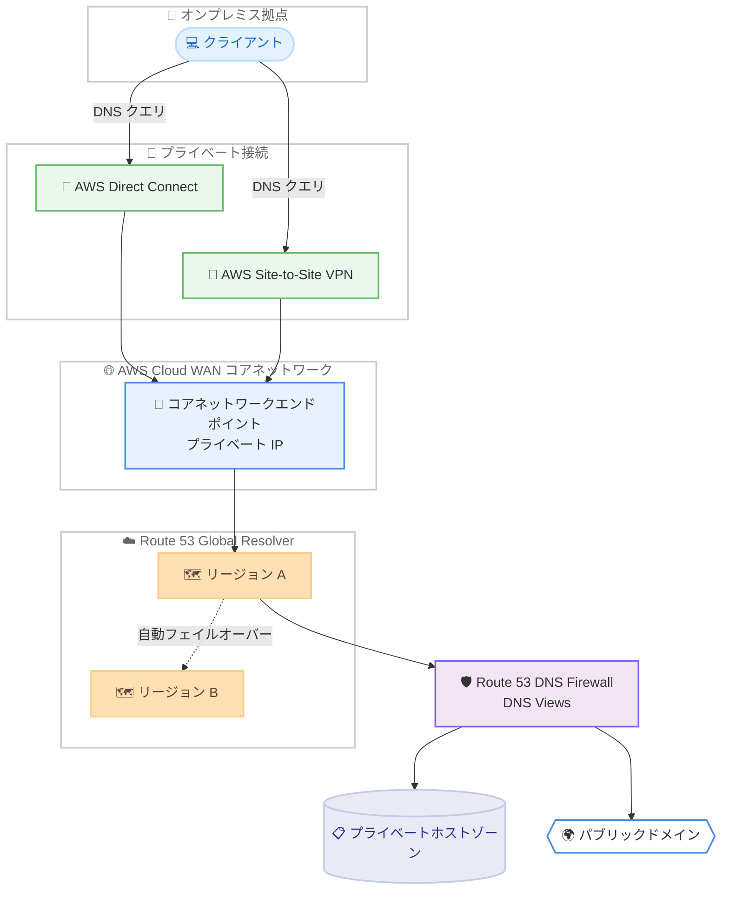

# Amazon Route 53 - Global Resolver の AWS Cloud WAN 対応

**リリース日**: 2026 年 11 月 17 日
**サービス**: Amazon Route 53 (Global Resolver)、AWS Cloud WAN
**機能**: Amazon Route 53 Global Resolver is now available over AWS Cloud WAN for hybrid networks

📊 [このアップデートのインフォグラフィックを見る](https://takech9203.github.io/aws-news-summary/20261117-route-53-global-resolver-cloud-wan.html)

## 概要

Amazon Route 53 Global Resolver が、AWS Cloud WAN 設定で管理されるプライベート接続経由での anycast DNS 解決をサポートしました。これにより、ハイブリッドネットワークを運用する組織は、既存の AWS Direct Connect または AWS VPN 接続を介して、パブリックドメインとプライベートドメインの両方の DNS クエリを解決できるようになります。高可用性のための自動マルチリージョンフェイルオーバーも利用できます。

Route 53 Global Resolver は、anycast IP アドレスを使用して DNS クエリをクエリ送信元に最も近い AWS リージョンへ自動的にルーティングする DNS リゾルバーです。これまではインターネット到達可能な anycast IP を前提としていましたが、今回のアップデートにより、インターネットアクセスを持たないクライアントやコンプライアンス要件で制限されているクライアントも、Cloud WAN ネットワーク経由のプライベート接続で Global Resolver のメリットを享受できます。

対象ユーザーは、オンプレミス拠点や支社、リモート環境を AWS とプライベート接続で結び、DNS 解決の一元管理とセキュリティ強化を求める企業です。

**アップデート前の課題**

- 以前は、各 AWS リージョンと顧客拠点ごとに個別の Resolver エンドポイントをデプロイ・管理する必要があり、リージョン間の自動フェイルオーバーもなかった
- または、インターネット到達可能な anycast IP を使用する Global Resolver を利用する必要があり、インターネットアクセスを持たないクライアントや、コンプライアンス要件で制限されたクライアントは anycast DNS 解決を活用できなかった
- プライベート接続のみの環境では、リージョン間の高可用性と一元的な DNS フィルタリングの両立が困難だった

**アップデート後の改善**

- Cloud WAN ネットワーク上のプライベート接続を持つクライアントが、自動リージョンフェイルオーバーによる高可用性を利用できるようになった
- Route 53 DNS Firewall による一元的な DNS フィルタリングで、DNS ベースのデータ漏洩を防止できるようになった
- パブリックインターネットドメインと Route 53 でホストされるプライベートドメインの両方を、単一のリゾルバーで簡単に解決できるようになった
- 新しい `publicIpStatus` 設定により、パブリック IP を無効化して Cloud WAN 経由のみで到達可能なリゾルバーを構成できるようになった

## アーキテクチャ図



オンプレミスクライアントの DNS クエリは、Direct Connect または VPN から Cloud WAN コアネットワーク上のプライベート IP (コアネットワークエンドポイント) に転送され、最寄りのリージョンの Global Resolver が DNS Firewall と DNS Views を適用した上でパブリック・プライベートドメインを解決します。リージョン障害時は別リージョンへ自動フェイルオーバーします。

## サービスアップデートの詳細

### 主要機能

1. **Cloud WAN 経由のプライベート anycast DNS 解決**
   - Cloud WAN ネットワーク設定に Global Resolver を関連付け、プライベート接続経由で DNS クエリを解決
   - 既存の AWS Direct Connect または AWS VPN 接続をそのまま利用可能
   - Cloud WAN 内で使用中のアドレスと競合しない、プライベートにルーティング可能な IP アドレス (IPv4、IPv6) を 1 つ以上選択して利用

2. **自動マルチリージョンフェイルオーバー**
   - 2 つ以上の AWS リージョンで Global Resolver を有効化することで、リージョン間の自動フェイルオーバーを実現
   - 従来の Resolver エンドポイント方式では実現できなかった高可用性を提供

3. **一元的な DNS セキュリティとフィルタリング**
   - Route 53 DNS Firewall による集中管理された DNS フィルタリングで、DNS ベースのデータ漏洩 (data exfiltration) を防止
   - DNS Views を定義し、Cloud WAN のどのセグメントにどのプライベートホストゾーンと DNS フィルタリングルールを適用するかを指定可能

4. **パブリック IP の無効化オプション**
   - 新しい `publicIpStatus` 設定 (`ENABLED_RESERVED`、`DISABLED_RESERVED`、`DISABLED_RELEASED`) により、パブリック IP を無効化し、Cloud WAN 経由のみで到達可能なリゾルバーを構成可能
   - インターネット到達性を許可できないコンプライアンス要件の厳しい環境に対応

## 技術仕様

### 新しいリソースと設定項目

| 項目 | 詳細 |
|------|------|
| コアネットワークエンドポイント | Global Resolver を Cloud WAN コアネットワークに接続するエンドポイント。プライベート IP アドレス (IPv4、IPv6)、DNS ラベル、リージョンスコープ (ALL または REGIONAL) を設定 |
| アクセスソース | `coreNetworkEndpointId` と Cloud WAN の `segment` を指定し、セグメント単位でアクセス元を定義。DNS View との紐付けも可能 |
| 対応プロトコル | Do53、DoH、DoT (`DO53`、`DOH`、`DOT`) |
| publicIpStatus | `ENABLED_RESERVED`、`DISABLED_RESERVED`、`DISABLED_RELEASED` からパブリック IP の状態を選択 |
| IP アドレスタイプ | IPv4 またはデュアルスタック (IPv4/IPv6) |

### API 変更履歴

| 日付 | サービス | 変更内容 |
|------|----------|----------|
| 2026/11/17 | [Amazon Route 53 Global Resolver](https://awsapichanges.com/archive/changes/a370bc-route53globalresolver.html) | 5 new 9 updated api methods - コアネットワークエンドポイント管理 API (`CreateCoreNetworkEndpoint`、`GetCoreNetworkEndpoint`、`UpdateCoreNetworkEndpoint`、`DeleteCoreNetworkEndpoint`、`ListCoreNetworkEndpoints`) の追加。`CreateGlobalResolver` などへの `publicIpStatus` パラメータ追加、アクセスソース API への `coreNetworkEndpointId` と `segment` の追加 |

### コアネットワークエンドポイント作成 API の例

```python
response = client.create_core_network_endpoint(
    coreNetworkArn='arn:aws:networkmanager::123456789012:core-network/core-network-xxxx',
    globalResolverId='gr-xxxxxxxx',
    name='my-core-network-endpoint',
    ipAddresses=[
        {
            'ipv4Address': '10.100.0.53',
            'dnsLabel': 'dns-primary',
            'regionScope': 'ALL'
        }
    ]
)
```

## 設定方法

### 前提条件

1. AWS Cloud WAN コアネットワークが構築済みで、オンプレミス拠点が AWS Direct Connect または AWS VPN で接続されていること
2. Global Resolver と AWS Cloud WAN の両方が利用可能な AWS リージョンを使用すること
3. Cloud WAN 内で使用中のアドレスと競合しない、プライベートにルーティング可能な IP アドレスを用意すること

### 手順

#### ステップ1: Global Resolver の有効化

```bash
aws route53globalresolver create-global-resolver \
  --name "hybrid-dns-resolver" \
  --regions "ap-northeast-1" "us-east-1" \
  --ip-address-type DUAL_STACK \
  --public-ip-status DISABLED_RESERVED
```

2 つ以上の AWS リージョンを指定して Global Resolver を作成します。`--public-ip-status DISABLED_RESERVED` を指定すると、パブリック IP を無効化して Cloud WAN 経由のみで到達可能な構成になります。

#### ステップ2: Cloud WAN ネットワーク設定への関連付け

```bash
aws route53globalresolver create-core-network-endpoint \
  --core-network-arn "arn:aws:networkmanager::123456789012:core-network/core-network-xxxx" \
  --global-resolver-id "gr-xxxxxxxx" \
  --name "cwan-dns-endpoint" \
  --ip-addresses '[{"ipv4Address":"10.100.0.53","dnsLabel":"dns-primary","regionScope":"ALL"}]'
```

Global Resolver を Cloud WAN コアネットワークに接続するコアネットワークエンドポイントを作成します。Cloud WAN 内で競合しないプライベート IP アドレスを 1 つ以上指定します。

#### ステップ3: DNS Views とアクセスソースの定義

```bash
aws route53globalresolver create-access-source \
  --core-network-endpoint-id "cne-xxxxxxxx" \
  --segment "production" \
  --dns-view-id "view-xxxxxxxx" \
  --protocol DO53 \
  --name "prod-segment-access"
```

Cloud WAN のセグメントごとにアクセスソースを作成し、どのプライベートホストゾーンと DNS フィルタリングルールを適用するかを DNS View で指定します。

#### ステップ4: オンプレミスクライアントの設定

オンプレミスの DNS フォワーダーまたはクライアントの DNS 設定で、Global Resolver に構成したプライベート IP アドレス (例: 10.100.0.53) へ DNS クエリを転送するよう設定します。

## メリット

### ビジネス面

- **コンプライアンス対応**: インターネットアクセスが制限される規制業種でも、プライベート接続のみで anycast DNS 解決と DNS セキュリティを利用可能
- **運用コスト削減**: リージョンや拠点ごとの Resolver エンドポイント管理が不要になり、DNS インフラの運用負荷を削減
- **セキュリティ強化**: Route 53 DNS Firewall による一元的なフィルタリングで、組織全体の DNS ベースのデータ漏洩リスクを低減

### 技術面

- **高可用性**: anycast とマルチリージョン構成による自動リージョンフェイルオーバーで、単一リージョン障害時も DNS 解決を継続
- **統合された名前解決**: パブリックドメインと Route 53 プライベートホストゾーンの両方を単一のリゾルバーで解決
- **柔軟なアクセス制御**: Cloud WAN セグメント単位で DNS Views を割り当て、セグメントごとに異なる解決ポリシーとフィルタリングルールを適用可能

## デメリット・制約事項

### 制限事項

- Global Resolver と AWS Cloud WAN の両方が利用可能な AWS リージョンでのみ利用可能
- 自動リージョンフェイルオーバーを利用するには、2 つ以上の AWS リージョンで Global Resolver を有効化する必要がある
- 選択するプライベート IP アドレスは、Cloud WAN 内で既に使用中のアドレスと競合してはならない

### 考慮すべき点

- AWS Cloud WAN を利用していないハイブリッドネットワーク (Transit Gateway のみの構成など) では、本機能の対象外となるため、ネットワーク構成の見直しが必要
- オンプレミスクライアント側の DNS 転送設定の変更が必要となるため、段階的な移行計画を検討することが望ましい
- DNS Views とセグメントの対応関係を事前に設計し、意図しないゾーン解決やフィルタリング漏れがないか確認が必要

## ユースケース

### ユースケース1: インターネットアクセスが制限された金融機関のハイブリッド DNS

**シナリオ**: コンプライアンス要件によりインターネットへの直接アクセスが禁止されているオンプレミスシステムから、AWS 上のプライベートホストゾーンと許可されたパブリックドメインを解決したい。

**実装例**:
```
1. publicIpStatus を DISABLED_RESERVED に設定した Global Resolver を作成
2. Cloud WAN コアネットワークにコアネットワークエンドポイントを作成
3. Direct Connect 経由でオンプレミスから DNS クエリを転送
4. DNS Firewall で許可ドメインのみを通過させるルールを適用
```

**効果**: インターネット経路を一切使わずに、高可用性の DNS 解決と厳格なドメインフィルタリングを両立できる。

### ユースケース2: 多拠点企業のリージョン間 DNS フェイルオーバー

**シナリオ**: 国内外の複数拠点を Cloud WAN で接続しており、従来は各リージョンに Resolver エンドポイントを個別にデプロイしていたが、リージョン障害時のフェイルオーバーを自動化したい。

**実装例**:
```
1. 東京とシンガポールなど 2 つ以上のリージョンで Global Resolver を有効化
2. 各拠点の DNS フォワーダーを Global Resolver のプライベート anycast IP に向ける
3. 既存のリージョンごとの Resolver エンドポイントを段階的に廃止
```

**効果**: 最寄りリージョンでの低レイテンシー解決と、障害時の自動フェイルオーバーを実現し、エンドポイント管理の運用負荷を削減できる。

### ユースケース3: Cloud WAN セグメントごとの DNS ポリシー分離

**シナリオ**: 本番セグメントと開発セグメントを Cloud WAN で分離しており、セグメントごとに解決可能なプライベートホストゾーンとフィルタリングルールを変えたい。

**実装例**:
```
1. 本番用と開発用の 2 つの DNS Views を作成し、それぞれに
   プライベートホストゾーンと DNS Firewall ルールを関連付け
2. セグメントごとにアクセスソースを作成し、対応する DNS View を割り当て
3. 各セグメントのクライアントから名前解決の動作を検証
```

**効果**: 単一の Global Resolver で、セグメントごとに異なる DNS 解決ポリシーとセキュリティポリシーを一元管理できる。

## 料金

Route 53 Global Resolver の料金体系が適用されます。料金の詳細は [Amazon Route 53 の料金ページ](https://aws.amazon.com/route53/pricing/)を参照してください。また、AWS Cloud WAN、AWS Direct Connect、AWS VPN の利用料金が別途発生します。

## 利用可能リージョン

Global Resolver と AWS Cloud WAN の両方が利用可能な AWS リージョンで利用できます。Global Resolver は米国東部 (バージニア北部)、米国東部 (オハイオ)、米国西部 (オレゴン)、欧州 (フランクフルト)、欧州 (アイルランド)、アジアパシフィック (東京)、アジアパシフィック (大阪)、アジアパシフィック (シンガポール) など 30 リージョンで利用可能です。最新のリージョン一覧は[開発者ガイド](https://docs.aws.amazon.com/Route53/latest/DeveloperGuide/gr-what-is-global-resolver.html)を参照してください。

## 関連サービス・機能

- **AWS Cloud WAN**: グローバルネットワークを一元管理するサービス。本アップデートで Global Resolver との統合が実現し、コアネットワーク経由のプライベート DNS 解決が可能になった
- **AWS Direct Connect / AWS VPN**: オンプレミスと AWS を接続するプライベート接続サービス。既存の接続をそのまま DNS クエリの経路として利用できる
- **Route 53 DNS Firewall**: DNS クエリのフィルタリングサービス。Global Resolver と組み合わせて DNS ベースのデータ漏洩を防止
- **Route 53 Resolver エンドポイント**: 従来のハイブリッド DNS 解決手段。リージョンごとの個別デプロイが必要で自動フェイルオーバーがない点が Global Resolver との違い

## 参考リンク

- 📊 [インフォグラフィック](https://takech9203.github.io/aws-news-summary/20261117-route-53-global-resolver-cloud-wan.html)
- [公式発表 (What's New)](https://aws.amazon.com/about-aws/whats-new/2026/11/route-53-global-resolver-cloud-wan/)
- [Route 53 Global Resolver 製品ページ](https://aws.amazon.com/route53/global-resolver/)
- [Route 53 Global Resolver 開発者ガイド](https://docs.aws.amazon.com/Route53/latest/DeveloperGuide/gr-what-is-global-resolver.html)
- [料金ページ](https://aws.amazon.com/route53/pricing/)

## まとめ

Route 53 Global Resolver の AWS Cloud WAN 対応により、インターネットアクセスを持たないハイブリッド環境のクライアントも、anycast ベースの高可用な DNS 解決と一元的な DNS セキュリティを利用できるようになりました。Cloud WAN を利用中で、リージョンごとの Resolver エンドポイント管理に課題を感じている場合は、Global Resolver への移行を検討する価値があります。まずは 2 つ以上のリージョンで Global Resolver を有効化し、開発セグメントでの動作検証から始めることを推奨します。
