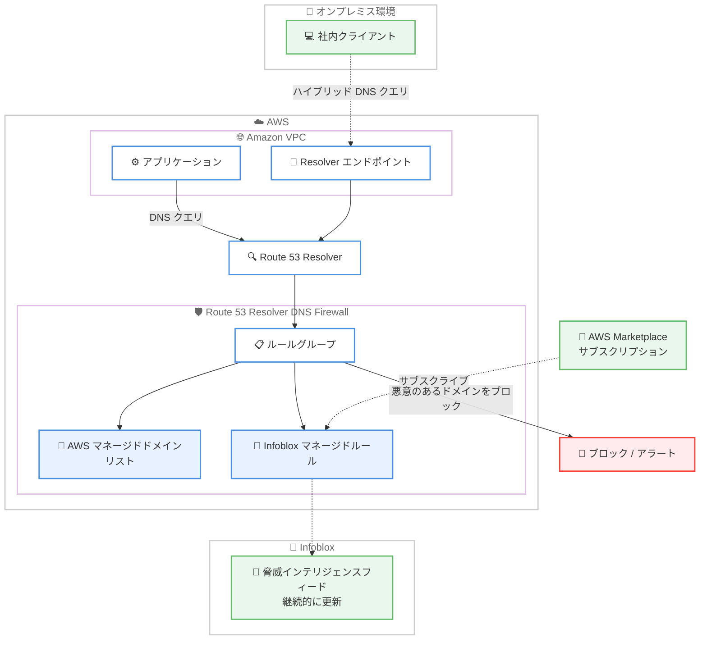

# Amazon Route 53 - Resolver DNS Firewall での Infoblox Threat Defense サポート (プレビュー)

**リリース日**: 2026 年 11 月 17 日
**サービス**: Amazon Route 53 Resolver DNS Firewall
**機能**: Infoblox Threat Defense on Route 53 Resolver DNS Firewall (Preview)

📊 [このアップデートのインフォグラフィックを見る](https://takech9203.github.io/aws-news-summary/20261117-route53-dns-firewall-infoblox-preview.html)

## 概要

AWS は、Amazon Route 53 Resolver DNS Firewall における Infoblox Threat Defense のプレビュー提供を発表しました。セキュリティ管理者は、Route 53 DNS Firewall コンソールから AWS Marketplace の Infoblox 製品リスティングをサブスクライブすることで、Infoblox の脅威インテリジェンスを DNS Firewall ルールに直接適用し、Amazon VPC 内のアプリケーションをサイバー脅威から事前に保護できるようになります。

今回のアップデートにより、DNS Firewall のルールグループに Infoblox のマネージドルールを追加し、悪意のあるドメインや高リスクドメインへのクエリを DNS レイヤーでフィルタリング・ブロックできます。Infoblox は脅威インテリジェンスフィードを継続的に更新しており、フィッシング、マルウェア、ランサムウェアなどの高度な攻撃からクラウドワークロードを事前に保護します。保護は VPC からの DNS クエリに加えて、Route 53 Resolver エンドポイント経由で転送されるハイブリッドトラフィックにも適用できるため、セキュリティチームは AWS とオンプレミス環境の間で一貫した DNS ポリシーを維持しつつ、AWS マネージドドメインリストの上にもう一層の保護を追加できます。

公式ドキュメントによると、本統合では別途 DNS セキュリティアプライアンスをデプロイしたり、VPC のルーティングを変更したり、DNS トラフィックを外部の検査ポイントへ転送したりする必要はありません。既存の DNS Firewall のルールとルールグループの仕組みをそのまま使用して、Infoblox の保護を適用できます。

**アップデート前の課題**

このアップデート以前には、以下の課題がありました。

- DNS Firewall で利用できる脅威インテリジェンスは AWS マネージドドメインリストと独自ドメインリストに限られており、サードパーティの脅威インテリジェンスを直接利用できなかった
- Infoblox などパートナーの DNS 脅威インテリジェンスを利用するには、別途 DNS セキュリティアプライアンスの展開や DNS トラフィックの外部転送といった追加のインフラ構築が必要だった
- 複数の VPC やアカウントにまたがる環境では、独立した DNS セキュリティ基盤の運用によりコストと運用の複雑さが増大していた

**アップデート後の改善**

今回のアップデートにより、以下が可能になりました。

- Route 53 DNS Firewall コンソールから AWS Marketplace の Infoblox リスティングをサブスクライブし、Infoblox のマネージドルールを既存のルールグループに直接追加できるようになった
- 脅威レベル別 (情報レベルからクリティカルまで) にグループ化された Infoblox の脅威インテリジェンスフィードを、追加インフラなしで DNS クエリのフィルタリングに利用できるようになった
- VPC からの DNS クエリと、Resolver エンドポイント経由のハイブリッドトラフィックの両方に同じ保護を適用し、AWS とオンプレミスで一貫した DNS ポリシーを維持できるようになった

## アーキテクチャ図



VPC 内のアプリケーションとオンプレミスからのハイブリッド DNS クエリが Route 53 Resolver を経由する際に、DNS Firewall のルールグループに追加した Infoblox マネージドルールで評価され、悪意のあるドメインへのクエリが DNS レイヤーでブロックされる流れを示しています。

## サービスアップデートの詳細

### 主要機能

1. **Infoblox マネージドルールの DNS Firewall への直接統合**
   - Route 53 DNS Firewall コンソールから AWS Marketplace の Infoblox 製品リスティングをサブスクライブし、既存の DNS Firewall ルールグループに Infoblox のルールを追加できる
   - 別途 DNS セキュリティアプライアンスの展開、VPC ルーティングの変更、外部検査ポイントへの DNS トラフィック転送は不要
   - 既存の DNS Firewall のルールとルールグループの管理方法をそのまま利用できる

2. **脅威レベル別の脅威インテリジェンスフィード**
   - Infoblox の DNS 脅威インテリジェンスフィードは、脅威レベル別 (情報レベルからクリティカルまで) にグループ化されて提供される
   - Infoblox がフィードを継続的に更新し、フィッシング、マルウェア、ランサムウェアなどの高度な攻撃からワークロードを事前に保護する
   - AWS マネージドドメインリストに加えて、もう一層の保護を追加できる

3. **ハイブリッド環境での一貫した DNS ポリシー**
   - VPC からの DNS クエリに加えて、Route 53 Resolver エンドポイント経由で転送されるハイブリッドトラフィックにも保護を適用できる
   - セキュリティチームは AWS とオンプレミス環境の間で一貫した DNS セキュリティポリシーを維持できる
   - 複数の VPC やアカウントで個別の DNS セキュリティ基盤を運用する必要がなくなり、コストと運用の複雑さを削減できる

## 技術仕様

### 機能概要

| 項目 | 詳細 |
|------|------|
| 提供形態 | プレビュー |
| 統合先 | Amazon Route 53 Resolver DNS Firewall のルールグループ |
| サブスクリプション | AWS Marketplace の Infoblox 製品リスティング (DNS Firewall コンソールから実施) |
| 必要なプラン | DNS Firewall Advanced プランのルール設定が必要 |
| 保護対象 | VPC からの DNS クエリ、Resolver エンドポイント経由のハイブリッドトラフィック |
| 脅威フィード | Infoblox が継続的に更新 (脅威レベル別にグループ化) |
| 対象の脅威 | フィッシング、マルウェア、ランサムウェアなどの高度な攻撃 |

## 設定方法

### 前提条件

公式ドキュメントによると、Infoblox によるパートナーマネージド DNS 脅威保護を利用するには、以下が必要です。

1. DNS Firewall と AWS Marketplace に対する適切な IAM 権限を持つ AWS アカウント
2. 作成済みの DNS Firewall ルールグループ (ワークフロー中に新規作成することも可能)
3. ルールに対する Advanced プランの料金オプションの選択 (パートナーマネージド DNS 脅威保護に必須。DNS Firewall ルール作成時に選択可能)

### 手順

#### ステップ 1: AWS Marketplace で Infoblox リスティングをサブスクライブ

Route 53 DNS Firewall コンソールから、AWS Marketplace の Infoblox Threat Defense for Route 53 DNS Firewall の製品リスティングをサブスクライブします。プレビュー期間中、Infoblox のサブスクリプションは無料です。

#### ステップ 2: ルールグループに Infoblox マネージドルールを追加

DNS Firewall のルールグループに Infoblox のマネージドルールを追加します。ルールには Advanced プランの料金オプションを選択する必要があります。脅威レベル別にグループ化されたフィードから、適用したい保護を選択します。

#### ステップ 3: ルールグループを VPC に関連付け

ルールグループを保護対象の VPC に関連付けます。これにより、VPC からの DNS クエリと、Resolver エンドポイント経由で転送されるハイブリッドトラフィックに Infoblox の保護が適用されます。

詳細な手順は [Route 53 DNS Firewall ドキュメント](https://docs.aws.amazon.com/Route53/latest/DeveloperGuide/firewall-partner-infoblox.html)を参照してください。

## メリット

### ビジネス面

- **インフラコストの削減**: 複数の VPC やアカウントにまたがる個別の DNS セキュリティ基盤が不要になり、コストと運用の複雑さを削減できる
- **プレビュー期間中は追加費用なし**: DNS Firewall Advanced の利用者は追加の DNS Firewall 料金なしで Infoblox ルールを既存のルールグループに追加でき、AWS Marketplace の Infoblox サブスクリプションもプレビュー期間中は無料
- **事前防御によるリスク低減**: Infoblox の継続的に更新される脅威インテリジェンスにより、フィッシングやランサムウェアなどの攻撃を DNS レイヤーで事前にブロックできる

### 技術面

- **既存ワークフローとの統合**: 使い慣れた DNS Firewall のルールとルールグループの仕組みをそのまま利用でき、学習コストが低い
- **多層防御の強化**: AWS マネージドドメインリストの上に Infoblox の脅威インテリジェンスを重ねることで、DNS レイヤーの防御を強化できる
- **ハイブリッド環境での一貫性**: VPC とオンプレミスの両方からの DNS クエリに同じポリシーを適用でき、ポリシーの分断を防げる

## デメリット・制約事項

### 制限事項

- 現時点ではプレビュー提供であり、一般提供 (GA) 時に仕様や料金が変更される可能性がある
- パートナーマネージド DNS 脅威保護の利用には、ルールに対する DNS Firewall Advanced プランの選択が必要
- AWS Marketplace での Infoblox サブスクリプションが前提となる (プレビュー期間中は無料)

### 考慮すべき点

- GA 後の Infoblox サブスクリプション料金は AWS Marketplace のリスティングで確認が必要
- 脅威レベル別フィードの適用範囲 (どのレベルまでブロックするか) は、業務影響とセキュリティ要件のバランスを考慮して設計する必要がある
- 既存の AWS マネージドドメインリストや独自ドメインリストとのルール優先度の設計を見直す必要がある

## ユースケース

### ユースケース 1: マルチアカウント環境での DNS セキュリティ統合

**シナリオ**: 多数の AWS アカウントと VPC を運用する企業が、各環境に個別の DNS セキュリティアプライアンスを展開しており、運用負荷とコストが課題となっている。

**実装例**:
```
1. DNS Firewall コンソールから Infoblox リスティングをサブスクライブ
2. Infoblox マネージドルールを含むルールグループを作成 (Advanced プラン)
3. AWS Firewall Manager や AWS RAM を活用して各 VPC にルールグループを展開
```

**効果**: 個別アプライアンスの運用が不要になり、全アカウントで一貫した DNS 脅威保護を低い運用負荷で実現できる。

### ユースケース 2: ハイブリッド環境での一貫した DNS ポリシー適用

**シナリオ**: オンプレミスのデータセンターと AWS を併用する企業が、オンプレミスからの DNS クエリにも AWS と同じ脅威保護を適用したい。

**実装例**:
```
1. Route 53 Resolver インバウンドエンドポイントを構成
2. オンプレミス DNS から Resolver エンドポイントへクエリを転送
3. Infoblox マネージドルールを含むルールグループで転送トラフィックを保護
```

**効果**: AWS とオンプレミスの両環境で一貫した DNS セキュリティポリシーを維持し、ハイブリッド環境全体の防御を強化できる。

### ユースケース 3: フィッシング・ランサムウェア対策の強化

**シナリオ**: 金融機関などセキュリティ要件の高い組織が、AWS マネージドドメインリストに加えてサードパーティの脅威インテリジェンスで DNS レイヤーの防御を強化したい。

**実装例**:
```
1. 既存の DNS Firewall ルールグループに Infoblox マネージドルールを追加
2. 脅威レベルがクリティカル・高のフィードはブロック、中・低はアラートに設定
3. Resolver クエリログで検知状況をモニタリングし、設定を調整
```

**効果**: マルウェアの C2 通信やフィッシングドメインへのアクセスを DNS レイヤーで事前に遮断し、多層防御を実現できる。

## 料金

DNS Firewall Advanced の利用者は、追加の DNS Firewall 料金なしで Infoblox ルールを既存のルールグループに追加できます。AWS Marketplace での Infoblox サブスクリプションは、プレビュー期間中は無料です。

Route 53 の料金の詳細は [Route 53 料金ページ](https://aws.amazon.com/route53/pricing/)を、Infoblox Threat Defense for Route 53 DNS Firewall の AWS Marketplace リスティングと料金については [AWS Marketplace のページ](https://aws.amazon.com/marketplace/pp/prodview-sempmhxl3aqgg)を参照してください。

## 利用可能リージョン

Route 53 Resolver DNS Firewall が利用可能なすべての AWS 商用リージョンでプレビュー提供されています。

## 関連サービス・機能

- **Amazon Route 53 Resolver DNS Firewall**: 本アップデートの統合先。VPC からの DNS クエリをドメインリストやマネージドルールでフィルタリングするサービス
- **Route 53 Resolver エンドポイント**: オンプレミスと AWS 間の DNS クエリ転送を実現し、ハイブリッドトラフィックへの Infoblox 保護適用の基盤となる
- **AWS Marketplace**: Infoblox Threat Defense のサブスクリプションを提供するプラットフォーム
- **AWS Firewall Manager**: 複数アカウント・VPC への DNS Firewall ルールグループの一元展開に活用できる

## 参考リンク

- 📊 [インフォグラフィック](https://takech9203.github.io/aws-news-summary/20261117-route53-dns-firewall-infoblox-preview.html)
- [公式発表 (What's New)](https://aws.amazon.com/about-aws/whats-new/2026/11/route53-dns-firewall-infoblox-preview/)
- [ドキュメント (Using partner managed DNS threat protection with Infoblox in DNS Firewall)](https://docs.aws.amazon.com/Route53/latest/DeveloperGuide/firewall-partner-infoblox.html)
- [料金ページ (Amazon Route 53)](https://aws.amazon.com/route53/pricing/)
- [AWS Marketplace (Infoblox Threat Defense for Route 53 DNS Firewall)](https://aws.amazon.com/marketplace/pp/prodview-sempmhxl3aqgg)

## まとめ

Route 53 Resolver DNS Firewall に Infoblox Threat Defense が統合されたことで、追加のインフラなしにサードパーティの脅威インテリジェンスを DNS レイヤーの防御に組み込めるようになりました。DNS Firewall Advanced を利用中、またはハイブリッド環境で一貫した DNS セキュリティポリシーを求めている場合は、プレビュー期間中に無料で Infoblox ルールを評価し、既存の AWS マネージドドメインリストとの組み合わせによる多層防御の効果を検証することを推奨します。
