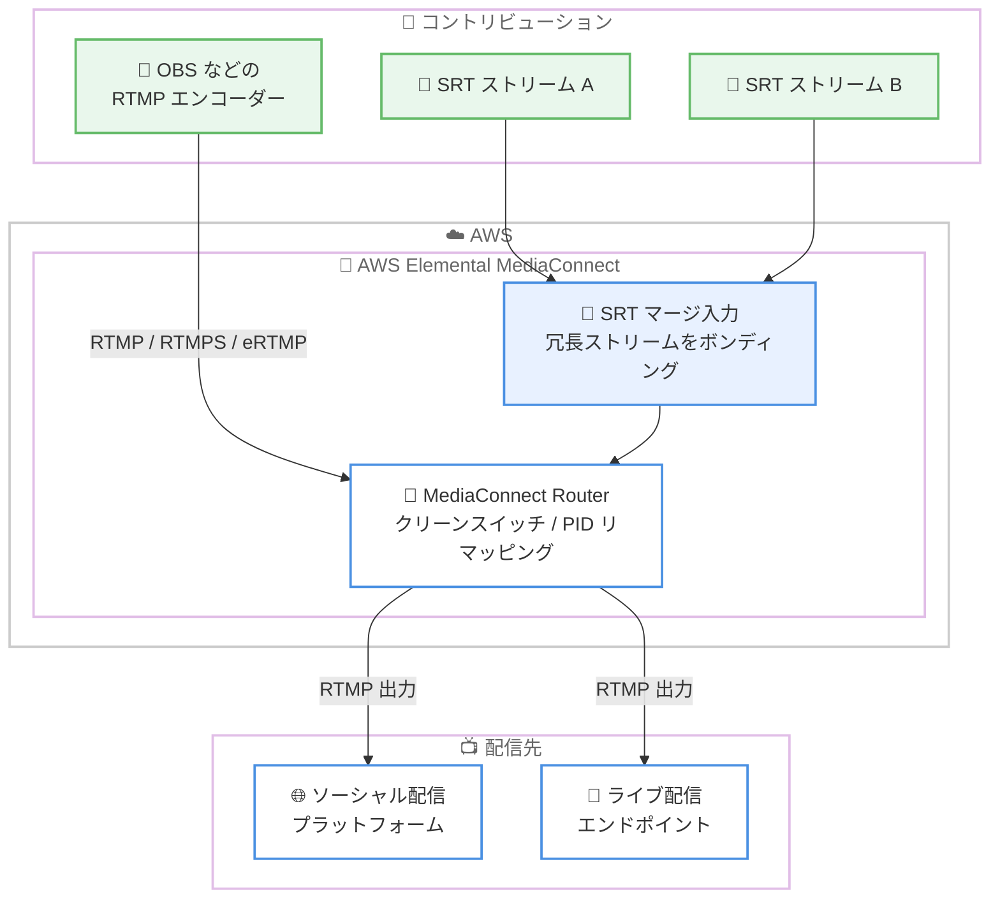

# AWS Elemental MediaConnect - RTMP 対応とルーティング制御の拡張

**リリース日**: 2026 年 11 月 17 日
**サービス**: AWS Elemental MediaConnect
**機能**: RTMP / RTMPS / eRTMP プロトコル対応、PID リマッピング、クリーンスイッチ、SRT マージ入力モード

📊 [このアップデートのインフォグラフィックを見る](https://takech9203.github.io/aws-news-summary/20261117-rtmp-support-aws-elemental-mediaconnect.html)

## 概要

AWS Elemental MediaConnect が、ライブ映像ワークフロー向けにプロトコル対応とルーティング制御を大幅に拡張しました。今回のアップデートにより、フローとルーターの両方で RTMP、RTMPS、eRTMP の各プロトコルがサポートされ、さらにルーター向けに 3 つの新しいルーティング機能 (PID リマッピング、クリーンスイッチ、SRT マージ入力モード) が追加されました。

RTMP は OBS をはじめとするライブストリーミングエンコーダーやソフトウェアで広く使用されているプロトコルです。今回の対応により、RTMP ソースを MediaConnect に直接取り込み、ソーシャルメディアやライブ配信プラットフォームなどの RTMP エンドポイントへ配信できるようになりました。放送事業者やライブ配信事業者にとって、コントリビューションから配信までのワークフローを MediaConnect に統合しやすくなる重要なアップデートです。

**アップデート前の課題**

このアップデート以前には、以下の課題や制限がありました。

- MediaConnect は RTMP / RTMPS / eRTMP に対応しておらず、OBS などの RTMP ベースのエンコーダーやソーシャル配信プラットフォームと連携するには、別途プロトコル変換の仕組みが必要だった
- トランスポートストリームの PID を変更するには、トランスコード処理を挟む必要があり、遅延やコストが増加していた
- ルーター入力の切り替えが映像の境界に揃わず、切り替え時に映像の乱れが発生する可能性があった
- 損失の多い経路や長距離伝送では、SRT ストリームの冗長化を行っても、フェイルオーバー方式では経路劣化時の映像品質維持に限界があった

**アップデート後の改善**

今回のアップデートにより、以下が可能になりました。

- RTMP / RTMPS / eRTMP のソースをフローおよびルーターに直接取り込み、RTMP エンドポイントへ配信できるようになった
- PID リマッピングにより、トランスコードなしでトランスポートストリームの PID をインラインで再割り当てできるようになった
- クリーンスイッチにより、入力切り替えが映像の境界に揃えられ、シームレスな切り替えが可能になった
- SRT マージ入力モードにより、同一コンテンツの冗長な SRT ストリームをボンディングし、一方の経路が劣化してもクリーンなフィードを再構築できるようになった

## アーキテクチャ図



RTMP エンコーダーや冗長化された SRT ストリームを MediaConnect に取り込み、ルーターで切り替え・PID 再割り当てを行ったうえで、RTMP エンドポイントへ配信する構成を示しています。

## サービスアップデートの詳細

### 主要機能

1. **RTMP / RTMPS / eRTMP プロトコル対応**
   - フローとルーターの両方で RTMP、RTMPS、eRTMP をサポート
   - OBS などの RTMP ベースのエンコーダーからソースを直接取り込み可能
   - ソーシャルメディアやライブ配信プラットフォームなどの RTMP エンドポイントへの配信に対応
   - API では `rtmp-push` プロトコルがフロー、ブリッジの入出力に追加

2. **PID リマッピング**
   - MediaConnect Router 上でトランスポートストリームの PID をインラインで再割り当て
   - トランスコードが不要なため、遅延や追加の処理コストを抑えながら下流システムの PID 要件に適合可能
   - API では `SingleProgramTransportStreamPidMap` 設定が追加され、ルールベース (`MatchExpression`) または自動 (`Auto`) での PID 割り当てに対応

3. **クリーンスイッチ**
   - ルーター入力の切り替えを映像の境界 (キーフレーム) に揃えることで、シームレスな切り替えを実現
   - API では `KeyFrame` 切り替えモードと `KeyFrameWaitMilliseconds` パラメータが追加

4. **SRT マージ入力モード**
   - 同一コンテンツの冗長な SRT ストリームをボンディングし、一方の経路が劣化した場合にクリーンなフィードを再構築
   - 損失の多い経路や長距離伝送 (long-haul contribution) での耐障害性を向上
   - API では従来の `FAILOVER` に加えて `MERGE` モードが追加され、`MergeRecoveryWindowMilliseconds` で回復ウィンドウを設定可能

## 技術仕様

### 新機能の対応範囲

| 機能 | 対応範囲 |
|------|----------|
| RTMP / RTMPS / eRTMP | フローおよびルーターの両方 |
| PID リマッピング | MediaConnect Router |
| クリーンスイッチ | MediaConnect Router の入力切り替え |
| SRT マージ入力モード | SRT ストリームの冗長化構成 |

### API 変更履歴

| 日付 | サービス | 変更内容 |
|------|----------|----------|
| 2026/11/12 | [mediaconnect](https://awsapichanges.com/archive/changes/981bee-mediaconnect.html) | 24 updated api methods - RTMP Push 対応、PID リマッピング、キーフレームスイッチング、SRT マージ入力の追加 |

主な更新対象 API には `CreateFlow`、`UpdateFlowSource`、`AddFlowOutputs`、`CreateRouterInput`、`CreateRouterOutput`、`UpdateRouterInput`、`CreateBridge` などが含まれます。

### SRT マージ入力の設定例

```json
{
  "FailoverSettings": {
    "Mode": "MERGE",
    "MergeRecoveryWindowMilliseconds": 500
  }
}
```

同一コンテンツの冗長な SRT ストリームをマージモードでボンディングする設定のイメージです。回復ウィンドウの時間内で両ストリームからパケットを突き合わせ、クリーンなフィードを再構築します。

## 設定方法

### 前提条件

1. AWS アカウントと MediaConnect への適切な IAM 権限があること
2. MediaConnect Router の機能を使用する場合は、MediaConnect Router が利用可能なリージョンであること
3. RTMP ソースを使用する場合は、OBS などの RTMP 対応エンコーダーが用意されていること

### 手順

#### ステップ 1: RTMP ソースを持つフローの作成

```bash
aws mediaconnect create-flow \
  --name "rtmp-ingest-flow" \
  --availability-zone "ap-northeast-1a" \
  --source "Name=rtmp-source,Protocol=rtmp-push,IngestPort=1935"
```

RTMP Push プロトコルでソースを受け付けるフローを作成します。エンコーダーからは、作成されたフローのインジェストエンドポイントに対して RTMP で映像を送信します。

#### ステップ 2: RTMP エンドポイントへの出力の追加

```bash
aws mediaconnect add-flow-outputs \
  --flow-arn "arn:aws:mediaconnect:ap-northeast-1:123456789012:flow:example:rtmp-ingest-flow" \
  --outputs "Name=rtmp-output,Protocol=rtmp-push,Destination=rtmp.example.com,Port=1935"
```

フローに RTMP 出力を追加し、ソーシャル配信プラットフォームなどの RTMP エンドポイントへ映像を配信します。

#### ステップ 3: ルーターでのクリーンスイッチと PID リマッピングの設定

MediaConnect Router の入力・出力設定で、キーフレームに揃えた切り替え (クリーンスイッチ) や、`SingleProgramTransportStreamPidMap` による PID の再割り当てを設定します。詳細な設定項目は [MediaConnect Router のドキュメント](https://docs.aws.amazon.com/mediaconnect/latest/ug/routers.html)を参照してください。

## メリット

### ビジネス面

- **配信先の拡大**: ソーシャルメディアやライブ配信プラットフォームなど、RTMP ベースの配信先へ MediaConnect から直接配信できる
- **コスト削減**: PID 変更のためだけのトランスコード処理が不要になり、追加のエンコードコストを削減できる
- **ワークフローの統合**: RTMP 変換用の中間サーバーが不要になり、コントリビューションから配信までを MediaConnect に集約できる

### 技術面

- **プロトコルの柔軟性**: RTMP、RTMPS、eRTMP がフローとルーターの両方で利用でき、既存の SRT、Zixi、RIST などと組み合わせられる
- **高品質な切り替え**: クリーンスイッチにより入力切り替えが映像の境界に揃い、視聴者に違和感のない映像切り替えを実現できる
- **伝送の耐障害性向上**: SRT マージ入力モードにより、冗長経路の一方が劣化してもクリーンなフィードを維持できる

## デメリット・制約事項

### 制限事項

- 今回の新しいルーティング機能 (PID リマッピング、クリーンスイッチ、SRT マージ入力) は MediaConnect Router が利用可能なリージョンでの提供となる
- SRT マージ入力モードは、同一コンテンツの冗長な SRT ストリームが前提となる

### 考慮すべき点

- RTMP は比較的レイテンシーが大きいプロトコルであり、超低遅延が求められるワークフローでは SRT などの他プロトコルとの使い分けを検討する必要がある
- マージモードの回復ウィンドウ (`MergeRecoveryWindowMilliseconds`) は、経路の遅延差を考慮して適切に設定する必要がある

## ユースケース

### ユースケース 1: OBS からのライブ配信の取り込みとマルチプラットフォーム配信

**シナリオ**: イベント会場から OBS で映像を送出し、複数のソーシャル配信プラットフォームへ同時配信したい。

**実装例**:
```
OBS (RTMP) → MediaConnect フロー (rtmp-push ソース)
            → RTMP 出力 1 (ソーシャルプラットフォーム A)
            → RTMP 出力 2 (ライブ配信プラットフォーム B)
```

**効果**: 中間変換サーバーなしで RTMP ソースを取り込み、複数の RTMP エンドポイントへ安定して同時配信できる。

### ユースケース 2: 長距離伝送での SRT 冗長化によるコントリビューション

**シナリオ**: 海外のスポーツ会場から国内の放送センターへ、損失の多いインターネット経路で映像を伝送する。

**実装例**:
```
会場エンコーダー → SRT ストリーム A (経路 1)
                → SRT ストリーム B (経路 2)
両ストリームを MediaConnect の SRT マージ入力でボンディング
→ クリーンなフィードを再構築して下流へ伝送
```

**効果**: 一方の経路が劣化してもパケットレベルで補完され、放送品質のフィードを維持できる。

### ユースケース 3: PID 要件が異なる下流システムへの配信

**シナリオ**: 放送局の下流システムが特定の PID 構成を要求しており、ソース側の PID と一致しない。

**実装例**:
```
ソース (任意の PID 構成) → MediaConnect Router
→ SingleProgramTransportStreamPidMap で PID をインライン再割り当て
→ 下流システムの要求する PID 構成で出力
```

**効果**: トランスコードを挟まずに PID 要件へ適合でき、遅延とコストを抑えながら相互運用性を確保できる。

## 料金

MediaConnect の料金は、フローの稼働時間とデータ転送量、および MediaConnect Router の利用に基づいて課金されます。今回の新機能に関する追加料金の発表はなく、詳細は料金ページを参照してください。

- [AWS Elemental MediaConnect 料金ページ](https://aws.amazon.com/mediaconnect/pricing/)

## 利用可能リージョン

これらの機能は、MediaConnect Router が利用可能なすべての AWS リージョンで利用できます。

## 関連サービス・機能

- **AWS Elemental MediaLive**: MediaConnect で取り込んだフィードのトランスコードやチャンネル制作に利用できる
- **AWS Elemental MediaPackage**: ライブストリームのパッケージングとオリジン配信に利用でき、MediaConnect と組み合わせたエンドツーエンドのライブ配信が可能
- **Amazon CloudFront**: パッケージングされたストリームの視聴者向け配信に利用できる

## 参考リンク

- 📊 [インフォグラフィック](https://takech9203.github.io/aws-news-summary/20261117-rtmp-support-aws-elemental-mediaconnect.html)
- [公式発表 (What's New)](https://aws.amazon.com/about-aws/whats-new/2026/11/rtmp-support-aws-elemental-mediaconnect/)
- [AWS Elemental MediaConnect ドキュメント](https://docs.aws.amazon.com/mediaconnect/latest/ug/what-is.html)
- [MediaConnect フローのドキュメント](https://docs.aws.amazon.com/mediaconnect/latest/ug/flows.html)
- [MediaConnect Router のドキュメント](https://docs.aws.amazon.com/mediaconnect/latest/ug/routers.html)
- [API 変更詳細 (awsapichanges.com)](https://awsapichanges.com/archive/changes/981bee-mediaconnect.html)
- [料金ページ](https://aws.amazon.com/mediaconnect/pricing/)

## まとめ

AWS Elemental MediaConnect の RTMP / RTMPS / eRTMP 対応により、OBS などの一般的なエンコーダーからソーシャル配信プラットフォームまで、RTMP ベースのワークフローを MediaConnect に統合できるようになりました。あわせて追加された PID リマッピング、クリーンスイッチ、SRT マージ入力モードは、放送品質のライブ伝送に求められる柔軟性と耐障害性を大きく高めます。ライブ映像ワークフローを運用しているチームは、既存の中間変換サーバーや冗長化構成を MediaConnect の新機能で置き換えられないか検討することをお勧めします。
