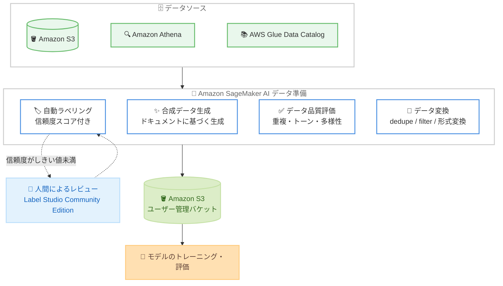

# Amazon SageMaker - AI データ準備機能

**リリース日**: 2026 年 11 月 17 日
**サービス**: Amazon SageMaker
**機能**: AI データ準備機能 (AI data preparation capabilities)

📊 [このアップデートのインフォグラフィックを見る](https://takech9203.github.io/aws-news-summary/20261117-sagemaker-ai-data-prep-capabilities.html)

## 概要

Amazon SageMaker が、モデル開発向けの高品質なデータセットを構築するための AI データ準備機能をサポートしました。データサイエンティストや ML エンジニアは、テキストベースのモデルカスタマイズと従来型 ML の両方を対象に、高品質なトレーニングデータセットおよび評価データセットを構築できます。

今回提供される機能は、自社ドキュメントに基づく合成データ生成、信頼度スコア付きの大規模な自動ラベリング、人間によるレビューを通じた専門家フィードバックの取り込み、データ品質評価、トレーニングや評価手法に合わせたデータ変換です。少数のサンプル、本番トレース、または Amazon S3、Amazon Athena、AWS Glue Data Catalog 上の既存データから開始できます。

開発者は SageMaker Python SDK API から直接、または Agent Toolkit for AWS の最新版 AWS AI-ML スキルを通じて自然言語でこれらの機能にアクセスできます。ソースデータ、生成されたデータセット、ラベルはすべてユーザー自身が管理する IAM ロールで制御された Amazon S3 バケット内に保持されます。

**アップデート前の課題**

高品質なトレーニングデータセットの構築には、従来、数週間に及ぶ手作業が必要でした。

- 手動でのデータラベリングとデータクリーニングに数週間を要していた
- トレーニングデータや評価データが不足している場合、自社ドキュメントからデータセットを用意する仕組みがなかった
- 重複やトーンの不一致、多様性の不足といったデータ品質の問題を検出する手段を個別に用意する必要があった

**アップデート後の改善**

今回のアップデートにより、データ準備のワークフローを SageMaker 上で自動化できます。

- 自社ドキュメントに基づいた仕様から、トレーニング・評価・テスト用の合成データを生成できるようになった
- 組み込みタスクタイプとカスタムタスクによる自動ラベリングが可能になり、信頼度がしきい値未満の行は SageMaker AI Studio 内の Label Studio Community Edition のレビューキューに送られるようになった
- 重複検出、トーンや多様性不足などの品質問題の検出、dedupe・filter・フォーマット変換などのオペレーターによるデータ変換が利用可能になった

## アーキテクチャ図



S3、Athena、Glue Data Catalog の既存データや少数のサンプルを入力として、合成データ生成・自動ラベリング・品質評価・データ変換を実行し、低信頼度の行は人間のレビューを経て、最終的なデータセットがユーザー管理の S3 バケットに出力される流れを示しています。

## サービスアップデートの詳細

### 主要機能

1. **合成データ生成 (Synthetic Data Generation)**
   - 自社ドキュメントに基づく仕様 (スペシフィケーション) からトレーニング、評価、テストデータを生成
   - 少数のサンプル、本番トレース、既存データからの開始が可能
   - テキストベースのモデルカスタマイズと従来型 ML の両方に対応

2. **自動ラベリング (Auto-labeling)**
   - 信頼度スコア付きで大規模にデータをラベリング
   - 組み込みタスクタイプ。分類、固有表現認識 (NER)、抽出型質問応答、順序評価 (ordinal rating)、要約
   - カスタムタスクにも対応
   - 信頼度がしきい値未満の行は、SageMaker AI Studio 内の Label Studio Community Edition のヒューマンレビューキューに送信

3. **データ品質評価 (Data Quality Evaluation)**
   - 重複データの検出
   - トーンの不一致や多様性不足などの問題を品質メトリクスとルールの両方で検出

4. **データ変換 (Data Transformation)**
   - 選択したトレーニング手法や評価手法に合わせてデータをクリーニング・再構成
   - dedupe、filter、フォーマット変換などのオペレーターを提供

5. **アクセス方法とデータ管理**
   - SageMaker Python SDK API から直接利用可能
   - Agent Toolkit for AWS の最新版 AWS AI-ML スキルを通じた自然言語での利用も可能
   - ソースデータ、生成データセット、ラベルはユーザーが管理する IAM ロールで制御された自身の S3 バケット内に保持

## 技術仕様

### 機能一覧

| 機能 | 内容 |
|------|------|
| 合成データ生成 | ドキュメントに基づく仕様からトレーニング・評価・テストデータを生成 |
| 自動ラベリング | 組み込み 5 タスクタイプ + カスタムタスク、信頼度スコア付き |
| ヒューマンレビュー | Label Studio Community Edition (SageMaker AI Studio 内) のレビューキュー |
| データ品質評価 | 重複検出、トーン・多様性などの品質メトリクスとルール |
| データ変換 | dedupe、filter、フォーマット変換などのオペレーター |
| データソース | 少数のサンプル、本番トレース、Amazon S3 / Amazon Athena / AWS Glue Data Catalog |
| アクセス方法 | SageMaker Python SDK API、Agent Toolkit for AWS の AWS AI-ML スキル |
| データ保持 | ユーザー管理の S3 バケット (IAM ロールで制御) |

### API 変更履歴

| 日付 | サービス | 変更内容 |
|------|----------|----------|
| 2026/11/16 | [Amazon SageMaker Service](https://awsapichanges.com/archive/changes/f1785c-api.sagemaker.html) | 8 new 11 updated api methods - 合成データ生成、自動ラベリング、データ品質評価、データ変換機能の追加 (Cross-Region Inference Routing などの変更も同時に含む) |

`CreateJob` / `DeleteJob` API の `JobCategory` パラメータに、今回のアップデートに対応する `SyntheticDataGeneration`、`DataQualityEvaluation`、`DataTransformation` の値が追加されています。

### CreateJob API の例

```json
{
  "JobName": "my-synthetic-data-job",
  "RoleArn": "arn:aws:iam::123456789012:role/SageMakerDataPrepRole",
  "JobCategory": "SyntheticDataGeneration",
  "JobConfigSchemaVersion": "string",
  "JobConfigDocument": "string"
}
```

## 設定方法

### 前提条件

1. 対応リージョン (us-east-1 または us-west-2) で SageMaker を利用できること
2. ソースデータおよび出力先となる Amazon S3 バケットと、それらへのアクセスを許可する IAM ロール
3. SageMaker Python SDK、または Agent Toolkit for AWS の最新版 AWS AI-ML スキル
4. ヒューマンレビューを利用する場合は SageMaker AI Studio 環境

### 手順

#### ステップ 1: データソースの準備

```bash
aws s3 cp ./seed-examples/ s3://my-bucket/seed-data/ --recursive
```

少数のサンプルや既存データを Amazon S3 にアップロードします。Amazon Athena や AWS Glue Data Catalog 上の既存データをそのまま使用することもできます。

#### ステップ 2: データ準備ジョブの作成

```python
import boto3

client = boto3.client("sagemaker")

response = client.create_job(
    JobName="my-synthetic-data-job",
    RoleArn="arn:aws:iam::123456789012:role/SageMakerDataPrepRole",
    JobCategory="SyntheticDataGeneration",
    JobConfigSchemaVersion="<schema-version>",
    JobConfigDocument="<job-config-json>",
)
print(response["JobArn"])
```

`CreateJob` API でデータ準備ジョブを作成します。`JobCategory` に `SyntheticDataGeneration`、`DataQualityEvaluation`、`DataTransformation` のいずれかを指定し、ジョブの設定内容は `JobConfigDocument` で指定します。具体的な設定スキーマは [AI データ準備ドキュメント](https://docs.aws.amazon.com/sagemaker/latest/dg/ai-data-prep.html)を参照してください。

#### ステップ 3: 自動ラベリングとヒューマンレビュー

自動ラベリングの実行後、信頼度スコアがしきい値未満の行は SageMaker AI Studio 内の Label Studio Community Edition のレビューキューに送られます。専門家がレビューキューでラベルを確認・修正することで、フィードバックをデータセットに反映できます。

## メリット

### ビジネス面

- **データ準備期間の短縮**: 従来は数週間かかっていた手動ラベリングとデータクリーニングを自動化し、モデル開発の立ち上げを高速化できる
- **少ない初期データからの開始**: 少数のサンプルや本番トレースから開始できるため、十分なデータが揃っていない段階でもモデルカスタマイズに着手できる
- **データ主権の維持**: ソースデータ、生成データセット、ラベルがユーザー管理の S3 バケットに保持され、IAM ロールで制御できる

### 技術面

- **自社ドキュメントへのグラウンディング**: 合成データが自社ドキュメントに基づいて生成されるため、ドメインに即したデータセットを構築できる
- **品質管理の仕組みを内蔵**: 信頼度スコアによるヒューマンレビューへの振り分けと、メトリクス・ルールによる品質評価が組み込まれている
- **複数のアクセス手段**: SageMaker Python SDK によるプログラマティックな利用と、Agent Toolkit for AWS の AWS AI-ML スキルによる自然言語での利用を選択できる

## デメリット・制約事項

### 制限事項

- 利用可能リージョンは米国東部 (バージニア北部) と米国西部 (オレゴン) の 2 リージョンのみ (東京リージョンは未対応)
- 自動ラベリングの組み込みタスクタイプはテキスト系の 5 種類 (分類、固有表現認識、抽出型質問応答、順序評価、要約) が中心で、それ以外はカスタムタスクでの対応となる

### 考慮すべき点

- 合成データや自動ラベルの品質は最終的に人間のレビューで担保する運用設計が重要となる
- ヒューマンレビューに使用する Label Studio Community Edition は SageMaker AI Studio 内で動作するため、Studio 環境の整備が必要
- 料金の詳細は公式発表に記載がないため、利用前に SageMaker の料金ページで確認が必要

## ユースケース

### ユースケース 1: 社内ドキュメントに基づくモデルカスタマイズ用データセットの構築

**シナリオ**: 社内ナレッジベースに特化したテキスト生成モデルをファインチューニングしたいが、トレーニングデータがほとんど存在しない。

**実装例**:
```
1. 社内ドキュメントと少数のサンプルを S3 にアップロード
2. 合成データ生成ジョブ (JobCategory: SyntheticDataGeneration) で
   トレーニング・評価・テストデータを生成
3. データ品質評価で重複や多様性不足を確認
4. 生成されたデータセットでモデルカスタマイズを実行
```

**効果**: 手作業でのデータ作成なしに、ドメインに即したトレーニングデータセットを短期間で構築できる。

### ユースケース 2: 大量の未ラベルデータの自動ラベリング

**シナリオ**: カスタマーサポートの問い合わせログが大量にあり、分類モデルのトレーニングに使用したいが、ラベル付けの工数が確保できない。

**実装例**:
```
1. 問い合わせログを S3 または Athena 経由で入力として指定
2. 組み込みの分類タスクタイプで自動ラベリングを実行
3. 信頼度しきい値を設定し、低信頼度の行のみ
   Label Studio のレビューキューで専門家が確認
4. 確定したラベル付きデータセットを S3 に出力
```

**効果**: 全件の手動ラベリングが不要になり、専門家は低信頼度のデータのレビューに集中できる。

### ユースケース 3: 本番トレースを活用した評価データセットの整備

**シナリオ**: 本番環境のトレースを評価データとして活用したいが、重複やフォーマットの不統一が多く、そのままでは評価に使用できない。

**実装例**:
```
1. 本番トレースを入力として指定
2. データ品質評価ジョブで重複やトーンなどの問題を検出
3. データ変換ジョブで dedupe、filter、フォーマット変換を適用し、
   評価手法に合わせた形式に整形
4. 整形済み評価データセットを S3 に出力
```

**効果**: 実トラフィックに基づく高品質な評価データセットを、手作業のクリーニングなしで整備できる。

## 料金

公式発表には料金に関する記載がありません。最新の料金情報は [Amazon SageMaker の料金ページ](https://aws.amazon.com/sagemaker/pricing/)を参照してください。

## 利用可能リージョン

以下の 2 リージョンで利用可能です。

- 米国東部 (バージニア北部) - us-east-1
- 米国西部 (オレゴン) - us-west-2

## 関連サービス・機能

- **Amazon S3**: ソースデータの入力元および生成データセット・ラベルの保存先。データはユーザー管理のバケットに保持される
- **Amazon Athena**: 既存データをデータ準備の入力ソースとして利用可能
- **AWS Glue Data Catalog**: カタログ化された既存データをデータ準備の入力ソースとして利用可能
- **SageMaker AI Studio**: ヒューマンレビュー用の Label Studio Community Edition の実行環境
- **Agent Toolkit for AWS**: AWS AI-ML スキルを通じて自然言語でデータ準備機能を利用可能

## 参考リンク

- 📊 [インフォグラフィック](https://takech9203.github.io/aws-news-summary/20261117-sagemaker-ai-data-prep-capabilities.html)
- [公式発表 (What's New)](https://aws.amazon.com/about-aws/whats-new/2026/11/sagemaker-ai-data-prep-capabilities/)
- [AI データ準備ドキュメント](https://docs.aws.amazon.com/sagemaker/latest/dg/ai-data-prep.html)
- [AWS AI-ML skill in the Agent Toolkit for AWS (GitHub)](https://github.com/aws/agent-toolkit-for-aws/tree/main/skills/core-skills/aws-ai-ml)
- [Amazon SageMaker 料金ページ](https://aws.amazon.com/sagemaker/pricing/)

## まとめ

Amazon SageMaker の AI データ準備機能により、従来数週間を要していたトレーニングデータセットの構築を、合成データ生成・自動ラベリング・品質評価・データ変換の組み合わせで大幅に効率化できます。モデルカスタマイズや ML プロジェクトでデータ不足やラベリング工数が課題となっているチームは、us-east-1 または us-west-2 リージョンで SageMaker Python SDK から試用を開始することを推奨します。
